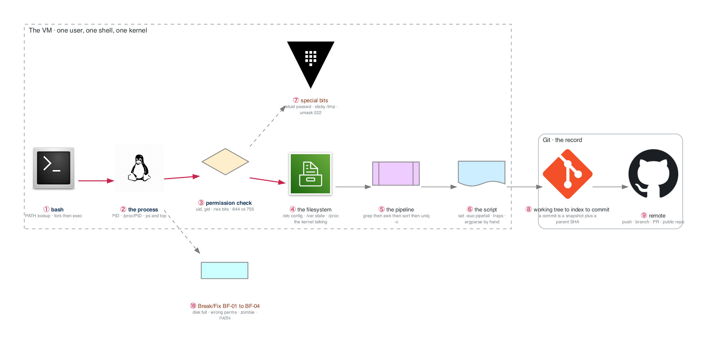

# Figure 1.1 — A process on a Linux system, from the shell to the commit

> Week 1 · badges ① to ⑩ · about three minutes at a normal pace. Point at each badge as you say its line. Blue is the path to follow first; orange-red is where something refuses or fails.



Everything the week teaches is one of four mechanisms: how a command becomes a process, how the kernel decides what it may touch, how text flows between processes, and how Git records the result.

## What to say, badge by badge

- **Open.** “This is one week of Linux in one picture: a command becomes a process, the kernel checks what it may touch, text flows through a pipeline, and Git records what you built. Follow the blue path first.”
- **① bash.** “Every command starts here. The shell searches PATH, forks itself, and the child execs the program. That is why a typo in PATH breaks everything at once, and why `which` is the first debugging command.”
- **② the process.** “The result is a process with a PID. /proc/PID is not a file on disk; it is the kernel describing that process. `ps` and `top` read it. When a lab says inspect a process, this is the directory to open.”
- **③ permission check.** “Before any read or write, the kernel compares the file's owner, group, and mode bits to the process's uid and gid. 644 means owner writes, everyone reads. On a directory, execute means enter, which is why 755 matters there.”
- **④ the filesystem.** “The hierarchy is a convention worth memorizing: /etc is configuration, /var is state that grows, /proc and /sys are the kernel. Where a file lives tells you who owns the problem.”
- **⑤ the pipeline.** “Text processing is processes connected by pipes. grep selects lines, awk picks fields and counts into an associative array, sort and uniq -c aggregate. A 100,000-line log becomes a top-10 report with four processes.”
- **⑥ the script.** “A real script starts with `set -euo pipefail`: exit on error, error on an unset variable, fail the pipeline if any stage fails. Traps clean up. Arguments are parsed by hand. This is `sysreport.sh`.”
- **⑦ special bits.** “Three bits that are classic interview and escalation material. setuid lets `passwd` edit /etc/shadow as root. The sticky bit lets everyone write /tmp but delete only their own files. umask 022 is why new files are 644, not 666.”
- **⑧ working tree to index to commit.** “A commit is not a diff. It is a snapshot plus the SHA of its parent, which is why history is a chain and why rewriting one commit changes every SHA after it. The index is the staging step in between.”
- **⑨ remote.** “push sends the chain. A branch is a pointer, a pull request is a conversation about a pointer. The deliverable is public, which means the README has to work for a stranger.”
- **⑩ Break/Fix.** “Four scenarios, forty minutes, narrated out loud: disk full, wrong permissions, a zombie, a broken PATH. Each one is logged in the incident journal. That journal is the interview story bank.”
- **Close.** “So: shell to process to permission check to filesystem, text through pipes, a script that fails loudly, and Git recording it. Nothing in the next 25 weeks is not one of these in a costume.”

**Print it:** [`figure-1.1-numbered-spoken.pdf`](figure-1.1-numbered-spoken.pdf) is the two-page version, the figure on page one and this script on page two.

## Use it

- Read the figure before the day plan. Say the script out loud on Friday with the file closed.
- Each badge line is a thirty-second interview answer; the whole script is the three-minute version.
- Regenerate after editing the spec in `_shared/diagrams/week_figures/`:

```bash
python3 ../../_shared/diagrams/generate-week-figures.py --only 1
```
