# Week 1 — Lab figures

> One figure per lab, numbered 1.2 to 1.7. Figure 1.1 is the week figure in
> [`../content/FIGURE.md`](../content/FIGURE.md); these six go one level down, to the mechanism each
> lab makes you touch. Same language: gray is structure, **blue is the path to follow first**,
> orange-red is where something refuses, washed boxes are stores. Each badge line is a thirty-second
> interview answer; each whole script is under three minutes.

**The protocol per figure**

1. **Before the lab:** read the figure, say the badges out loud once. You now know what you are about to prove.
2. **During the lab:** every badge has a **Prove it** command. Run it and watch the badge happen. A badge you cannot see happen is one you are taking on faith.
3. **After the lab:** close the file, redraw the figure, say the script. Check against the file. The badge where the order slipped goes in the *Figures redrawn* column of `progress.md`.
4. **Own the numbers.** The *Numbers to own* table is what separates "I know Linux" from "a parent directory without the x bit denies a file you have read on, and `namei -l` shows which component."
5. **Answer the question.** Each figure ends with the question a senior interviewer asks about it. Answer it cold, in under a minute, before the gate.

---

## Figure 1.2 — Lab 1: the VM, the kernel as files, and a find that is safe

> Lab 1 · badges ① to ⑨ · about three minutes.

<!-- figure: generated from the Mermaid below by _shared/diagrams/embed-figures.py — do not edit the image -->
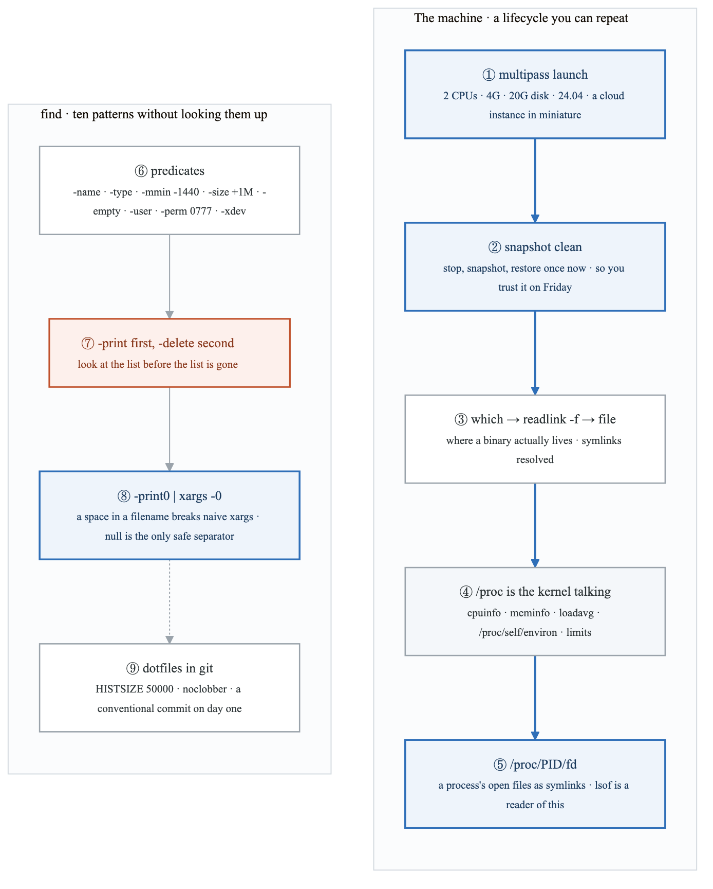

<details>
<summary>Diagram source (Mermaid)</summary>

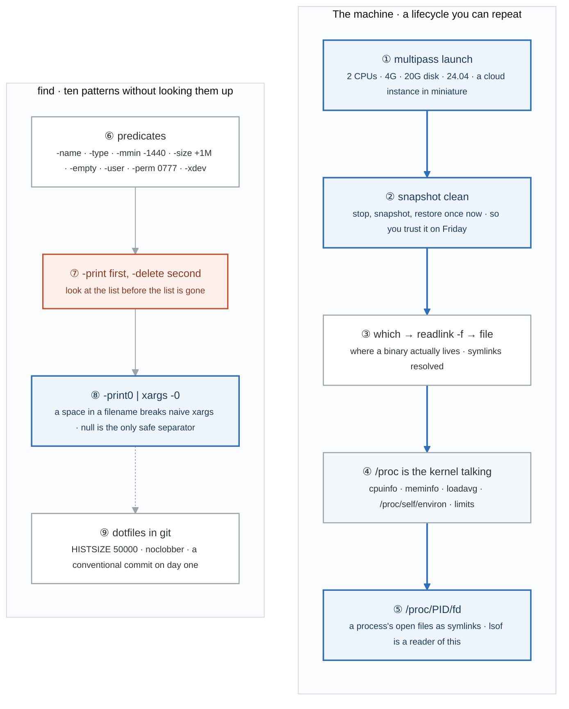

</details>

### Say it, badge by badge

- **Open.** "Week 1 builds the machine you will break for twenty-six weeks and teaches you to read the kernel as a filesystem. Follow the blue path from a VM to a process's open files, then the find row underneath."
- **① multipass launch.** "A full VM, not WSL. Boot, network, snapshot, destroy is the cloud instance lifecycle, and you rehearse it here for free. Two CPUs, four gigabytes, twenty gigabytes of disk."
- **② snapshot clean.** "Stop the VM, snapshot it, and restore it once right now. A restore you have never done is a backup you do not have. Every Friday starts from this."
- **③ which, readlink, file.** "`which` gives a path, `readlink -f` resolves the symlinks, `file` says what the bytes are. Three commands and you know where a binary really lives."
- **④ /proc.** "Not a disk. Every file in it is the kernel answering a question at read time: CPU model, memory, load average, your own shell's environment and limits under `/proc/self`."
- **⑤ /proc/PID/fd.** "A directory of symlinks, one per open file descriptor of that process. `lsof` is a nicer interface to exactly this. When week 1's disk-full lab finds a deleted file still held open, this is where it shows."
- **⑥ find predicates.** "Name, type, modified in minutes or days, size, empty, owner, exact permissions, and `-xdev` to stay on one filesystem. Ten tasks, written from memory, is the exit check."
- **⑦ -print first, -delete second.** "Run the find with `-print`, read the list, then run it again with `-delete`. The order is the safety; the command is otherwise identical."
- **⑧ -print0 and xargs -0.** "A filename with a space splits into two arguments under plain `xargs`. Null separation is the only correct fix. This is a real bug class, and the habit costs nothing."
- **⑨ dotfiles in git.** "History of fifty thousand lines with timestamps, `noclobber` so a redirect cannot overwrite a file, and the first conventional commit. The habits start on day one so they are invisible by week 26."
- **Close.** "A machine you can reset, a kernel you can read, and a find you can trust with spaces and deletes. Everything in week 2 assumes these three."

### Numbers to own

| Number | Where it comes from | Why it matters |
|---|---|---|
| 2 CPUs · 4G · 20G | the multipass launch line | enough for every month-1 lab; the shape of the smallest useful cloud instance |
| 1 restore, done now | the snapshot task | the only proof a snapshot works |
| `-mmin -1440` = `-mtime -1` | the find patterns | minutes versus days; the same 24 hours spelled two ways |
| `-size +1M` · `-mtime +7` · `-perm 0777` | the find patterns | the three predicates that answer "what is big, what is old, what is dangerous" |
| 10 find tasks | the exit check | written without looking up syntax |
| `HISTSIZE=50000` | `.bashrc_custom` | enough history to grep your own past month |

### Prove it

```bash
multipass stop lab && multipass snapshot lab --name clean && multipass restore lab.clean   # ②
readlink -f "$(which ls)"; file "$(which ls)"                                               # ③
cat /proc/self/environ | tr '\0' '\n' | head                                                # ④
sudo ls -l /proc/"$(pgrep -f sshd | head -1)"/fd                                            # ⑤
find . -name '*.log' -mtime +7 -print                                                       # ⑦ look first
find . -name '*.log' -print0 | xargs -0 grep -l 'ERROR'                                     # ⑧
```

### The question a senior interviewer asks

*"Why does `du -sh /usr/*` disagree with summing the sizes find prints, and why do people say lsof is just /proc?"*
Badges ④ and ⑤ for lsof. For du: `du` counts allocated blocks, so sparse files, hard links counted once, and directory entries all shift the total, while `find -printf '%s'` prints apparent bytes. Say "blocks versus bytes" and you have it.

---

## Figure 1.3 — Lab 2: the mode bits, the directory x bit, and what a signal does

> Lab 2 · badges ① to ⑨ · about three minutes. Reads top-down.

<!-- figure: generated from the Mermaid below by _shared/diagrams/embed-figures.py — do not edit the image -->
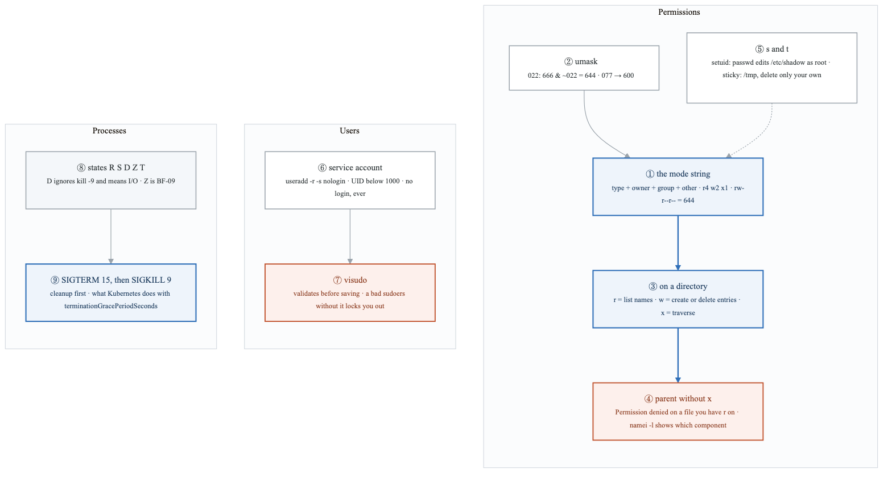

<details>
<summary>Diagram source (Mermaid)</summary>

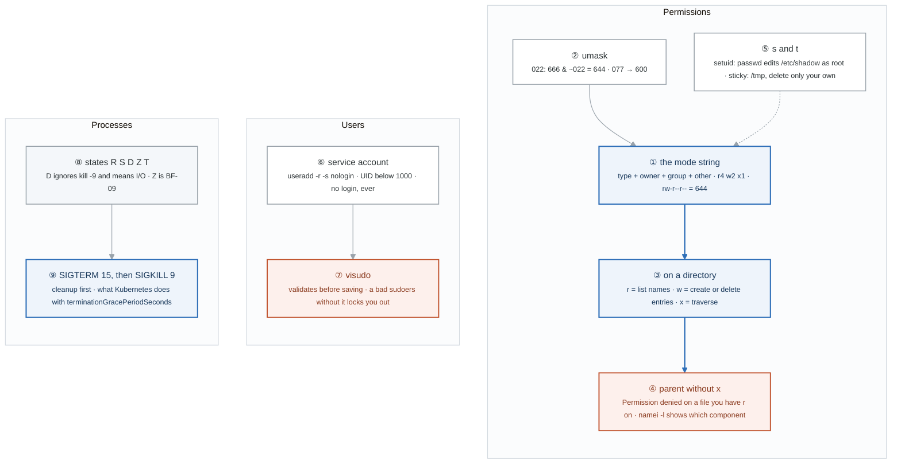

</details>

### Say it, badge by badge

- **Open.** "Three things people get wrong for years: what the bits mean on a directory, that a service account should not be able to log in, and that `kill -9` is not a stronger `kill`. The blue path is the directory experiment, because that is the point of the lab."
- **① the mode string.** "One type character, then three triplets: owner, group, other. Read each as bits, r is four, w is two, x is one, and add. rw-r--r-- is 644. You convert in your head by the end of the week."
- **② umask.** "New files start at 666 and directories at 777, and umask removes bits. 022 gives 644; 077 gives 600. That is why new files are not world-writable without you asking."
- **③ on a directory.** "r lets you list names. w lets you create and delete entries. x lets you pass through. You can see names without reading files, or read a file by exact name without being able to list. That split is the part people miss."
- **④ parent without x.** "Remove x from the parent and `cat` on a child file you own fails with Permission denied, even with 644 on the file. `namei -l` walks the path and shows the component that denies. That is the diagnostic."
- **⑤ s and t.** "The s on passwd means it runs as its owner, root, so it can edit /etc/shadow. The t on /tmp means world-writable but delete only your own files. setuid is also why `find / -perm -4000` is a security audit."
- **⑥ service account.** "`-r` for a system UID below 1000, `-s nologin` so nobody can ever shell in as it. The same principle runs containers as non-root in week 4 and pods in week 15."
- **⑦ visudo.** "A syntax error in sudoers edited by hand locks you out of sudo. visudo validates first. One habit, one bad day avoided."
- **⑧ process states.** "R running, S sleeping, which is most processes most of the time, D uninterruptible sleep on I/O, Z zombie, T stopped. A pile of D is a disk or NFS problem, not CPU, and no signal moves them."
- **⑨ SIGTERM then SIGKILL.** "15 asks; the process flushes, closes, deregisters. 9 is the kernel removing it with no chance to clean up. Always 15 first. Kubernetes does exactly this, with a grace period in between."
- **Close.** "Bits you can read, a directory you can traverse, a user that cannot log in, and a signal that asks before it kills. Week 2 runs a service under all four."

### Numbers to own

| Number | Where it comes from | Why it matters |
|---|---|---|
| 644 · 600 · 755 · 700 | the chmod tasks | the four modes you set without thinking: shared file, private file, shared dir, private dir |
| 022 → 644 · 077 → 600 | the umask task | the mask subtracts from 666; a tighter mask is how private files happen by default |
| UID below 1000 | `useradd -r` | the system-account range; a glance at `id` tells you whether something should have a shell |
| 15 and 9 | SIGTERM, SIGKILL | the polite one and the kernel one; the order is the lesson |
| 7 states | the STAT table | R S D Z T, plus the modifiers; D is the one that changes your diagnosis |
| `-perm -4000` | the exit check | every setuid binary on the box, which is the privilege-escalation surface |

### Prove it

```bash
stat file.txt                                               # ① the full picture behind ls -l
umask 077 && touch new2 && ls -l new2 && umask 022          # ② 600
chmod 644 ~/lab2/parent && cat ~/lab2/parent/child/data.txt # ④ denied, with r on the file
namei -l ~/lab2/parent/child/data.txt                       # ④ the component that denies
ls -l /usr/bin/passwd; ls -ld /tmp                          # ⑤ s and t
ps -eo pid,stat,cmd | awk '$2 ~ /^D/'                       # ⑧ anything stuck on I/O
sleep 300 & kill %1; sleep 300 & kill -9 %2                 # ⑨
```

### The question a senior interviewer asks

*"A user has read permission on a file and still gets Permission denied. Walk me through it. And why does kill -9 not work on some processes?"*
Badges ③ and ④ for the first: path resolution needs x on every directory in the path, and `namei -l` is the proof. Badge ⑧ for the second: D state is a process inside a kernel I/O call, and signals are delivered only when it returns, so the fix is the disk or the mount, not the process.

---

## Figure 1.4 — Lab 3: a log line to a report, the awk pipeline

> Lab 3 · badges ① to ⑨ · about three minutes.

<!-- figure: generated from the Mermaid below by _shared/diagrams/embed-figures.py — do not edit the image -->
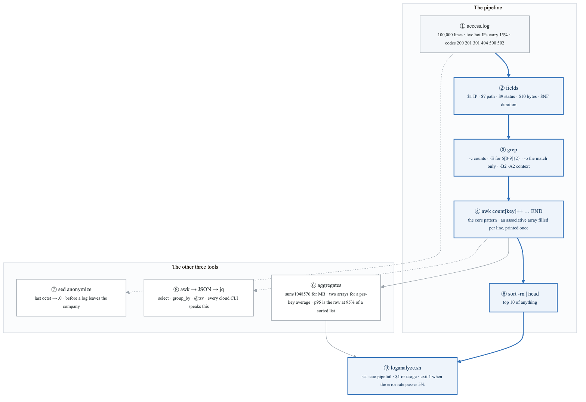

<details>
<summary>Diagram source (Mermaid)</summary>

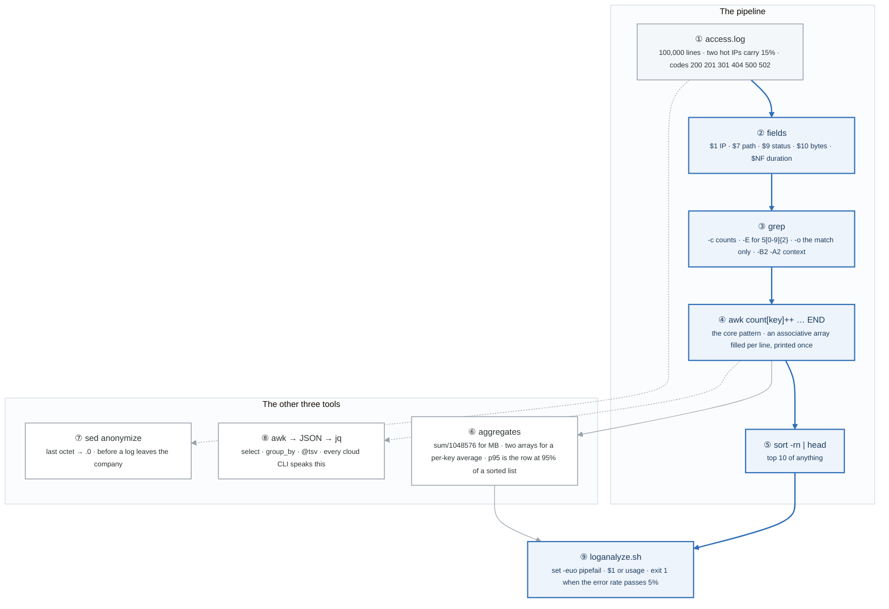

</details>

### Say it, badge by badge

- **Open.** "This is the live-coding exercise in half the technical screens you will sit, and the skill you use every working day. One log, one pattern, one script that exits non-zero. Follow the blue path."
- **① access.log.** "A hundred thousand generated lines with a known shape: two noisy clients carrying fifteen percent of traffic, a status mix weighted toward 200, and 5xx responses that are deliberately slow. You know the answers, so you can check your tools."
- **② fields.** "Space-separated, one-indexed. $1 is the IP, $7 the path, $9 the status, $10 bytes, and $NF, the last field, is the duration. Learn the positions once and every awk one-liner writes itself."
- **③ grep.** "Filter before you count. `-c` counts, `-E` gives you the regex for any 5xx, `-o` prints only the match, `-B2 -A2` shows the lines around an error. Four flags cover most of what grep is for."
- **④ awk count[key]++ then END.** "For every line, increment an array keyed by the field. After the last line, in END, print the array. That one pattern is top-N, histograms, per-key totals, and error rates. If you learn one thing this week, it is this."
- **⑤ sort -rn | head.** "Numeric, reversed, first ten. Bolted onto the END block it turns any count into a leaderboard."
- **⑥ aggregates.** "Sum the bytes and divide by 1048576 for megabytes. Two arrays, sum and count, give a per-path average. p95 is not a formula here: sort the durations and take the row at ninety-five percent of the count."
- **⑦ sed anonymize.** "A regex with a capture group rewrites the last octet to zero. You do this before any log goes to a vendor. In-place with a backup, `-i.bak`."
- **⑧ awk to JSON to jq.** "awk prints a JSON object per line, `jq -s` slurps them into an array, and then select, group_by, and @tsv do the rest. Every AWS and kubectl command outputs JSON; this is how you read it."
- **⑨ loganalyze.sh.** "The deliverable. Strict mode, the file as the first argument or a usage message, the report, and exit 1 when the error rate passes five percent. The exit code is what makes it a monitoring check instead of a printout."
- **Close.** "Filter, count into an array, print in END, sort. Then make it a script with an exit code. That is text processing, and it does not change for the rest of your career."

### Numbers to own

| Number | Where it comes from | Why it matters |
|---|---|---|
| 100,000 lines | the generator | large enough that the wrong approach is visibly slow |
| 15% | the hot-IP share | the answer your top-10 should show first; a check on your pipeline |
| `$NF` | the duration field | the last field, whatever the count; the one position that never shifts |
| 1048576 | bytes per MB | `sum/1048576` in the END block |
| 5% | the alert threshold | `exit 1` above it; the script becomes a monitor |
| p95 = row at 95% | the hint | sort numerically, take the row at 0.95 × count; no library needed |

### Prove it

```bash
wc -l access.log && head -2 access.log                                                  # ①
awk '{print $1, $9, $NF}' access.log | head                                              # ②
grep -E '" 5[0-9]{2} ' access.log | wc -l                                                # ③
awk '{count[$1]++} END {for (ip in count) print count[ip], ip}' access.log | sort -rn | head -10   # ④ ⑤
awk '{sum += $10} END {print sum/1048576 " MB"}' access.log                              # ⑥
sed -E 's/([0-9]+\.[0-9]+\.[0-9]+)\.[0-9]+/\1.0/' access.log | head -2                   # ⑦
jq 'group_by(.path) | map({path: .[0].path, n: length})' reqs.json                       # ⑧
./loganalyze.sh access.log; echo "exit: $?"                                              # ⑨
```

### The question a senior interviewer asks

*"Here is an access log. Top ten IPs by request count, and the error rate as a percentage. Go."*
Badges ④ and ⑤, typed without pausing, then badge ⑥ for the rate: a total counter and a status array in the same awk, divided in END. If they add "and p95 latency", say sort and the row at ninety-five percent before reaching for Python.

---

## Figure 1.5 — Lab 4: sysreport.sh, from a strict shell to an exit code

> Lab 4 · badges ① to ⑩ · about three minutes. Reads top-down.

<!-- figure: generated from the Mermaid below by _shared/diagrams/embed-figures.py — do not edit the image -->
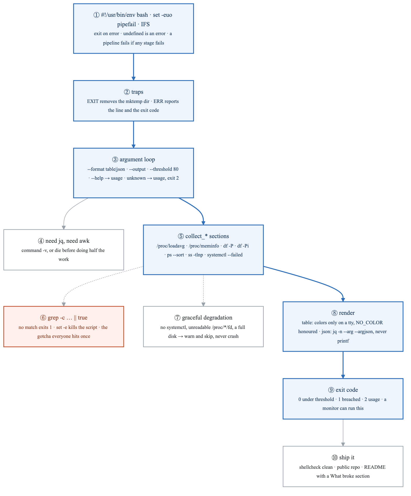

<details>
<summary>Diagram source (Mermaid)</summary>

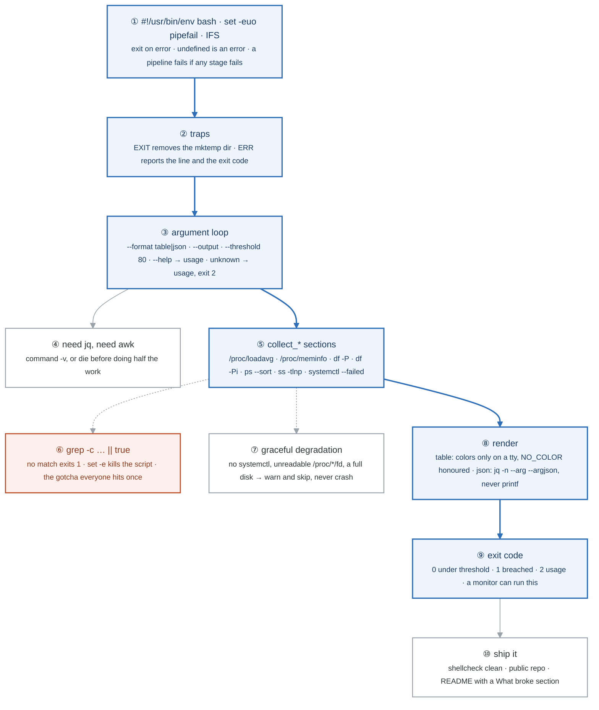

</details>

### Say it, badge by badge

- **Open.** "The first portfolio artifact, and the shape of every operational script you will write: strict mode, traps, arguments, collect, render, and an exit code someone else can act on. Follow the blue path top to bottom."
- **① strict mode.** "`env bash` for portability, because macOS ships bash 3.2. `-e` exits on any non-zero, `-u` makes an undefined variable an error, and `pipefail` makes a pipeline fail if any stage fails, not just the last. IFS set to newline and tab stops word-splitting on spaces."
- **② traps.** "An EXIT trap removes the temp directory however the script ends. An ERR trap prints the line number and the exit code, so a failure names itself."
- **③ argument loop.** "A `while` over `$#` with a `case`. Format, output file, threshold with a default of 80, help, and anything unknown prints usage and exits 2. Exit 2 is usage; keep it distinct from a real failure."
- **④ need.** "`command -v` for every tool the script depends on, before any work. Failing on the first line beats failing halfway through a report."
- **⑤ collect.** "Nine sections, each a function, each reading a source you already know: `/proc` for load and memory, `df -P` for POSIX single-line output you can parse, `df -Pi` for inodes, `ps --sort`, `ss -tlnp`, and `systemctl --failed`."
- **⑥ grep -c with || true.** "grep exits 1 when it finds nothing, and under `set -e` that kills your script in the middle of the zombie count. `|| true` is the fix, and everyone hits this exactly once."
- **⑦ graceful degradation.** "No systemctl on this box, a /proc you cannot read, a disk at one hundred percent: warn and skip the section. A monitoring script that crashes on the thing it monitors is worse than none."
- **⑧ render.** "Table output with colors only when stdout is a terminal and NO_COLOR is unset. JSON through `jq -n` with `--arg` and `--argjson`, never hand-rolled printf, because the first value with a quote in it breaks printf JSON."
- **⑨ exit code.** "Zero when every check is under threshold, one when any is over, two for bad usage. That number is the whole reason a cron job or a monitor can use it."
- **⑩ ship it.** "ShellCheck clean, public on GitHub by Lab 6, a README from the template, and at least two real entries in What broke. The What broke section is what a hiring manager reads."
- **Close.** "Strict, trapped, parsed, collected, rendered, and an exit code. The same skeleton runs the week 2 timer, the week 4 Python CLI, and every deploy script after that."

### Numbers to own

| Number | Where it comes from | Why it matters |
|---|---|---|
| 80 | the default threshold | the disk and memory warning line, overridable with `--threshold` |
| 0 · 1 · 2 | the exit codes | ok, breached, usage; a monitor keys on the first two, a human on the third |
| 9 sections | the requirements table | host · CPU · memory · disk · inodes · processes · network · systemd · logins |
| `2**n`, max 5 | the retry pattern | exponential backoff with a ceiling; the same shape as every cloud SDK |
| bash 3.2 | the shebang comment | why `/usr/bin/env bash` and not `/bin/bash` on macOS |
| 2 What-broke entries | the deliverable checklist | the minimum honest README |

### Prove it

```bash
bash -c 'set -e; grep -c nomatch /dev/null; echo still here'          # ⑥ it is not still here
bash -c 'set -eo pipefail; false | true; echo $?'                      # ① pipefail: a 1, not a 0
./sysreport.sh --threshold 1; echo "exit: $?"                          # ⑨ 1
./sysreport.sh --bogus; echo "exit: $?"                                # ③ usage, 2
NO_COLOR=1 ./sysreport.sh | cat                                        # ⑧ no escape codes
./sysreport.sh --format json | jq .                                    # ⑧ valid JSON
shellcheck sysreport.sh                                                # ⑩
```

### The question a senior interviewer asks

*"Why does `grep -c` with no matches kill a `set -e` script, and what does `pipefail` actually change?"*
Badge ⑥: grep's exit status is 1 on no match, and `-e` treats that as failure. Badge ①: without pipefail a pipeline's status is its last command's, so `false | true` is a success; with it, any failing stage fails the pipeline. Then add the fix, `|| true`, and when you would not want it.

---

## Figure 1.6 — Lab 5: Break/Fix Friday #1, four breaks and the loop they share

> Lab 5 · badges ① to ⑦ · about two minutes. The loop itself is Figure BF.0 in
> [`../../_shared/breakfix/FIGURE.md`](../../_shared/breakfix/FIGURE.md); this figure is today's four scenarios hanging off it.

<!-- figure: generated from the Mermaid below by _shared/diagrams/embed-figures.py — do not edit the image -->
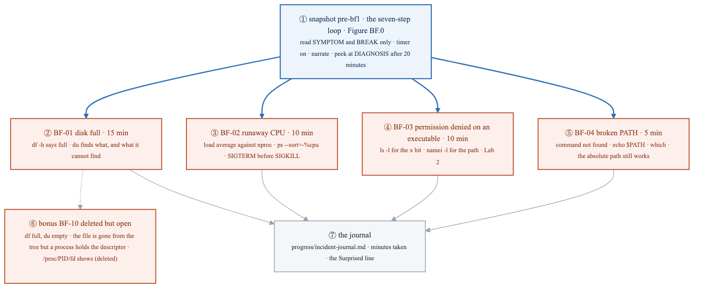

<details>
<summary>Diagram source (Mermaid)</summary>

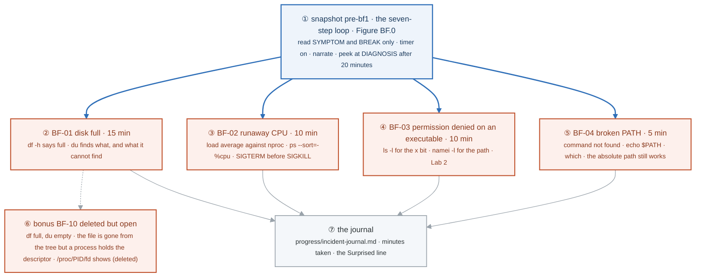

</details>

### Say it, badge by badge

- **Open.** "Four breaks, one loop, and a timer. The loop is the skill; the four are this week's material. The targets are the point: a disk-full diagnosis in fifteen minutes is a junior answer, and you will be at five by month three."
- **① the loop.** "Snapshot first. Read only the symptom and the break command. Run it, close the file, start the timer, and say every step out loud. Twenty minutes stuck is the rule for opening the diagnosis, and you log that you did."
- **② BF-01 disk full.** "`df -h` says one hundred percent. `du` finds the big thing, or it does not, and the second case is the footnote that becomes BF-10. Fifteen minutes."
- **③ BF-02 runaway CPU.** "Load average read against the core count from Lab 4, then `ps` sorted by CPU to name the process. SIGTERM, then SIGKILL only if it ignores you. Ten minutes."
- **④ BF-03 permission denied on an executable.** "The x bit on the file, or an x missing on a directory in its path. `ls -l` and `namei -l`, straight from Lab 2. Ten minutes."
- **⑤ BF-04 broken PATH.** "Command not found for a binary that exists. `echo $PATH`, `which`, and the absolute path still runs. Five minutes, because the test is cheap."
- **⑥ BF-10 deleted but open.** "The disk is full, du finds nothing, and the file was deleted while a process still held it open. The space is freed when the descriptor closes, not when the name goes. `/proc/PID/fd` shows the link marked deleted. Interviewers ask this constantly."
- **⑦ the journal.** "Symptom, hypothesis, confirmed, root cause, fix, prevent, minutes taken, and Surprised. The Surprised line is the edge of your model, and by week 26 those lines are your stories."
- **Close.** "Four breaks in two hours, each narrated and each logged. Next Friday the scenarios change and the loop does not."

### Numbers to own

| Number | Where it comes from | Why it matters |
|---|---|---|
| 15 · 10 · 10 · 5 minutes | the target table | BF-01 through BF-04; the clock is part of the exercise |
| 20 minutes | the rules | stuck that long, open DIAGNOSIS and log that you did |
| 7 steps | the narration block | symptom · change · hypothesis · layers · confirm · fix · prevent |
| 5 layers this week | step 4 of the loop | app → process → filesystem → kernel → network; the ladder grows to seven by week 14 |
| 1 bonus | BF-10 | the deleted-but-open file, the one almost nobody gets first try |

### Prove it

```bash
multipass stop lab && multipass snapshot lab --name pre-bf1          # ① before anything
df -h / ; sudo du -xsh /* 2>/dev/null | sort -rh | head             # ② the two numbers that should agree
read -r l1 _ < /proc/loadavg; echo "$l1 on $(nproc) cores"           # ③ load per core
namei -l "$(which some-script)"                                      # ④
echo "$PATH"; which ls; /bin/ls                                      # ⑤
sudo ls -l /proc/*/fd 2>/dev/null | grep '(deleted)'                 # ⑥ the space that df counts and du cannot
```

### The question a senior interviewer asks

*"df says the disk is full and du cannot find anything large. What happened, and how do you prove it?"*
Badge ⑥. A deleted file with an open descriptor still owns its blocks. `ls -l /proc/*/fd | grep deleted` names the process; restarting or truncating through the descriptor frees the space. If you say "reboot" first, you have described the fix without the mechanism.

---

## Figure 1.7 — Lab 6: what a commit is, and the two ways to undo one

> Lab 6 · badges ① to ⑪ · about three and a half minutes.

<!-- figure: generated from the Mermaid below by _shared/diagrams/embed-figures.py — do not edit the image -->


<details>
<summary>Diagram source (Mermaid)</summary>

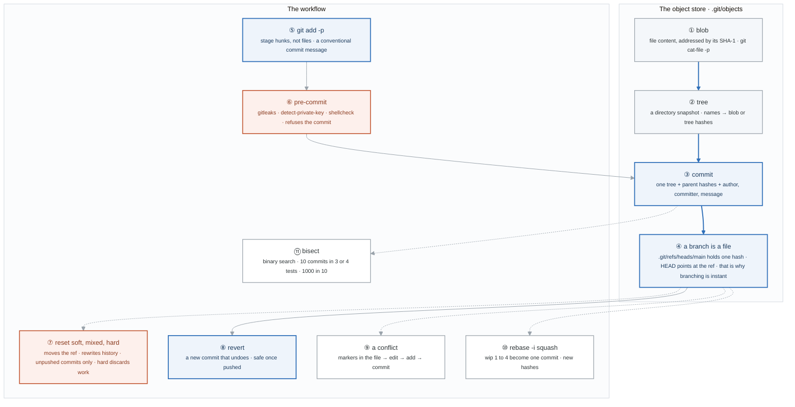

</details>

### Say it, badge by badge

- **Open.** "Git stops being magic the moment you see that a commit is three pointers and a branch is a forty-character text file. Follow the blue path through the object store; everything in the workflow row is a consequence."
- **① blob.** "The content of a file, nothing else, stored under the hash of that content. Two identical files are one blob. `git cat-file -p` on the hash prints it."
- **② tree.** "A directory: a list of names, each pointing at a blob or another tree. A tree is a snapshot of the whole working directory at one instant."
- **③ commit.** "A pointer to one tree, pointers to the parent commit or commits, and author, committer, and message. Change any byte of any of those and the hash changes. That is why rewriting history makes new commits."
- **④ a branch is a file.** "`.git/refs/heads/main` contains one hash. HEAD contains the name of that ref. Creating a branch writes a forty-character file, which is why it is instant and free."
- **⑤ git add -p.** "Stage hunks, not whole files. Your commit becomes the change you meant, and the diff a reviewer reads is the diff you intended. Then a conventional commit message."
- **⑥ pre-commit.** "gitleaks, detect-private-key, and shellcheck run before the commit object exists. A refused commit on your laptop costs seconds; a key in a public repository costs a rotation and an incident. Installed from week 1 so it is never a question."
- **⑦ reset.** "Moves the branch ref backwards. Soft keeps the changes staged, mixed keeps them unstaged, hard discards them. All three rewrite history, so only for commits nobody else has."
- **⑧ revert.** "A new commit whose tree undoes the change. History grows, nothing is rewritten, and it is the only safe undo for anything already pushed."
- **⑨ a conflict.** "Two branches changed the same lines. Git writes both versions with markers into the file and stops. You edit, add, and commit. The lab makes you do it once on purpose so the first real one is not the first."
- **⑩ rebase -i.** "Four wip commits become one with a real message before the pull request. New hashes, same content. Clean history is a courtesy to the reviewer and to the bisect in six months."
- **⑪ bisect.** "Mark a bad commit and a good one; git checks out the midpoint; you say good or bad; repeat. Ten commits take three or four tests, a thousand take ten. It is a binary search over history and it is asked in interviews."
- **Close.** "Blob, tree, commit, ref. Stage carefully, let the hook refuse, reset only what is yours, revert what is shared, and bisect when you do not know. Lab 6 ends with sysreport public and the hooks passing."

### Numbers to own

| Number | Where it comes from | Why it matters |
|---|---|---|
| SHA-1 | the object store | content-addressed; the hash is the identity, so any change is a new object |
| 3 reset modes | soft · mixed · hard | staged, unstaged, discarded; only hard loses work |
| 3 or 4 tests for 10 commits, 10 for 1,000 | the bisect note | log base two; the reason bisect beats reading the log |
| 4 wip commits → 1 | the rebase -i exercise | the squash you do before every pull request |
| v4.6.0 · v0.10.0 · v8.18.4 | the pre-commit config | pinned hook versions; pin them, bump them deliberately |
| 1 first action after a pushed secret | the challenge | rotate the credential; history cleanup comes second, because the secret is already public |

### Prove it

```bash
git cat-file -p HEAD; git cat-file -p 'HEAD^{tree}'                     # ③ ② the three pointers
cat .git/HEAD; cat .git/refs/heads/main                                 # ④ a branch is a file
git add -p                                                              # ⑤
pre-commit run --all-files                                              # ⑥
git reset --soft HEAD~1 && git status -sb                               # ⑦ still staged
git revert HEAD                                                         # ⑧ history grows
git bisect start && git bisect bad HEAD && git bisect good HEAD~10      # ⑪
```

### The question a senior interviewer asks

*"What is in a commit object, why is creating a branch free, and when is reset unsafe?"*
Badges ③, ④, and ⑦ in that order. A tree pointer, parent pointers, and metadata; a ref is a file with one hash; reset rewrites history, so it is unsafe once anyone else has the commits, and revert is the answer there. The follow-up is the challenge: "you pushed a password", and the first word of the answer is rotate.

---

## Redraw schedule

Same cadence as the week figure, see [`../../FIGURES.md`](../../FIGURES.md): Friday of this week after break/fix, Sunday of week 3, and cold at the Gate 1 Sunday in week 4. Lab figures are redrawn **after** the week figure, one at a time, and only the badge order has to be right; the captions are the check, not the test.
