# Week 2 — Linux II and Networking I

> **Thesis:** systemd is how every Linux service actually runs, and subnetting is the single
> highest-return 6 hours in this entire program. Every AWS VPC, every Kubernetes CNI, every
> firewall conversation for the rest of your career runs on the CIDR math you drill this week.

| | |
|---|---|
| **Hours** | 30–45 |
| **Deliverable** | Blog post #1 — "What actually happens when you type a URL and hit enter" |
| **Break/Fix** | BF-05, BF-06, BF-07, BF-11 |
| **Exit check** | CIDR math with no calculator. Explain a TCP handshake from a packet capture. |

## The week in one figure

**Figure 2.1 — From a URL to a packet, and the service that answers.** The blue path is the request: name resolution, the three-way handshake, HTTP. Around it are the things that make the server answer at all: a systemd unit, a hardened sshd, and the CIDR math that decides where the packet goes. Badges are numbered in the order to walk them; the blue path is the one to follow first.

```mermaid
%%{init: {'theme':'base','themeVariables':{'fontFamily':'Helvetica, Arial, sans-serif','fontSize':'13px','primaryColor':'#ffffff','primaryTextColor':'#2d3436','primaryBorderColor':'#9aa3ab','lineColor':'#9aa3ab','textColor':'#2d3436','clusterBkg':'#fbfcfd','clusterBorder':'#d4dae0','edgeLabelBackground':'#ffffff','tertiaryColor':'#eef4fb'},'flowchart':{'curve':'basis','padding':14,'nodeSpacing':42,'rankSpacing':58}}}%%
flowchart LR
  classDef default fill:#ffffff,stroke:#9aa3ab,stroke-width:1.3px,color:#2d3436
  classDef n    fill:#ffffff,stroke:#9aa3ab,stroke-width:1.3px,color:#2d3436
  classDef crit fill:#eef4fb,stroke:#2f6fb8,stroke-width:1.8px,color:#1b3a5c
  classDef data fill:#f4f7fa,stroke:#9aa3ab,stroke-width:1.3px,color:#2d3436
  classDef mut  fill:#ffffff,stroke:#cfd6dc,stroke-width:1.1px,color:#7a8288
  classDef warn fill:#fdf0ec,stroke:#c0522d,stroke-width:1.6px,color:#8a3a1e

  U["① the URL<br/><small>scheme · host · port 443 · path</small>"]:::crit
  D["② DNS resolution<br/><small>stub to recursive to root to TLD to authoritative · dig +trace</small>"]:::crit
  C["③ CIDR decision<br/><small>same subnet? 10.0.0.0/24 = 254 hosts · else the default route</small>"]:::crit
  T["④ TCP handshake<br/><small>SYN · SYN-ACK · ACK · seen in tcpdump</small>"]:::crit
  H["⑤ HTTP<br/><small>GET / · status · headers · the body</small>"]:::crit
  subgraph SRV["The server · what makes it answer"]
    direction TB
    S1["⑥ systemd unit<br/><small>ExecStart · Restart=on-failure · a timer, not cron</small>"]:::n
    S2["⑦ journald<br/><small>journalctl -u name -f · -p err · --since</small>"]:::data
    S3["⑧ sshd hardened<br/><small>keys only · no root login · two sessions open</small>"]:::warn
    S4["⑨ disks<br/><small>lsblk · mkfs · mount · fstab · a loopback to practice on</small>"]:::data
  end
  B["⑩ blog post 1<br/><small>what happens when you hit enter</small>"]:::mut
  U ==> D ==> C ==> T ==> H
  H --> S1
  S1 -.-> S2
  S3 -.-> S1
  S1 -.-> S4
  H -.-> B
  linkStyle 0,1,2,3 stroke:#2f6fb8,stroke-width:2px
```

**What to say, badge by badge** · about three and a half minutes at a normal pace. Point at each badge as you say its line.

- **Open.** “This is the week's deliverable drawn out: what happens when you type a URL and hit enter, and what has to be true on the server for anything to come back. Left to right is the request. The box is the server.”
- **① the URL.** “Four parts: a scheme that implies a port, a host that needs resolving, a path the server interprets. 443 is a number you say without thinking by Friday.”
- **② DNS resolution.** “Your stub resolver asks a recursive resolver. It walks root, then the TLD, then the authoritative server, caching each answer for its TTL. `dig +trace` shows every hop. A wrong answer is almost always a stale cache or the wrong authoritative server.”
- **③ CIDR decision.** “Before a packet leaves, the kernel asks one question: is the destination in my subnet? A /24 is 256 addresses, 254 usable, network and broadcast reserved. If it is not local, the packet goes to the default route. One hundred problems this week make that question automatic.”
- **④ TCP handshake.** “SYN, SYN-ACK, ACK. Three packets, one round trip, before a single byte of HTTP. In tcpdump you can point at all three. A connection that hangs at SYN is a firewall or a routing problem, never the application.”
- **⑤ HTTP.** “Now the request: a method, a path, headers, a body. The status code is the server's one-word answer. Everything above this line was plumbing; everything the user sees starts here.”
- **⑥ systemd unit.** “The server answers because a unit file says ExecStart and Restart=on-failure, and systemd keeps it running. A timer unit replaces cron with logging, dependencies, and `systemctl list-timers`. Write both from blank.”
- **⑦ journald.** “`journalctl -u name -f` follows one service. `-p err --since today` filters. This is where you look before you look anywhere else.”
- **⑧ sshd hardened.** “Keys only, no root login, no passwords. The rule that matters: keep two sessions open while you change sshd, and test from a third before you close anything. Lockouts are the week's classic self-inflicted incident.”
- **⑨ disks.** “lsblk, mkfs, mount, fstab. Practice on a loopback file so a mistake costs nothing. A full disk is BF-01; knowing the layout is how you find what filled it.”
- **⑩ blog post.** “Saturday you write all of this down for a stranger. If a step is hard to explain, that is the step you do not yet own.”
- **Close.** “Name, route, handshake, request. Then a unit that keeps the service alive and logs you can read. Every VPC and every Kubernetes Service later is this picture with different names on the boxes.”

---

## Day plan

| Day | Focus | Lab |
|---|---|---|
| Mon | systemd: units, services, timers, journald | Lab 1 |
| Tue | Users, sudo, SSH hardening, disks | Lab 2 |
| Wed | **Subnetting drill (100 problems)** + IP fundamentals | Lab 3 |
| Thu | TCP/IP, DNS, tcpdump | Lab 4 |
| Fri | Break/Fix BF-05, 06, 07, 11 | Lab 5 |
| Sat | Write and publish blog post #1 | — |
| Sun | Review, plan week 3 | — |

## Reading map

- `_reference/linux-networking/08-networking-fundamentals.md`
- `_reference/linux-networking/10-ssh-remote-access.md`
- `_reference/linux-networking/11-system-monitoring.md`
- `_reference/linux-networking/alt/09-dns-and-http.md`
- `_reference/linux-networking/alt/10-network-troubleshooting.md`
- **Drill:** `_shared/drills/subnetting.md` — this is the week's centerpiece

**Free primary sources:** `man systemd.unit`, `man systemd.timer`, `man 5 sshd_config`,
Julia Evans' networking zines, and Beej's Guide to Network Programming (chapters 1–3).

## Labs

All labs: [labs/LABS.md](labs/LABS.md) · Solutions: [solutions/SOLUTIONS.md](solutions/SOLUTIONS.md)

| # | Lab | Time |
|---|---|---|
| 1 | systemd services and timers | 3h |
| 2 | SSH hardening and disk management | 3h |
| 3 | **Subnetting to automaticity** | 3h |
| 4 | TCP/IP and DNS with tcpdump | 3h |
| 5 | Break/Fix Friday #2 | 2h |

## Drills (Block 4, daily)

- **20 subnetting problems, every single day this week.** Non-negotiable.
- `_shared/drills/bash-oneliners.md` — Processes and network section
- Anki: `linux-networking.tsv`, plus your own cards

## Exit criteria

- [ ] Write a systemd unit + timer from blank and explain why it beats cron
- [ ] Harden sshd without locking yourself out (keep two sessions open)
- [ ] **Convert any CIDR to network/broadcast/host-count in under 10 seconds, no calculator**
- [ ] Split a /16 into N subnets on paper
- [ ] Explain the TCP three-way handshake pointing at a real `tcpdump` capture
- [ ] Trace a DNS query through the full delegation chain with `dig +trace`
- [ ] Blog post #1 published
- [ ] 4 more incident-journal entries
