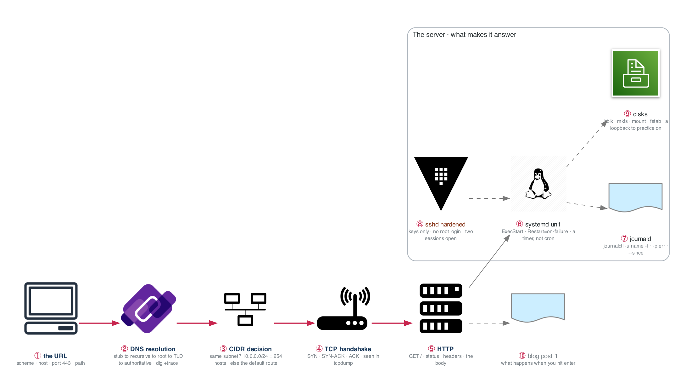

# Figure 2.1 — From a URL to a packet, and the service that answers

> Week 2 · badges ① to ⑩ · about three and a half minutes at a normal pace. Point at each badge as you say its line. Blue is the path to follow first; orange-red is where something refuses or fails.



The blue path is the request: name resolution, the three-way handshake, HTTP. Around it are the things that make the server answer at all: a systemd unit, a hardened sshd, and the CIDR math that decides where the packet goes.

## What to say, badge by badge

- **Open.** “This is the week's deliverable drawn out: what happens when you type a URL and hit enter, and what has to be true on the server for anything to come back. Left to right is the request. The box is the server.”
- **① the URL.** “Four parts: a scheme that implies a port, a host that needs resolving, a path the server interprets. 443 is a number you say without thinking by Friday.”
- **② DNS resolution.** “Your stub resolver asks a recursive resolver. It walks root, then the TLD, then the authoritative server, caching each answer for its TTL. `dig +trace` shows every hop. A wrong answer is almost always a stale cache or the wrong authoritative server.”
- **③ CIDR decision.** “Before a packet leaves, the kernel asks one question: is the destination in my subnet? A /24 is 256 addresses, 254 usable, network and broadcast reserved. If it is not local, the packet goes to the default route. One hundred problems this week make that question automatic.”
- **④ TCP handshake.** “SYN, SYN-ACK, ACK. Three packets, one round trip, before a single byte of HTTP. In tcpdump you can point at all three. A connection that hangs at SYN is a firewall or a routing problem, never the application.”
- **⑤ HTTP.** “Now the request: a method, a path, headers, a body. The status code is the server's one-word answer. Everything above this line was plumbing; everything the user sees starts here.”
- **⑥ systemd unit.** “The server answers because a unit file says ExecStart and Restart=on-failure, and systemd keeps it running. A timer unit replaces cron with logging, dependencies, and `systemctl list-timers`. Write both from blank.”
- **⑦ journald.** “`journalctl -u name -f` follows one service. `-p err --since today` filters. This is where you look before you look anywhere else.”
- **⑧ sshd hardened.** “Keys only, no root login, no passwords. The rule that matters: keep two sessions open while you change sshd, and test from a third before you close anything. Lockouts are the week's classic self-inflicted incident.”
- **⑨ disks.** “lsblk, mkfs, mount, fstab. Practice on a loopback file so a mistake costs nothing. A full disk is BF-01; knowing the layout is how you find what filled it.”
- **⑩ blog post.** “Saturday you write all of this down for a stranger. If a step is hard to explain, that is the step you do not yet own.”
- **Close.** “Name, route, handshake, request. Then a unit that keeps the service alive and logs you can read. Every VPC and every Kubernetes Service later is this picture with different names on the boxes.”

## Use it

- Read the figure before the day plan. Say the script out loud on Friday with the file closed.
- Each badge line is a thirty-second interview answer; the whole script is the three-minute version.
- Regenerate after editing the spec in `_shared/diagrams/week_figures/`:

```bash
python3 ../../_shared/diagrams/generate-week-figures.py --only 2
```
