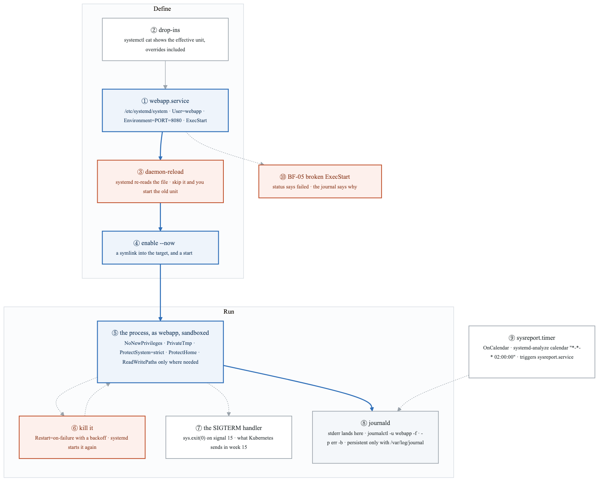
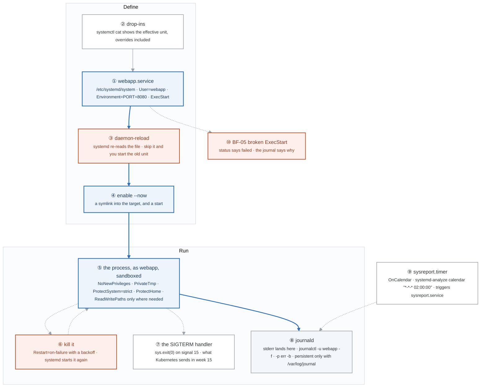
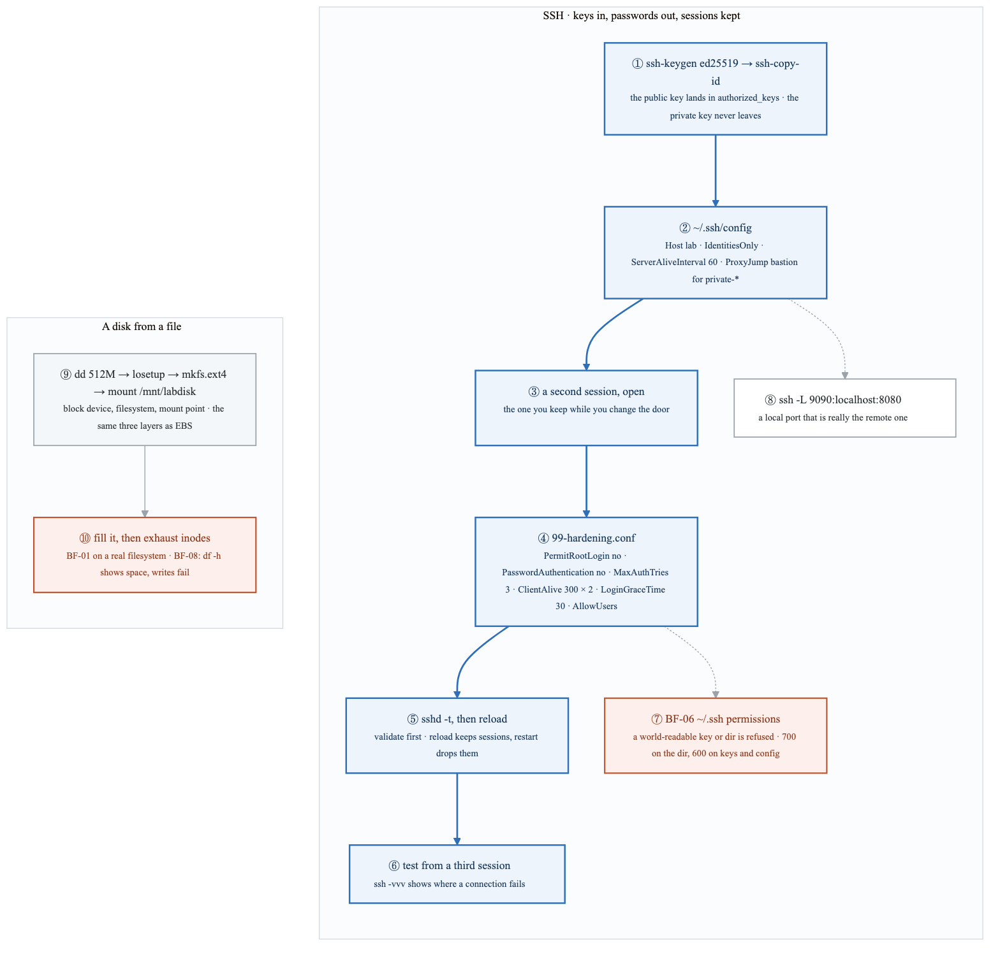
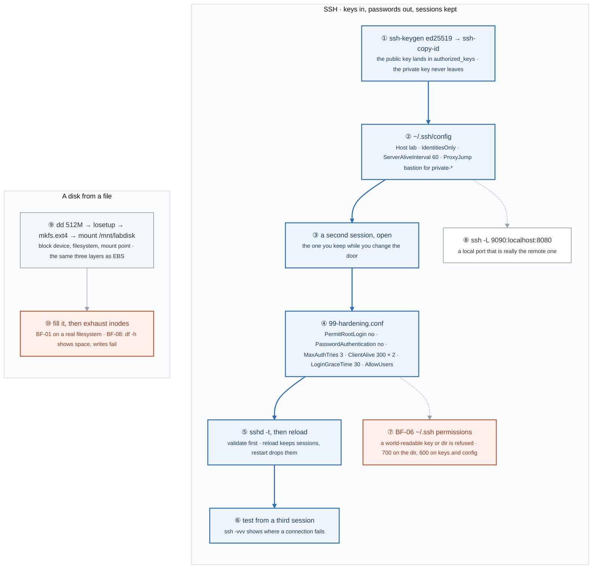
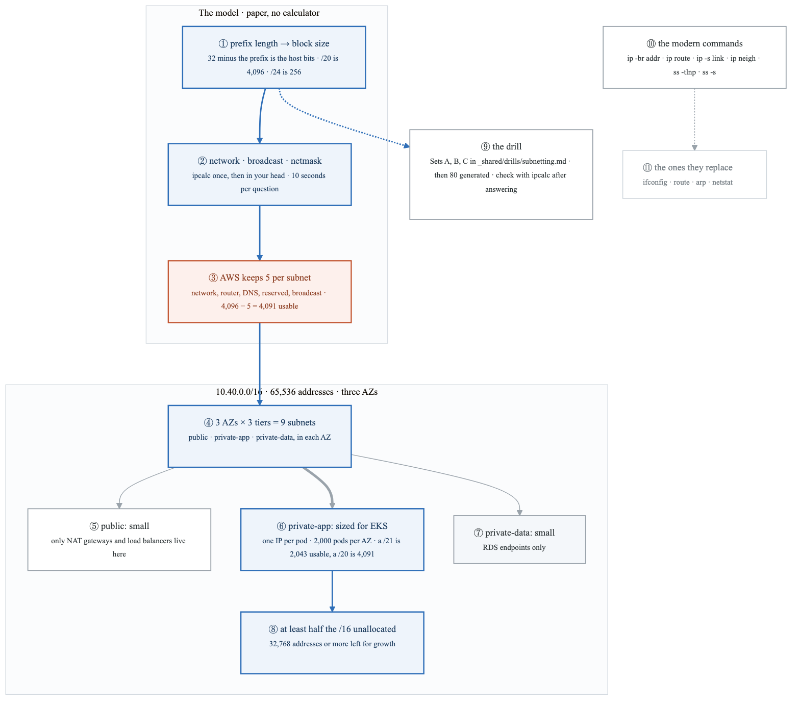
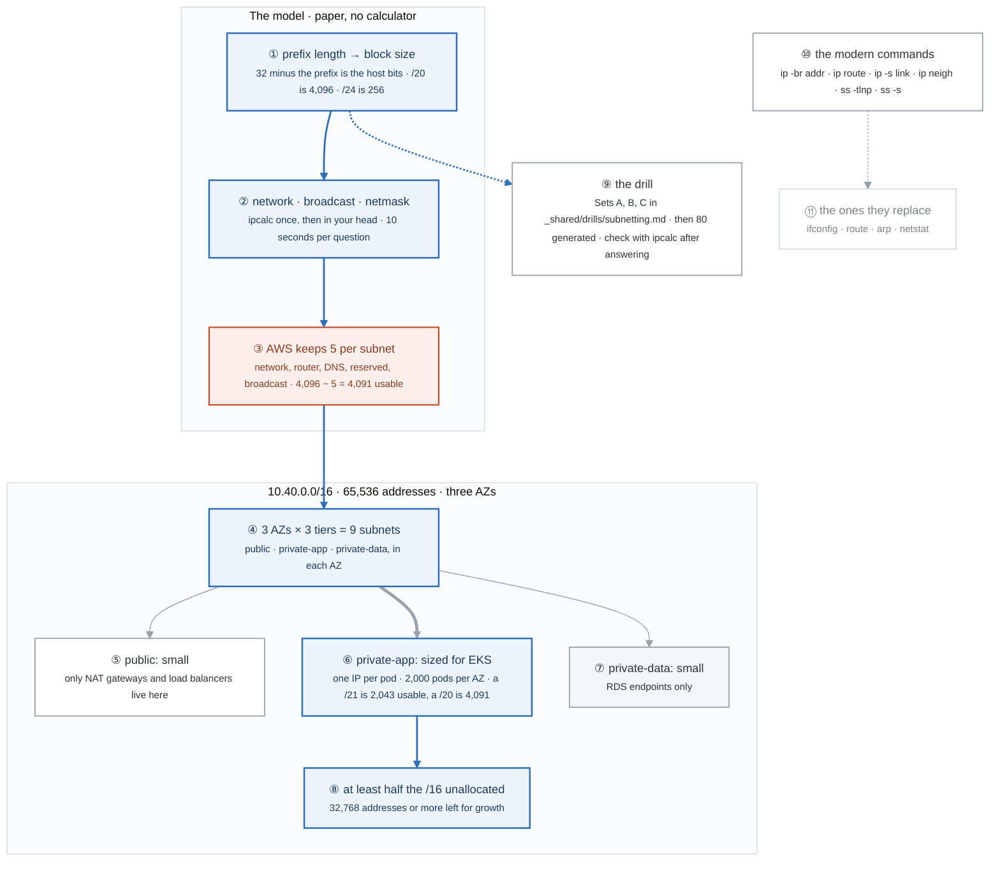
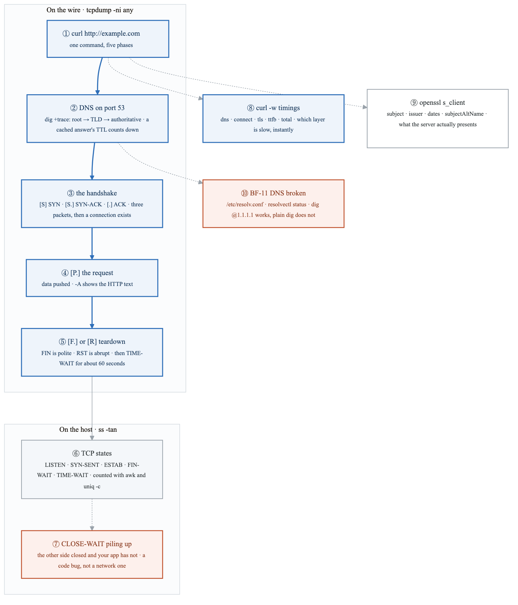
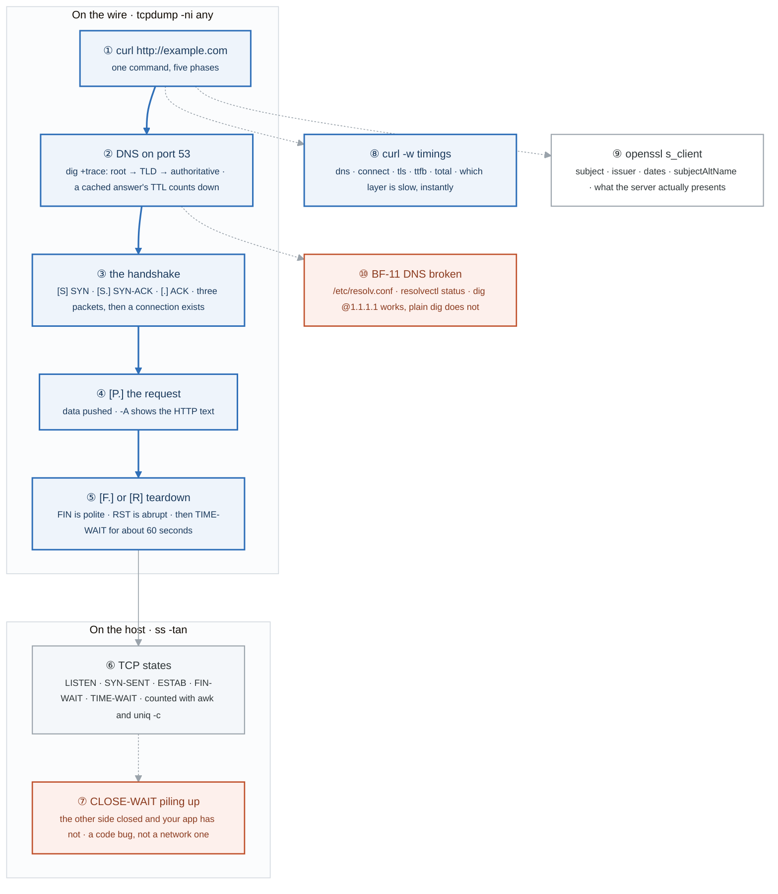
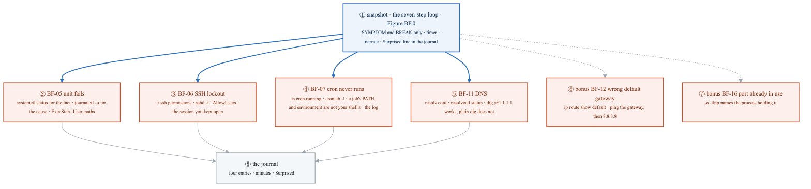
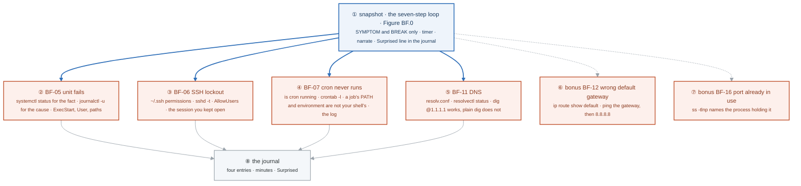

# Week 2 — Lab figures

> One figure per lab, numbered 2.2 to 2.6. Figure 2.1 is the week figure in
> [`../content/FIGURE.md`](../content/FIGURE.md); these five go one level down, to the mechanism each
> lab makes you touch. Same language: gray is structure, **blue is the path to follow first**,
> orange-red is where something refuses, washed boxes are stores. Each badge line is a thirty-second
> interview answer; each whole script is under three minutes.

**The protocol per figure**

1. **Before the lab:** read the figure, say the badges out loud once. You now know what you are about to prove.
2. **During the lab:** every badge has a **Prove it** command. Run it and watch the badge happen. A badge you cannot see happen is one you are taking on faith.
3. **After the lab:** close the file, redraw the figure, say the script. Check against the file. The badge where the order slipped goes in the *Figures redrawn* column of `progress.md`.
4. **Own the numbers.** The *Numbers to own* table is what separates "I know systemd" from "reload keeps the sessions, restart drops them, and `sshd -t` runs before either."
5. **Answer the question.** Each figure ends with the question a senior interviewer asks about it. Answer it cold, in under a minute, before the gate.

---

## Figure 2.2 — Lab 1: a unit file to a restarted process, and where its logs go

> Lab 1 · badges ① to ⑩ · about three minutes.

<!-- figure: generated from the Mermaid below by _shared/diagrams/embed-figures.py — do not edit the image -->


<details>
<summary>Diagram source (Mermaid)</summary>



</details>

### Say it, badge by badge

- **Open.** "A service on Linux is a text file systemd reads, a process it starts as a user you chose, and a journal that captures everything the process writes. Follow the blue path from the file to the log."
- **① webapp.service.** "Runs as the webapp user from Lab 2's service-account pattern, never root. Environment sets the port. ExecStart is the one line that must be right, and the one BF-05 breaks."
- **② drop-ins.** "Overrides live in a `.d` directory next to the unit. `systemctl cat` prints the effective unit with every drop-in, which is the only honest view of what systemd will run."
- **③ daemon-reload.** "systemd caches units. Edit the file without reloading and `restart` runs the old definition. The symptom is a change that does nothing, and the fix is one command you learn to type reflexively."
- **④ enable --now.** "Enable writes a symlink into the target's wants directory, so it starts at boot. `--now` starts it this instant. Two things, one flag."
- **⑤ the process, sandboxed.** "No new privileges, a private /tmp, a read-only system except the paths you list, no home directories. The process gets the filesystem it needs and nothing else. This is the week-4 container idea, done by the init system."
- **⑥ kill it.** "`Restart=on-failure` with a backoff. Kill the process and watch systemd bring it back. That restart loop is the same loop Kubernetes runs with a kubelet."
- **⑦ the SIGTERM handler.** "The app catches signal 15 and exits cleanly. Without the handler, the default dies without closing anything. Week 15 sends this signal with a grace period."
- **⑧ journald.** "stderr goes to the journal. Follow with `-f`, filter by unit and time, errors this boot with `-p err -b`. It is persistent only if `/var/log/journal` exists; on some distros a reboot erases it until you create that directory."
- **⑨ the timer.** "Last week's sysreport, run on a calendar. `systemd-analyze calendar` tells you when an expression next fires before you trust it. The timer starts the service; the service's output is in the journal like any other."
- **⑩ BF-05.** "Break ExecStart. `systemctl status` says failed with an exit code; `journalctl -u` has the line the process printed before it died. Status for the fact, journal for the cause."
- **Close.** "File, reload, enable, process, journal. Hardened by default, restarted on failure, scheduled by a timer. By Friday you diagnose the broken version in minutes."

### Numbers to own

| Number | Where it comes from | Why it matters |
|---|---|---|
| `PORT=8080` | the `Environment=` task | configuration through the unit, not the code |
| 200 or 503 on /health | app.py | the health endpoint pattern every later lab reuses |
| `"*-*-* 02:00:00"` · `"Mon..Fri 09:00"` | `systemd-analyze calendar` | two OnCalendar shapes; verify before you schedule |
| `--vacuum-time=7d` | the journald part | how much journal you keep |
| `/var/log/journal` | the persistence note | the directory that decides whether logs survive a reboot |
| signal 15 | the handler in app.py | the signal the app must catch; 9 cannot be caught |

### Prove it

```bash
systemctl cat webapp                                        # ② the effective unit
sudo systemctl daemon-reload && sudo systemctl enable --now webapp   # ③ ④
systemctl show webapp -p User -p NoNewPrivileges -p ProtectSystem    # ⑤
sudo kill "$(systemctl show webapp -p MainPID --value)"; sleep 2; systemctl status webapp   # ⑥ restarted
journalctl -u webapp -f                                     # ⑧
systemd-analyze calendar "Mon..Fri 09:00"                   # ⑨
systemctl status webapp; journalctl -u webapp -n 20         # ⑩ fact, then cause
```

### The question a senior interviewer asks

*"Walk me through what happens from `systemctl enable --now` to a crash and the restart, and where the SIGTERM handler fits."*
Badges ④ ⑤ ⑥ ⑦ in order. Symlink and start; the process runs sandboxed as its user; it dies; `Restart=on-failure` brings it back after the backoff; on a deliberate stop systemd sends SIGTERM first and the handler exits cleanly. If you say "systemd restarts it" without naming the restart policy, you have skipped the mechanism.

---

## Figure 2.3 — Lab 2: the SSH door, hardened without locking yourself out, and a disk from a file

> Lab 2 · badges ① to ⑩ · about three minutes.

<!-- figure: generated from the Mermaid below by _shared/diagrams/embed-figures.py — do not edit the image -->


<details>
<summary>Diagram source (Mermaid)</summary>



</details>

### Say it, badge by badge

- **Open.** "Two chains. The first hardens the only door into every server you will ever run, in an order that cannot lock you out. The second builds a disk out of a file so you can fill it and break it without touching a real one."
- **① keygen and copy-id.** "An ed25519 key pair. `ssh-copy-id` appends the public half to `authorized_keys` on the server. The private half stays on your machine, and that asymmetry is the whole security model."
- **② the config file.** "Host aliases with the key, `IdentitiesOnly` so the client offers one key not all of them, a keepalive, and `ProxyJump` through a bastion for anything private. ProxyJump is exactly how you reach a private subnet in week 6."
- **③ a second session.** "Open it and leave it open. Every change to sshd happens while a known-good session exists. This is the habit that saves you at least once."
- **④ the hardening drop-in.** "No root login, no passwords, three tries, idle sessions dropped after 300 seconds twice, thirty seconds to authenticate, and an explicit user list. AllowUsers is the line that locks you out if it names the wrong user."
- **⑤ sshd -t, then reload.** "Validate the config before applying it. Reload re-reads the config and keeps existing sessions; restart drops them. The order is validate, reload, never restart blind."
- **⑥ a third session.** "Prove the new config lets you in before you close the old sessions. If it fails, `ssh -vvv` shows the exact step: key offered, key refused, user not allowed."
- **⑦ BF-06.** "sshd refuses keys from a directory or file other users can read. 700 on `~/.ssh`, 600 on the keys and config. The symptom is a key that worked yesterday and is silently ignored today."
- **⑧ the tunnel.** "`-L 9090:localhost:8080` makes a local port that forwards to the remote one. Curl 9090 on your laptop and the service on the server answers. Database access through a bastion works the same way."
- **⑨ a disk from a file.** "dd a 512-megabyte file, attach it as a loop device, make a filesystem, mount it. Block device, filesystem, mount point: the three layers every EBS volume has in week 5."
- **⑩ fill it, then exhaust inodes.** "Fill to one hundred percent and recover, as in BF-01. Then create files until the inodes run out: `df -h` still shows free space and writes fail anyway. That is BF-08, and `df -i` is the only command that shows it."
- **Close.** "Key, config, spare session, harden, validate, reload, prove. Then a disk you can break. The order on the SSH side is the lesson; the disk side is week 1's BF-01 made real."

### Numbers to own

| Number | Where it comes from | Why it matters |
|---|---|---|
| `MaxAuthTries 3` | the hardening drop-in | brute force gets three guesses per connection |
| `ClientAliveInterval 300` · `ClientAliveCountMax 2` | the hardening drop-in | an idle session is dropped after two missed probes, ten minutes |
| `LoginGraceTime 30` | the hardening drop-in | thirty seconds to finish authenticating |
| `ServerAliveInterval 60` | the client config | the client-side keepalive that stops a NAT from dropping you |
| 700 · 600 | the BF-06 fix | directory and files under `~/.ssh`; anything looser is ignored by sshd |
| 512 MB | the loop disk | large enough to fill, small enough to do it in seconds |
| 9090 → 8080 | the tunnel task | local port, remote port |

### Prove it

```bash
ssh -vvv lab 2>&1 | grep -i 'offering\|accepted\|denied'      # ① ⑥ where the key is offered and taken
sudo sshd -t && sudo systemctl reload ssh                      # ⑤ validate, then reload
chmod 644 ~/.ssh/lab_ed25519 && ssh lab                        # ⑦ refused; chmod 600 to fix
ssh -L 9090:localhost:8080 lab -N & curl localhost:9090        # ⑧
sudo losetup -fP /tmp/disk.img && lsblk | grep loop            # ⑨
df -h /mnt/labdisk; df -i /mnt/labdisk                         # ⑩ the two numbers that disagree
```

### The question a senior interviewer asks

*"df -h shows free space and writes fail with No space left on device. What is happening? And how do you harden sshd on a box you can only reach over ssh?"*
Badge ⑩ for the first: inodes, shown by `df -i`, exhausted by many small files. Badges ③ ⑤ ⑥ for the second: a second session kept open, `sshd -t` then reload, a third session to prove it. Name the three steps in order and you have answered it.

---

## Figure 2.4 — Lab 3: a /16 carved for three AZs, and the five addresses AWS keeps

> Lab 3 · badges ① to ⑪ · about three minutes. Parts 1 and 2 of the lab are a drill with no mechanism to draw; this figure is Part 3, the VPC layout, with the drill and Part 4 as context.

<!-- figure: generated from the Mermaid below by _shared/diagrams/embed-figures.py — do not edit the image -->


<details>
<summary>Diagram source (Mermaid)</summary>



</details>

### Say it, badge by badge

- **Open.** "The highest-return lab in month one, and it is mostly a drill. The figure is the one design the drill is for: a /16 cut for three zones with room to grow, done on paper while the other candidate finds a calculator."
- **① prefix to block size.** "Thirty-two minus the prefix is the host bits; two to that power is the block. A /20 is 4,096 addresses, a /24 is 256. Once that is automatic, every subnet question is arithmetic."
- **② network, broadcast, netmask.** "Run ipcalc once to see the shape, then stop using it. The target is ten seconds per question, on paper, checked after."
- **③ AWS keeps five.** "In every subnet AWS reserves the network address, the router, the DNS resolver, one for future use, and the broadcast. Usable is the block minus five. A /20 gives 4,091, not 4,096, and forgetting this is how a subnet comes up one short."
- **④ nine subnets.** "Three availability zones, each with a public tier, a private application tier, and a private data tier. Nine subnets from one /16, and each AZ is a copy of the others."
- **⑤ public: small.** "Only NAT gateways and load balancers get public addresses. A handful of IPs per AZ; make it small on purpose so nobody puts an application there."
- **⑥ private-app: sized for EKS.** "Every pod takes one IP from this subnet. Two thousand pods per AZ means a /21 is 2,043 usable, which leaves almost nothing for nodes and growth, so the honest answer is a /20. Say the arithmetic out loud; that is what the interviewer wants to hear."
- **⑦ private-data: small.** "RDS endpoints and nothing else. Small, with no route to the internet at all in week 6."
- **⑧ half the /16 free.** "At least 32,768 addresses unallocated. Three /20 application tiers alone use 12,288, so the budget is real. The constraint is what makes the design a design rather than a list."
- **⑨ the drill.** "Sets A, B, and C, then eighty more generated by the script. Paper, pen, ten seconds, check afterwards. Six hours of this pays off in every AWS and Kubernetes conversation after it."
- **⑩ the modern commands.** "`ip -br addr`, `ip route`, `ip -s link` for errors and drops, `ip neigh` for ARP, `ss -tlnp` for listeners. These are the commands on every box you will touch."
- **⑪ the ones they replace.** "ifconfig, route, arp, netstat. Still typed by people who learned before you; do not be one of them in an interview."
- **Close.** "Block size, minus five, nine subnets, pods sized honestly, half left over. Do the drill until the figure is arithmetic you do while talking."

### Numbers to own

| Number | Where it comes from | Why it matters |
|---|---|---|
| 5 | AWS reserved addresses per subnet | usable = block − 5; the one subtraction every design needs |
| `10.40.0.0/16` = 65,536 | the Part 3 brief | the budget you are carving |
| 2,000 pods per AZ | the EKS requirement | one IP per pod; the number that sizes private-app |
| /21 = 2,043 · /20 = 4,091 | block minus five | the two candidate sizes for private-app, and why the smaller is too tight |
| ≥ 50% free | the Part 3 constraint | 32,768 addresses or more untouched |
| 10 seconds | the drill rule | per question, on paper |
| 100 + 80 | Sets A to C plus the generator | the volume that makes it automatic |

### Prove it

```bash
python3 -c "import ipaddress as i; n=i.ip_network('10.40.16.0/20'); print(n.num_addresses, n.num_addresses-5)"   # ① ③
ipcalc 10.40.0.0/20                                            # ② after you answered on paper
python3 -c "import ipaddress as i; print(list(i.ip_network('10.40.0.0/16').subnets(new_prefix=20))[:9])"   # ④ nine /20s to pick from
ip -br addr; ip route; ss -tlnp                                # ⑩
```

### The question a senior interviewer asks

*"You have 10.40.0.0/16 and three AZs. Size the EKS application subnets for two thousand pods per zone and keep half the VPC free. Talk me through it."*
Badges ③ ⑥ ⑧. A /21 is 2,043 usable after the five reserved, too tight once nodes are counted, so a /20 per AZ at 4,091. Three of those is 12,288 of 65,536, the small public and data tiers add little, and more than half is still free. Do the subtraction out loud; the five reserved addresses are the detail that separates you.

---

## Figure 2.5 — Lab 4: one curl, as packets, states, and timings

> Lab 4 · badges ① to ⑩ · about three minutes.

<!-- figure: generated from the Mermaid below by _shared/diagrams/embed-figures.py — do not edit the image -->


<details>
<summary>Diagram source (Mermaid)</summary>



</details>

### Say it, badge by badge

- **Open.** "One curl, watched three ways: as packets on the wire, as socket states on the host, and as a timing breakdown. After this lab, 'the site is slow' is a question with a layer, not a feeling."
- **① curl.** "A single HTTP request. Underneath it: a name lookup, a three-way handshake, a request, a response, and a teardown. tcpdump on `any` with `-c 20` catches the whole thing."
- **② DNS.** "A query to port 53 before anything else. `dig +trace` walks the delegation from the root through the TLD to the authoritative server, and a second query against a cache shows the TTL counting down. Hop by hop is the exit task."
- **③ the handshake.** "SYN from the client, SYN-ACK from the server, ACK back. tcpdump flags them S, S-dot, and dot. After the third packet both sides have a connection; before it, nothing exists."
- **④ the request.** "P-dot is data being pushed. With `-A` you see the GET line in ASCII. This is where the HTTP you thought you were debugging finally appears."
- **⑤ teardown.** "FIN is a polite close, RST is a slam. The closer then sits in TIME-WAIT for about sixty seconds so late duplicates cannot land on a new connection. Thousands of TIME-WAIT is normal on a busy client; it is not a leak."
- **⑥ TCP states.** "`ss -tan`, column one, sorted and counted. LISTEN for servers, ESTAB for live connections, the closing family for everything on its way out. Learn to read the histogram in one glance."
- **⑦ CLOSE-WAIT.** "The peer sent FIN and your application never called close. The kernel is waiting for your code. A pile of these is an application bug, and knowing that is a strong interview answer."
- **⑧ curl -w timings.** "Name lookup, connect, TLS, time to first byte, total. Each is cumulative, so the gaps are the layers. Slow dns is the resolver, slow connect is the network, slow ttfb is the application. One flag, instant triage."
- **⑨ openssl s_client.** "Connect with SNI and print the certificate the server actually presents: subject, issuer, dates, SANs. This is next week's TLS lab arriving early."
- **⑩ BF-11.** "Names stop resolving. `resolv.conf` and `resolvectl status` say which resolver is configured; `dig @1.1.1.1` working while plain `dig` fails proves the resolver, not the network, is the problem."
- **Close.** "Lookup, three packets, data, teardown, and the states they leave behind. With tcpdump, ss, and curl -w you can place any slowness on a layer in under a minute."

### Numbers to own

| Number | Where it comes from | Why it matters |
|---|---|---|
| 53 · 80 · 443 | the capture filters | DNS, HTTP, HTTPS; the three ports every capture starts from |
| 3 packets | the handshake | SYN, SYN-ACK, ACK; no connection exists before the third |
| ~60 seconds | TIME-WAIT | why a busy client shows thousands of them, harmlessly |
| 5 phases | `curl -w` | dns · connect · tls · ttfb · total, cumulative |
| `-c 20` | the first capture | enough packets for one request without drowning |
| 6 flags | the identification task | S · S. · . · P. · F. · R |

### Prove it

```bash
sudo tcpdump -ni any -c 20 'tcp port 80 and host example.com' & curl -s http://example.com >/dev/null; wait   # ③ ④ ⑤
sudo tcpdump -ni any port 53 -c 4                                             # ②
dig example.com +trace                                                        # ② every hop
ss -tan | awk '{print $1}' | sort | uniq -c                                   # ⑥
curl -w 'dns %{time_namelookup} connect %{time_connect} tls %{time_appconnect} ttfb %{time_starttransfer} total %{time_total}\n' -o /dev/null -s https://example.com   # ⑧
echo | openssl s_client -connect example.com:443 -servername example.com 2>/dev/null | openssl x509 -noout -dates -ext subjectAltName   # ⑨
```

### The question a senior interviewer asks

*"A service has thousands of sockets in CLOSE-WAIT. Which side is at fault, and how does the state machine prove it?"*
Badge ⑦. CLOSE-WAIT is the state after receiving a FIN and before the local application closes; only the local process can leave it. The peer did its part. The proof is the state name itself: the kernel is waiting for close(). Contrast with TIME-WAIT, badge ⑤, which is the kernel's own timer and nobody's bug.

---

## Figure 2.6 — Lab 5: Break/Fix Friday #2, four breaks and the loop they share

> Lab 5 · badges ① to ⑧ · about two minutes. The loop is Figure BF.0 in
> [`../../_shared/breakfix/FIGURE.md`](../../_shared/breakfix/FIGURE.md); this figure is today's scenarios hanging off it.

<!-- figure: generated from the Mermaid below by _shared/diagrams/embed-figures.py — do not edit the image -->


<details>
<summary>Diagram source (Mermaid)</summary>



</details>

### Say it, badge by badge

- **Open.** "Same loop as last Friday, four new breaks from this week's material. Each one has a first command, and the first command is what you are drilling."
- **① the loop.** "Snapshot, symptom and break only, timer, narrate, journal. Figure BF.0 is the script; say it before the first break."
- **② BF-05 unit fails.** "`systemctl status` says failed and gives an exit code. `journalctl -u` has the line the process printed. The usual culprits are ExecStart, the User, and a path the sandbox made read-only."
- **③ BF-06 SSH lockout.** "Permissions on `~/.ssh`, a config that did not pass `sshd -t`, or an AllowUsers line that names the wrong user. The second session you kept open is the recovery."
- **④ BF-07 cron never runs.** "Is cron running, is the entry there, and is the job's environment what you assumed? A cron job's PATH is not your shell's PATH, and that is the usual answer. Then the log."
- **⑤ BF-11 DNS.** "The resolver. `resolv.conf` or `resolvectl status` shows what is configured; a query to 1.1.1.1 that works while the default fails proves it."
- **⑥ BF-12 wrong default gateway.** "`ip route show default`. Ping the gateway, then ping past it. The lab from week 3 breaks this deliberately."
- **⑦ BF-16 port in use.** "`ss -tlnp` names the process on the port. The fix is to stop it or move; the diagnosis is one command."
- **⑧ the journal.** "Four entries, minutes taken, Surprised line filled in. The lab says that line is non-negotiable."
- **Close.** "Status then journal, permissions then config, service then environment, resolver then network. Four first commands, and the loop around them."

### Numbers to own

| Number | Where it comes from | Why it matters |
|---|---|---|
| 4 scenarios + 2 bonus | the lab | BF-05, 06, 07, 11; BF-12 and BF-16 if time |
| 20 minutes | the week 1 rules, reused | the peek rule |
| 1 session kept open | BF-06 | the recovery path for every SSH change |
| 1 line | the Surprised field | the field the lab calls out as mandatory |

### Prove it

```bash
systemctl status webapp; journalctl -u webapp -n 20            # ②
ls -la ~/.ssh; sudo sshd -t                                    # ③
systemctl status cron; crontab -l; grep CRON /var/log/syslog | tail   # ④
resolvectl status; dig @1.1.1.1 example.com +short             # ⑤
ip route show default                                          # ⑥
ss -tlnp | grep ':8080'                                        # ⑦
```

### The question a senior interviewer asks

*"A cron job never runs. Where do you look, in order?"*
Badge ④: the daemon, the crontab entry, the job's environment, the log. Say the PATH difference without being asked and you have shown you have been bitten by it.

---

## Redraw schedule

Same cadence as the week figure, see [`../../FIGURES.md`](../../FIGURES.md): Friday of this week after break/fix, and cold at the Gate 1 Sunday in week 4, which is also the two-week redraw. Lab figures are redrawn **after** the week figure, one at a time, and only the badge order has to be right; the captions are the check, not the test.
