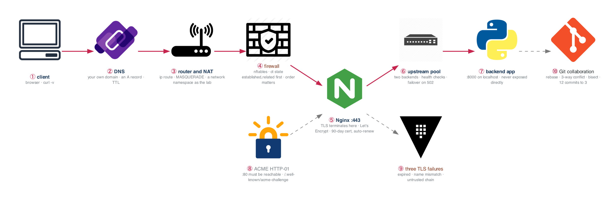

# Week 3 — Networking II, Git Collaboration, Nginx

> **Thesis:** routing, NAT, and firewalls are the *concepts* behind every AWS networking question you
> will be asked. Build a reverse proxy with real TLS this week and weeks 6–7 become review.

| | |
|---|---|
| **Hours** | 30–45 |
| **Deliverable** | Blog post #2 — "Reverse proxies and TLS, explained by breaking them" (with a diagram) |
| **Break/Fix** | BF-13, BF-14, BF-15, BF-16 |
| **Exit check** | Explain stateful vs stateless firewalling *before* touching AWS |

## The week in one figure

**Figure 3.1 — Browser to backend: routing, NAT, firewall, TLS, and the reverse proxy.** Follow the blue path from a client on the internet to the Python process behind Nginx. Every box is something you build by hand this week, and every box is something AWS will later sell you under a different name.

**Say it, badge by badge:** [`content/FIGURE.md`](content/FIGURE.md) — the spoken script for each of the 10 badges, about three and a half minutes; [`content/figure-3.1-numbered-spoken.pdf`](content/figure-3.1-numbered-spoken.pdf) is the printable two-page version. Read the figure before the day plan; say the script on Friday.

---

## Day plan
| Day | Focus | Lab |
|---|---|---|
| Mon | Routing, NAT, firewalls | Lab 1 |
| Tue | DNS deep + buy a domain | Lab 2 |
| Wed | Nginx reverse proxy + load balancing | Lab 3 |
| Thu | TLS end to end (self-signed → Let's Encrypt) | Lab 4 |
| Fri | Break/Fix + Git collaboration | Lab 5, 6 |
| Sat | Blog post #2 | — |
| Sun | Review, plan week 4 | — |

## Reading map
- `_reference/linux-networking/12-security-hardening.md`
- `_reference/linux-networking/alt/09-dns-and-http.md`
- `_reference/linux-networking/alt/10-network-troubleshooting.md`
- `_reference/devsecops/content-module-11-network-security.md` (skim — you'll return in week 19)

**Buy a domain this week.** ~$12/year. You will use it for TLS labs now, Route 53 in week 7, ALB
certificates in week 13, and Ingress in weeks 16 and 23. It is the best $12 in the program.

## Labs
[labs/LABS.md](labs/LABS.md) · [solutions/SOLUTIONS.md](solutions/SOLUTIONS.md)

| # | Lab | Time |
|---|---|---|
| 1 | Routing, NAT, and nftables | 3h |
| 2 | DNS deep dive with your own domain | 2h |
| 3 | Nginx reverse proxy and load balancing | 3h |
| 4 | TLS from self-signed to Let's Encrypt | 2h |
| 5 | Break/Fix Friday #3 | 2h |
| 6 | Git collaboration: rebase, conflicts, bisect | 3h |

## Drills
- Subnetting: 20/day, still
- `_shared/drills/bash-oneliners.md` — Processes and network
- Anki daily

## Exit criteria
- [ ] Explain stateful vs stateless firewalls and map it to SG vs NACL **before** week 6
- [ ] Nginx load-balancing two backends with health checks; demonstrate failover
- [ ] Real Let's Encrypt certificate on your own domain, auto-renewing
- [ ] Explain the three distinct TLS failure modes and how to tell them apart
- [ ] Resolved a 3-way merge conflict; squashed 12 commits into 3
- [ ] Used `git bisect` to find a breaking commit
- [ ] Blog post #2 published with a diagram
