# Week 3 — Networking II, Git Collaboration, Nginx

> **Thesis:** routing, NAT, and firewalls are the *concepts* behind every AWS networking question you
> will be asked. Build a reverse proxy with real TLS this week and weeks 6–7 become review.

| | |
|---|---|
| **Hours** | 30–45 |
| **Deliverable** | Blog post #2 — "Reverse proxies and TLS, explained by breaking them" (with a diagram) |
| **Break/Fix** | BF-13, BF-14, BF-15, BF-16 |
| **Exit check** | Explain stateful vs stateless firewalling *before* touching AWS |

## The week in one figure

**Figure 3.1 — Browser to backend: routing, NAT, firewall, TLS, and the reverse proxy.** Follow the blue path from a client on the internet to the Python process behind Nginx. Every box is something you build by hand this week, and every box is something AWS will later sell you under a different name. Badges are numbered in the order to walk them; the blue path is the one to follow first.

```mermaid
%%{init: {'theme':'base','themeVariables':{'fontFamily':'Helvetica, Arial, sans-serif','fontSize':'13px','primaryColor':'#ffffff','primaryTextColor':'#2d3436','primaryBorderColor':'#9aa3ab','lineColor':'#9aa3ab','textColor':'#2d3436','clusterBkg':'#fbfcfd','clusterBorder':'#d4dae0','edgeLabelBackground':'#ffffff','tertiaryColor':'#eef4fb'},'flowchart':{'curve':'basis','padding':14,'nodeSpacing':42,'rankSpacing':58}}}%%
flowchart LR
  classDef default fill:#ffffff,stroke:#9aa3ab,stroke-width:1.3px,color:#2d3436
  classDef n    fill:#ffffff,stroke:#9aa3ab,stroke-width:1.3px,color:#2d3436
  classDef crit fill:#eef4fb,stroke:#2f6fb8,stroke-width:1.8px,color:#1b3a5c
  classDef data fill:#f4f7fa,stroke:#9aa3ab,stroke-width:1.3px,color:#2d3436
  classDef mut  fill:#ffffff,stroke:#cfd6dc,stroke-width:1.1px,color:#7a8288
  classDef warn fill:#fdf0ec,stroke:#c0522d,stroke-width:1.6px,color:#8a3a1e

  CL["① client<br/><small>browser · curl -v</small>"]:::crit
  DN["② DNS<br/><small>your own domain · an A record · TTL</small>"]:::crit
  RT["③ router and NAT<br/><small>ip route · MASQUERADE · a network namespace as the lab</small>"]:::crit
  FW["④ firewall<br/><small>nftables · ct state established,related first · order matters</small>"]:::warn
  NG["⑤ Nginx :443<br/><small>TLS terminates here · Let's Encrypt · 90-day cert, auto-renew</small>"]:::crit
  UP["⑥ upstream pool<br/><small>two backends · health checks · failover on 502</small>"]:::crit
  AP["⑦ backend app<br/><small>:8000 on localhost · never exposed directly</small>"]:::crit
  AC["⑧ ACME HTTP-01<br/><small>:80 must be reachable · /.well-known/acme-challenge</small>"]:::mut
  TF["⑨ three TLS failures<br/><small>expired · name mismatch · untrusted chain</small>"]:::warn
  GT["⑩ Git collaboration<br/><small>rebase · 3-way conflict · bisect · 12 commits to 3</small>"]:::data
  CL ==> DN ==> RT ==> FW ==> NG ==> UP ==> AP
  AC -.-> NG
  NG -.-> TF
  AP -.-> GT
  linkStyle 0,1,2,3,4,5 stroke:#2f6fb8,stroke-width:2px
```

**What to say, badge by badge** · about three and a half minutes at a normal pace. Point at each badge as you say its line.

- **Open.** “This is the packet path you will be asked to explain at Gate 1: a browser on the internet to a Python process on your VM. Seven boxes on the blue line, each one built by hand this week.”
- **① client.** “Start with `curl -v`. It prints the DNS answer, the TCP connect, the TLS handshake, and the HTTP exchange, in order. When something breaks, the line where curl stops names the layer.”
- **② DNS.** “Your own domain, bought this week for about twelve dollars. One A record points at the VM. The TTL you choose is how long a wrong answer lives in every cache on the internet.”
- **③ router and NAT.** “A packet that leaves a private address needs its source rewritten. MASQUERADE does that at the router, and the conntrack table remembers the mapping so the reply finds its way back. You build this with a network namespace, so you can see both sides.”
- **④ firewall.** “nftables evaluates rules in order and stops at the first match. The stateful rule, `ct state established,related accept`, goes first; without it every reply is dropped. BF-13 is exactly this: a correct rule in the wrong position. Stateful versus stateless is the whole SG versus NACL conversation in week 6.”
- **⑤ Nginx on 443.** “TLS terminates here. The certificate is from Let's Encrypt, valid 90 days, renewed by a timer. Nginx is the only process that listens on a public port.”
- **⑥ upstream pool.** “Two backends behind one name. Health checks mark one down; traffic fails over on a 502. Kill a backend and watch the other take the load. That is a load balancer, and you now know what the ALB does.”
- **⑦ backend app.** “The Python process listens on 8000, on localhost only. It never sees the internet. If it did, the firewall and the proxy would be decoration.”
- **⑧ ACME HTTP-01.** “Let's Encrypt proves you own the name by fetching a token over port 80. If 80 is closed, issuance fails. That is the reason the firewall opens 80 even though users use 443.”
- **⑨ three TLS failures.** “Expired, name mismatch, untrusted chain. They look identical in a browser and completely different in `openssl s_client`. Break each one on purpose so you recognize it on sight.”
- **⑩ Git collaboration.** “Friday afternoon: resolve a real three-way conflict, squash twelve commits into three with an interactive rebase, and find a breaking commit with bisect in log-two-n steps.”
- **Close.** “Name, route, rewrite, filter, terminate, balance, serve. Weeks 6 and 7 are this diagram with AWS names: Route 53, NAT gateway, security group, ALB, target group.”

---

## Day plan
| Day | Focus | Lab |
|---|---|---|
| Mon | Routing, NAT, firewalls | Lab 1 |
| Tue | DNS deep + buy a domain | Lab 2 |
| Wed | Nginx reverse proxy + load balancing | Lab 3 |
| Thu | TLS end to end (self-signed → Let's Encrypt) | Lab 4 |
| Fri | Break/Fix + Git collaboration | Lab 5, 6 |
| Sat | Blog post #2 | — |
| Sun | Review, plan week 4 | — |

## Reading map
- `_reference/linux-networking/12-security-hardening.md`
- `_reference/linux-networking/alt/09-dns-and-http.md`
- `_reference/linux-networking/alt/10-network-troubleshooting.md`
- `_reference/devsecops/content-module-11-network-security.md` (skim — you'll return in week 19)

**Buy a domain this week.** ~$12/year. You will use it for TLS labs now, Route 53 in week 7, ALB
certificates in week 13, and Ingress in weeks 16 and 23. It is the best $12 in the program.

## Labs
[labs/LABS.md](labs/LABS.md) · [solutions/SOLUTIONS.md](solutions/SOLUTIONS.md)

| # | Lab | Time |
|---|---|---|
| 1 | Routing, NAT, and nftables | 3h |
| 2 | DNS deep dive with your own domain | 2h |
| 3 | Nginx reverse proxy and load balancing | 3h |
| 4 | TLS from self-signed to Let's Encrypt | 2h |
| 5 | Break/Fix Friday #3 | 2h |
| 6 | Git collaboration: rebase, conflicts, bisect | 3h |

## Drills
- Subnetting: 20/day, still
- `_shared/drills/bash-oneliners.md` — Processes and network
- Anki daily

## Exit criteria
- [ ] Explain stateful vs stateless firewalls and map it to SG vs NACL **before** week 6
- [ ] Nginx load-balancing two backends with health checks; demonstrate failover
- [ ] Real Let's Encrypt certificate on your own domain, auto-renewing
- [ ] Explain the three distinct TLS failure modes and how to tell them apart
- [ ] Resolved a 3-way merge conflict; squashed 12 commits into 3
- [ ] Used `git bisect` to find a breaking commit
- [ ] Blog post #2 published with a diagram
