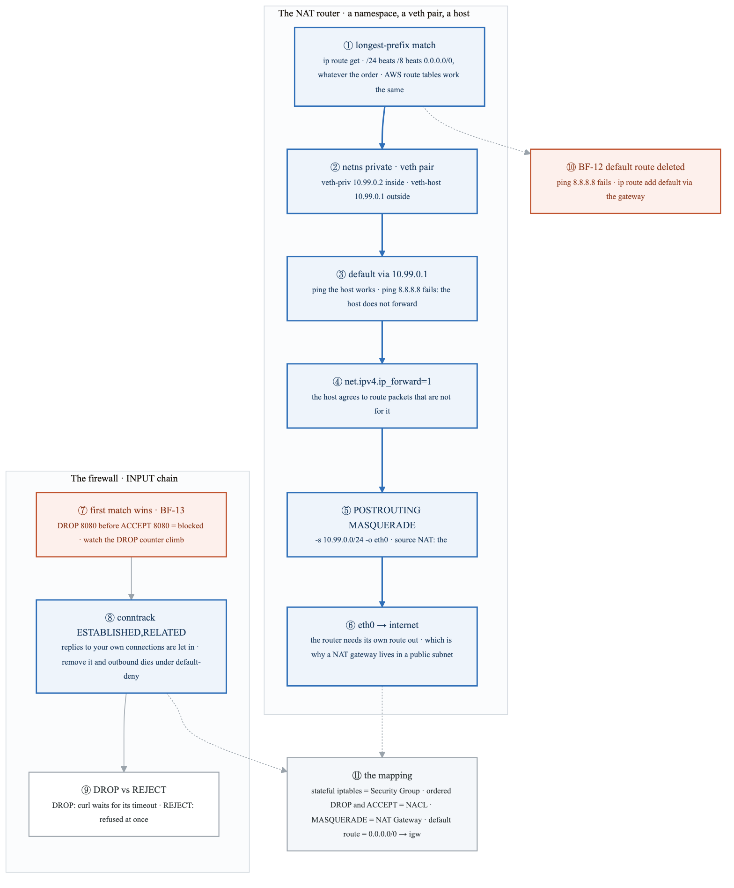
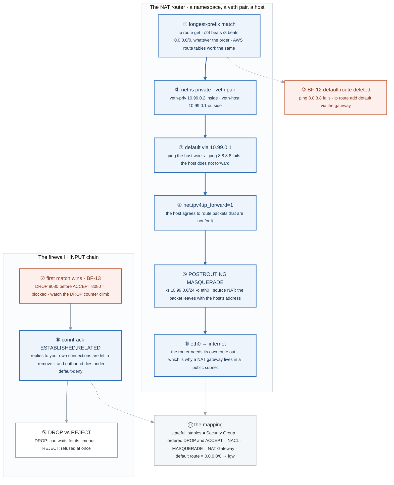
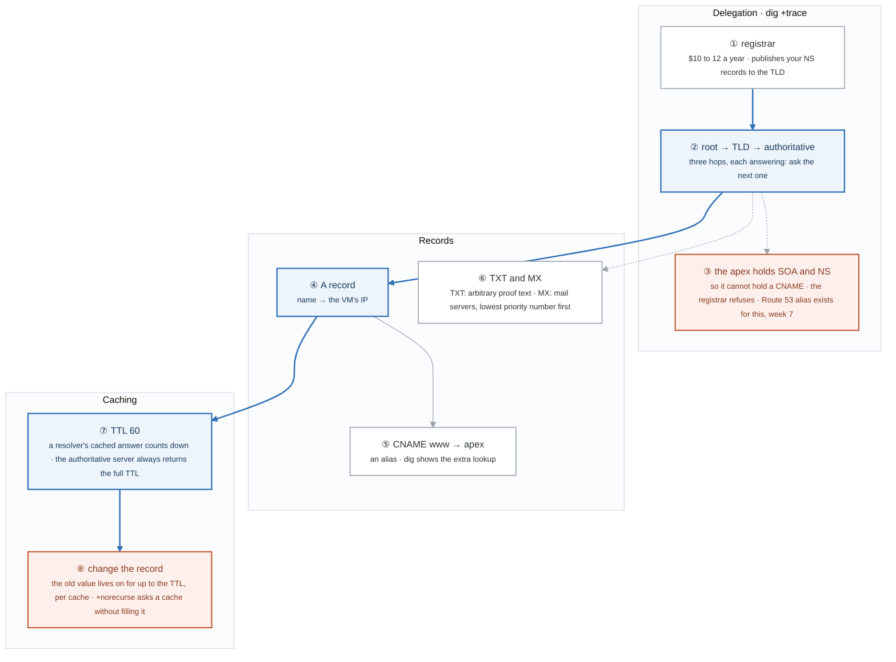
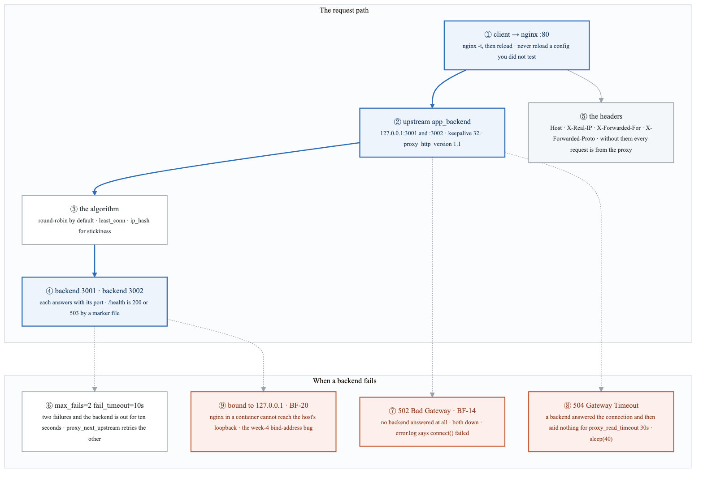
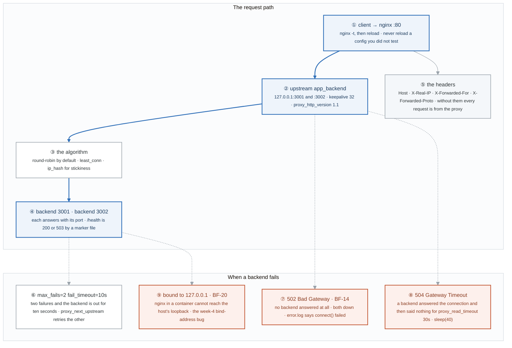
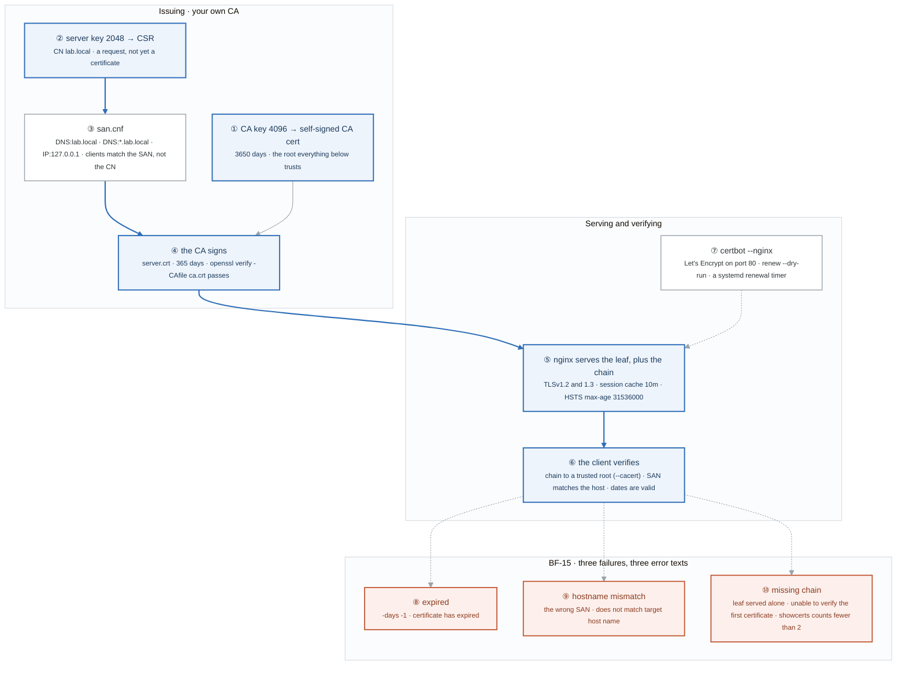
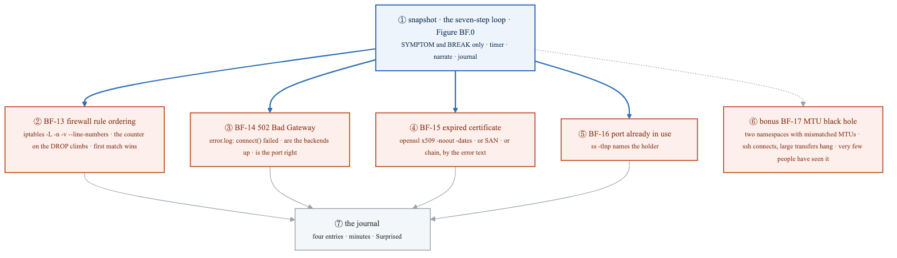
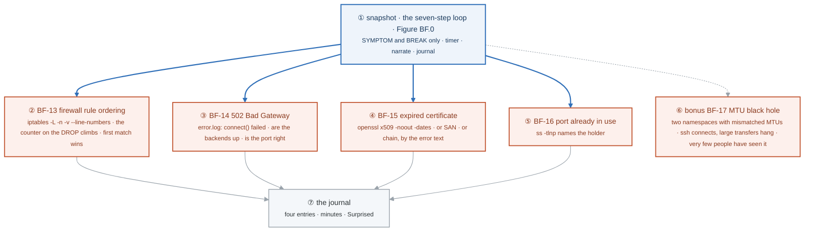
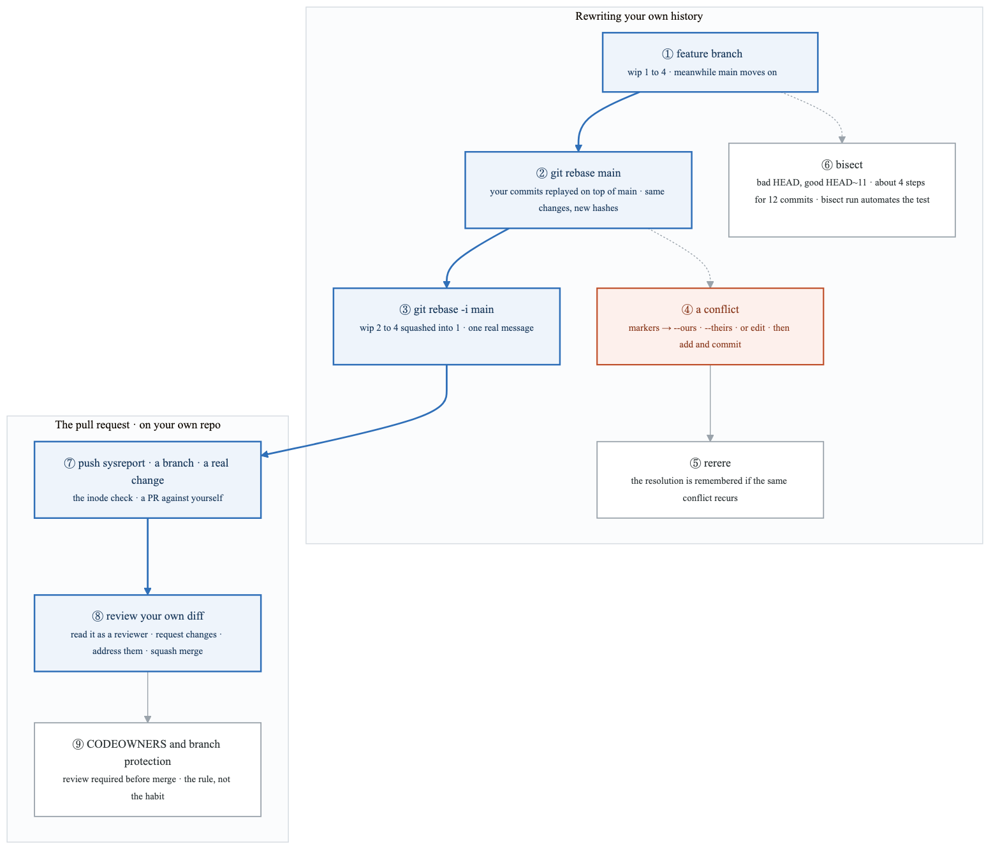
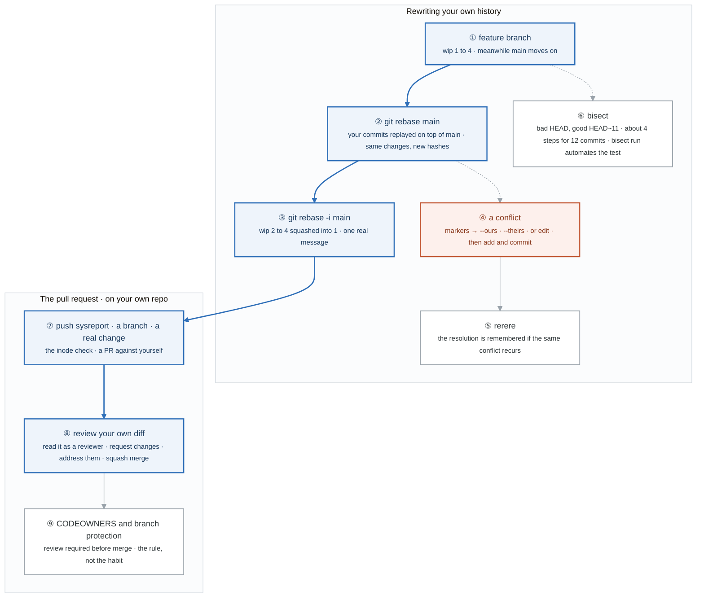

# Week 3 — Lab figures

> One figure per lab, numbered 3.2 to 3.7. Figure 3.1 is the week figure in
> [`../content/FIGURE.md`](../content/FIGURE.md); these six go one level down, to the mechanism each
> lab makes you touch. Same language: gray is structure, **blue is the path to follow first**,
> orange-red is where something refuses, washed boxes are stores. Each badge line is a thirty-second
> interview answer; each whole script is under three minutes.

**The protocol per figure**

1. **Before the lab:** read the figure, say the badges out loud once. You now know what you are about to prove.
2. **During the lab:** every badge has a **Prove it** command. Run it and watch the badge happen. A badge you cannot see happen is one you are taking on faith.
3. **After the lab:** close the file, redraw the figure, say the script. Check against the file. The badge where the order slipped goes in the *Figures redrawn* column of `progress.md`.
4. **Own the numbers.** The *Numbers to own* table is what separates "I know networking" from "a 502 is no backend answering and a 504 is proxy_read_timeout at thirty seconds expiring."
5. **Answer the question.** Each figure ends with the question a senior interviewer asks about it. Answer it cold, in under a minute, before the gate.

---

## Figure 3.2 — Lab 1: a packet out of a private namespace, through NAT, past the firewall

> Lab 1 · badges ① to ⑪ · about three and a half minutes.

<!-- figure: generated from the Mermaid below by _shared/diagrams/embed-figures.py — do not edit the image -->


<details>
<summary>Diagram source (Mermaid)</summary>



</details>

### Say it, badge by badge

- **Open.** "This is the lab that makes week 6 obvious. You build a NAT gateway out of a network namespace and three commands, then you learn why a firewall rule's position matters more than its content. Follow the blue path from a route lookup to the internet."
- **① longest-prefix match.** "With routes for 0.0.0.0/0, 10.0.0.0/8, and 10.0.5.0/24, a packet to 10.0.5.7 takes the /24. The most specific route wins, regardless of the order you added them. `ip route get` tells you which one before you send anything. AWS route tables use the same rule."
- **② a namespace and a veth pair.** "A network namespace is a private network stack. A veth pair is a cable with one end in each namespace: 10.99.0.2 inside, 10.99.0.1 on the host. The namespace is a private subnet; the host is about to become its router."
- **③ default via the host.** "The namespace can ping 10.99.0.1 and nothing beyond it. The host receives the packet for 8.8.8.8 and drops it, because by default a Linux box does not forward."
- **④ ip_forward.** "One sysctl. Now the host passes packets between interfaces. Without this a router is just a machine with two addresses."
- **⑤ MASQUERADE.** "A POSTROUTING rule in the nat table rewrites the source of packets from 10.99.0.0/24 leaving on eth0 to the host's own address. The internet answers the host; conntrack maps the reply back to the namespace. That is source NAT, and that is a NAT gateway."
- **⑥ out through eth0.** "The router itself must have a route to the internet. A NAT gateway in a subnet with no route out NATs packets into nothing. That is BF-27 in week 6, and you already understand it."
- **⑦ first match wins.** "A DROP for port 8080 followed by an ACCEPT for 8080: blocked, because the chain stops at the first match. `--line-numbers` and the packet counters show exactly which rule ate it. BF-13."
- **⑧ conntrack.** "One rule: accept packets belonging to connections this host started. Under a default-deny INPUT policy this is what lets replies to your own curl back in. Remove it and every outbound connection hangs. That rule is what 'stateful' means."
- **⑨ DROP versus REJECT.** "DROP discards silently and the client waits out its timeout. REJECT sends a refusal and the client fails instantly. Same block, very different symptom on the other end."
- **⑩ BF-12.** "Delete the default route and the internet vanishes while the local network still works. `ip route show default` is empty; `ip route add default via` the gateway restores it."
- **⑪ the mapping.** "Write it down tonight. iptables with conntrack is a Security Group. Ordered DROP and ACCEPT without state is a NACL. MASQUERADE is a NAT Gateway. A default route to the router is 0.0.0.0/0 pointed at an internet gateway."
- **Close.** "Route, namespace, forward, masquerade, out. Order, state, drop or reject. Every AWS networking construct in weeks 6 and 7 is one of these with a console in front of it."

### Numbers to own

| Number | Where it comes from | Why it matters |
|---|---|---|
| `10.99.0.0/24` · `.1` host · `.2` namespace | the namespace build | the private subnet and its router |
| `/24` beats `/8` beats `/0` | the routing note | longest-prefix match; order of insertion is irrelevant |
| `ip_forward=1` | the sysctl | the one bit that turns a host into a router |
| `curl -m3` | the BF-13 test | a three-second timeout so a DROP shows as a timeout, not a hang |
| 8080 | the firewall exercise | the port the DROP and ACCEPT rules fight over |
| 4 rows | the Linux-to-AWS table | SG · NACL · NAT Gateway · route table; you will be asked it |

### Prove it

```bash
ip route get 8.8.8.8; ip route get 10.0.0.5                                  # ①
sudo ip netns exec private ping -c1 10.99.0.1; sudo ip netns exec private ping -c1 8.8.8.8   # ③ works, fails
sudo sysctl -w net.ipv4.ip_forward=1                                          # ④
sudo iptables -t nat -A POSTROUTING -s 10.99.0.0/24 -o eth0 -j MASQUERADE && sudo ip netns exec private ping -c1 8.8.8.8   # ⑤ ⑥ works
sudo iptables -L INPUT -n -v --line-numbers                                   # ⑦ counters by rule
sudo iptables -D INPUT -m conntrack --ctstate ESTABLISHED,RELATED -j ACCEPT; curl -m3 https://example.com   # ⑧ hangs under default-deny
sudo ip route del default; ping -c1 8.8.8.8                                   # ⑩
```

### The question a senior interviewer asks

*"Why does a NAT gateway have to sit in a public subnet, and why does removing the conntrack rule break outbound connections on a default-deny host?"*
Badges ⑥ and ⑧. The router forwards and rewrites, but its own packets still need a route to the internet; a private subnet gives it none. And under default-deny the replies to your own connections are inbound packets; the ESTABLISHED,RELATED rule is the only thing that admits them. Say "the router needs a route out" and "replies are inbound" and you have both.

---

## Figure 3.3 — Lab 2: your domain, from the registrar to a cached answer

> Lab 2 · badges ① to ⑧ · about two and a half minutes.

<!-- figure: generated from the Mermaid below by _shared/diagrams/embed-figures.py — do not edit the image -->


<details>
<summary>Diagram source (Mermaid)</summary>



</details>

### Say it, badge by badge

- **Open.** "A domain you own, so every DNS fact becomes something you did rather than something you read. Follow the blue path from the registrar to the moment a cached answer goes stale."
- **① the registrar.** "Ten to twelve dollars a year. Its job in the mechanism is one thing: it tells the TLD which nameservers are authoritative for your name."
- **② root, TLD, authoritative.** "`dig +trace` asks a root server, which says ask the TLD; the TLD says ask these nameservers; those answer. Three hops, and the exit task is to write down every one."
- **③ the apex holds SOA and NS.** "The bare domain must carry its SOA and NS records. A CNAME says 'this name is entirely another name', which cannot coexist with those. The registrar refuses, and you remember forever. Route 53's alias record is the workaround, and now you know why it exists."
- **④ the A record.** "A name to an IP. The simplest record and the one everything else is built on."
- **⑤ CNAME www.** "An alias to the apex. In the dig output you see the resolver chase it: one answer for www, then a second lookup for the target. Every CNAME is an extra round trip."
- **⑥ TXT and MX.** "TXT carries text, usually proof of ownership for some service. MX lists mail servers with a priority number; lowest wins, the rest are fallbacks."
- **⑦ TTL 60.** "The authoritative server returns 60 every time. A resolver that cached the answer returns what is left of its 60, and ten seconds later it is ten lower. That difference is how you tell a cache from the source."
- **⑧ change the record.** "Set it, change it, and time how long the old answer survives. Up to the TTL, per cache, and you cannot flush other people's caches. Lower the TTL before a migration, not during."
- **Close.** "Registrar, three hops, records at the apex that forbid a CNAME, and a TTL that decides how long a mistake lives. Week 7 puts a load balancer behind the alias record you now understand."

### Numbers to own

| Number | Where it comes from | Why it matters |
|---|---|---|
| $10 to 12 a year | the lab | the cost of owning the mechanism instead of reading about it |
| 3 hops | `dig +trace` | root → TLD → authoritative |
| TTL 60 | the caching task | low enough to watch; the number you lower before a cutover |
| `sleep 10` | the caching task | the second query returns a TTL ten lower; a cache, not the source |
| 2 records at the apex | SOA and NS | the reason an apex CNAME is refused |
| lowest MX wins | the MX task | priority is a preference order, not a weight |

### Prove it

```bash
dig yourdomain.com NS +short; dig yourdomain.com SOA                    # ① ③
dig yourdomain.com +trace                                                # ②
dig www.yourdomain.com                                                   # ⑤ the CNAME, then the A
dig yourdomain.com; sleep 10; dig yourdomain.com                         # ⑦ TTL drops
dig @ns1.registrar.com yourdomain.com                                    # ⑦ authoritative: full TTL
dig @1.1.1.1 yourdomain.com +norecurse                                   # ⑧ in that cache or not
```

### The question a senior interviewer asks

*"Why can't the apex be a CNAME, and how does Route 53 get around it?"*
Badge ③. The apex must hold SOA and NS; a CNAME replaces every record at a name, so the two cannot coexist. Route 53's alias answers the query with the target's A records itself, so the apex looks like an A record to the world. Add badge ⑧ unprompted: before any such change, drop the TTL first.

---

## Figure 3.4 — Lab 3: nginx in front of two backends, and what 502 and 504 each mean

> Lab 3 · badges ① to ⑨ · about three minutes.

<!-- figure: generated from the Mermaid below by _shared/diagrams/embed-figures.py — do not edit the image -->


<details>
<summary>Diagram source (Mermaid)</summary>



</details>

### Say it, badge by badge

- **Open.** "A reverse proxy is a process that accepts a connection and opens another one on your behalf. Everything interesting is in what it does when the second connection misbehaves. Follow the blue path, then look at the three orange boxes."
- **① client to nginx.** "Port 80, a server block, and `nginx -t` before every reload. A config that fails to parse does not get applied, and reload keeps the old one running while it checks."
- **② the upstream.** "A named pool of two backends on loopback, with a keepalive pool of thirty-two connections so nginx does not open a fresh TCP connection per request. HTTP/1.1 to the backend is what makes keepalive possible."
- **③ the algorithm.** "Round-robin unless told otherwise. `least_conn` for backends with uneven request costs; `ip_hash` when a client must land on the same backend. The lab asks you to say when each is right."
- **④ the two backends.** "Each returns its own port, so ten curls show the alternation. Each has a `/health` that flips to 503 when a marker file is removed, which is how you fail one without killing it."
- **⑤ the headers.** "Without X-Forwarded-For, every request in the backend's log comes from the proxy's IP. Rate limiting, geo logic, audit trails, and abuse investigations all die. The ALB sets the same header in week 7, and the ALB-versus-NLB question is about exactly this."
- **⑥ ejection.** "Two failures within ten seconds and the backend is marked down for ten seconds. `proxy_next_upstream` sends the failed request to the other backend on error, timeout, 502, or 503. Kill 3001 and measure how long traffic takes to shift; that number is the lab."
- **⑦ 502.** "Nothing answered. Both backends down, or the port wrong. The error log says connect() failed, and that line is the diagnosis. BF-14."
- **⑧ 504.** "A backend accepted the connection and then went quiet. After `proxy_read_timeout`, thirty seconds here, nginx gives up. A `sleep(40)` in the backend produces it on demand. 502 is no answer; 504 is a slow answer."
- **⑨ bound to loopback.** "Bind a backend to 127.0.0.1 and run nginx in a container: the container's loopback is not the host's, and the proxy gets connection refused. This is BF-20 from week 4 arriving early, and it is the most common 'works on my machine' of all."
- **Close.** "Pool, algorithm, headers, ejection. Then 502 for silence, 504 for slowness, and refused for the wrong address. Three symptoms, three different layers."

### Numbers to own

| Number | Where it comes from | Why it matters |
|---|---|---|
| 3001 · 3002 | the two backends | distinguishable answers, so you can see the balancing |
| `max_fails=2` · `fail_timeout=10s` | the upstream block | how fast a dead backend is ejected and for how long |
| `keepalive 32` | the upstream block | pooled connections to the backend; needs HTTP/1.1 and an empty Connection header |
| 5s · 30s · 30s | connect, send, read timeouts | the read timeout is the one that becomes a 504 |
| `sleep(40)` | the 504 task | longer than the read timeout, on purpose |
| seconds to shift | the kill-3001 task | measured, not assumed: the time between the kill and the first clean request |

### Prove it

```bash
sudo nginx -t && sudo systemctl reload nginx                                   # ①
for i in $(seq 1 10); do curl -s localhost | jq -r .backend; done              # ③ ④ alternation
kill %1; date +%s; until curl -sf localhost >/dev/null; do :; done; date +%s   # ⑥ seconds to shift
kill %2; curl -si localhost | head -1; sudo tail -3 /var/log/nginx/lab-error.log   # ⑦ 502, connect() failed
curl -si localhost | head -1                                                   # ⑧ 504 after 30s with sleep(40) in a backend
sudo tail -3 /var/log/nginx/lab-access.log                                     # ⑤ the forwarded headers logged
```

### The question a senior interviewer asks

*"Your proxy returns 502 for some requests and 504 for others. What is the difference, and how long did failover to the healthy backend take?"*
Badges ⑦ ⑧ ⑥. 502 is no backend answering, a connect failure in the error log; 504 is a backend that answered the connection and exceeded the read timeout. Failover is max_fails within fail_timeout plus the retry on the next request, and you have a measured number from the lab. Give the number.

---

## Figure 3.5 — Lab 4: the chain of trust, and the three ways it fails

> Lab 4 · badges ① to ⑩ · about three minutes.

<!-- figure: generated from the Mermaid below by _shared/diagrams/embed-figures.py — do not edit the image -->


<details>
<summary>Diagram source (Mermaid)</summary>



</details>

### Say it, badge by badge

- **Open.** "TLS is a chain of signatures that ends at something the client already trusts. Build the chain yourself once and the three ways it breaks become three error messages you recognise on sight. Follow the blue path from a key to a verified connection."
- **① your own CA.** "A 4096-bit key and a self-signed certificate good for ten years. It is a root because nothing signs it; clients trust it only because you tell them to with `--cacert`."
- **② the server key and CSR.** "A 2048-bit key and a signing request carrying the name. The request is not a certificate; it is a question to the CA."
- **③ the SAN file.** "Subject Alternative Names: the DNS names and the IP the certificate is valid for. Modern clients ignore the CN and match the SAN. Leave a name out and the certificate is wrong for that host no matter what the CN says."
- **④ the CA signs.** "The CA's key signs the request with the SAN extension attached, for 365 days. `openssl verify -CAfile ca.crt` proves the chain closes."
- **⑤ nginx serves it.** "The leaf and, for a real CA, the intermediate too, in one file. TLS 1.2 and 1.3 only, a session cache so repeat handshakes are cheap, and HSTS so browsers refuse to downgrade for a year."
- **⑥ the client verifies.** "Three checks. Does the chain end at a root I trust. Does a SAN match the name I asked for. Is today inside the validity window. Any one fails and the connection is refused before a byte of HTTP."
- **⑦ certbot.** "Let's Encrypt proves you control the name over port 80, issues a ninety-day certificate, and installs a renewal timer. `renew --dry-run` tests the renewal before you depend on it."
- **⑧ expired.** "Issue one with `-days -1`. The error says expired, in those words. Check three: dates."
- **⑨ hostname mismatch.** "Issue one with the wrong SAN. The error says the certificate does not match the target host name. Check two: SAN."
- **⑩ missing chain.** "Serve the leaf without the intermediate to a client that does not have it. 'Unable to verify the first certificate.' `-showcerts` counts fewer than two. Browsers sometimes fetch the missing intermediate themselves, which is why it works in Chrome and fails in curl. Check one: chain."
- **Close.** "Key, request, names, signature, served, verified. Three checks, three failures, three error texts. Being able to name which one from the message alone is the interview answer."

### Numbers to own

| Number | Where it comes from | Why it matters |
|---|---|---|
| 4096 · 3650 days | the CA key and cert | a root is long-lived and large; it signs rarely |
| 2048 · 365 days | the server key and cert | a leaf is replaced often; shorter is safer |
| `-days -1` | the expiry task | an already-expired certificate, on demand |
| ≥ 2 `BEGIN CERT` | the showcerts check | leaf plus intermediate; fewer means the chain is missing |
| `max-age=31536000` | the HSTS header | one year of refusing plain HTTP |
| TLS 1.2 and 1.3 | the modern config | nothing older is served |
| `10m` · `1d` | the session cache and timeout | resumed handshakes without a full exchange |

### Prove it

```bash
openssl x509 -in server.crt -noout -text | grep -A1 'Subject Alternative Name'   # ③
openssl verify -CAfile ca.crt server.crt                                          # ④
curl https://lab.local/; curl --cacert ca.crt https://lab.local/                 # ⑥ refused, then trusted
openssl x509 -req -in server.csr -CA ca.crt -CAkey ca.key -days -1 -out expired.crt -extfile san.cnf   # ⑧
echo | openssl s_client -connect yourdomain.com:443 -showcerts 2>/dev/null | grep -c 'BEGIN CERT'       # ⑩ should be 2 or more
sudo certbot renew --dry-run; systemctl list-timers | grep certbot                                     # ⑦
```

### The question a senior interviewer asks

*"Here are three TLS error messages. Which is expired, which is a name mismatch, which is a missing chain, and why does the browser sometimes pass the third while curl fails?"*
Badges ⑧ ⑨ ⑩. Expired says expired; mismatch names the host; the chain one says it cannot verify the first certificate. Browsers may fetch the missing intermediate via the certificate's AIA extension, which is a well-known browser behaviour; curl does not, so curl is the honest test.

---

## Figure 3.6 — Lab 5: Break/Fix Friday #3, four breaks and the loop they share

> Lab 5 · badges ① to ⑦ · about two minutes. The loop is Figure BF.0 in
> [`../../_shared/breakfix/FIGURE.md`](../../_shared/breakfix/FIGURE.md); this figure is today's scenarios hanging off it.

<!-- figure: generated from the Mermaid below by _shared/diagrams/embed-figures.py — do not edit the image -->


<details>
<summary>Diagram source (Mermaid)</summary>



</details>

### Say it, badge by badge

- **Open.** "Four breaks from this week's firewall, proxy, and TLS labs, and a bonus almost nobody has seen. Same loop, and by now the loop should be faster than the breaks."
- **① the loop.** "Snapshot, symptom and break only, timer, narrate, journal. Figure BF.0."
- **② BF-13.** "A rule that looks right does nothing because an earlier rule matched first. `--line-numbers` with `-v` shows the counters; the rule whose counter climbs is the one eating the packets."
- **③ BF-14.** "502. The error log says connect() failed to the upstream. Are the backends running, and is the upstream pointing at the right port. Lab 3's figure, badge ⑦."
- **④ BF-15.** "The certificate. `openssl x509 -dates` for expiry; the error text tells you whether it is instead the SAN or the chain. Lab 4's three orange boxes."
- **⑤ BF-16.** "A service will not start because its port is taken. `ss -tlnp` names the process. One command."
- **⑥ BF-17.** "Two namespaces, two different MTUs. Small packets pass, large ones are dropped silently, so ssh logs in and a transfer hangs. The diagnosis is ping with the do-not-fragment bit at increasing sizes. Reproducing this once is worth more than reading about it ten times."
- **⑦ the journal.** "Four entries with minutes and a Surprised line. BF-17 earns a long one."
- **Close.** "Counters, error log, certificate dates, ss. And an MTU story you can tell in an interview because you built it."

### Numbers to own

| Number | Where it comes from | Why it matters |
|---|---|---|
| 4 + 1 bonus | the lab | BF-13, 14, 15, 16, and BF-17 |
| `--line-numbers` | BF-13 | the rule index you delete by |
| ≥ 2 certificates | the chain check from Lab 4 | fewer than two served means the chain case |
| 1 command | BF-16 | `ss -tlnp` |

### Prove it

```bash
sudo iptables -L INPUT -n -v --line-numbers                                          # ②
sudo tail -5 /var/log/nginx/lab-error.log                                            # ③
echo | openssl s_client -connect lab.local:443 2>/dev/null | openssl x509 -noout -dates   # ④
ss -tlnp | grep ':8080'                                                              # ⑤
sudo ip netns exec a ping -M do -s 1400 -c1 10.99.1.2                                # ⑥ does a large packet pass
```

### The question a senior interviewer asks

*"SSH works but any large transfer over the link hangs. What is it?"*
Badge ⑥. An MTU mismatch with path MTU discovery blocked: small packets fit, large ones are dropped without an ICMP message back. Ping with `-M do` and a rising size finds the ceiling; the fix is a matching MTU or MSS clamping. Saying "MTU black hole" by name is the whole answer.

---

## Figure 3.7 — Lab 6: rebase, conflicts, bisect, and a pull request against yourself

> Lab 6 · badges ① to ⑨ · about three minutes.

<!-- figure: generated from the Mermaid below by _shared/diagrams/embed-figures.py — do not edit the image -->


<details>
<summary>Diagram source (Mermaid)</summary>



</details>

### Say it, badge by badge

- **Open.** "Week 1 was what a commit is. This is how a team shares them without stepping on each other: rebase your own work, squash it, resolve what collides, and put it through a review even when the reviewer is you."
- **① the feature branch.** "Four wip commits on a branch while main gets a commit of its own. Two lines of history that must become one."
- **② rebase onto main.** "Your commits are replayed one by one on top of main's tip. Same diffs, new parents, so new hashes. History reads as if you started after main's change. Only on branches nobody else has pulled."
- **③ interactive rebase.** "Squash wip 2 through 4 into wip 1 and write the message you should have written. The pull request gets one commit that explains itself."
- **④ a conflict.** "Same lines changed on both sides. Git writes both versions between markers and stops. Take ours, take theirs, or edit by hand, then add and commit to continue. Doing it on purpose here means the first real one is not a surprise."
- **⑤ rerere.** "Reuse recorded resolution. Enable it once and git replays your fix if the same conflict shows up again during a long rebase."
- **⑥ bisect.** "Twelve commits, one broken at v7. Mark bad and good, test the midpoint, repeat: about four steps instead of eleven. `bisect run` with a test command does the whole thing unattended."
- **⑦ push and a real change.** "sysreport from week 1 goes to GitHub, you branch, you add the inode check, and you open a pull request against your own repository."
- **⑧ review your own diff.** "Read it as a stranger would. Request changes on yourself, address them, squash merge. The point is that the first pull request you open at a job is not the first one you have ever opened."
- **⑨ CODEOWNERS and protection.** "A file naming who must review, and a rule that main cannot take a merge without that review. The habit from badge ⑧, enforced by the repository instead of by memory."
- **Close.** "Rebase, squash, resolve, bisect, review, protect. Collaboration is a set of mechanical habits, and every one of them is rehearsed here alone so it is automatic with other people."

### Numbers to own

| Number | Where it comes from | Why it matters |
|---|---|---|
| 4 wip commits → 1 | the squash | what every pull request should look like |
| 12 commits, broken at v7 | the bisect setup | the known answer you check your bisect against |
| ~4 steps, not 11 | the bisect note | log base two of twelve; the reason to bisect instead of reading |
| 1 pull request against yourself | Part 4 | the rehearsal |
| 1 required review | branch protection | the rule that makes the habit real |

### Prove it

```bash
git switch feature && git rebase main && git log --oneline --graph --all        # ②
git rebase -i main                                                               # ③
git merge other; cat conflict.txt; git checkout --theirs conflict.txt            # ④
git config --global rerere.enabled true                                          # ⑤
git bisect start HEAD HEAD~11 && git bisect run bash -c '! grep -q BROKEN version.txt'; git bisect reset   # ⑥
gh pr create --fill && gh pr view --web                                          # ⑦
```

### The question a senior interviewer asks

*"Why does rebase change commit hashes, and when would you merge instead of rebase on a shared branch?"*
Badge ②: a commit's hash covers its parent, so a new parent is a new commit. Rebase rewrites, which is fine for your own unpushed branch and wrong for one others have based work on; there you merge, because merge adds history instead of replacing it. Add badge ③: rebase interactively before the pull request, never after it is shared.

---

## Redraw schedule

Same cadence as the week figure, see [`../../FIGURES.md`](../../FIGURES.md): Friday of this week after break/fix, cold at the Gate 1 Sunday in week 4, and again on the Sunday of week 5. Lab figures are redrawn **after** the week figure, one at a time, and only the badge order has to be right; the captions are the check, not the test.
