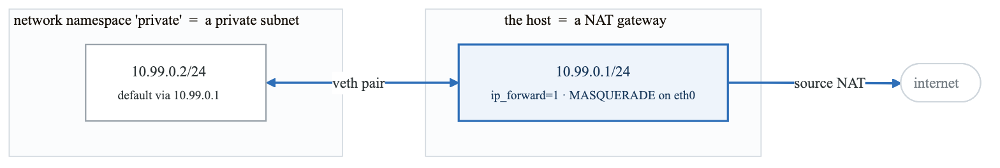
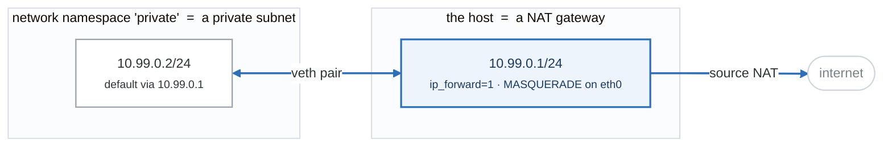

# Week 3 Solutions

---

## Lab 1 — Routing, NAT, firewalls

### Longest-prefix match

```bash
ip route show
# default via 10.0.0.1 dev eth0
# 10.0.0.0/24 dev eth0 proto kernel scope link src 10.0.0.5
# 10.0.5.0/24 via 10.0.0.9 dev eth0

ip route get 10.0.5.7      # -> via 10.0.0.9   (the /24 wins over default)
ip route get 10.0.0.7      # -> dev eth0       (directly connected)
ip route get 1.1.1.1       # -> via 10.0.0.1   (default)
```

**The most specific prefix always wins, regardless of the order rules appear in.** This is exactly
how an AWS route table works, and it's why you can add a more-specific route to steer particular
traffic through a firewall appliance without touching the default route.

### The NAT namespace lab — what you actually built

<!-- figure: generated from the Mermaid below by _shared/diagrams/embed-figures.py — do not edit the image -->


<details>
<summary>Diagram source (Mermaid)</summary>



</details>

Three things had to be true```

Three things had to be true, and each maps to an AWS concept:

| Requirement | AWS equivalent |
|---|---|
| Default route pointing at the router | Private subnet route table: `0.0.0.0/0 → nat-gw` |
| `net.ipv4.ip_forward=1` on the router | The NAT gateway being a NAT gateway |
| `MASQUERADE` — rewrite source to the router's IP | NAT gateway's SNAT |
| **The router itself had a route to the internet** | **The NAT gateway must live in a PUBLIC subnet** |

That last row is BF-27, the single most common VPC mistake. You just proved why it's true rather
than memorizing it.

### Firewall rule order (BF-13)

```bash
sudo iptables -L INPUT -n -v --line-numbers
# num  pkts bytes target  prot opt in  out  source     destination
# 1      14   840 DROP    tcp  --  *   *    0.0.0.0/0  0.0.0.0/0   tcp dpt:8080
# 2       0     0 ACCEPT  tcp  --  *   *    0.0.0.0/0  0.0.0.0/0   tcp dpt:8080
```
**The packet counters tell you everything.** Rule 1 is incrementing, rule 2 is at zero — it is never
reached. First match wins, top to bottom.

### The conntrack rule

```bash
sudo iptables -P INPUT DROP                 # default deny
sudo iptables -A INPUT -i lo -j ACCEPT
sudo iptables -A INPUT -m conntrack --ctstate ESTABLISHED,RELATED -j ACCEPT
sudo iptables -A INPUT -p tcp --dport 22 -j ACCEPT
```
Remove the conntrack line and **every outbound connection breaks** — you send the request, and the
reply is dropped because there is no rule allowing inbound traffic on the ephemeral port.

**This is precisely the difference between a Security Group and a NACL.** A security group has that
conntrack behavior built in and you cannot turn it off. A NACL does not, which is why NACLs require
an explicit inbound allow on ports 1024–65535 for return traffic. Having broken it yourself makes
that a one-sentence answer instead of memorized trivia.

### DROP vs REJECT

```bash
sudo iptables -A INPUT -p tcp --dport 9999 -j DROP
time curl -m5 localhost:9999      # hangs for the full timeout

sudo iptables -R INPUT 1 -p tcp --dport 9999 -j REJECT
time curl -m5 localhost:9999      # "Connection refused" immediately
```
**DROP** = silence, the client waits for its timeout. **REJECT** = an ICMP or RST reply, immediate
failure. DROP is preferred on internet-facing rules because it slows down scanners and gives no
information; REJECT is better internally because it fails fast and makes debugging sane.

Connect to BF-18: a timeout means DROP or a black hole; a RST means something actively said no.

---

## Lab 2 — DNS

### Why a CNAME can't exist at the apex

RFC 1034: a CNAME record cannot coexist with any other record type for the same name. The zone apex
**must** have `SOA` and `NS` records. Therefore the apex cannot be a CNAME.

That's why:
- Route 53 invented **alias** records — a Route 53-specific type that points at an AWS resource,
  works at the apex, resolves directly to the IP with no second lookup, and costs nothing to query
- Other providers offer `ALIAS` / `ANAME` / "CNAME flattening" — all the same workaround

**It's a great interview question** because you only know it if you've configured DNS for real.

### TTL and propagation

"DNS propagation" is a misnomer — nothing propagates. Resolvers cache for the TTL and then ask
again. So:

**To change a record with minimal disruption:** lower the TTL to 60 seconds, wait for the *old* TTL
to fully expire everywhere, then make the change, then raise the TTL back. Doing this correctly is
how zero-downtime DNS migrations work, and forgetting the "wait for the old TTL first" step is the
classic mistake.

---

## Lab 3 — Nginx

### 502 vs 504 — the distinction that matters

| | Cause | Nginx error log says |
|---|---|---|
| **502 Bad Gateway** | Upstream refused, died, or returned garbage | `connect() failed (111: Connection refused)` |
| **504 Gateway Timeout** | Upstream accepted but didn't answer in time | `upstream timed out (110: Connection timed out)` |

Different fixes entirely: 502 → start the backend / fix the port / fix the bind address.
504 → make the app faster, or raise `proxy_read_timeout` if the work legitimately takes that long.

**On an ALB the same triple exists:** 502 = malformed response or the target closed the connection;
503 = **no healthy targets at all**; 504 = target didn't respond within the idle timeout. Being able
to state that mapping is a strong AWS answer (BF-28).

### Failover timing

```bash
kill %1                               # stop backend 3001
for i in $(seq 1 20); do curl -s localhost | jq -r .backend; done
```
With `max_fails=2 fail_timeout=10s`, nginx marks the backend down after 2 failures and stops sending
to it for 10 seconds, then probes again. `proxy_next_upstream` makes the *current* request retry the
other backend rather than returning an error to the client — so users see a slower request, not a
failure.

**This is the same state machine as an ALB target group's `HealthyThreshold`,
`UnhealthyThreshold`, and `Interval`.** Same problem, same shape.

### Load-balancing algorithms

| Algorithm | Use when |
|---|---|
| round-robin (default) | Requests cost roughly the same |
| `least_conn` | Request duration varies a lot — long requests don't pile up on one backend |
| `ip_hash` | You need session stickiness and have no shared session store |
| `hash $request_uri consistent` | Cache locality — send the same URL to the same backend |

**`ip_hash` is a smell, not a solution.** It breaks when clients are behind a shared NAT, it makes
scaling and draining painful, and it means your app has local state. The right answer is a shared
session store (Redis) and stateless backends. Saying this out loud is a good signal.

---

## Lab 4 — TLS

### The three failure modes, and how you tell them apart

```bash
# 1. EXPIRED
curl https://expired.badssl.com/
# curl: (60) SSL certificate problem: certificate has expired
openssl s_client -connect host:443 2>/dev/null | openssl x509 -noout -dates

# 2. HOSTNAME MISMATCH
curl https://wrong.host.badssl.com/
# curl: (60) SSL: no alternative certificate subject name matches target host name
openssl s_client -connect host:443 2>/dev/null | openssl x509 -noout -ext subjectAltName

# 3. MISSING INTERMEDIATE (incomplete chain)
curl https://incomplete-chain.badssl.com/
# curl: (60) SSL certificate problem: unable to get local issuer certificate
echo | openssl s_client -connect host:443 -showcerts 2>/dev/null | grep -c 'BEGIN CERT'
# returns 1 -> only the leaf is served. Should be >= 2.
```

**The incomplete-chain case is the interesting one to be able to explain:** it often *works in
Chrome* — browsers cache intermediates from previous sites and some will fetch the missing one via
the AIA extension — while failing in `curl`, in your CI, and on mobile. So the bug report is "the
site works for me but the API client can't connect," and the cause is a chain that was never
complete.

badssl.com is genuinely useful here — it hosts a live example of every TLS failure mode.

### Renewal

```bash
systemctl list-timers | grep certbot
sudo certbot renew --dry-run
```
Certbot installs a systemd timer that runs twice daily and renews anything within 30 days of expiry.

**Add an independent expiry alarm anyway.** Auto-renewal fails silently more often than people
expect — a changed webroot, a firewall rule, a rate limit. A cert expiry is a completely
self-inflicted outage and it still happens to large companies every year.

```bash
# Simple external check
days=$(( ($(date -d "$(echo | openssl s_client -connect yourdomain.com:443 2>/dev/null \
  | openssl x509 -noout -enddate | cut -d= -f2)" +%s) - $(date +%s)) / 86400 ))
echo "$days days until expiry"
[[ $days -lt 30 ]] && echo "ALERT"
```

---

## Lab 6 — Git

### Interactive rebase: squashing

```
pick a1b2c3d wip 1
squash e4f5g6h wip 2
squash i7j8k9l wip 3
squash m0n1o2p wip 4
```
`squash` (`s`) keeps the commit and lets you merge its message. `fixup` (`f`) discards the message —
use it for "fix typo" commits. Then write one real message.

### Conflict markers

```
<<<<<<< HEAD
MAIN VERSION
=======
OTHER VERSION
>>>>>>> other
```
Top is **your current branch** (HEAD), bottom is the **incoming** branch.

**During a rebase these are inverted** — because rebase replays *your* commits onto *their* base,
"ours" is the branch you're rebasing onto. This reliably confuses people. When in doubt use
`git checkout --conflict=diff3 <file>` to see the common ancestor too, which makes the intent of
each side obvious.

### bisect is binary search

12 commits → ~4 tests (log₂12 ≈ 3.6). 1,000 commits → 10 tests. That's the whole value.

```bash
git bisect start HEAD HEAD~11
git bisect run ./test.sh        # exit 0 = good, non-zero = bad
```
`git bisect run` fully automates it — you hand it a test script and it names the culprit with no
further input. **Being able to say "I'd write a one-line test and `git bisect run` it" is a strong
answer** to "how would you find which change broke this?"

### The branch protection settings worth knowing

- Require a pull request before merging
- Require status checks to pass (name them explicitly)
- Require branches to be up to date before merging
- Require conversation resolution
- Do **not** allow force pushes or deletions on `main`
- Include administrators — otherwise it's advisory

These map directly onto week 12's CI gates and week 23's platform guardrails.
