# Week 4 — Python for Ops, Docker, and Gate 1

> **Thesis:** a container is not a small VM. It is a Linux process with restricted visibility —
> namespaces for what it can see, cgroups for what it can use. Understand that this week and
> Kubernetes in week 14 is a scheduling problem, not a magic problem.

| | |
|---|---|
| **Hours** | 35–45 |
| **Deliverable** | Public Compose stack: app + Postgres + Nginx, with README, diagram, RUNBOOK |
| **Break/Fix** | BF-19 – BF-24 |
| **★ GATE 1** | From a fresh VM, docs only: deploy the stack behind Nginx with TLS, managed by systemd, correct firewall rules — then explain the packet path browser → Python process. Plus CIDR math, no calculator. |

## The week in one figure

**Figure 4.1 — What a container actually is, and the stack Gate 1 asks you to deploy.** Top row: an image is built and becomes a process the kernel isolates. Bottom row: three of those processes behind the week-3 Nginx, managed by systemd. The gate is the whole picture, from a fresh VM, with docs only. Badges are numbered in the order to walk them; the blue path is the one to follow first.

```mermaid
%%{init: {'theme':'base','themeVariables':{'fontFamily':'Helvetica, Arial, sans-serif','fontSize':'13px','primaryColor':'#ffffff','primaryTextColor':'#2d3436','primaryBorderColor':'#9aa3ab','lineColor':'#9aa3ab','textColor':'#2d3436','clusterBkg':'#fbfcfd','clusterBorder':'#d4dae0','edgeLabelBackground':'#ffffff','tertiaryColor':'#eef4fb'},'flowchart':{'curve':'basis','padding':14,'nodeSpacing':42,'rankSpacing':58}}}%%
flowchart LR
  classDef default fill:#ffffff,stroke:#9aa3ab,stroke-width:1.3px,color:#2d3436
  classDef n    fill:#ffffff,stroke:#9aa3ab,stroke-width:1.3px,color:#2d3436
  classDef crit fill:#eef4fb,stroke:#2f6fb8,stroke-width:1.8px,color:#1b3a5c
  classDef data fill:#f4f7fa,stroke:#9aa3ab,stroke-width:1.3px,color:#2d3436
  classDef mut  fill:#ffffff,stroke:#cfd6dc,stroke-width:1.1px,color:#7a8288
  classDef warn fill:#fdf0ec,stroke:#c0522d,stroke-width:1.6px,color:#8a3a1e

  subgraph BUILD["Build · Dockerfile"]
    direction LR
    B1["① build stage<br/><small>compiler, dev deps · discarded</small>"]:::n
    B2["② runtime stage<br/><small>slim base · non-root · measured size</small>"]:::crit
    B3["③ image layers<br/><small>content-addressed · cached · pulled once</small>"]:::data
  end
  subgraph RUN["Run · the kernel"]
    direction LR
    R1["④ the process<br/><small>PID 1 in its own view</small>"]:::crit
    R2["⑤ namespaces<br/><small>pid · net · mnt · uts · ipc · user · what it can SEE</small>"]:::crit
    R3["⑥ cgroups<br/><small>cpu · memory · what it can USE · OOM = exit 137</small>"]:::warn
  end
  subgraph STACK["Compose · the Gate 1 stack"]
    direction LR
    C1["⑦ Python app<br/><small>argparse · logging · pytest · JSON out</small>"]:::crit
    C2["⑧ Postgres<br/><small>named volume · healthcheck</small>"]:::data
    C3["⑨ Nginx<br/><small>TLS from week 3 · the only public port</small>"]:::crit
    C4["⑩ systemd + firewall<br/><small>compose up on boot · 80/443 only</small>"]:::n
  end
  EX["⑪ exit codes<br/><small>0 · 1 · 137 killed · 139 segfault · 143 SIGTERM</small>"]:::warn
  B2 ==> B3 ==> R1 ==> R2
  R1 --> R3
  B1 --> B2
  R2 --> C1
  C3 ==> C1 --> C2
  C4 -.-> C3
  R3 -.-> EX
  linkStyle 0,1,2,6 stroke:#2f6fb8,stroke-width:2px
```

**What to say, badge by badge** · about three and a half minutes at a normal pace. Point at each badge as you say its line.

- **Open.** “A container is not a small VM. It is a Linux process with restricted visibility and a budget. This figure shows the build, the isolation, and the three-container stack Gate 1 asks you to deploy from nothing.”
- **① build stage.** “The first stage has the compiler and every dev dependency. Nothing from it ships except the artifact you copy out. This is why multi-stage builds shrink images by hundreds of megabytes.”
- **② runtime stage.** “A slim base, a non-root user, only the artifact. Measure before and after and put the two numbers in the README. Size is attack surface, and a number is proof.”
- **③ image layers.** “Each instruction is a layer, addressed by content hash. Unchanged layers are cached and pulled once. Order the Dockerfile so the things that change most come last.”
- **④ the process.** “`docker run` starts one process. Inside, it is PID 1. From the host, `ps` shows it as an ordinary process with a strange parent. There is no hypervisor anywhere in this picture.”
- **⑤ namespaces.** “Six namespaces decide what the process can see: its own PIDs, its own network stack, its own mounts, hostname, IPC, and user mapping. `nsenter` lets you step into each one and prove it.”
- **⑥ cgroups.** “cgroups decide what it can use. CPU over the limit is throttled; memory over the limit is killed, exit code 137. Week 15 shows the same rule in Kubernetes. Learn it here where it is cheap.”
- **⑦ Python app.** “The week's first two days: a CLI with argparse, type hints, logging to stderr, JSON to stdout, and tests. It also exposes a Prometheus-format metrics endpoint, a preview of week 20.”
- **⑧ Postgres.** “A named volume so data survives the container. A healthcheck so Compose knows when it is actually ready, not just started. Depends-on without a healthcheck is a race.”
- **⑨ Nginx.** “The week-3 proxy, now in a container, still the only thing on a public port. TLS terminates here exactly as before.”
- **⑩ systemd and firewall.** “A unit runs `compose up` on boot and restarts it on failure. The firewall allows 80 and 443 and nothing else. The gate checks both.”
- **⑪ exit codes.** “0 is success, 1 is the app's own failure, 137 is the kernel killing it, 139 is a segfault, 143 is a clean SIGTERM. Reading the code is the first diagnostic step in BF-19.”
- **Close.** “Build small, run isolated, budget enforced, three containers behind one proxy, managed by systemd. Then the Gate 1 question: narrate the packet from the browser to the Python process, box by box.”

---

## Day plan
| Day | Focus | Lab |
|---|---|---|
| Mon | Python for ops: CLI, files, HTTP, errors | Lab 1 |
| Tue | Python: testing, packaging, `boto3` preview | Lab 2 |
| Wed | Docker fundamentals + what a container really is | Lab 3 |
| Thu | Dockerfiles: multi-stage, hardening, size | Lab 4 |
| Fri | Break/Fix + Compose stack | Lab 5, 6 |
| Sat | **Gate 1** + ship the deliverable | — |
| Sun | Month 1 retrospective; plan month 2 | — |

## Reading map
- `_reference/containers/01-container-concepts.md`
- `_reference/containers/02-docker-architecture.md`
- `_reference/containers/03-docker-images.md`
- `_reference/containers/04-dockerfile-best-practices.md`
- `_reference/containers/05-container-networking.md`
- `_reference/containers/06-container-storage.md`
- `_reference/containers/module/labs-lab-01-docker-fundamentals.md` … `labs-lab-04-docker-compose.md`
- `_reference/linux-networking/python/PYTHON_DEVOPS_ROADMAP.md` (skim for the Python-for-ops arc)

## Labs
[labs/LABS.md](labs/LABS.md) · [solutions/SOLUTIONS.md](solutions/SOLUTIONS.md)

| # | Lab | Time |
|---|---|---|
| 1 | Python ops CLI — rewrite `sysreport` properly | 3h |
| 2 | Testing, packaging, and HTTP clients | 2h |
| 3 | Docker fundamentals: namespaces and cgroups | 3h |
| 4 | Dockerfiles: 1.2 GB → 20 MB | 3h |
| 5 | Break/Fix Friday #4 | 2h |
| 6 | The Compose stack (deliverable) | 4h |

## Exit criteria — this is Gate 1
- [ ] Python CLI with `argparse`, type hints, logging, tests, and JSON output
- [ ] Explain namespaces and cgroups and name which does what
- [ ] Explain every Docker exit code in BF-19
- [ ] Multi-stage build with a **measured** size reduction recorded in the README
- [ ] Compose stack with healthchecks, named volumes, and a non-root user
- [ ] **Gate 1 passed** (see [assessment.md](assessment.md))
- [ ] Month 1 retrospective written
