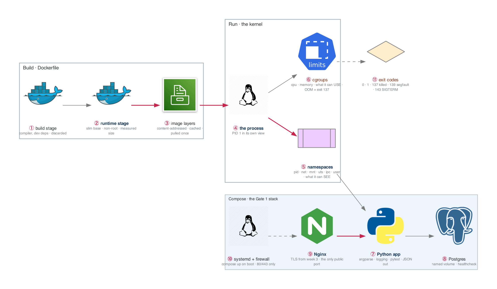

# Figure 4.1 — What a container actually is, and the stack Gate 1 asks you to deploy

> Week 4 · badges ① to ⑪ · about three and a half minutes at a normal pace. Point at each badge as you say its line. Blue is the path to follow first; orange-red is where something refuses or fails.



Top row: an image is built and becomes a process the kernel isolates. Bottom row: three of those processes behind the week-3 Nginx, managed by systemd. The gate is the whole picture, from a fresh VM, with docs only.

## What to say, badge by badge

- **Open.** “A container is not a small VM. It is a Linux process with restricted visibility and a budget. This figure shows the build, the isolation, and the three-container stack Gate 1 asks you to deploy from nothing.”
- **① build stage.** “The first stage has the compiler and every dev dependency. Nothing from it ships except the artifact you copy out. This is why multi-stage builds shrink images by hundreds of megabytes.”
- **② runtime stage.** “A slim base, a non-root user, only the artifact. Measure before and after and put the two numbers in the README. Size is attack surface, and a number is proof.”
- **③ image layers.** “Each instruction is a layer, addressed by content hash. Unchanged layers are cached and pulled once. Order the Dockerfile so the things that change most come last.”
- **④ the process.** “`docker run` starts one process. Inside, it is PID 1. From the host, `ps` shows it as an ordinary process with a strange parent. There is no hypervisor anywhere in this picture.”
- **⑤ namespaces.** “Six namespaces decide what the process can see: its own PIDs, its own network stack, its own mounts, hostname, IPC, and user mapping. `nsenter` lets you step into each one and prove it.”
- **⑥ cgroups.** “cgroups decide what it can use. CPU over the limit is throttled; memory over the limit is killed, exit code 137. Week 15 shows the same rule in Kubernetes. Learn it here where it is cheap.”
- **⑦ Python app.** “The week's first two days: a CLI with argparse, type hints, logging to stderr, JSON to stdout, and tests. It also exposes a Prometheus-format metrics endpoint, a preview of week 20.”
- **⑧ Postgres.** “A named volume so data survives the container. A healthcheck so Compose knows when it is actually ready, not just started. Depends-on without a healthcheck is a race.”
- **⑨ Nginx.** “The week-3 proxy, now in a container, still the only thing on a public port. TLS terminates here exactly as before.”
- **⑩ systemd and firewall.** “A unit runs `compose up` on boot and restarts it on failure. The firewall allows 80 and 443 and nothing else. The gate checks both.”
- **⑪ exit codes.** “0 is success, 1 is the app's own failure, 137 is the kernel killing it, 139 is a segfault, 143 is a clean SIGTERM. Reading the code is the first diagnostic step in BF-19.”
- **Close.** “Build small, run isolated, budget enforced, three containers behind one proxy, managed by systemd. Then the Gate 1 question: narrate the packet from the browser to the Python process, box by box.”

## Use it

- Read the figure before the day plan. Say the script out loud on Friday with the file closed.
- Each badge line is a thirty-second interview answer; the whole script is the three-minute version.
- Regenerate after editing the spec in `_shared/diagrams/week_figures/`:

```bash
python3 ../../_shared/diagrams/generate-week-figures.py --only 4
```
