# Week 4 — Lab figures

> One figure per lab, numbered 4.2 to 4.7. Figure 4.1 is the week figure in
> [`../content/FIGURE.md`](../content/FIGURE.md); these six go one level down, to the mechanism each
> lab makes you touch. Same language: gray is structure, **blue is the path to follow first**,
> orange-red is where something refuses, washed boxes are stores. Each badge line is a thirty-second
> interview answer; each whole script is under three minutes.

**The protocol per figure**

1. **Before the lab:** read the figure, say the badges out loud once. You now know what you are about to prove.
2. **During the lab:** every badge has a **Prove it** command. Run it and watch the badge happen. A badge you cannot see happen is one you are taking on faith.
3. **After the lab:** close the file, redraw the figure, say the script. Check against the file. The badge where the order slipped goes in the *Figures redrawn* column of `progress.md`.
4. **Own the numbers.** The *Numbers to own* table is what separates "I know Docker" from "the writable layer dies with the container; the named volume is what survives `rm -f`."
5. **Answer the question.** Each figure ends with the question a senior interviewer asks about it. Answer it cold, in under a minute, before the gate.

---

## Figure 4.2 — Lab 1: a Python ops CLI, from argparse to an exit code

> Lab 1 · badges ① to ⑧ · about two and a half minutes.

<!-- figure: generated from the Mermaid below by _shared/diagrams/embed-figures.py — do not edit the image -->


<details>
<summary>Diagram source (Mermaid)</summary>

```mermaid
%%{init: {'theme':'base','themeVariables':{'fontFamily':'Helvetica, Arial, sans-serif','fontSize':'13px','primaryColor':'#ffffff','primaryTextColor':'#2d3436','primaryBorderColor':'#9aa3ab','lineColor':'#9aa3ab','textColor':'#2d3436','clusterBkg':'#fbfcfd','clusterBorder':'#d4dae0','edgeLabelBackground':'#ffffff','tertiaryColor':'#eef4fb'},'flowchart':{'curve':'basis','padding':14,'nodeSpacing':42,'rankSpacing':58}}}%%
flowchart LR
  classDef default fill:#ffffff,stroke:#9aa3ab,stroke-width:1.3px,color:#2d3436
  classDef n    fill:#ffffff,stroke:#9aa3ab,stroke-width:1.3px,color:#2d3436
  classDef crit fill:#eef4fb,stroke:#2f6fb8,stroke-width:1.8px,color:#1b3a5c
  classDef data fill:#f4f7fa,stroke:#9aa3ab,stroke-width:1.3px,color:#2d3436
  classDef mut  fill:#ffffff,stroke:#cfd6dc,stroke-width:1.1px,color:#7a8288
  classDef warn fill:#fdf0ec,stroke:#c0522d,stroke-width:1.6px,color:#8a3a1e

  ARG["① argparse<br/><small>report · check · watch · --format · --threshold 80<br/>bad arguments → exit 2 before anything runs</small>"]:::crit
  LOG["② logging to stderr<br/><small>--verbose → DEBUG · stdout stays clean for the pipe</small>"]:::crit
  COL["③ collect() reads /proc<br/><small>read_loadavg · read_meminfo · the path is a parameter</small>"]:::crit
  DC["④ frozen dataclasses<br/><small>DiskUsage · Report · healthy property · asdict for free</small>"]:::crit
  REN["⑤ renderer dispatch<br/><small>table · json · prometheus · a dict, not an if-chain</small>"]:::crit
  PROM["⑥ Prometheus exposition<br/><small>gauge · {mount=&quot;/&quot;} is bounded · a pid label is BF-56</small>"]:::data
  EXC["⑦ specific exceptions → exit 2<br/><small>FileNotFoundError · PermissionError · never bare except: it eats Ctrl+C</small>"]:::warn
  EXIT["⑧ main() returns an int<br/><small>sys.exit(main()) · 0 healthy · 1 breach · 2 usage · testable with no SystemExit</small>"]:::crit

  ARG ==> LOG ==> COL ==> DC ==> REN ==> EXIT
  REN --> PROM
  COL -.-> EXC -.-> EXIT
  linkStyle 0,1,2,3,4 stroke:#2f6fb8,stroke-width:2px
```

</details>

### Say it, badge by badge

- **Open.** "Week 1's sysreport.sh, rewritten as a tool another engineer can test, package, and wire into monitoring. The blue path is one request: parse, log, read, model, render, exit. Every box is a habit, not a feature."
- **① argparse.** "Subcommands and typed flags. An unknown format fails before a single file is read, with exit code 2, and that is the first contract: usage errors are distinct from health failures."
- **② logging to stderr.** "Diagnostics go to stderr, the result goes to stdout. That split is why `sysreport --format json | jq` works even with `--verbose` on. A print statement in the wrong stream corrupts the pipe."
- **③ collect() reads /proc.** "`read_loadavg(proc: Path = Path('/proc/loadavg'))`. The path is a parameter with a default. In production it reads the kernel; in a test it reads a fixture file. Parameterising I/O is the single most useful Python-for-ops habit."
- **④ frozen dataclasses.** "DiskUsage and Report carry the numbers. Frozen gives equality, repr, and immutability for free; `asdict` gives JSON for free. The `healthy` property is where the threshold lives, once."
- **⑤ renderer dispatch.** "A dict from format name to function. Adding a format is adding a key, and argparse's `choices` already rejected everything else."
- **⑥ Prometheus exposition.** "HELP, TYPE, then `name{label} value`. The `mount` label is fine because there are a handful of mounts. A `pid` label would be a new series per process, forever. That is the cardinality question you meet again as BF-56 in week 20."
- **⑦ specific exceptions.** "Catch FileNotFoundError and PermissionError, return 2 with a message. A bare `except:` also catches KeyboardInterrupt and SystemExit, so Ctrl+C stops working and the tool cannot be killed cleanly."
- **⑧ main() returns an int.** "`sys.exit(main())` at the bottom means `main` is a plain function that returns 0, 1 or 2. A test calls it and asserts the number. Monitoring reads the same number. One contract for both."
- **Close.** "Parse, log to the right stream, read through a parameter, model, render, return a number. By Saturday the Compose stack's healthcheck is calling this."

### Numbers to own

| Number | Where it comes from | Why it matters |
|---|---|---|
| `0` / `1` / `2` | the exit-code contract | healthy · threshold breach · usage error; monitoring and tests both read it |
| `80` | `--threshold` default and `healthy` | `used_pct < 80` is healthy, so 80 itself is a breach; the boundary test in Lab 2 pins this |
| 3 formats | `--format` choices | table · json · prometheus; the dict dispatch has exactly three keys |
| 3 subcommands | the requirements | report · check · watch |
| ≥ 6 tests | the requirements | the bar for "tested", and Lab 2 writes them |
| `(total − available) × 100 / total` | `read_meminfo` | MemAvailable, not MemFree; the kernel's own estimate of what is reclaimable |

### Prove it

```bash
sysreport --format bogus; echo "rc=$?"                       # ① 2, and nothing was read
sysreport --verbose --format json 2>/dev/null | jq .hostname  # ② stderr gone, stdout still valid JSON
python3 -c 'from sysreport import read_loadavg; from pathlib import Path; print(read_loadavg(Path("/proc/loadavg")))'   # ③
sysreport --format prometheus | grep mount                   # ⑥ a bounded label
sysreport; echo "rc=$?"                                      # ⑧ 0 or 1, from a property
```

### The question a senior interviewer asks

*"Why do you pass the `/proc` path into the function instead of hardcoding it, and why would a `pid` label in your metrics be a problem?"*
Badges ③ and ⑥. Testability through injected I/O, and bounded versus unbounded label values. If you answer the second half with "it is a lot of data" you have described the symptom; the mechanism is one time series per distinct label value, kept in memory by the scraper.

---

## Figure 4.3 — Lab 2: tests that pin the boundary, a package that installs, a client that cannot hang

> Lab 2 · badges ① to ⑨ · about three minutes. Three rows: test, package, call.

<!-- figure: generated from the Mermaid below by _shared/diagrams/embed-figures.py — do not edit the image -->
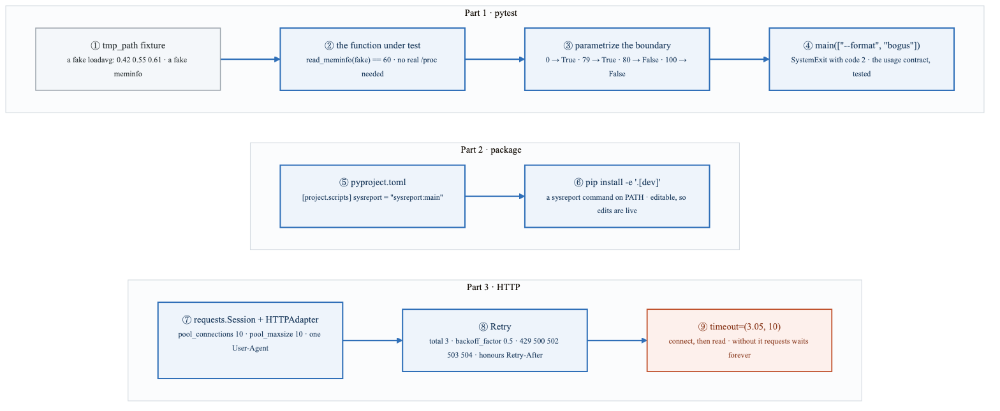

<details>
<summary>Diagram source (Mermaid)</summary>

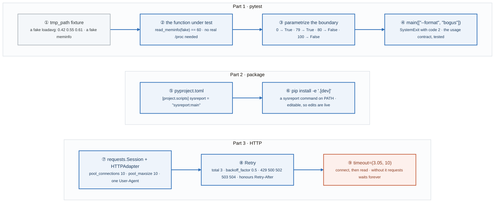

</details>

### Say it, badge by badge

- **Open.** "Three things that turn a script into a tool: tests that pin the edges, a package that puts a command on PATH, and an HTTP client that cannot hang. The blue path runs through all three."
- **① tmp_path fixture.** "pytest hands you a temporary directory. You write a fake `/proc/loadavg` into it with known numbers. That is the other half of Lab 1's injected path: the fixture is why the parameter exists."
- **② the function under test.** "`read_meminfo(fake)` returns 60 because the fixture says 16,384,000 total and 6,553,600 available. A known input, a known output, no root, no Linux required."
- **③ parametrize the boundary.** "0, 79, 80, 100. The pair that matters is 79 and 80: `< 80` means 79 is healthy and 80 is not. Off-by-one on a threshold is the most common bug in a check script, and this is the test a reviewer looks for."
- **④ main with bad arguments.** "argparse raises SystemExit with code 2. The test asserts the code. The usage contract from Lab 1 is now enforced by a test, not a comment."
- **⑤ pyproject.toml.** "`[project.scripts]` maps a command name to `module:function`. That one line is the difference between `python3 sysreport.py` and `sysreport`."
- **⑥ pip install -e.** "Editable install: the command on PATH points at your working copy. `.[dev]` pulls pytest, mypy, and ruff too. `sysreport --format json | jq` now works from any directory."
- **⑦ Session and adapter.** "One Session reuses connections through a pool of ten. Mount the adapter on both schemes. A new connection per call is slow and, under load, exhausts ports."
- **⑧ Retry.** "Three attempts, backoff factor 0.5 so the wait grows each time, only on 429 and the 5xx family, and it honours Retry-After. Retrying a 400 is noise; retrying a 503 is resilience."
- **⑨ timeout.** "A tuple: 3.05 seconds to connect, 10 to read. Without it, a hung dependency hangs your process until something kills it. This is the number one production bug in Python scripts that call APIs."
- **Close.** "Pin the boundary, install the command, pool, retry on the right codes, and always set a timeout. 'Always set a timeout' is a complete answer to a resilience question."

### Numbers to own

| Number | Where it comes from | Why it matters |
|---|---|---|
| `79` / `80` | the parametrize test | the boundary of `< 80`; the one test a reviewer looks for |
| `60` | the meminfo fixture | (16,384,000 − 6,553,600) × 100 / 16,384,000, rounded; proves the formula, not the machine |
| exit `2` | `main(["--format", "bogus"])` | argparse's usage error, asserted |
| `3` retries, `0.5` backoff | `Retry(...)` | urllib3's wait is `backoff_factor × 2^(n−1)`, so the gaps grow rather than hammer |
| `429 500 502 503 504` | `status_forcelist` | the retryable set; 4xx other than 429 is the caller's fault |
| `10` / `10` | pool_connections, pool_maxsize | one pool, reused connections |
| `(3.05, 10)` | `timeout=` | connect and read, separately; 3.05 is the requests docs' habit of sitting just above a multiple of 3, the TCP retransmit window |

### Prove it

```bash
pytest -v                                                    # ① to ④ six green lines
pytest --cov=sysreport --cov-report=term-missing              # the lines no test reaches
pip install -e '.[dev]' && which sysreport                   # ⑥ a command, not a script
python3 -c 'import requests; requests.get("https://api.github.com/rate_limit", timeout=(3.05,10)).raise_for_status(); print("ok")'   # ⑨
```

### The question a senior interviewer asks

*"Describe an HTTP client that will not take production down with it."*
Badges ⑦ ⑧ ⑨, in that order: a pooled Session, retries only on retryable statuses with growing backoff and Retry-After respected, and a connect/read timeout on every call. The follow-up is "what happens with retries on a POST?" and the honest answer is that it is only safe if the endpoint is idempotent, which is why the lab's `allowed_methods` is a decision, not a default.

---

## Figure 4.4 — Lab 3: a container is a process, and the four things that prove it

> Lab 3 · badges ① to ⑩ · about three and a half minutes. Four rows: process, image, network, data.

<!-- figure: generated from the Mermaid below by _shared/diagrams/embed-figures.py — do not edit the image -->
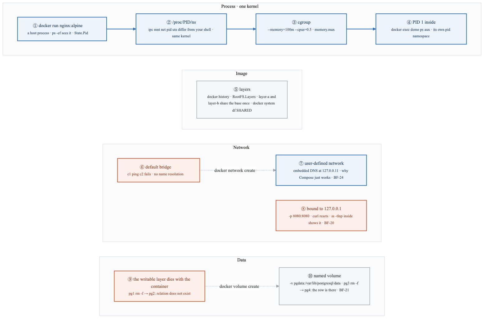

<details>
<summary>Diagram source (Mermaid)</summary>

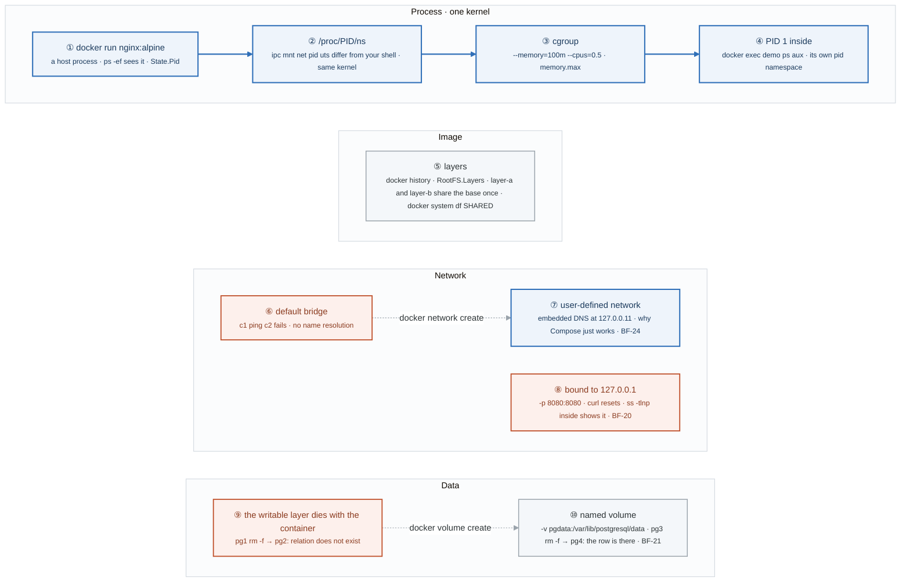

</details>

### Say it, badge by badge

- **Open.** "A container is a process with a different view of the kernel. This figure is the four experiments that make that sentence true on your own machine: namespaces and cgroups, shared layers, two networks, and a volume."
- **① docker run.** "Start nginx, then look for it from the host with `ps -ef`. It is right there, a normal process with a normal PID. `docker inspect` tells you which."
- **② /proc/PID/ns.** "List the namespace links for that PID and for your shell. ipc, mnt, net, pid, uts: five different IDs. Different IDs mean different views. Same kernel. That is the entire trick."
- **③ cgroup.** "`--memory=100m --cpus=0.5` is a cgroup with limits, and `memory.max` under /sys/fs/cgroup is where the number lives. Exceed it and the kernel kills the process, which is week 14's exit 137."
- **④ PID 1 inside.** "`docker exec demo ps aux` shows nginx as PID 1. Its pid namespace starts counting at one. When PID 1 exits, the container is over, which is BF-19 on Friday."
- **⑤ layers.** "An image is a stack of read-only layers. Build layer-a and layer-b from the same base and `docker system df` shows the base stored once, shared. That sharing is why a slim base saves disk on every image built from it."
- **⑥ default bridge.** "Two containers on the default bridge cannot resolve each other's names. `c1 ping c2` fails. That bridge has no DNS."
- **⑦ user-defined network.** "Create a network and start them on it: `d1 ping d2` works, and `/etc/resolv.conf` inside says nameserver 127.0.0.11, Docker's embedded DNS. Compose creates one of these for every project, which is why service names resolve there."
- **⑧ bound to 127.0.0.1.** "Publish 8080 and bind the server to 127.0.0.1 inside the container. From the host, `curl` is reset. `ss -tlnp` inside shows the bind. The port mapping reaches the container's interface, not its loopback. BF-20, and it comes back in Kubernetes as endpoints that refuse."
- **⑨ the writable layer.** "Create a table in pg1, remove the container, start pg2 from the same image: the table is gone. The writable layer is part of the container, and `rm -f` takes it."
- **⑩ named volume.** "Create `pgdata`, mount it at the data directory, do the same dance: the row survives. The volume is a directory the daemon owns; the container only borrows it. BF-21, and week 14's PersistentVolumeClaim."
- **Close.** "Process, namespaces, cgroup, PID 1; layers shared once; DNS only on a user-defined network; data only in a volume. Every Friday scenario this week is one of these four rows."

### Numbers to own

| Number | Where it comes from | Why it matters |
|---|---|---|
| 5 namespace links listed | `ls -l /proc/PID/ns` in the lab | ipc · mnt · net · pid · uts; the kernel also has user, cgroup and time namespaces, but these five are the ones the lab compares |
| `100m` / `0.5` | `--memory` and `--cpus` | a cgroup limit, visible as `memory.max` |
| PID `1` | `docker exec demo ps aux` | the first process in the pid namespace; its exit ends the container |
| `127.0.0.11` | `/etc/resolv.conf` on a user-defined network | Docker's embedded DNS; absent on the default bridge |
| `127.0.0.1` vs `0.0.0.0` | the bindbug container | loopback is unreachable through a port mapping; bind to all interfaces |
| 1 base layer shared | `docker system df` | the SHARED column; layers are content-addressed and stored once |

### Prove it

```bash
sudo ls -l /proc/$(docker inspect demo --format '{{.State.Pid}}')/ns/ && ls -l /proc/self/ns/   # ② different IDs
docker inspect limited --format '{{.HostConfig.Memory}}'                                        # ③ 104857600
docker exec demo ps aux | head -3                                                               # ④ PID 1
docker system df                                                                                # ⑤ SHARED
docker exec d1 cat /etc/resolv.conf                                                             # ⑦ 127.0.0.11
docker exec bindbug ss -tlnp                                                                    # ⑧ 127.0.0.1:8080
docker exec pg4 psql -U postgres -c "SELECT * FROM t;"                                          # ⑩ the row survived
```

### The question a senior interviewer asks

*"'A container is just a process.' Prove it, and tell me exactly which kernel features make the isolation."*
Badges ① to ④: `ps` on the host, the namespace links under `/proc`, the cgroup limit, PID 1 inside. Namespaces change what the process sees; cgroups change what it may use; neither is a virtual machine. If you reach for the word "sandbox", the follow-up will be "sandboxed by what?"

---

## Figure 4.5 — Lab 4: 1.2 GB to 20 MB, measured at every step

> Lab 4 · badges ① to ⑧ · about three minutes.

<!-- figure: generated from the Mermaid below by _shared/diagrams/embed-figures.py — do not edit the image -->
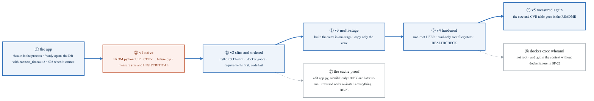

<details>
<summary>Diagram source (Mermaid)</summary>

```mermaid
%%{init: {'theme':'base','themeVariables':{'fontFamily':'Helvetica, Arial, sans-serif','fontSize':'13px','primaryColor':'#ffffff','primaryTextColor':'#2d3436','primaryBorderColor':'#9aa3ab','lineColor':'#9aa3ab','textColor':'#2d3436','clusterBkg':'#fbfcfd','clusterBorder':'#d4dae0','edgeLabelBackground':'#ffffff','tertiaryColor':'#eef4fb'},'flowchart':{'curve':'basis','padding':14,'nodeSpacing':42,'rankSpacing':58}}}%%
flowchart LR
  classDef default fill:#ffffff,stroke:#9aa3ab,stroke-width:1.3px,color:#2d3436
  classDef n    fill:#ffffff,stroke:#9aa3ab,stroke-width:1.3px,color:#2d3436
  classDef crit fill:#eef4fb,stroke:#2f6fb8,stroke-width:1.8px,color:#1b3a5c
  classDef data fill:#f4f7fa,stroke:#9aa3ab,stroke-width:1.3px,color:#2d3436
  classDef mut  fill:#ffffff,stroke:#cfd6dc,stroke-width:1.1px,color:#7a8288
  classDef warn fill:#fdf0ec,stroke:#c0522d,stroke-width:1.6px,color:#8a3a1e

  APP["① the app<br/><small>/health is the process · /ready opens the DB with connect_timeout 2 · 503 when it cannot</small>"]:::crit
  V1["② v1 naive<br/><small>FROM python:3.12 · COPY . . before pip · measure size and HIGH/CRITICAL</small>"]:::warn
  V2["③ v2 slim and ordered<br/><small>python:3.12-slim · .dockerignore · requirements first, code last</small>"]:::crit
  V3["④ v3 multi-stage<br/><small>build the venv in one stage · copy only the venv</small>"]:::crit
  V4["⑤ v4 hardened<br/><small>non-root USER · read-only root filesystem · HEALTHCHECK</small>"]:::crit
  V5["⑥ v5 measured again<br/><small>the size and CVE table goes in the README</small>"]:::crit
  CACHE["⑦ the cache proof<br/><small>edit app.py, rebuild: only COPY and later re-run · reversed order re-installs everything · BF-23</small>"]:::n
  WHO["⑧ docker exec whoami<br/><small>not root · and .git in the context without .dockerignore is BF-22</small>"]:::n

  APP ==> V1 ==> V2 ==> V3 ==> V4 ==> V5
  V2 -.-> CACHE
  V4 -.-> WHO
  linkStyle 0,1,2,3,4 stroke:#2f6fb8,stroke-width:2px
```

</details>

### Say it, badge by badge

- **Open.** "Five Dockerfiles for the same app, each one measured. The point is not the final number; it is that you can say what each change bought, in megabytes and CVEs, because you wrote them down."
- **① the app.** "Two endpoints on purpose. `/health` answers if the process is alive. `/ready` opens a database connection with a two-second timeout and returns 503 if it cannot. A database blip should take you out of rotation, not restart you. That split is BF-44 in week 15."
- **② v1 naive.** "Full python:3.12, copy everything, then pip install. Build it, `docker images` for the size, `trivy image --severity HIGH,CRITICAL` for the count. Write both down. This is the row every later row is compared to."
- **③ v2 slim and ordered.** "Slim base, a `.dockerignore`, and requirements copied before the code. The base cuts the size; the ignore file keeps `.git` out of the context; the order is what lets the cache hold the pip layer when only code changes."
- **④ v3 multi-stage.** "Build the virtualenv in one stage with the compilers, copy only the venv into a clean stage. The build tools never ship."
- **⑤ v4 hardened.** "A non-root USER, a read-only root filesystem, and a HEALTHCHECK that calls the app. Three lines, and they are the same three requirements the Compose stack and the week-14 pod spec ask for."
- **⑥ v5 measured again.** "Same two commands as v1. Size and CVE count per version, as a table, in the README. The lab title is the target; your numbers are the result."
- **⑦ the cache proof.** "Change `app.py` and rebuild: only the COPY of the code and the layers after it re-run. Now reverse the order so code is copied before pip, and time it: every edit re-installs every dependency. BF-23, reproduced before you fix it."
- **⑧ whoami.** "`docker exec whoami` says the app user, not root. And add `.git` to the context with no `.dockerignore` to watch the image grow: BF-22."
- **Close.** "Measure, slim, order, stage, harden, measure. The table is the deliverable, and the two Break/Fix scenarios are the two mistakes the table catches."

### Numbers to own

| Number | Where it comes from | Why it matters |
|---|---|---|
| 1.2 GB → 20 MB | the lab title | the target; your measured sizes per version go in the README, and they are yours, not the lab's |
| 5 Dockerfile versions | the step list | naive · slim and ordered · multi-stage · hardened · measured |
| 2 endpoints | `app.py` | `/health` liveness, `/ready` readiness; one checks the process, the other the dependency |
| `connect_timeout=2` | `/ready` | a readiness check must fail fast, or it is the hang it was meant to detect |
| `503` | `/ready` when the DB is unreachable | not ready is a status code, not an exception |
| HIGH and CRITICAL | the trivy filter | the two severities you count per version |

### Prove it

```bash
docker build -f Dockerfile.v1 -t demo:v1 . && docker images demo:v1 && trivy image --severity HIGH,CRITICAL demo:v1 | tail -5   # ②
touch app.py && docker build -t demo:v2 . 2>&1 | grep -c CACHED                                   # ⑦ how many layers held
docker run --rm demo:v4 whoami                                                                    # ⑧ not root
curl -s localhost:8080/ready                                                                      # ① 503 with no database
```

### The question a senior interviewer asks

*"Which Dockerfile change invalidates the cache, and why should a database outage fail readiness but not liveness?"*
Badges ⑦ and ①. A layer is rebuilt when its inputs change, and every layer after it; copying requirements before code keeps the expensive layer stable. Liveness restarts the process; readiness removes it from rotation; restarting a healthy app because its database is down turns one outage into two.

---

## Figure 4.6 — Lab 5: Break/Fix Friday #4, six container symptoms and the row each belongs to

> Lab 5 · badges ① to ⑦ · about two minutes. The loop itself is
> [Figure BF.0](../../_shared/breakfix/FIGURE.md); this is the week's branch of it.

<!-- figure: generated from the Mermaid below by _shared/diagrams/embed-figures.py — do not edit the image -->
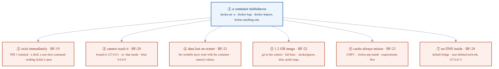

<details>
<summary>Diagram source (Mermaid)</summary>

```mermaid
%%{init: {'theme':'base','themeVariables':{'fontFamily':'Helvetica, Arial, sans-serif','fontSize':'13px','primaryColor':'#ffffff','primaryTextColor':'#2d3436','primaryBorderColor':'#9aa3ab','lineColor':'#9aa3ab','textColor':'#2d3436','clusterBkg':'#fbfcfd','clusterBorder':'#d4dae0','edgeLabelBackground':'#ffffff','tertiaryColor':'#eef4fb'},'flowchart':{'curve':'basis','padding':14,'nodeSpacing':42,'rankSpacing':58}}}%%
flowchart TB
  classDef default fill:#ffffff,stroke:#9aa3ab,stroke-width:1.3px,color:#2d3436
  classDef n    fill:#ffffff,stroke:#9aa3ab,stroke-width:1.3px,color:#2d3436
  classDef crit fill:#eef4fb,stroke:#2f6fb8,stroke-width:1.8px,color:#1b3a5c
  classDef data fill:#f4f7fa,stroke:#9aa3ab,stroke-width:1.3px,color:#2d3436
  classDef mut  fill:#ffffff,stroke:#cfd6dc,stroke-width:1.1px,color:#7a8288
  classDef warn fill:#fdf0ec,stroke:#c0522d,stroke-width:1.6px,color:#8a3a1e

  SYM["① a container misbehaves<br/><small>docker ps -a · docker logs · docker inspect, before anything else</small>"]:::crit
  B19["② exits immediately · BF-19<br/><small>PID 1 returned · a shell, a one-shot command · nothing holds it open</small>"]:::warn
  B20["③ cannot reach it · BF-20<br/><small>bound to 127.0.0.1 · ss -tlnp inside · bind 0.0.0.0</small>"]:::warn
  B21["④ data lost on restart · BF-21<br/><small>the writable layer went with the container · named volume</small>"]:::warn
  B22["⑤ 1.2 GB image · BF-22<br/><small>.git in the context · full base · .dockerignore, slim, multi-stage</small>"]:::warn
  B23["⑥ cache always misses · BF-23<br/><small>COPY . . before pip install · requirements first</small>"]:::warn
  B24["⑦ no DNS inside · BF-24<br/><small>default bridge · user-defined network, 127.0.0.11</small>"]:::warn

  SYM --> B19
  SYM --> B20
  SYM --> B21
  SYM --> B22
  SYM --> B23
  SYM --> B24
```

</details>

### Say it, badge by badge

- **Open.** "Six scenarios, all container-specific, and every one of them comes back in Kubernetes in week 14 wearing a different name. Run the loop from Figure BF.0; this figure is the branch you take at step four."
- **① first three commands.** "`docker ps -a` for the exit code, `docker logs` for what it said, `docker inspect` for how it was started. Those three answer most of the six before you form a hypothesis."
- **② exits immediately.** "Exit code 0 and nothing running: PID 1 finished. A shell with no command, or a one-shot script. Nothing is wrong with the process; nothing is holding the container open. In week 14 this is CrashLoopBackOff with exit 0."
- **③ cannot reach it.** "The port is published and `curl` resets. Inside, `ss -tlnp` shows 127.0.0.1. Bind to 0.0.0.0. Week 14 calls this 'endpoints present, connection refused'."
- **④ data lost on restart.** "The database wrote to the writable layer, and `rm -f` took the layer. A named volume outlives the container. Week 14: a PersistentVolumeClaim."
- **⑤ 1.2 GB image.** "`.git`, test data, and a full base image in the context. `.dockerignore`, slim, multi-stage: Lab 4, in order."
- **⑥ cache always misses.** "Code copied before dependencies are installed, so every edit reinstalls everything. Copy requirements first."
- **⑦ no DNS inside.** "Containers on the default bridge cannot resolve each other. A user-defined network has embedded DNS at 127.0.0.11, which is what Compose gives you for free."
- **Close.** "Six symptoms, four rows of Figure 4.4: process, image, network, data. Log all six with a Surprised line each; by week 14 you will recognise them in a `kubectl describe`."

### Numbers to own

| Number | Where it comes from | Why it matters |
|---|---|---|
| 6 scenarios | BF-19 to BF-24 | the whole container chapter of the library, in one Friday |
| exit `0` with nothing running | BF-19 | PID 1 returned; not a failure, a design mistake |
| `127.0.0.1` | BF-20 | the bind address a port mapping cannot reach |
| `127.0.0.11` | BF-24 | Docker's embedded DNS, only on user-defined networks |
| 3 commands first | `ps -a`, `logs`, `inspect` | the container equivalent of `kubectl describe` before `kubectl logs` |

### Prove it

```bash
docker ps -a --format '{{.Names}} {{.Status}}'          # ① exit codes at a glance
docker run --rm alpine; echo "rc=$?"                     # ② a shell with no tty exits 0 at once
docker exec bindbug ss -tlnp                             # ③
docker volume ls                                         # ④ does the data have somewhere to live
docker run --rm c1 nslookup c2                           # ⑦ fails on the default bridge
```

### The question a senior interviewer asks

*"A container exits immediately with code 0. What does PID 1 have to do with it?"*
Badge ②. The container lives exactly as long as its first process; a process that completes successfully ends it. The fix is a foreground process, not a restart policy, and saying so is what separates understanding from `--restart=always`.

---

## Figure 4.7 — Lab 6: the Compose stack, the week's deliverable

> Lab 6 · badges ① to ⑩ · about three minutes.

<!-- figure: generated from the Mermaid below by _shared/diagrams/embed-figures.py — do not edit the image -->
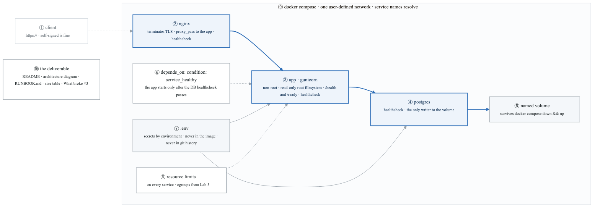

<details>
<summary>Diagram source (Mermaid)</summary>

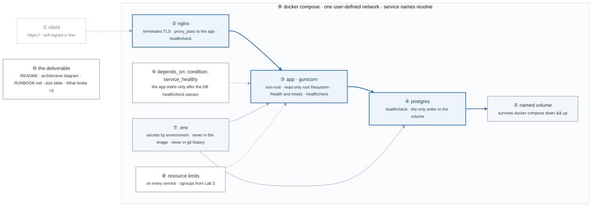

</details>

### Say it, badge by badge

- **Open.** "Three services, one network, one volume, no secrets in any image. This is the deliverable for Gate 1 and the stack you port to Kubernetes in week 14, so every box here has a Kubernetes name waiting for it."
- **① client.** "HTTPS to nginx. A self-signed certificate is fine; the point is that TLS ends at the proxy and the app never sees it."
- **② nginx.** "Terminates TLS and proxies to the app by service name. It has its own healthcheck, so `compose ps` tells you whether the front door is up."
- **③ the app.** "gunicorn, as a non-root user, on a read-only root filesystem, with `/health` and `/ready` from Lab 4 and a healthcheck that calls one of them."
- **④ postgres.** "With a healthcheck, because the next badge depends on it. Nothing else writes to its data directory."
- **⑤ named volume.** "Mounted at the data directory. `docker compose down && docker compose up` and the rows are still there. That is the Lab 3 experiment, now a requirement."
- **⑥ depends_on with a condition.** "`depends_on` alone orders container start, not readiness. `condition: service_healthy` makes the app wait until the database healthcheck passes. In week 14 this one line becomes an init container plus a readiness probe."
- **⑦ .env.** "Secrets reach the containers as environment, from a file that is gitignored. Never baked into an image, because images are copied, pushed, and cached; never in history, because history is forever."
- **⑧ resource limits.** "A limit on every service. These are the Lab 3 cgroups, written in YAML. Week 14 asks for requests and limits on every container for the same reason."
- **⑨ one network.** "Compose creates a user-defined network per project, so `nginx` can reach `app` and `app` can reach `postgres` by name. Lab 3 showed why that would fail on the default bridge."
- **⑩ the deliverable.** "A public repo with the README template, an architecture diagram, a runbook that covers start, stop, back up, restore and debug, the size table from Lab 4, and three genuine entries under What broke."
- **Close.** "TLS at the edge, a hardened app, a database that waits to be healthy, data in a volume, secrets in the environment, limits everywhere, names that resolve. Draw it yourself for the README; this figure is the check."

### Numbers to own

| Number | Where it comes from | Why it matters |
|---|---|---|
| 3 services | the stack | nginx · app · postgres, each with a healthcheck |
| 1 named volume | the requirements | the only place data survives `down && up` |
| 0 secrets in the image | the requirements | `.env` and environment only; `docker history` would show anything baked in |
| ≥ 3 What broke entries | the deliverable | the section a hiring manager reads first |
| 1 condition | `depends_on: condition: service_healthy` | the difference between "started" and "ready" |
| 5 runbook verbs | `RUNBOOK.md` | start · stop · back up · restore · debug |

### Prove it

```bash
docker compose up -d && docker compose ps                   # ② ③ ④ three healthy
curl -k https://localhost/ready                             # ① ② ③ TLS at nginx, readiness from the app
docker compose down && docker compose up -d && docker compose exec postgres psql -U postgres -c 'SELECT * FROM t;'   # ⑤
docker compose exec app whoami && docker compose exec app touch /x; echo "rc=$?"   # ③ non-root, read-only
docker history app:latest | grep -i -c password                                   # ⑦ expect 0
```

### The question a senior interviewer asks

*"Why isn't `depends_on` enough by itself, and what does the healthcheck condition change about startup?"*
Badge ⑥, with badge ④ as the prerequisite. Plain `depends_on` waits for the container to start, and Postgres accepts connections some seconds after that; the condition waits for the healthcheck to pass. The follow-up is "and if the database goes away later?" and the answer is the app's `/ready` endpoint, not Compose.

---

## Redraw schedule

Same cadence as the week figure, see [`../../FIGURES.md`](../../FIGURES.md): Friday of this week after break/fix, Sunday of week 6, and cold at the Gate 2 Sunday in week 9. Lab figures are redrawn **after** the week figure, one at a time, and only the badge order has to be right; the captions are the check, not the test.
