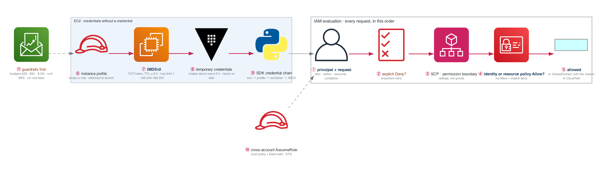

# Week 5 — AWS Foundations: IAM and EC2

> **Thesis:** IAM breaks in production more than anything else in AWS. Over-invest here. Every
> "AccessDenied" you will ever debug, every cross-account question in an interview, every
> least-privilege discussion traces back to the policy evaluation logic you learn this week.

| | |
|---|---|
| **Hours** | 35–45 |
| **Deliverable** | Blog post #3 — "IAM policy evaluation, explained with the four times I got AccessDenied" |
| **Break/Fix** | BF-25, BF-26 |
| **Exit check** | Write an IAM policy from scratch; explain why an EC2 instance can call AWS APIs with no keys on disk |

> ## ⚠ BEFORE YOU CREATE ANY AWS RESOURCE
> ```bash
> EMAIL=you@example.com bash ../_setup/01-aws-guardrails.sh
> ```
> Budget alarms at $25/$50/$100, billing alerts on, root MFA, no root access keys.
> **Then put a recurring Monday reminder in your calendar: "check AWS bill."** For 26 weeks.
> A surprise $400 bill in week 6 ends programs.

## The week in one figure

**Figure 5.1 — How AWS decides, and how an instance gets credentials with no keys on disk.** Two blue paths. The top one is the IAM evaluation every request goes through. The bottom one is the mechanism that gives an EC2 instance credentials it never stores: the instance profile and IMDSv2.



**Say it, badge by badge:** [`content/FIGURE.md`](content/FIGURE.md) — the spoken script for each of the 11 badges, about three and a half minutes; [`content/figure-5.1-numbered-spoken.pdf`](content/figure-5.1-numbered-spoken.pdf) is the printable two-page version. Read the figure before the day plan; say the script on Friday.

---

## Day plan
| Day | Focus | Lab |
|---|---|---|
| Mon | Guardrails, account structure, CLI, SAA course start | Lab 1 |
| Tue | **IAM deep** — policies, roles, evaluation logic | Lab 2 |
| Wed | Cross-account roles, permission boundaries | Lab 3 |
| Thu | EC2, EBS, AMIs, security groups, user data | Lab 4 |
| Fri | Instance profiles + IMDSv2 + Break/Fix | Lab 5 |
| Sat | SAA course: IAM + EC2 domains; practice questions | — |
| Sun | Review, Anki, plan week 6 | — |

## Reading map

**Primary — the reference library has a full SAA course. Use it.**
- `_reference/aws/phase-1-foundations-notes-01-cloud-fundamentals.md`
- `_reference/aws/phase-1-foundations-notes-02-iam-deep-dive.md`
- `_reference/aws/phase-2-compute-storage-notes-01-ec2-deep-dive.md`
- `_reference/aws/phase-2-compute-storage-notes-03-ebs-volumes.md`
- **Cheat sheets:** `phase-1-foundations-cheat-sheets-iam-cheat-sheet.md`,
  `phase-2-compute-storage-cheat-sheets-ec2-compute-cheat-sheet.md`
- **Practice questions:** `phase-1-foundations-practice-questions-questions.md`
- **Existing labs worth doing:** `phase-1-foundations-labs-lab-01-iam-policies.md`,
  `phase-2-compute-storage-labs-lab-01-ec2-launch-configure.md`
- **Study plan:** `_reference/aws/AWS_SAA_STUDY_PLAN.md`

**Choose ONE video course as your spine** — Stephane Maarek (faster) or Adrian Cantrill (deeper,
better labs). Not both. See `../CERTIFICATIONS.md`.

**Free and authoritative:** the AWS SAA exam guide (use as a coverage checklist), AWS Skill Builder,
the FAQ pages for IAM and EC2.

## Method for month 2

**Build every service by hand in the console before automating it.** This is deliberate and it
inverts in month 3. Console-first builds the mental model that makes Terraform legible; going
straight to Terraform means learning two things at once and understanding neither.

## Labs
[labs/LABS.md](labs/LABS.md) · [labs/FIGURES.md](labs/FIGURES.md) (figures 5.2 to 5.6, one per lab) · [solutions/SOLUTIONS.md](solutions/SOLUTIONS.md)

| # | Lab | Time | Cost |
|---|---|---|---|
| 1 | Account guardrails and the CLI | 1h | $0 |
| 2 | IAM policies from scratch | 3h | $0 |
| 3 | Roles, assume-role, boundaries | 3h | $0 |
| 4 | EC2, EBS, AMIs, security groups | 3h | ~$1 |
| 5 | Instance profiles, IMDSv2, Break/Fix | 3h | ~$1 |

**Destroy everything each night.** `bash ../_setup/03-teardown.sh`

## Drills
- `_shared/drills/aws-comparisons.md` — IAM and Compute sections, daily
- Subnetting: 10/day (maintenance now, not acquisition)
- Anki: import `_reference/aws/anki-README.md` decks + write your own

## Exit criteria
- [ ] Budget alarms firing to your email (test one)
- [ ] Recite the IAM policy evaluation order from memory
- [ ] Write a policy granting read-only on one S3 prefix, from scratch, and test both allow and deny
- [ ] Cross-account role assumption working between two roles
- [ ] EC2 instance calling AWS APIs with **no credentials on disk** — and explain the mechanism
- [ ] Explain IMDSv1 vs IMDSv2 and why it matters for SSRF
- [ ] Blog post #3 published
- [ ] Everything destroyed; bill checked
