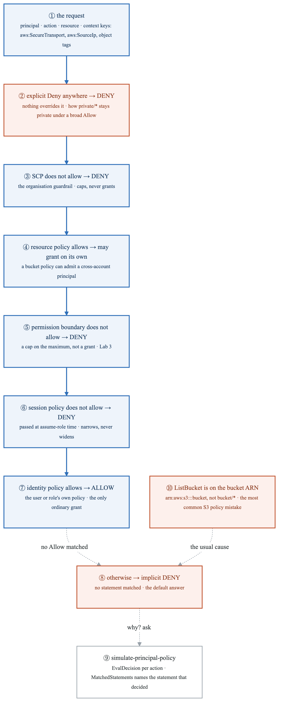
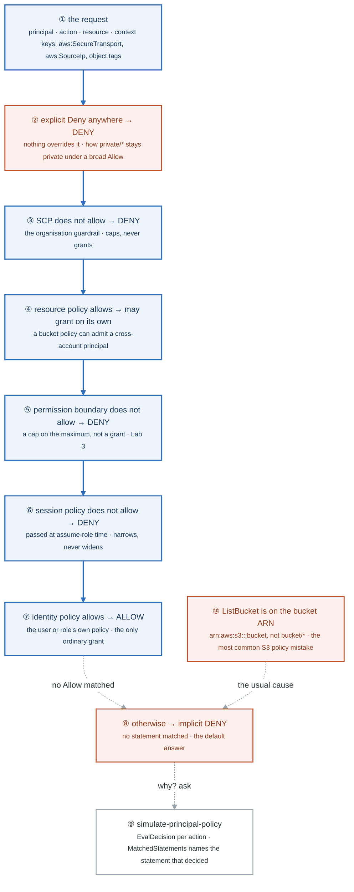
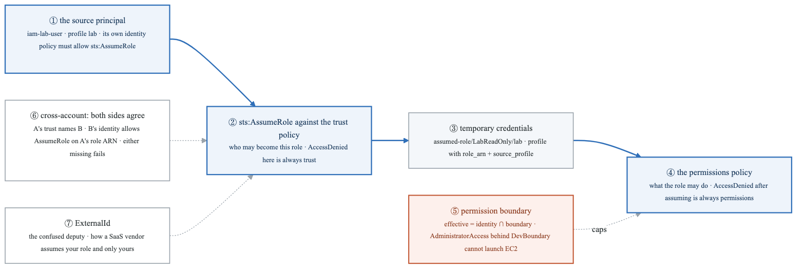
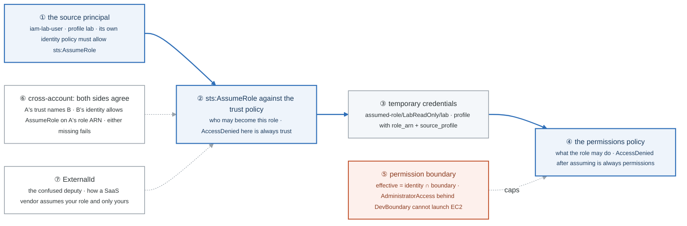
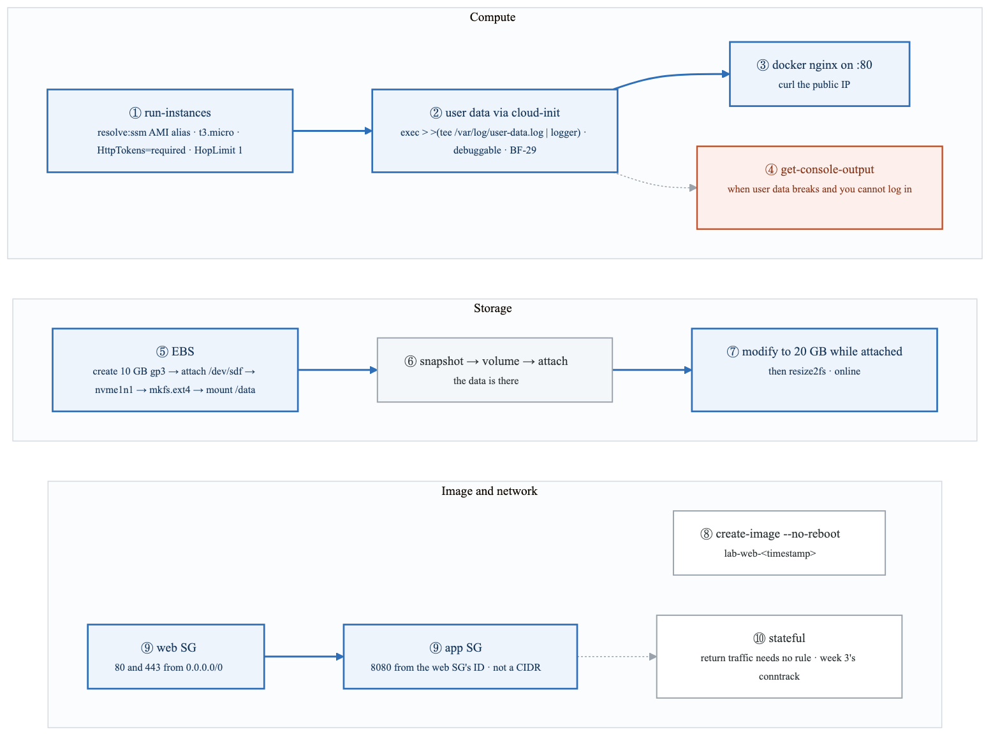
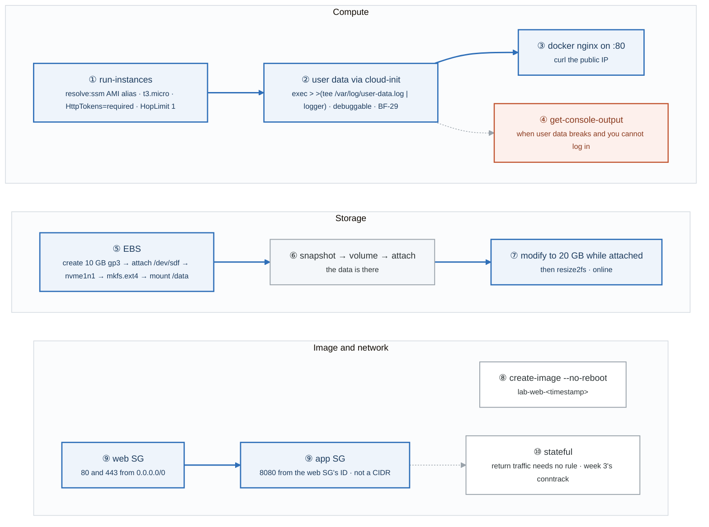
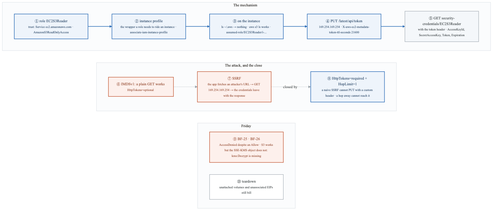
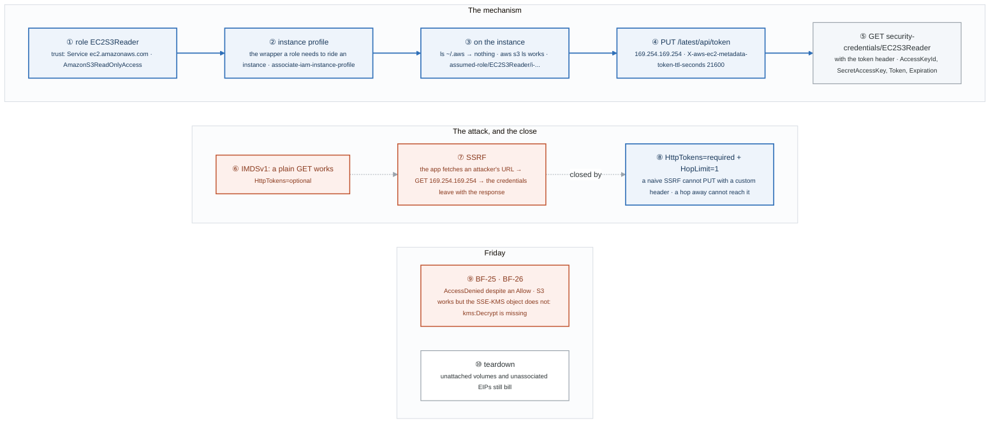

# Week 5 — Lab figures

> One figure per lab, numbered 5.2 to 5.6. Figure 5.1 is the week figure in
> [`../content/FIGURE.md`](../content/FIGURE.md); these go one level down, to the mechanism each
> lab makes you touch. Same language: gray is structure, **blue is the path to follow first**,
> orange-red is where something refuses, washed boxes are stores. Each badge line is a thirty-second
> interview answer; each whole script is under three minutes.

**The protocol per figure**

1. **Before the lab:** read the figure, say the badges out loud once. You now know what you are about to prove.
2. **During the lab:** every badge has a **Prove it** command. Run it and watch the badge happen. A badge you cannot see happen is one you are taking on faith.
3. **After the lab:** close the file, redraw the figure, say the script. Check against the file. The badge where the order slipped goes in the *Figures redrawn* column of `progress.md`.
4. **Own the numbers.** The *Numbers to own* table is what separates "I know IAM" from "an explicit deny anywhere wins, then the SCP, then the boundary, and ListBucket is on the bucket ARN."
5. **Answer the question.** Each figure ends with the question a senior interviewer asks about it. Answer it cold, in under a minute, before the gate.

---

## Figure 5.2 — Lab 1: no figure

Lab 1 is setup: the guardrails script, the budget alarm, a named profile, and twenty minutes on
`--query`. There is no mechanism to draw; there are three habits to start. Run
`aws sts get-caller-identity` as the first command of every IAM investigation from now on. Make the
budget alarm fire once so you have seen it (an alarm you have never seen fire is a decoration, and
BF-32 is built on that sentence). And note that AZ **names** are shuffled per account while AZ
**IDs** such as `use1-az1` are stable, which is the detail that matters the first time you design
across accounts.

---

## Figure 5.3 — Lab 2: how AWS decides, the evaluation order as a ladder

> Lab 2 · badges ① to ⑩ · about three and a half minutes. Reads top-down, the way the decision runs.

<!-- figure: generated from the Mermaid below by _shared/diagrams/embed-figures.py — do not edit the image -->


<details>
<summary>Diagram source (Mermaid)</summary>



</details>

### Say it, badge by badge

- **Open.** "Every AccessDenied you will ever debug runs down this ladder. Seven rungs, in a fixed order, and the whole lab is building policies that stop at each one on purpose. Write the order from memory every day this week."
- **① the request.** "Who, what, on which ARN, under which conditions. The context keys are facts about the call: was it TLS, which IP, what tags the object carries. A Condition block tests those keys and nothing else."
- **② explicit Deny.** "If any policy anywhere says Deny for this request, the answer is Deny and the ladder stops. That is how task 3 works: full access, plus one Deny on `private/*`, and no Allow can bring it back."
- **③ SCP.** "A service control policy at the organisation level. If it does not allow the action, Deny. It never grants anything on its own, which is why an SCP with `s3:*` gives you nothing without an identity policy."
- **④ resource policy.** "A bucket policy, a KMS key policy. For a principal in another account it can grant access on its own. Same account, it adds to the identity policy. This is the rung where cross-account access actually happens."
- **⑤ permission boundary.** "A policy that caps what an identity may ever do. Not a grant. If the boundary does not allow the action, Deny, however generous the identity policy is. Lab 3 proves it with AdministratorAccess behind a boundary."
- **⑥ session policy.** "Passed when a role is assumed, to narrow that session. It cannot widen. Rarely the culprit, always in the order."
- **⑦ identity policy.** "The user's or role's own policy. If it allows, and nothing above denied, the answer is Allow. This is the only rung that grants in the ordinary case."
- **⑧ implicit Deny.** "No statement matched, so the default applies. Most AccessDenied messages are this rung: not a Deny you wrote, but an Allow you did not."
- **⑨ the simulator.** "`simulate-principal-policy` with the ARN, the actions and the resource prints the decision per action, and `MatchedStatements` tells you which statement decided. Learn it now; it answers 'why is this denied' faster than reading."
- **⑩ ListBucket on the bucket ARN.** "Listing is an action on the bucket, so the resource is `arn:aws:s3:::bucket`, with no `/*`. Object actions are on `bucket/*`. Writing ListBucket against the object ARN is the most common S3 policy mistake, and it lands on rung eight."
- **Close.** "Explicit Deny, SCP, resource policy, boundary, session, identity, implicit Deny. Say it in order, then say which rung your AccessDenied stopped on. That is the answer in almost every AWS interview."

### Numbers to own

| Number | Where it comes from | Why it matters |
|---|---|---|
| 7 rungs | Part 4 of the lab | explicit Deny · SCP · resource policy · boundary · session policy · identity Allow · implicit Deny, in that order |
| 5 policy elements | Part 1 | Effect · Action · Resource · Principal (resource policies only) · Condition |
| 6 ARN fields | `arn:partition:service:region:account-id:resource` | S3 omits region and account; IAM omits region; write one from memory |
| 6 policies to write | Part 2 | read-only prefix · read-write prefix · all but `private/*` · source IP · TLS only · ListBucket |
| 2 paths per policy | the task rule | test the allow and the deny; a policy you only tested one way is half-tested |
| 1 Deny beats any number of Allows | rung ② | the reason `private/*` stays private |

### Prove it

```bash
AWS_PROFILE=iamlab aws s3 cp "s3://$BUCKET/reports/q1.txt" -          # ⑦ the Allow path
AWS_PROFILE=iamlab aws s3 cp "s3://$BUCKET/private/payroll.txt" -     # ② the explicit Deny path
aws iam simulate-principal-policy --policy-source-arn arn:aws:iam::ACCT:user/iam-lab-user \
  --action-names s3:GetObject s3:PutObject s3:DeleteObject --resource-arns "arn:aws:s3:::$BUCKET/reports/q1.txt" \
  --query 'EvaluationResults[].{Action:EvalActionName,Decision:EvalDecision}' --output table   # ⑨
AWS_PROFILE=iamlab aws s3 ls "s3://$BUCKET/"                           # ⑩ fails until ListBucket is on the bucket ARN
```

### The question a senior interviewer asks

*"The identity policy clearly allows the action and you still get AccessDenied. Walk me down the ladder."*
Badges ② to ⑤ before you ever reach ⑦: an explicit Deny somewhere, an SCP that does not cover the action, a boundary that caps it, or a resource policy on the other side that does not admit you. Then badge ⑨: the simulator names the statement. Saying "check the policy again" is the answer that fails.

---

## Figure 5.4 — Lab 3: who may become a role, what it may do, and the cap on top

> Lab 3 · badges ① to ⑦ · about two and a half minutes.

<!-- figure: generated from the Mermaid below by _shared/diagrams/embed-figures.py — do not edit the image -->


<details>
<summary>Diagram source (Mermaid)</summary>



</details>

### Say it, badge by badge

- **Open.** "A role has two policies that answer two different questions, and a boundary that caps the second. Most role problems are people reading the wrong one. The blue path is one assume-role call."
- **① the source principal.** "A user, or another role, with an identity policy that allows `sts:AssumeRole` on the target. That permission lives on the caller's side, and it is the half people forget in cross-account setups."
- **② the trust policy.** "`AssumeRolePolicyDocument`: who may become this role. The call is checked here first. AccessDenied on the assume call is always the trust policy. Say that instantly and the interviewer relaxes."
- **③ temporary credentials.** "STS returns a key, a secret, and a session token, and your identity is now `assumed-role/LabReadOnly/lab`. In `~/.aws/config` a profile with `role_arn` and `source_profile` does this on every command."
- **④ the permissions policy.** "What the role may do, once assumed. AccessDenied after assuming is always this policy, or one of the ladder's rungs above it. A role with trust and no permissions can be assumed and does nothing."
- **⑤ permission boundary.** "A cap on the maximum. Attach AdministratorAccess to a user whose boundary only allows S3, CloudWatch and Logs, and launching an instance fails. The effective permission is the intersection. This is how you let developers create their own roles safely: every role they make must carry the boundary."
- **⑥ cross-account.** "Account A's role trusts account B's principal, and B's principal is allowed to assume A's role ARN. Both sides. Missing either one fails, and the error looks the same."
- **⑦ ExternalId.** "A shared secret in the trust condition. A vendor who holds roles in many customer accounts cannot be tricked into using yours on someone else's behalf. That is the confused deputy, and this is the standard answer."
- **Close.** "Caller allowed, trust admits, credentials issued, permissions decide, boundary caps. Two policies, two kinds of AccessDenied, one intersection."

### Numbers to own

| Number | Where it comes from | Why it matters |
|---|---|---|
| 2 policies on a role | Part 1's table | trust answers who; permissions answer what |
| 2 kinds of AccessDenied | Part 1 | on assume = trust; after assume = permissions |
| 2 sides of cross-account | Part 3 | A's trust and B's identity policy; either missing fails |
| 3 services in the boundary | `boundary.json` | `s3:*`, `cloudwatch:*`, `logs:*`; everything else is capped out, even for an administrator |
| `identity ∩ boundary` | Part 4 | the effective permission is the intersection, never the union |
| 1 ExternalId | Part 3 | the confused-deputy guard for third parties |

### Prove it

```bash
aws sts assume-role --role-arn "arn:aws:iam::${ACCT}:role/LabReadOnly" --role-session-name lab --profile iamlab   # ② ③
aws sts get-caller-identity --profile lab-readonly        # ③ assumed-role/LabReadOnly/...
aws s3 ls --profile lab-readonly                          # ④ allowed by ReadOnlyAccess
aws ec2 run-instances --image-id ami-x --instance-type t3.micro --profile iamlab   # ⑤ denied by the boundary despite AdministratorAccess
```

### The question a senior interviewer asks

*"AccessDenied on assume-role versus AccessDenied after assuming: which policy, and how do you delegate IAM to developers safely?"*
Badges ② and ④ for the first half, badge ⑤ for the second. Trust versus permissions, then a required boundary on every role a developer creates so nothing they build can exceed it.

**The hardening step in the lab** adds `aws:MultiFactorAuthPresent: true` to the trust policy and assumes again. The AccessDenied that follows is badge ②, a trust denial: the CLI session carries no MFA claim. `false` would be the reverse, admitting only sessions without MFA, which is the kind of condition to read twice before copying.

---

## Figure 5.5 — Lab 4: an instance from run-instances to a mounted disk, and a security group that names another

> Lab 4 · badges ① to ⑩ · about three and a half minutes. Three rows: compute, storage, image and network.

<!-- figure: generated from the Mermaid below by _shared/diagrams/embed-figures.py — do not edit the image -->


<details>
<summary>Diagram source (Mermaid)</summary>



</details>

### Say it, badge by badge

- **Open.** "One instance, launched the way you will launch every instance from now on, then a disk, a snapshot, an image, and two security groups that reference each other. Three rows; the compute row is the one that becomes Terraform in week 10."
- **① run-instances.** "The AMI is `resolve:ssm:` and an alias, so it never goes stale and never differs per region. `HttpTokens=required` with a hop limit of one turns IMDSv2 on, which is Lab 5. Tags on the instance from the start."
- **② user data.** "cloud-init runs your script once, as root, at first boot. The `exec > >(tee ... | logger)` line sends every line to a log file, syslog, and the console. That line is the answer to 'my user data didn't run': now you can read why."
- **③ nginx on 80.** "Docker installed and started by the script, nginx behind port 80, `--restart=always`. `curl` the public IP and the launch is proven."
- **④ get-console-output.** "Break the script on purpose. You cannot SSH in to read the log, so `aws ec2 get-console-output` is the view from outside. That is where the tee to `/dev/console` pays off."
- **⑤ EBS.** "Create a 10 GB gp3, attach it as `/dev/sdf`, and the instance sees `nvme1n1`. Make a filesystem, mount it. The device name you asked for and the one you get are different, and that is normal."
- **⑥ snapshot.** "Snapshot the volume, create a volume from the snapshot, attach it: the files are there. A snapshot is the backup primitive every AMI and every restore is built on."
- **⑦ grow it online.** "Modify the volume to 20 GB while it is attached, then `resize2fs`. No downtime. That is a real operational task, and knowing it is two commands is the point."
- **⑧ create-image.** "`--no-reboot` snapshots the running instance into an AMI. Fast, slightly inconsistent; the trade-off is one you should be able to name."
- **⑨ two security groups.** "Web allows 80 and 443 from anywhere. App allows 8080 from the web SG's ID. A source that is a group, not a CIDR, follows the instances as they come and go. Auto Scaling in week 7 depends on exactly that."
- **⑩ stateful.** "Add an inbound rule and the response leaves without an egress rule. The group tracks connections, the same way conntrack did in week 3. NACLs, next week, do not."
- **Close.** "Resolve the AMI, require IMDSv2, log the user data, mount, snapshot, grow, image, reference groups by ID, trust the state table. Six of those are default settings in the Terraform you write next."

### Numbers to own

| Number | Where it comes from | Why it matters |
|---|---|---|
| `3,000` IOPS at any size | gp3 baseline | IOPS decoupled from size; the default choice |
| `3` IOPS per GB | gp2 | why people over-provisioned storage to get IOPS; the reason gp3 exists |
| 10 → 20 GB | the resize task | grown while attached, then `resize2fs` |
| `80`, `443`, `8080` | the two security groups | web from anywhere, app from the web group only |
| HopLimit `1` | `--metadata-options` | a container one hop away cannot reach the metadata service; Lab 5 explains |
| ~$1 | the lab title | the cost of the lab if you tear down; unattached volumes keep billing |

### Prove it

```bash
curl -s http://<public-ip>/ | head -3                                        # ③
ssh ec2-user@<public-ip> sudo tail -3 /var/log/user-data.log                  # ② "user-data finished at ..."
aws ec2 get-console-output --instance-id i-xxx --output text | tail -20       # ④
lsblk                                                                         # ⑤ nvme1n1 where you asked for sdf
sudo resize2fs /dev/nvme1n1 && df -h /data                                    # ⑦ 20 GB, no unmount
aws ec2 describe-security-groups --group-ids $SG_APP --query 'SecurityGroups[].IpPermissions[].UserIdGroupPairs'   # ⑨ a group, not a CIDR
```

### The question a senior interviewer asks

*"Why reference a security group by ID instead of a CIDR, and why does the return traffic need no rule?"*
Badges ⑨ and ⑩. A group ID follows membership, so a scaled-out instance is covered the moment it joins; a CIDR has to be right forever. Return traffic rides the connection-tracking table, which is week 3's conntrack with an AWS name. If the follow-up is "and a NACL?", the answer is next week's Figure 6.3.

---

## Figure 5.6 — Lab 5: credentials with no keys on disk, and the SSRF that IMDSv2 closes

> Lab 5 · badges ① to ⑩ · about three and a half minutes. Three rows: the mechanism, the attack and its close, Friday.

<!-- figure: generated from the Mermaid below by _shared/diagrams/embed-figures.py — do not edit the image -->


<details>
<summary>Diagram source (Mermaid)</summary>



</details>

### Say it, badge by badge

- **Open.** "No access key exists anywhere on this instance and it can still list S3. The blue path is how. The orange row is why the old version of that mechanism was a breach waiting to happen, and the one setting that closes it. An AWS feature, a vulnerability class, and a specific mitigation, in one picture."
- **① the role.** "Trust policy names the EC2 service as the principal; permissions policy is read-only S3. Same two policies as Lab 3, with a service instead of a user on the trust side."
- **② the instance profile.** "A role cannot be attached to an instance directly; it rides in a profile. Create the profile, add the role, associate it. Three calls that the console does in one click, which is why people cannot explain it."
- **③ on the instance.** "`ls ~/.aws` finds nothing. `aws s3 ls` works. `get-caller-identity` says `assumed-role/EC2S3Reader/i-...`. The SDK found credentials somewhere, and the next two badges are where."
- **④ PUT for a token.** "The SDK asks the metadata service at 169.254.169.254 for a session token with a PUT and a TTL header. 21,600 seconds is six hours. A PUT with a custom header is the whole security model, and badge eight explains why."
- **⑤ GET the credentials.** "With the token in a header, GET the role's credentials: key, secret, session token, and an expiration a few hours out. These rotate on their own. There is nothing on disk to leak."
- **⑥ IMDSv1.** "Launch with `HttpTokens=optional` and a plain GET returns the same metadata, credentials included. No token, no header, no PUT."
- **⑦ SSRF.** "A web app that fetches an attacker-supplied URL will fetch `http://169.254.169.254/latest/meta-data/iam/security-credentials/ROLE` if asked, and return the body. One GET, and the attacker has the instance's role. That is the credential-theft path behind well-known cloud breaches."
- **⑧ the close.** "`HttpTokens=required` means no token, no answer, and a naive SSRF can only make a GET without custom headers, so it cannot get a token. `HopLimit=1` means the response TTL dies after one hop, so a container or a forwarded request cannot reach it. Two properties, two halves of the attack."
- **⑨ Friday.** "BF-25 is an Allow that still denies: the ladder from Figure 5.3. BF-26 is a bucket with default SSE-KMS and a principal with `s3:*` but no `kms:Decrypt`: the object read fails while the listing works, because decryption is a KMS call made on your behalf."
- **⑩ teardown.** "Run the script, then look for running instances and volumes in state `available`. An unattached volume and an unassociated Elastic IP are the two things everyone forgets, and both bill."
- **Close.** "Role, profile, token, credentials. Then the same mechanism without the token, and the one GET that steals it. Require the token, limit the hop. Say all of that in ninety seconds and you have answered a security question and an architecture question at once."

### Numbers to own

| Number | Where it comes from | Why it matters |
|---|---|---|
| `169.254.169.254` | the metadata service | link-local, reachable only from the instance; the SSRF target |
| `21600` s | the token TTL header | six hours; the longest a token may live |
| a few hours | the credential `Expiration` | the SDK refreshes before then; nothing to rotate by hand |
| `HopLimit=1` | `--metadata-options` | the response cannot travel through a container's extra hop |
| `--max-time 3` | the IMDSv1 probe | with tokens required the plain GET hangs rather than refuses; the timeout is what makes the test finish |
| 0 files in `~/.aws` | badge ③ | the proof that credentials came from the metadata service |
| 2 forgotten billers | teardown | unattached EBS volumes and unassociated Elastic IPs |

### Prove it

```bash
ls ~/.aws 2>/dev/null; aws sts get-caller-identity                                 # ③ nothing on disk, still an identity
TOKEN=$(curl -sX PUT http://169.254.169.254/latest/api/token -H "X-aws-ec2-metadata-token-ttl-seconds: 21600")   # ④
curl -s -H "X-aws-ec2-metadata-token: $TOKEN" http://169.254.169.254/latest/meta-data/iam/security-credentials/EC2S3Reader | jq .Expiration   # ⑤
curl -s --max-time 3 http://169.254.169.254/latest/meta-data/; echo "rc=$?"         # ⑥ ⑧ hangs with tokens required, answers when optional
aws ec2 describe-volumes --filters "Name=status,Values=available" --query 'Volumes[].VolumeId' --output text   # ⑩
```

### The question a senior interviewer asks

*"Trace an SSRF on IMDSv1 to stolen credentials, and tell me exactly which two IMDSv2 properties stop it."*
Badges ⑥ ⑦ ⑧. The app fetches the metadata URL on the attacker's behalf and returns the role's credentials; the token requirement defeats a GET-only SSRF, and the hop limit defeats a forwarded one. Name both; naming only "IMDSv2" is the answer that gets the follow-up.

---

## Redraw schedule

Same cadence as the week figure, see [`../../FIGURES.md`](../../FIGURES.md): Friday of this week after break/fix, Sunday of week 7, and cold at the Gate 2 Sunday in week 9. Lab figures are redrawn **after** the week figure, one at a time, and only the badge order has to be right; the captions are the check, not the test.
