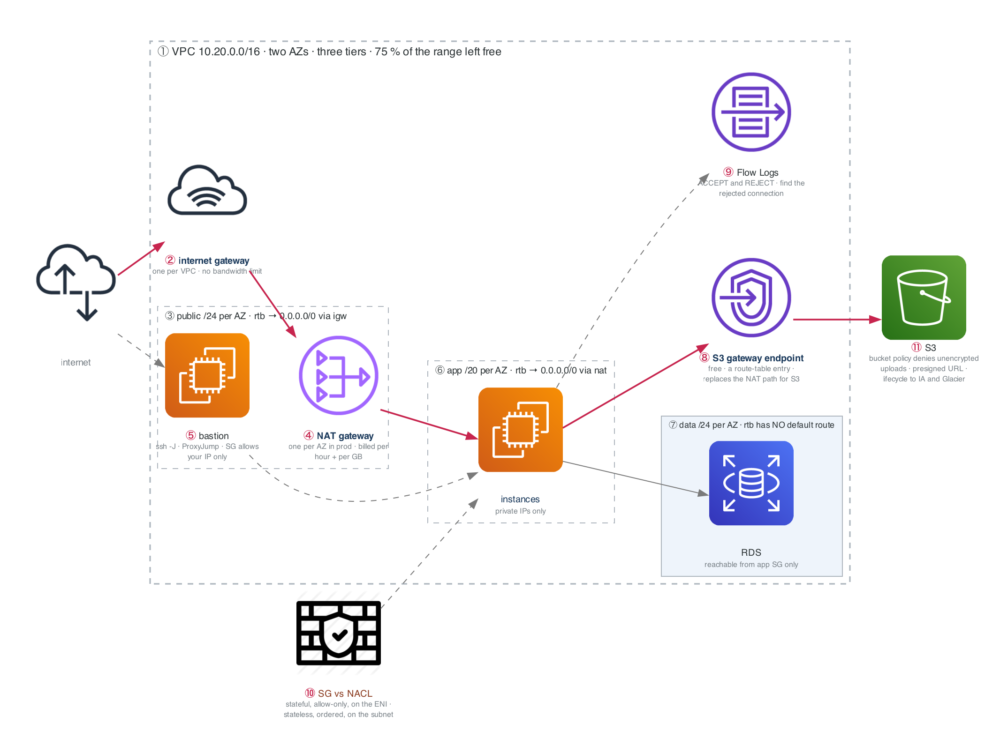

# Figure 6.1 — A two-AZ VPC, and what makes a subnet public

> Week 6 · badges ① to ⑪ · about three and a half minutes at a normal pace. Point at each badge as you say its line. Blue is the path to follow first; orange-red is where something refuses or fails.



The week-2 subnetting and the week-3 router, NAT, and firewall, now as AWS resources. Follow the blue line from the internet to the data tier and notice where it stops.

## What to say, badge by badge

- **Open.** “This is the diagram you draw by hand this week and clean up for Project Alpha. Three tiers, two availability zones, and one question that decides everything: what route table is a subnet attached to.”
- **① VPC.** “A /16 gives you 65,536 addresses. The tiers here use about a quarter of them, deliberately, so there is room to add tiers later without renumbering. Renumbering a VPC is a migration.”
- **② internet gateway.** “One per VPC, horizontally scaled, no bandwidth to size. Attaching it does nothing by itself. A route has to point at it.”
- **③ public subnets.** “What makes a subnet public is not a checkbox. It is a route table with 0.0.0.0/0 pointing at the internet gateway, plus an instance with a public IP. Say that sentence in an interview and you are ahead of most candidates.”
- **④ NAT gateway.** “Private instances reach the internet through NAT in a public subnet, exactly like the week-3 namespace lab. One per AZ in production, because a NAT in AZ-a does nothing for AZ-b when AZ-a is down. It bills per hour and per gigabyte.”
- **⑤ bastion.** “The only SSH door, in the public tier, security group open to your IP alone. `ssh -J bastion private-host` with ProxyJump in your SSH config, so the private key never leaves your laptop.”
- **⑥ app subnets.** “A /20 per AZ, 4,096 addresses, because this tier will hold pods one day and pods eat IPs. Default route to the NAT. No public IPs.”
- **⑦ data subnets.** “No default route at all. Not to NAT, not to anything. The database cannot initiate a connection to the internet, which means a compromised database cannot phone home.”
- **⑧ S3 gateway endpoint.** “A route-table entry that sends S3 traffic over AWS's network instead of through the NAT. It is free. The exit criterion asks you to replace the NAT for S3 and compare the bill.”
- **⑨ Flow Logs.** “Every accepted and rejected connection, per ENI. The lab asks you to find one rejected connection. In an incident, this is how you prove a security group is the cause.”
- **⑩ SG versus NACL.** “A security group is stateful, allow-only, and attached to the interface: the reply is allowed automatically. A NACL is stateless, ordered, allow and deny, on the subnet: you must allow the ephemeral reply ports yourself. This is the week-3 `ct state` rule, sold twice.”
- **⑪ S3.** “A bucket policy that denies any upload without server-side encryption. A presigned URL that grants one object for fifteen minutes. A lifecycle rule to Infrequent Access at 30 days and Glacier at 90. Numbers an exam asks for.”
- **Close.** “Route table decides public. NAT per AZ. Data tier with no way out. Endpoints instead of NAT where you can. And the diagram goes into the Alpha repo this Sunday.”

## Use it

- Read the figure before the day plan. Say the script out loud on Friday with the file closed.
- Each badge line is a thirty-second interview answer; the whole script is the three-minute version.
- Regenerate after editing the spec in `_shared/diagrams/week_figures/`:

```bash
python3 ../../_shared/diagrams/generate-week-figures.py --only 6
```
