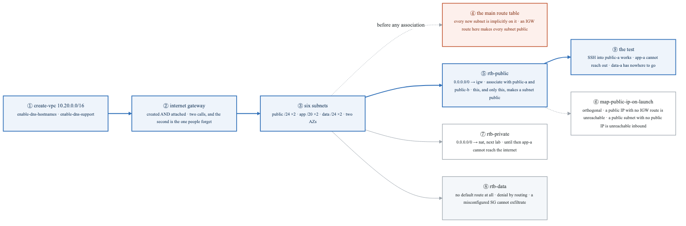
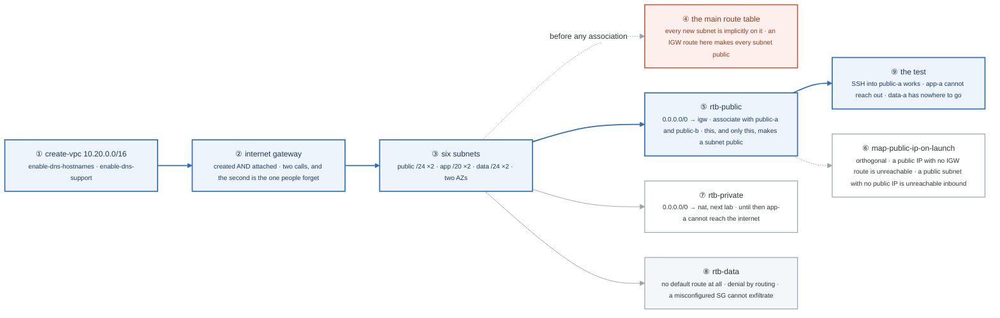
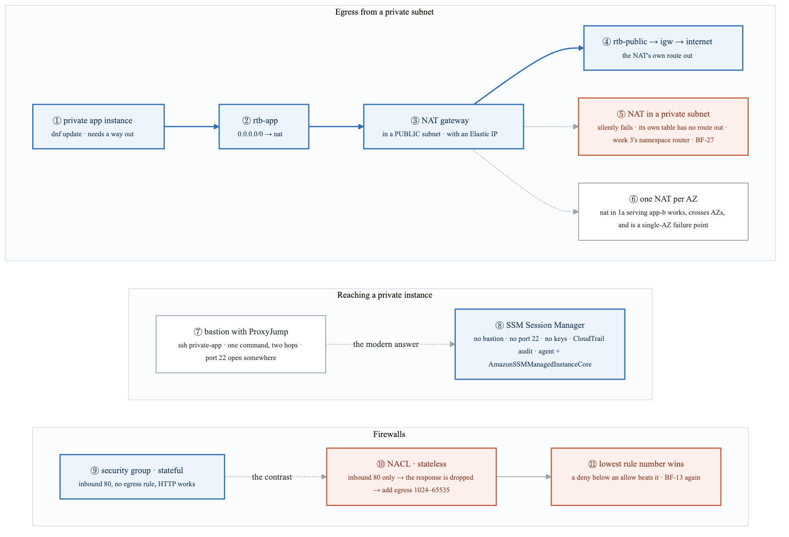
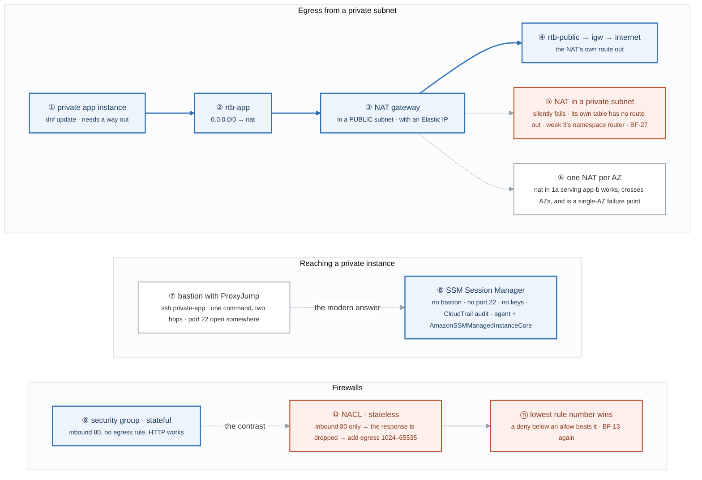
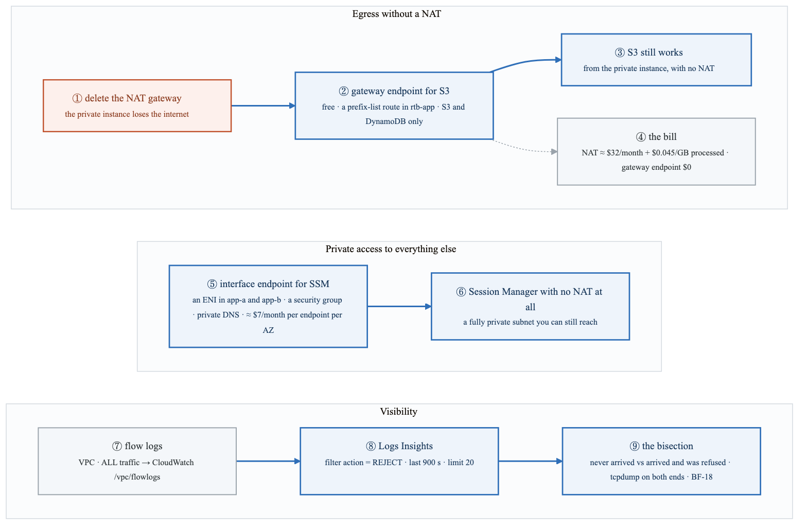
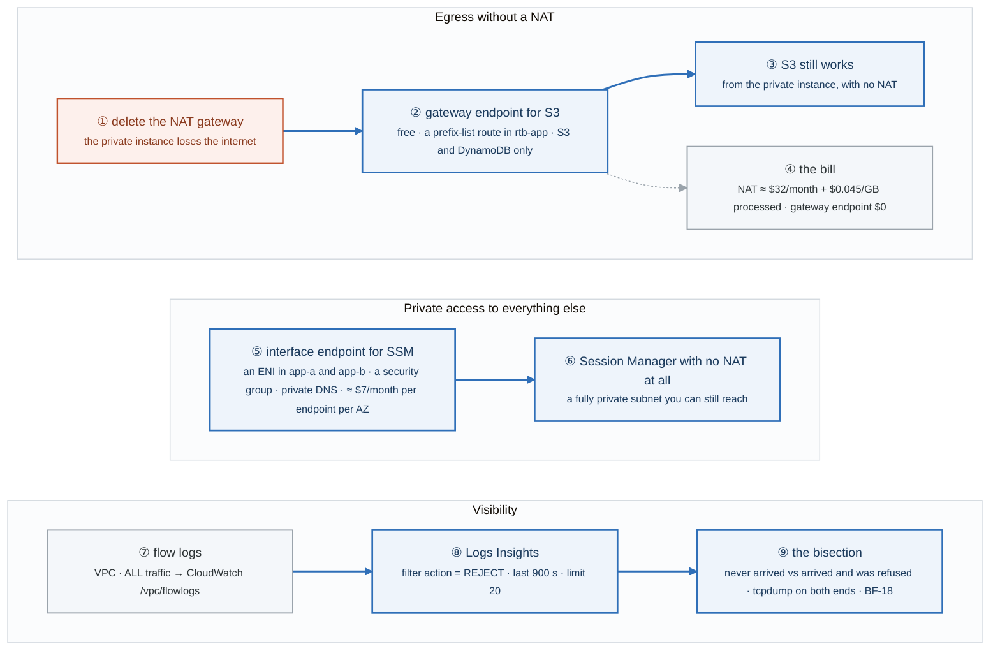
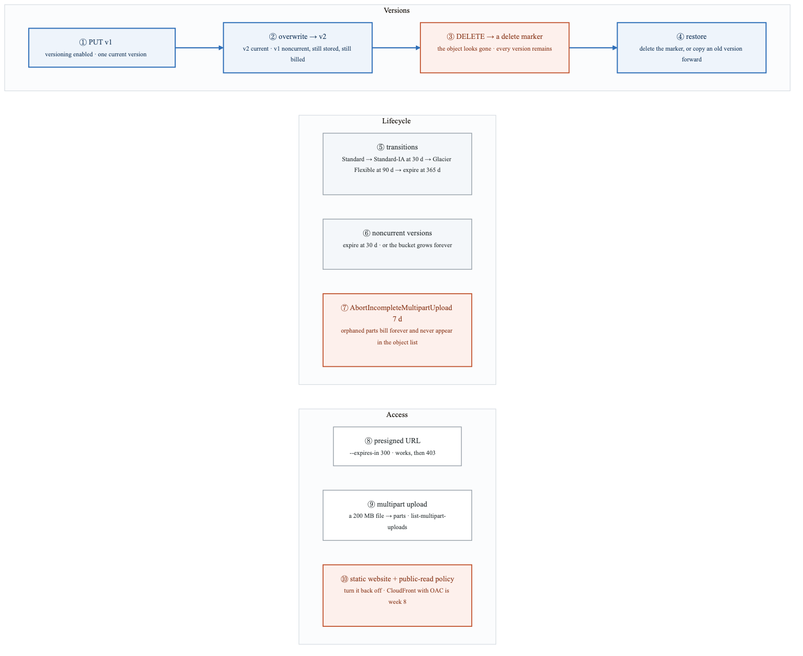
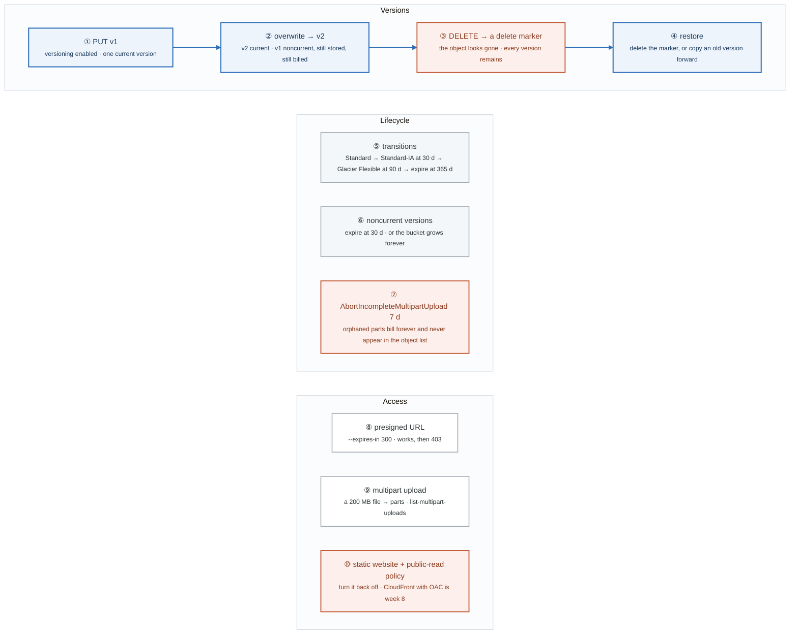
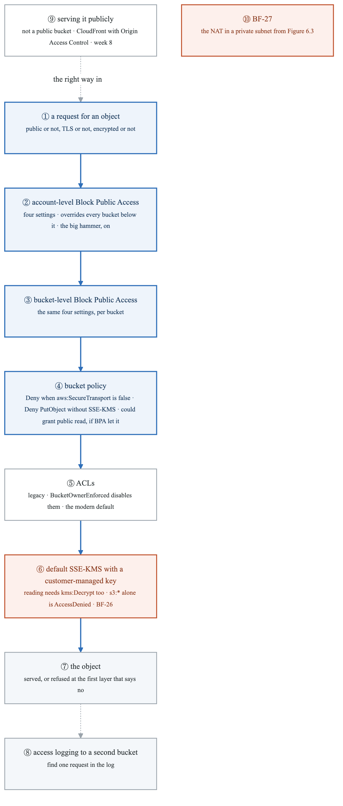
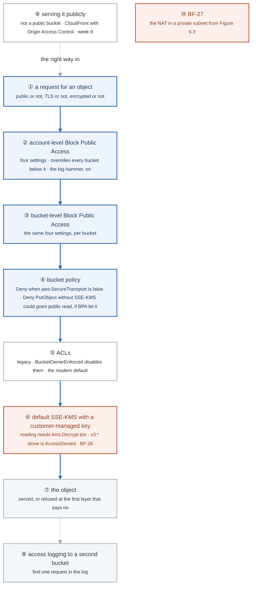

# Week 6 — Lab figures

> One figure per lab, numbered 6.2 to 6.6. Figure 6.1 is the week figure in
> [`../content/FIGURE.md`](../content/FIGURE.md); these go one level down, to the mechanism each
> lab makes you touch. Lab 1's topology is already drawn in [`LABS.md`](LABS.md); Figure 6.2 is the
> decision underneath it. Same language: gray is structure, **blue is the path to follow first**,
> orange-red is where something refuses, washed boxes are stores. Each badge line is a thirty-second
> interview answer; each whole script is under three minutes.

**The protocol per figure**

1. **Before the lab:** read the figure, say the badges out loud once. You now know what you are about to prove.
2. **During the lab:** every badge has a **Prove it** command. Run it and watch the badge happen. A badge you cannot see happen is one you are taking on faith.
3. **After the lab:** close the file, redraw the figure, say the script. Check against the file. The badge where the order slipped goes in the *Figures redrawn* column of `progress.md`.
4. **Own the numbers.** The *Numbers to own* table is what separates "I know VPCs" from "a NAT gateway is about thirty-two dollars a month plus four and a half cents a gigabyte, and a gateway endpoint for S3 is free."
5. **Answer the question.** Each figure ends with the question a senior interviewer asks about it. Answer it cold, in under a minute, before the gate.

---

## Figure 6.2 — Lab 1: what makes a subnet public

> Lab 1 · badges ① to ⑨ · about three minutes. The topology is the figure in `LABS.md`; this is the
> routing decision it rests on.

<!-- figure: generated from the Mermaid below by _shared/diagrams/embed-figures.py — do not edit the image -->


<details>
<summary>Diagram source (Mermaid)</summary>



</details>

### Say it, badge by badge

- **Open.** "Draw it on paper first; the topology in the lab is the target. This figure is the single decision the topology encodes: a subnet is public if and only if its route table has a route to an internet gateway. Everything else is detail around that sentence."
- **① create-vpc.** "A /16, and two attributes turned on: DNS hostnames and DNS support. Without them instances get no names, and later every private-DNS endpoint silently fails."
- **② the internet gateway.** "Create it, then attach it to the VPC. Two calls. An unattached gateway is a resource with no effect, and the route you write in badge five will point at it and go nowhere."
- **③ six subnets.** "Two AZs, three tiers. Public is small, app is a /20 because that is where pods will live, data is small. The CIDRs are week 2's drill, applied."
- **④ the main route table.** "Before you associate anything, look: every subnet you just made is on the main table. If the main table ever gets an IGW route, every unassociated subnet is public, including the ones you called private. Check this first in any inherited account."
- **⑤ rtb-public.** "A new table, a default route to the gateway, associated with the two public subnets. That association is the definition. Not a checkbox, not a name, not a tag."
- **⑥ map-public-ip-on-launch.** "A separate setting. It gives instances a public address. An address with no IGW route is unreachable; an IGW route with no address is unreachable inbound. Two settings, two questions, and 'public' needs both answers."
- **⑦ rtb-private.** "The app tier's table. Next lab it gets a default route to a NAT gateway. Today it has none, and the instance in app-a proves it by failing `dnf update`."
- **⑧ rtb-data.** "No default route at all. A database should never initiate an outbound connection to the internet, and denying that by routing means a wrong security group cannot create an exfiltration path. Say that sentence; it is the strongest one in the week."
- **⑨ the test.** "SSH into public-a works. From app-a, nothing outbound. From data-a, nowhere to go. Three instances, three route tables, one rule."
- **Close.** "VPC, attached gateway, subnets, and a route table per tier. Public is a route, not a flag; private is the absence of one; data is the absence of any. By Friday the NAT fills the gap in the middle."

### Numbers to own

| Number | Where it comes from | Why it matters |
|---|---|---|
| `10.20.0.0/16` | `create-vpc` | the address space every subnet is carved from |
| 6 subnets · 3 route tables · 2 AZs | the target | one table per tier, shared across AZs |
| `/24` public, `/20` app, `/24` data | the topology | app is largest because pods will consume its addresses |
| 2 DNS attributes | `modify-vpc-attribute` | hostnames and support; private DNS on endpoints needs both |
| 1 definition of public | the question to answer in writing | a route to an IGW in the subnet's route table, and nothing else |
| 0 default routes | rtb-data | denial by routing, stronger than any firewall rule |

### Prove it

```bash
aws ec2 describe-route-tables --filters Name=vpc-id,Values=$VPC_ID --query 'RouteTables[?Associations[?Main]].Routes'   # ④ what the main table says
aws ec2 describe-route-tables --filters Name=association.subnet-id,Values=$PUB_A --query 'RouteTables[].Routes[].GatewayId'   # ⑤ igw-...
aws ec2 describe-subnets --subnet-ids $PUB_A --query 'Subnets[].MapPublicIpOnLaunch'                                   # ⑥
ssh ec2-user@<public-a-ip> 'curl -m3 -s https://example.com >/dev/null && echo out || echo blocked'                   # ⑨ from public-a
```

### The question a senior interviewer asks

*"What makes a subnet public, and why is a data tier with no default route stronger than a firewall rule?"*
Badges ⑤ and ⑧. A route to an internet gateway in the associated route table; the public-IP flag is orthogonal. A tier with no default route cannot reach the internet whatever its security group says, so the control survives a misconfiguration one layer up.

---

## Figure 6.3 — Lab 2: NAT, bastion versus Session Manager, and stateful versus stateless

> Lab 2 · badges ① to ⑪ · about three and a half minutes. Three rows: egress, access, firewalls.

<!-- figure: generated from the Mermaid below by _shared/diagrams/embed-figures.py — do not edit the image -->


<details>
<summary>Diagram source (Mermaid)</summary>



</details>

### Say it, badge by badge

- **Open.** "Three questions about a private subnet: how does it reach out, how do you reach in, and what filters the traffic. One mechanism per row, and each row has a wrong answer that looks right."
- **① the private instance.** "It needs `dnf update`. It has a private address and a route table with no default route. Nothing leaves."
- **② rtb-app.** "Add a default route pointing at a NAT gateway and associate the table with app-a. Now packets to the internet have a next hop."
- **③ the NAT gateway.** "It lives in a public subnet and owns an Elastic IP. It rewrites the source address of outbound packets to that IP and tracks the connection so replies come back. Week 3's MASQUERADE, as a managed service."
- **④ its own route out.** "The NAT is an instance-like thing in a subnet with a route table. That table must reach the internet gateway. The NAT's subnet being public is not decoration; it is how the NAT itself gets out."
- **⑤ NAT in a private subnet.** "Put it in app-a instead and watch `dnf update` hang. The NAT receives the packets and has nowhere to forward them. In week 3 that was the namespace router with no default route. BF-27, and it fails silently."
- **⑥ one per AZ.** "A NAT in 1a serving app-b works, but every byte crosses AZs and 1a going down takes app-b's egress with it. Production runs one NAT per AZ and a route table per AZ. Cost against blast radius."
- **⑦ bastion.** "A host in the public subnet, and `ProxyJump` in `~/.ssh/config` so `ssh private-app` is one command and two hops. It works, and it means port 22 is open somewhere and keys are on laptops."
- **⑧ Session Manager.** "No bastion, no open port, no keys, every session in CloudTrail, and it works in a subnet with no NAT at all through a VPC endpoint. Needs the agent and an instance profile with the managed policy. 'I'd use Session Manager' is the answer that marks you as current."
- **⑨ security group.** "Allow inbound 80 and nothing outbound. HTTP works. The group tracks the connection and lets the response out. Stateful, like last week's badge ten and week 3's conntrack."
- **⑩ NACL.** "Allow inbound 80 and nothing else. The request arrives and the response is dropped, because a NACL does not remember the connection. Add an egress rule for the ephemeral ports, 1024 to 65535, and it works. Stateless means you write both directions."
- **⑪ rule order.** "NACL rules are evaluated by number, lowest first, first match wins. A deny at 90 beats an allow at 100. That is week 3's iptables ordering, BF-13, in a new costume."
- **Close.** "Out through a NAT in a public subnet, one per AZ. In through Session Manager, not a bastion. Filter with a stateful group, and if you touch a NACL, write both directions and mind the numbers."

### Numbers to own

| Number | Where it comes from | Why it matters |
|---|---|---|
| ~$2 | the lab title | the NAT gateway is the expensive thing; delete it and release the EIP when done |
| 1 NAT per AZ | task 3 | a cross-AZ NAT works, costs per byte, and is a single-AZ failure |
| `1024–65535` | the NACL egress rule | the ephemeral port range a stateless filter must allow for responses |
| rule `100` | the NACL entries | evaluated lowest number first; a lower deny wins |
| 2 hops, 1 command | `ProxyJump` | the bastion pattern, and what Session Manager removes |
| 0 open ports with SSM | Part 2 | no 22, no keys, full audit; the modern answer |

### Prove it

```bash
aws ec2 wait nat-gateway-available --nat-gateway-ids $NAT && ssh private-app 'curl -m5 -s https://example.com >/dev/null && echo out'   # ③ ④
aws ec2 describe-nat-gateways --nat-gateway-ids $NAT --query 'NatGateways[].SubnetId'          # ③ must be a public subnet; ⑤ if not
aws ssm start-session --target i-xxx                                                           # ⑧
# ⑩ NACL with inbound 80 only, then:
curl -m5 http://<instance>/ ; echo "rc=$?"                                                     # times out until the egress rule exists
aws ec2 describe-network-acls --network-acl-ids $ACL --query 'NetworkAcls[].Entries[].[RuleNumber,Egress,RuleAction]'   # ⑪ order
```

### The question a senior interviewer asks

*"Why does a NAT gateway in a private subnet fail silently, and why does a NACL need an ephemeral egress rule when a security group does not?"*
Badges ⑤ and ⑩. The NAT forwards to its own route table, which has no way out, so packets go nowhere and nothing reports it. A security group tracks connections and lets responses out; a NACL does not, so the response needs its own rule on the ephemeral range. Link both to week 3 and the interviewer hears Linux, not just AWS.

---

## Figure 6.4 — Lab 3: endpoints instead of NAT, and flow logs that bisect

> Lab 3 · badges ① to ⑨ · about three minutes. Three rows: egress without NAT, private access, visibility.

<!-- figure: generated from the Mermaid below by _shared/diagrams/embed-figures.py — do not edit the image -->


<details>
<summary>Diagram source (Mermaid)</summary>



</details>

### Say it, badge by badge

- **Open.** "Last lab added a NAT so a private subnet could reach out. This lab removes it and keeps the two things the subnet actually needed: S3 and Session Manager. Then it adds the one log that tells you whether traffic arrived at all."
- **① delete the NAT.** "Confirm the private instance cannot reach the internet. That is the baseline for the next two badges: nothing works, so anything that does work is the endpoint."
- **② gateway endpoint.** "`create-vpc-endpoint` of type Gateway for S3, attached to the app route tables. It is free, and it shows up as a route to a prefix list, the set of S3's addresses in this region. Gateway endpoints exist for S3 and DynamoDB only."
- **③ S3 still works.** "From the private instance, with the NAT gone, `aws s3 ls` succeeds. The route table sent S3 traffic to the endpoint instead of to a default route that no longer exists."
- **④ the bill.** "A NAT gateway is roughly thirty-two dollars a month plus four and a half cents per gigabyte processed. The gateway endpoint is zero. For a workload whose only external dependency is S3, that is the entire NAT line removed from the invoice."
- **⑤ interface endpoint.** "For everything that is not S3 or DynamoDB: an elastic network interface in your subnets, guarded by a security group, with private DNS so the service's normal hostname resolves to it. About seven dollars a month per endpoint per AZ, plus data."
- **⑥ Session Manager with no NAT.** "With the SSM interface endpoints in place, `start-session` reaches an instance in a subnet with no route to anywhere. That is the fully private design: no NAT, no bastion, still operable."
- **⑦ flow logs.** "Turn them on for the VPC, all traffic, to a CloudWatch log group. Every accepted and rejected flow becomes a record with source, destination, port and action."
- **⑧ Logs Insights.** "Generate a connection to a port the security group blocks, then query for `action = REJECT` over the last fifteen minutes. There it is, with the port and the source."
- **⑨ the bisection.** "Flow logs answer one question: did the traffic arrive. That splits every connectivity problem in half: never got there, or got there and was refused. In week 3 that was tcpdump on both ends. BF-18."
- **Close.** "Remove the NAT, keep S3 through a free gateway endpoint, keep operability through an interface endpoint, and turn on the log that bisects. That design is cheaper, more private, and easier to debug than the one you built yesterday."

### Numbers to own

| Number | Where it comes from | Why it matters |
|---|---|---|
| $0 | the gateway endpoint | free, and it removes the NAT bill for S3-only workloads |
| ≈ $32/month + $0.045/GB | the lab's NAT estimate | the number to put in front of the design review |
| ≈ $7/month per endpoint per AZ | the interface endpoint | why you do not create one for every service by default |
| 2 services | gateway endpoints | S3 and DynamoDB only; everything else is an interface endpoint |
| `900` s, limit `20` | the Logs Insights query | the window and size the lab uses to find one rejected flow |
| 2 halves | the bisection | never arrived · arrived and refused |

### Prove it

```bash
ssh private-app 'curl -m5 -s https://example.com >/dev/null && echo out || echo no-internet'   # ① after the NAT is gone
aws ec2 describe-route-tables --route-table-ids $RTB_APP_A --query 'RouteTables[].Routes[?DestinationPrefixListId]'   # ② the prefix-list route
ssh private-app 'aws s3 ls'                                                                     # ③
aws ssm start-session --target i-xxx                                                            # ⑥ through the interface endpoint
aws logs start-query --log-group-name /vpc/flowlogs --start-time $(($(date +%s) - 900)) --end-time $(date +%s) \
  --query-string 'fields @timestamp, srcAddr, dstAddr, dstPort, action | filter action = "REJECT" | sort @timestamp desc | limit 20'   # ⑧
```

### The question a senior interviewer asks

*"An app's only external dependency is S3. Redesign to remove the NAT bill, and prove traffic still flows."*
Badges ② ③ ④ for the design, badge ⑦ to ⑨ for the proof. A gateway endpoint on the private route tables, the NAT deleted, `aws s3 ls` from inside, and a flow-log query that shows the accepted flow to the prefix list. If the follow-up is "and how do you still get a shell?", badge ⑥.

---

## Figure 6.5 — Lab 4: an object's life in a versioned bucket

> Lab 4 · badges ① to ⑩ · about three and a half minutes. Three rows: versions, lifecycle, access.

<!-- figure: generated from the Mermaid below by _shared/diagrams/embed-figures.py — do not edit the image -->


<details>
<summary>Diagram source (Mermaid)</summary>



</details>

### Say it, badge by badge

- **Open.** "A bucket with versioning on never really deletes anything, and that is both the safety net and the bill. Follow one object through its versions, then the rules that age it out, then the three ways in."
- **① PUT v1.** "With versioning enabled, every object has a version ID. The first PUT is the current version."
- **② overwrite.** "PUT again and v2 is current while v1 becomes noncurrent. Noncurrent versions are still stored and still billed. `list-object-versions` shows both."
- **③ delete.** "DELETE without a version ID writes a delete marker. `ls` no longer shows the object; every version is still there underneath. That is how an accidental delete is not a loss."
- **④ restore.** "Delete the marker and the previous version is current again, or copy an old version over the top. Either way, nothing was ever gone."
- **⑤ transitions.** "A lifecycle rule moves the object down the storage classes on a schedule: Standard-IA at 30 days, Glacier Flexible at 90, expire at 365. Cheaper storage for data nobody reads, automatically."
- **⑥ noncurrent versions.** "Without a rule, every overwrite keeps a copy forever. Expire noncurrent versions at 30 days and the safety net has a bounded cost."
- **⑦ abort incomplete multipart uploads.** "A failed large upload leaves its parts behind. They bill, and the console's object list does not show them. Abort at 7 days. Every production bucket should carry this rule, and knowing that is a genuinely good detail to mention."
- **⑧ presigned URL.** "A URL that carries your signature for five minutes. Anyone can use it until then; after that, 403. Temporary access without a principal."
- **⑨ multipart.** "A 200 MB upload goes up in parts. `list-multipart-uploads` while it runs shows the in-flight upload the abort rule exists for."
- **⑩ the public website.** "Turn on static hosting and a public-read policy, see it work, then turn it off. The modern way to serve a bucket publicly is CloudFront with Origin Access Control, next to a bucket that stays private. Week 8."
- **Close.** "Version, overwrite, mark, restore. Age, expire, abort. Sign, chunk, and do not go public. The one rule people forget is badge seven."

### Numbers to own

| Number | Where it comes from | Why it matters |
|---|---|---|
| 30 · 90 · 365 days | the transition rule | Standard-IA, Glacier Flexible, expiry |
| 30 days | noncurrent expiration | bounds the cost of versioning |
| 7 days | AbortIncompleteMultipartUpload | the rule every production bucket should have |
| `300` s | `aws s3 presign --expires-in` | five minutes, then 403 |
| 200 MB | the multipart task | large enough to see parts |
| 3 storage classes compared | task 3 | Standard · Standard-IA · One Zone-IA, in the pricing calculator |

### Prove it

```bash
aws s3api list-object-versions --bucket "$B" --query 'Versions[].[Key,VersionId,IsLatest]'           # ② two versions, one latest
aws s3api list-object-versions --bucket "$B" --query 'DeleteMarkers[].[Key,VersionId]'               # ③ the marker
aws s3api get-bucket-lifecycle-configuration --bucket "$B" --query 'Rules[].[ID,Transitions,AbortIncompleteMultipartUpload]'   # ⑤ ⑦
U=$(aws s3 presign "s3://$B/reports/q1.txt" --expires-in 300); curl -s -o /dev/null -w '%{http_code}\n' "$U"; sleep 300; curl -s -o /dev/null -w '%{http_code}\n' "$U"   # ⑧ 200 then 403
aws s3api list-multipart-uploads --bucket "$B"                                                      # ⑨ during the 200 MB upload
```

### The question a senior interviewer asks

*"You delete an object in a versioned bucket. What actually happens, and how do you get it back?"*
Badges ③ and ④: a delete marker becomes the current version and every real version stays; remove the marker or copy a version forward. The follow-up is "so what does versioning cost?", and badges ⑥ and ⑦ are the answer: noncurrent expiration and the abort rule.

---

## Figure 6.6 — Lab 5: the layers that keep a bucket private, and Friday

> Lab 5 · badges ① to ⑩ · about three minutes. The loop for the two Break/Fix scenarios is
> [Figure BF.0](../../_shared/breakfix/FIGURE.md).

<!-- figure: generated from the Mermaid below by _shared/diagrams/embed-figures.py — do not edit the image -->


<details>
<summary>Diagram source (Mermaid)</summary>



</details>

### Say it, badge by badge

- **Open.** "A public bucket is one of the most common real breach causes, and the reason is that four different layers can each make it public. This figure is the order those layers are consulted, and the one encryption surprise at the bottom."
- **① the request.** "An object read or write, from some principal, over some transport. Every layer below asks one question about it."
- **② account-level Block Public Access.** "Four settings, set once for the account, and they override every bucket setting and every bucket policy underneath. Turn it on. It is the answer to 'how do you make sure nobody creates a public bucket'."
- **③ bucket-level Block Public Access.** "The same four settings, per bucket, for the account that has a reason to leave the account level open. It cannot loosen what the account level set."
- **④ bucket policy.** "Two denies from the lab: refuse any request where `aws:SecureTransport` is false, and refuse any PutObject that does not specify SSE-KMS. A policy could also grant public read, which is exactly what Block Public Access exists to refuse."
- **⑤ ACLs.** "The legacy layer. `BucketOwnerEnforced` turns them off entirely, and that is the modern default. One fewer way to go public."
- **⑥ SSE-KMS.** "Default encryption with a customer-managed key. Now reading an object is also a KMS call made on your behalf, so a principal with `s3:*` and no `kms:Decrypt` can list the bucket and cannot read the object. That is BF-26, and it is the AccessDenied that confuses people most."
- **⑦ the object.** "Served, or refused at the first layer that said no. The ladder from Lab 2 decides which."
- **⑧ access logging.** "Logs to a second bucket. Make a request, find it in the log. The first time you look for a leak, this is where you look."
- **⑨ serving it publicly.** "The right answer is not a public bucket. CloudFront in front, Origin Access Control so only the distribution can read, and the bucket stays private. Week 8 builds it."
- **⑩ BF-27.** "The second Friday scenario is last lab's NAT in a private subnet. Run the loop, and link the fix to the route table, not the gateway."
- **Close.** "Account, bucket, policy, ACL, key. Each one can refuse; the account level refuses for everyone. Log it, and when you need public, put CloudFront in front."

### Numbers to own

| Number | Where it comes from | Why it matters |
|---|---|---|
| 4 settings | Block Public Access | the same four at account and bucket level; account wins |
| 2 deny conditions | the bucket policy | `aws:SecureTransport` false · uploads without SSE-KMS |
| 1 extra permission | SSE-KMS reads | `kms:Decrypt` on the key, or `s3:*` is not enough |
| 2 buckets | access logging | logs never go to the bucket they describe |
| 4 layers | the public-bucket table | account BPA · bucket BPA · policy · ACLs; `BucketOwnerEnforced` removes the last |
| 2 Friday scenarios | BF-26, BF-27 | the KMS surprise and the NAT placement |

### Prove it

```bash
aws s3control get-public-access-block --account-id $(aws sts get-caller-identity --query Account --output text)   # ② four trues
aws s3api get-bucket-policy --bucket "$B" --query Policy --output text | jq '.Statement[].Condition'               # ④ the two denies
aws s3api get-bucket-ownership-controls --bucket "$B"                                                               # ⑤ BucketOwnerEnforced
aws s3 cp "s3://$B/reports/q1.txt" - --profile s3-only-no-kms                                                       # ⑥ AccessDenied, the BF-26 shape
aws s3 ls "s3://$LOGB/" | tail -3                                                                                   # ⑧ a log object
```

### The question a senior interviewer asks

*"A bucket policy grants public read and the object still returns 403. Which layer wins, and why?"*
Badge ② over badge ④: account-level Block Public Access refuses public grants however the policy reads. Then badge ⑥ for the other 403 that looks the same: a principal with full S3 and no KMS permission on an SSE-KMS object. Two layers, two 403s, and the ladder from Figure 5.3 tells you which.

---

## Redraw schedule

Same cadence as the week figure, see [`../../FIGURES.md`](../../FIGURES.md): Friday of this week after break/fix, Sunday of week 8, and cold at the Gate 2 Sunday in week 9. Lab figures are redrawn **after** the week figure, one at a time, and only the badge order has to be right; the captions are the check, not the test.
