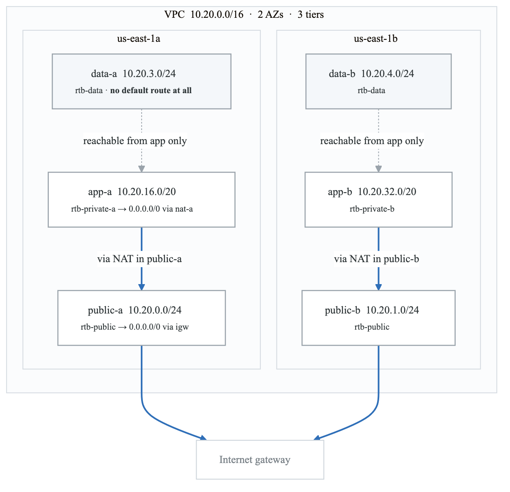
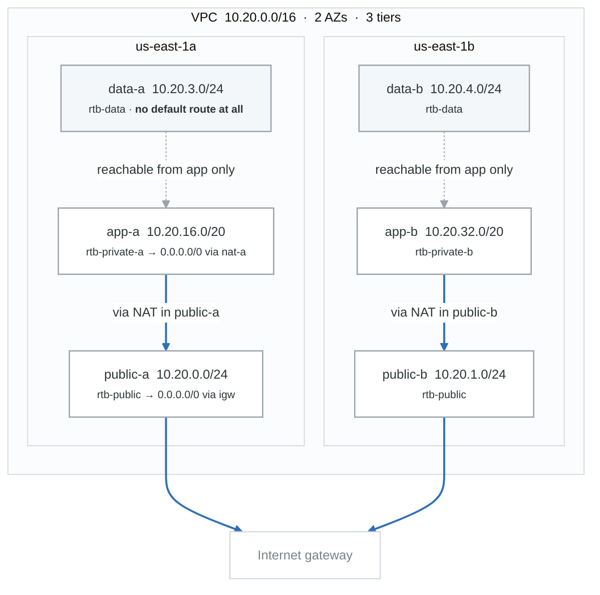

# Week 6 Labs

---

# Lab 1 — Build a VPC by Hand (3h)

> **Draw it on paper first.** Subnets, CIDRs, route tables, and which route table attaches to which
> subnet. Building before drawing is how people end up with a NAT gateway in a private subnet.

## The target

<!-- figure: generated from the Mermaid below by _shared/diagrams/embed-figures.py — do not edit the image -->


<details>
<summary>Diagram source (Mermaid)</summary>



</details>

> The data tier having **no default route at all** is deliberate, not an omission. A database should
> never initiate an outbound internet connection; denying it by *routing* rather than by firewall
> rule means even a misconfigured security group cannot create an exfiltration path.

## Build it```

## Build it

```bash
REGION=us-east-1
VPC_ID=$(aws ec2 create-vpc --cidr-block 10.20.0.0/16 \
  --tag-specifications 'ResourceType=vpc,Tags=[{Key=Name,Value=lab-vpc}]' \
  --query Vpc.VpcId --output text)

aws ec2 modify-vpc-attribute --vpc-id $VPC_ID --enable-dns-hostnames
aws ec2 modify-vpc-attribute --vpc-id $VPC_ID --enable-dns-support

IGW_ID=$(aws ec2 create-internet-gateway --query InternetGateway.InternetGatewayId --output text)
aws ec2 attach-internet-gateway --vpc-id $VPC_ID --internet-gateway-id $IGW_ID

PUB_A=$(aws ec2 create-subnet --vpc-id $VPC_ID --cidr-block 10.20.0.0/24 \
  --availability-zone ${REGION}a \
  --tag-specifications 'ResourceType=subnet,Tags=[{Key=Name,Value=public-a}]' \
  --query Subnet.SubnetId --output text)
# ... repeat for public-b, app-a, app-b, data-a, data-b

RTB_PUB=$(aws ec2 create-route-table --vpc-id $VPC_ID --query RouteTable.RouteTableId --output text)
aws ec2 create-route --route-table-id $RTB_PUB --destination-cidr-block 0.0.0.0/0 --gateway-id $IGW_ID
aws ec2 associate-route-table --route-table-id $RTB_PUB --subnet-id $PUB_A
aws ec2 modify-subnet-attribute --subnet-id $PUB_A --map-public-ip-on-launch
```

## Tasks
1. Build all six subnets and three route tables
2. **Before associating any route table,** check what route table the new subnets use. (The *main*
   route table — every subnet is implicitly associated with it. This is why a "private" subnet can
   accidentally be public if the main route table has an IGW route.)
3. Launch an instance in `public-a`; confirm you can SSH in
4. Launch an instance in `app-a`; confirm you **cannot** reach the internet from it (yet)
5. Look at the route table for `data-a` — no `0.0.0.0/0` at all. Explain what that means and why a
   database tier should look like this.

## The question to answer in writing

> *"What makes a subnet public?"*

Not "the checkbox." **A subnet is public if and only if its route table has a route to an internet
gateway.** `map-public-ip-on-launch` is a separate, orthogonal setting that gives instances a public
IP — an instance with a public IP in a subnet with no IGW route is still unreachable, and an
instance with no public IP in a public subnet still can't be reached inbound.

---

# Lab 2 — NAT, Bastion, SG vs NACL (3h · ~$2)

## Part 1 — NAT gateway

```bash
EIP=$(aws ec2 allocate-address --domain vpc --query AllocationId --output text)
NAT=$(aws ec2 create-nat-gateway --subnet-id $PUB_A --allocation-id $EIP \
  --query NatGateway.NatGatewayId --output text)
aws ec2 wait nat-gateway-available --nat-gateway-ids $NAT

RTB_APP_A=$(aws ec2 create-route-table --vpc-id $VPC_ID --query RouteTable.RouteTableId --output text)
aws ec2 create-route --route-table-id $RTB_APP_A --destination-cidr-block 0.0.0.0/0 --nat-gateway-id $NAT
aws ec2 associate-route-table --route-table-id $RTB_APP_A --subnet-id $APP_A
```

**Tasks:**
1. `dnf update` on the private instance — it now works
2. **Deliberately put the NAT gateway in a private subnet instead** and watch it fail. Explain why,
   referencing your week-3 namespace lab. (BF-27)
3. Note that `NAT` is per-AZ: a NAT in `us-east-1a` serving `app-b` works, but the traffic crosses
   AZs (cost) and the NAT is a single-AZ failure point. Production uses one per AZ.
4. **Delete the NAT gateway and release the EIP when done.**

## Part 2 — Bastion with ProxyJump

```ini
# ~/.aws/config equivalent for SSH -- ~/.ssh/config
Host bastion
    HostName <bastion-public-ip>
    User ec2-user
    IdentityFile ~/.ssh/lab.pem

Host private-app
    HostName 10.20.16.15
    User ec2-user
    IdentityFile ~/.ssh/lab.pem
    ProxyJump bastion
```
```bash
ssh private-app        # one command, two hops
```

**Better answer for an interview:** use **SSM Session Manager** instead of a bastion.
```bash
aws ssm start-session --target i-xxx
```
No bastion, no open port 22, no SSH keys to manage, full audit trail in CloudTrail, works in private
subnets with only VPC endpoints. Requires the SSM agent and an instance profile with
`AmazonSSMManagedInstanceCore`. **Saying "I'd use Session Manager rather than a bastion" is a
modern, security-aware answer** that a lot of candidates miss.

## Part 3 — SG vs NACL, proven

```bash
# Security group: stateful
aws ec2 authorize-security-group-ingress --group-id $SG_WEB --protocol tcp --port 80 --cidr 0.0.0.0/0
# Outbound response needs NO rule -- test it and confirm

# NACL: stateless
aws ec2 create-network-acl --vpc-id $VPC_ID
aws ec2 create-network-acl-entry --network-acl-id $ACL --rule-number 100 \
  --protocol tcp --port-range From=80,To=80 --cidr-block 0.0.0.0/0 --rule-action allow
# Now test: inbound works, but the RESPONSE is blocked because there's no egress rule
aws ec2 create-network-acl-entry --network-acl-id $ACL --rule-number 100 --egress \
  --protocol tcp --port-range From=1024,To=65535 --cidr-block 0.0.0.0/0 --rule-action allow
```

**Tasks:**
1. Prove the stateful behavior of SGs: allow inbound 80, no egress rule, confirm HTTP works
2. Prove the stateless behavior of NACLs: allow inbound 80 only, watch the response get dropped, then
   add the ephemeral egress rule
3. Add a NACL **deny** rule at a lower rule number than an allow and watch it win (BF-13 again)
4. Write out the full mapping to week 3's iptables lab

---

# Lab 3 — VPC Endpoints and Flow Logs (2h)

## Part 1 — Gateway endpoint for S3 (free, and it removes NAT cost)

```bash
aws ec2 create-vpc-endpoint --vpc-id $VPC_ID \
  --service-name com.amazonaws.${REGION}.s3 \
  --vpc-endpoint-type Gateway \
  --route-table-ids $RTB_APP_A $RTB_APP_B
```

**Tasks:**
1. **Delete the NAT gateway.** Confirm the private instance can no longer reach the internet.
2. Confirm it **can still reach S3** through the gateway endpoint.
3. Look at the private route table — the endpoint added a prefix-list route.
4. Compute the cost difference: gateway endpoint = **free**; NAT gateway ≈ $32/month + $0.045/GB
   processed. For an app whose only external dependency is S3, that's the entire NAT bill removed.

## Part 2 — Interface endpoint (costs money, but needed for most services)

```bash
aws ec2 create-vpc-endpoint --vpc-id $VPC_ID \
  --service-name com.amazonaws.${REGION}.ssm \
  --vpc-endpoint-type Interface \
  --subnet-ids $APP_A $APP_B \
  --security-group-ids $SG_ENDPOINT \
  --private-dns-enabled
```
This is what makes SSM Session Manager work in a fully private subnet with no NAT at all.

**Gateway vs Interface, memorize it:** Gateway = **S3 and DynamoDB only**, free, a route-table entry.
Interface = everything else, an ENI in your subnet, ~$7/month per endpoint per AZ plus data.

## Part 3 — Flow Logs

```bash
aws ec2 create-flow-logs --resource-type VPC --resource-ids $VPC_ID \
  --traffic-type ALL --log-destination-type cloud-watch-logs \
  --log-group-name /vpc/flowlogs --deliver-logs-permission-arn $FLOWLOG_ROLE_ARN
```

Then generate a rejected connection (try to reach a port your SG blocks) and find it:
```bash
aws logs start-query --log-group-name /vpc/flowlogs \
  --start-time $(($(date +%s) - 900)) --end-time $(date +%s) \
  --query-string 'fields @timestamp, srcAddr, dstAddr, dstPort, action
                  | filter action = "REJECT"
                  | sort @timestamp desc | limit 20'
```

**Flow Logs answer "is the traffic even arriving?"** — which bisects every connectivity problem into
"never got there" vs "got there and was refused." That's the AWS equivalent of tcpdump on both ends
(BF-18).

---

# Lab 4 — S3 Deep Dive (3h)

```bash
B="s3-lab-$(aws sts get-caller-identity --query Account --output text)"
aws s3 mb "s3://$B"
```

## Tasks
1. **Versioning:** enable it, overwrite an object, list versions, restore the old one, delete and
   observe the delete marker
2. **Lifecycle:** transition to Standard-IA at 30d, Glacier Flexible at 90d, expire at 365d; expire
   noncurrent versions at 30d and abort incomplete multipart uploads at 7d
3. **Storage classes:** upload the same object to Standard, Standard-IA, and One Zone-IA and compare
   the pricing in the calculator
4. **Static website hosting** + a public-read bucket policy, then **turn it off** and use CloudFront
   with OAC instead (week 8)
5. **Presigned URL:** generate one with a 5-minute expiry, test it, wait, test again
6. **Multipart upload:** upload a 200 MB file and observe the parts

```bash
aws s3api put-bucket-lifecycle-configuration --bucket "$B" --lifecycle-configuration file://lifecycle.json
aws s3api list-object-versions --bucket "$B"
aws s3 presign "s3://$B/reports/q1.txt" --expires-in 300
aws s3api list-multipart-uploads --bucket "$B"
```

**The lifecycle rule people forget:** `AbortIncompleteMultipartUpload`. Failed large uploads leave
orphaned parts that bill forever and are invisible in the console object list. Every production
bucket should have this rule. It's a genuinely good detail to mention.

---

# Lab 5 — S3 Security and Break/Fix (2h)

## Tasks
1. **Block Public Access** at the account level — understand the four settings and that account-level
   settings override bucket-level
2. Bucket policy denying non-TLS requests (`aws:SecureTransport`)
3. Bucket policy denying uploads that aren't SSE-KMS encrypted
4. Default encryption with a customer-managed KMS key; reproduce **BF-26**
5. Enable S3 access logging to a second bucket; find a request in the logs
6. **BF-27** — the NAT-in-a-private-subnet failure

## The public-bucket question

Public S3 buckets are one of the most common real-world breach causes. Know the layers:

| Layer | What it does |
|---|---|
| **Account-level Block Public Access** | The big hammer. Overrides everything below. Turn it on. |
| Bucket-level Block Public Access | Same four settings, per bucket |
| Bucket policy | Can grant public read if BPA allows it |
| ACLs | Legacy. `BucketOwnerEnforced` disables them entirely — the modern default. |

**The modern answer to "how do I serve static content publicly?"** is not a public bucket — it's
CloudFront with Origin Access Control, so the bucket stays private and only CloudFront can read it.
You'll build that in week 8.

## Teardown
```bash
aws ec2 delete-nat-gateway --nat-gateway-id $NAT
aws ec2 release-address --allocation-id $EIP
aws s3 rb "s3://$B" --force
bash ../../_setup/03-teardown.sh
```
**Verify the NAT gateway is gone.** It is the most expensive thing you created this week.
