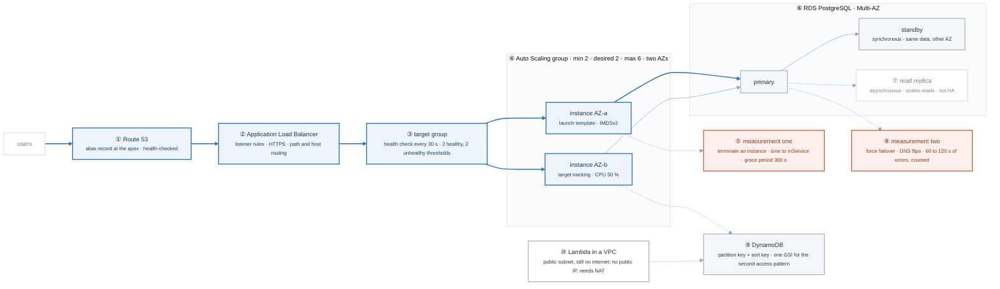

# Week 7 — Compute, Scaling, and Databases

> **Thesis:** this is where "architecture" starts. Every question from here on is a tradeoff between
> availability, cost, and operational overhead — and the SAA exam is almost entirely about which
> qualifier the question used.

| | |
|---|---|
| **Hours** | 35–45 |
| **Deliverable** | Blog post #4 — "Multi-AZ vs read replicas: I failed over an RDS instance to find out" |
| **Break/Fix** | BF-28, BF-29, BF-30 |
| **Exit check** | Measure a real RDS failover and a real ASG recovery. Write the numbers down. |

## The week in one figure

**Figure 7.1 — ALB to ASG to RDS, with the two numbers you measure.** The first real architecture: traffic in at the top, compute that replaces itself, a database that fails over. The week is about measuring the two recovery times, not reading about them. Badges are numbered in the order to walk them; the blue path is the one to follow first.

**What to say, badge by badge** · about three and a half minutes at a normal pace. Point at each badge as you say its line.

- **Open.** “Week 7 is where architecture starts, and the point of the week is two numbers you measure yourself: how long the fleet takes to heal, and how long the database is gone during a failover. Follow the blue line, then look at the two orange boxes.”
- **① Route 53.** “An alias record at the apex of your domain, pointing at the ALB. Alias, not CNAME, because the apex cannot hold a CNAME. Health-checked, so a dead endpoint is removed from the answer.”
- **② Application Load Balancer.** “Layer 7. Listener rules route by path and host. It terminates HTTPS with an ACM certificate. Compare it to the NLB in the lab: layer 4, static IPs, millions of connections, no routing rules.”
- **③ target group.** “Health checks every 30 seconds. Two consecutive passes mark a target healthy, two failures mark it unhealthy. That window is the floor on how fast anything above can react.”
- **④ Auto Scaling group.** “Minimum two, one per AZ, maximum six. A launch template defines the instance. Target tracking at 50 percent CPU scales out under load and, the part people forget to watch, scales back in afterwards.”
- **⑤ measurement one.** “Terminate an instance on purpose. Time it from termination to the replacement reporting InService. The 300-second grace period is part of that number. Write it down. It goes in blog post 4.”
- **⑥ RDS Multi-AZ.** “A primary and a standby in another AZ, replicated synchronously. Every commit lands on both before it is acknowledged. The standby takes no reads; it exists to take over.”
- **⑦ read replica.** “Asynchronous. It scales reads and it can lag. It is not high availability. One sentence for each: Multi-AZ is for failover, a replica is for read capacity.”
- **⑧ measurement two.** “Force a failover while a loop hammers the database and timestamps every result. The DNS name flips to the standby. Count the seconds of errors. Typically 60 to 120. That is your number, and it is the honest answer to how much downtime Multi-AZ costs.”
- **⑨ DynamoDB.** “A partition key and a sort key serve the first access pattern. A global secondary index serves the second. Design the table from the queries, not from the data.”
- **⑩ Lambda in a VPC.** “A Lambda attached to a public subnet still has no internet, because its interface has no public IP. It needs a NAT, like any private instance. This is a favourite exam trap and the week-6 route-table lesson again.”
- **Close.** “Traffic in, fleet that heals, database that fails over. Two measured numbers in your own words beat any diagram you copied, and both go into Project Alpha's README.”

---

## Day plan
| Day | Focus | Lab |
|---|---|---|
| Mon | ALB, target groups, listener rules | Lab 1 |
| Tue | ASG, launch templates, scaling policies | Lab 2 |
| Wed | RDS: Multi-AZ, replicas, **measured failover** | Lab 3 |
| Thu | DynamoDB: keys, indexes, capacity | Lab 4 |
| Fri | Lambda + ECS Fargate + Break/Fix | Lab 5 |
| Sat | SAA: compute + database domains; 40 questions | — |
| Sun | Blog post #4; plan week 8 | — |

## Reading map
- `_reference/aws/phase-1-foundations-notes-05-elastic-load-balancing.md`
- `_reference/aws/phase-2-compute-storage-notes-02-auto-scaling.md`
- `_reference/aws/phase-2-compute-storage-notes-05-lambda-serverless.md`
- `_reference/aws/phase-2-compute-storage-notes-04-containers-ecs-eks.md`
- `_reference/aws/phase-3-databases-integration-notes-01-rds.md`, `-02-aurora.md`, `-03-dynamodb.md`
- **Cheat sheets:** `phase-3-databases-integration-cheat-sheets-databases-cheat-sheet.md`
- **Labs:** `phase-2-compute-storage-labs-lab-02-auto-scaling-group.md`,
  `phase-3-databases-integration-labs-lab-01-rds-mysql-setup.md`,
  `phase-3-databases-integration-labs-lab-02-dynamodb-crud.md`

## Labs
[labs/LABS.md](labs/LABS.md) · [solutions/SOLUTIONS.md](solutions/SOLUTIONS.md)

| # | Lab | Time | Cost |
|---|---|---|---|
| 1 | ALB and target groups | 3h | ~$1 |
| 2 | ASG, launch templates, scaling | 3h | ~$1 |
| 3 | RDS Multi-AZ and measured failover | 3h | ~$3 |
| 4 | DynamoDB access patterns | 2h | <$1 |
| 5 | Lambda, Fargate, Break/Fix | 3h | <$1 |

**Destroy nightly.** An ALB is ~$0.55/day and an RDS Multi-AZ `db.t3.micro` is ~$1.20/day.

## Exit criteria
- [ ] ALB → ASG across 2 AZs, load-tested, observed scaling out **and back in**
- [ ] Terminated an instance and **measured** ASG recovery time
- [ ] Triggered an RDS failover and **measured** downtime
- [ ] Explain Multi-AZ vs read replica in one sentence each
- [ ] DynamoDB table with a GSI queried by both access patterns from boto3
- [ ] Explain why a VPC Lambda in a public subnet still has no internet
- [ ] Blog post #4 with your real numbers
