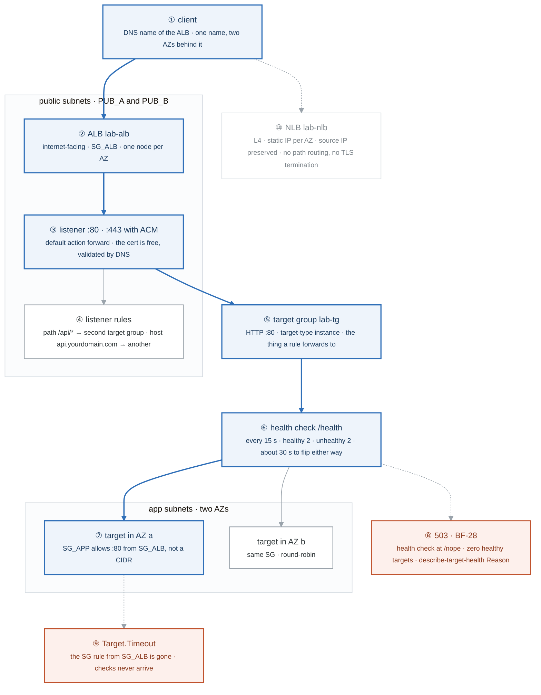
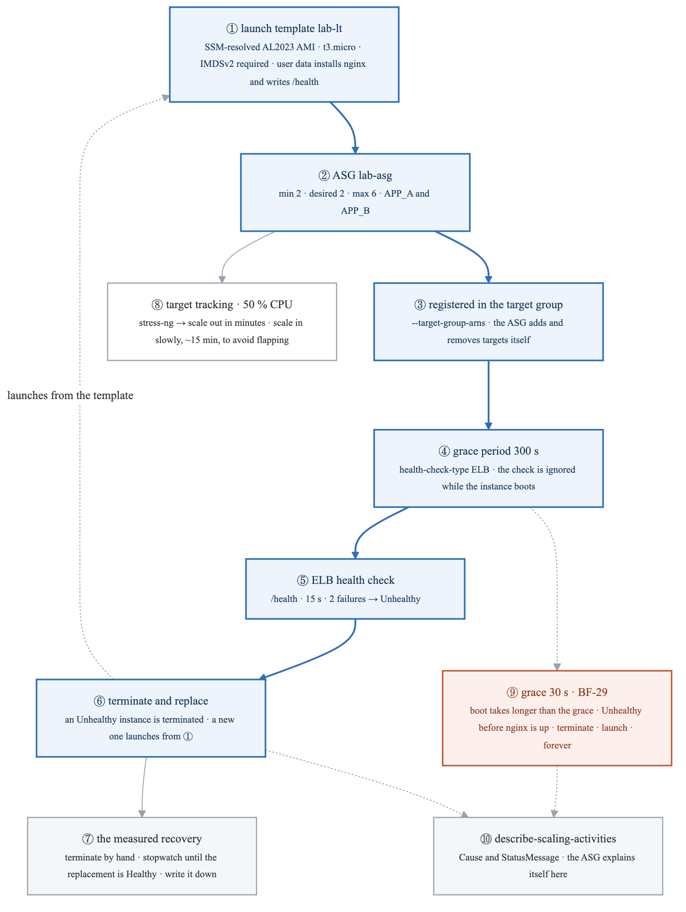
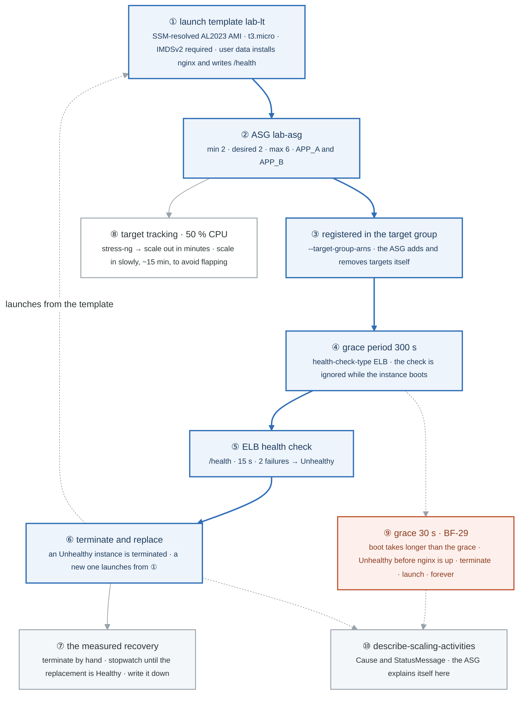
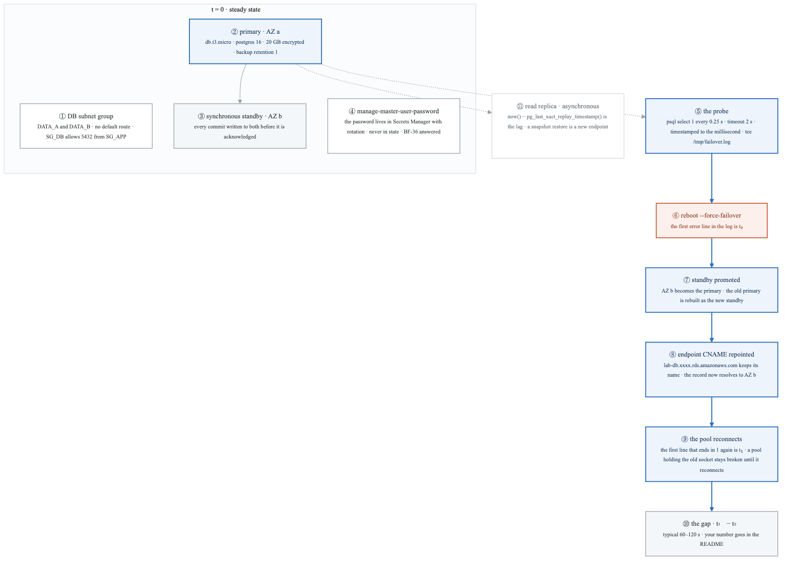
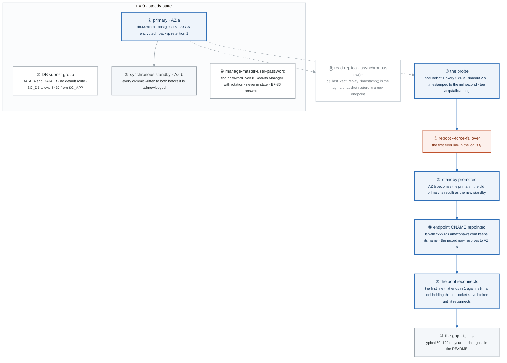
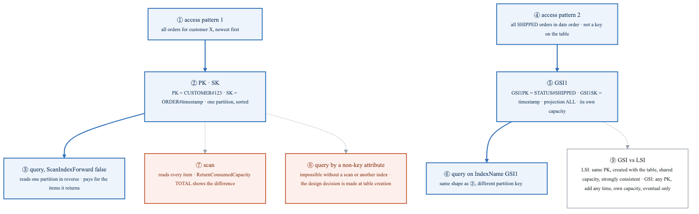
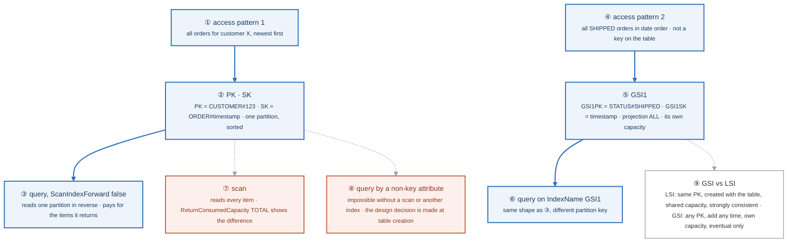
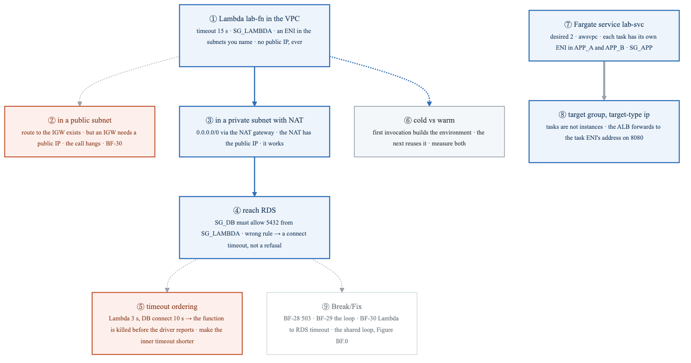
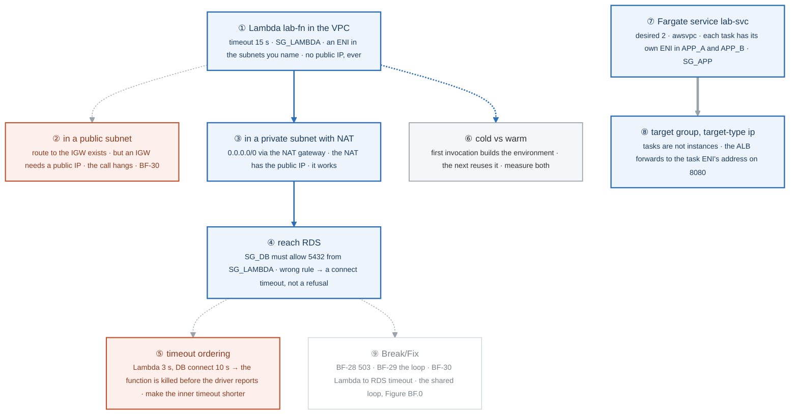

# Week 7 — Lab figures

> One figure per lab, numbered 7.2 to 7.6. Figure 7.1 is the week figure in
> [`../content/FIGURE.md`](../content/FIGURE.md); these five go one level down, to the mechanism each
> lab makes you touch. Same language: gray is structure, **blue is the path to follow first**,
> orange-red is where something refuses, washed boxes are stores. Each badge line is a thirty-second
> interview answer; each whole script is under three minutes.

**The protocol per figure**

1. **Before the lab:** read the figure, say the badges out loud once. You now know what you are about to prove.
2. **During the lab:** every badge has a **Prove it** command. Run it and watch the badge happen. A badge you cannot see happen is one you are taking on faith.
3. **After the lab:** close the file, redraw the figure, say the script. Check against the file. The badge where the order slipped goes in the *Figures redrawn* column of `progress.md`.
4. **Own the numbers.** The *Numbers to own* table is what separates "I know AWS" from "the health check is every fifteen seconds with a threshold of two, so a dead target takes about thirty seconds to leave rotation."
5. **Answer the question.** Each figure ends with the question a senior interviewer asks about it. Answer it cold, in under a minute, before the gate.

---

## Figure 7.2 — Lab 1: from the client to a healthy target, and the two ways it fails

> Lab 1 · badges ① to ⑩ · about three minutes. Reads top-down.

<!-- figure: generated from the Mermaid below by _shared/diagrams/embed-figures.py — do not edit the image -->


<details>
<summary>Diagram source (Mermaid)</summary>



</details>

### Say it, badge by badge

- **Open.** "A load balancer is three objects, not one: the balancer, the listener with its rules, and the target group with its health check. Each one can be wrong on its own. Follow the blue path from a client to a target, then the two orange boxes, which are the two failures you will diagnose for years."
- **① client.** "Resolves the ALB's DNS name and gets one address per AZ. The ALB itself is multi-AZ because it lives in two public subnets; your targets are only multi-AZ if you register them in two."
- **② ALB.** "Internet-facing, in PUB_A and PUB_B, wearing SG_ALB. It terminates HTTP, so it can read paths and hosts; it adds X-Forwarded-For because the target sees the ALB's address, not the client's."
- **③ listener.** "Port 80 forwarding to the target group by default; port 443 with an ACM certificate you requested and validated by DNS, for free. The listener is where TLS ends."
- **④ listener rules.** "Path /api/* to one target group, host api.yourdomain.com to another. Rules are evaluated in priority order, and the default action catches what nothing matched. This is the L7 part an NLB cannot do."
- **⑤ target group.** "The set of targets a rule forwards to, with its own port, protocol, and health check. Target-type instance here; target-type ip for Fargate in Lab 5, because a task has its own ENI."
- **⑥ health check.** "/health every fifteen seconds, two passes to become healthy, two failures to become unhealthy. That is roughly thirty seconds either way, and it is the number that bounds how long a dead instance keeps taking traffic."
- **⑦ targets.** "Two instances, two AZs, round-robin. SG_APP allows port 80 from SG_ALB by security group ID, not by CIDR. The ALB's addresses change; its security group does not."
- **⑧ 503.** "Point the health check at /nope and every target goes unhealthy. The ALB has nothing to forward to and answers 503 itself. `describe-target-health` says Target.ResponseCodeMismatch, and that Reason field is where BF-28 is solved."
- **⑨ Target.Timeout.** "Remove the SG rule and the checks never arrive. The Reason changes from a mismatch to a timeout, and that difference tells you whether the app is answering wrong or the packets are not reaching it."
- **⑩ NLB.** "Layer 4: a static IP per AZ, the client's source IP preserved at the target, no header reading, no path rules, no TLS termination unless you ask. Pick it for non-HTTP, for fixed IPs in someone's allowlist, or for raw throughput."
- **Close.** "Balancer, listener, rules, target group, health check, targets. A 503 is the check failing; a timeout is the check not arriving. One command, `describe-target-health`, tells you which."

### Numbers to own

| Number | Where it comes from | Why it matters |
|---|---|---|
| `15` s interval, `2` / `2` thresholds | `create-target-group` | about 30 s for a target to leave or rejoin rotation; the bound on how long a dead instance is served |
| 2 public subnets | `create-load-balancer --subnets` | the ALB is multi-AZ only because you gave it two subnets |
| port `80` from `SG_ALB` | `authorize-security-group-ingress --source-group` | SG-to-SG reference; the ALB's IPs change, its SG ID does not |
| `503` | the ALB with zero healthy targets | the balancer answers, not the app; `describe-target-health` holds the reason |
| `Target.Timeout` vs `Target.ResponseCodeMismatch` | the `Reason` field | packets not arriving versus app answering wrong |
| 1 static IP per AZ | NLB | why an NLB goes in a customer's allowlist and an ALB cannot |
| 60 s | ALB idle timeout default (AWS fact, week 9 numbers list) | long-polling and slow uploads need it raised |

### Prove it

```bash
aws elbv2 describe-target-health --target-group-arn $TG                               # ⑥ ⑦ State and Reason per target
for i in $(seq 6); do curl -s http://$ALB_DNS/ | grep -o 'ip-[0-9-]*'; done              # ⑦ round-robin across AZs
aws elbv2 modify-target-group --target-group-arn $TG --health-check-path /nope          # ⑧ then curl -I → 503
aws ec2 revoke-security-group-ingress --group-id $SG_APP --protocol tcp --port 80 --source-group $SG_ALB   # ⑨ Target.Timeout
curl -I http://$ALB_DNS/ | grep -i x-cache; aws s3 ls s3://$LOG_BUCKET/AWSLogs/ --recursive | tail -1   # access logs land in S3
```

### The question a senior interviewer asks

*"The ALB is returning 503. Is it the app or the network, and how do you tell in one command?"*
Badges ⑧ and ⑨: `describe-target-health`, then read Reason. ResponseCodeMismatch means the app answered and the check disagreed; Timeout means nothing arrived, so look at SG_APP's rule from SG_ALB. The follow-up is "and if the targets are healthy but users still get 503?" That is a listener rule forwarding to an empty target group, badge ④.

---

## Figure 7.3 — Lab 2: the ASG replaces what the health check condemns

> Lab 2 · badges ① to ⑩ · about three minutes. Reads top-down.

<!-- figure: generated from the Mermaid below by _shared/diagrams/embed-figures.py — do not edit the image -->


<details>
<summary>Diagram source (Mermaid)</summary>



</details>

### Say it, badge by badge

- **Open.** "An Auto Scaling group is a loop: launch from a template, let the load balancer judge the instance, replace what it condemns. The one number that decides whether the loop heals or destroys is the grace period. Follow the blue path, then the orange box, which is the same loop with the number wrong."
- **① launch template.** "Everything an instance needs to be born: an AMI resolved through SSM so it is always current, t3.micro, IMDSv2 required, and user data that installs nginx and writes /health. The template is immutable; you version it."
- **② ASG.** "Min 2, desired 2, max 6, across two app subnets. Desired is what it tries to keep; min and max are the fence the scaling policy moves inside."
- **③ registered in the target group.** "The ASG registers every instance it launches and deregisters every one it terminates. You never touch the target list again; that is the point."
- **④ grace period.** "Three hundred seconds during which ELB health check results are ignored. An instance takes time to boot, install packages, and start serving. Shorter than the boot and the ASG judges an instance that has not started yet."
- **⑤ ELB health check.** "After the grace, the target group's view becomes the ASG's view: two failed checks at /health and the instance is Unhealthy to the ASG, not just to the balancer."
- **⑥ terminate and replace.** "An Unhealthy instance is terminated and a fresh one launches from the template. Self-healing is exactly this: the balancer notices, the group replaces. Nobody pages."
- **⑦ the measured recovery.** "Terminate an instance by hand and time it until the replacement is Healthy: launch, boot, user data, grace, two passing checks. That number goes in your README and in your interview answer, because 'it self-heals' is a brochure sentence."
- **⑧ target tracking.** "Fifty percent average CPU. Push it up with stress-ng and watch desired climb within minutes; let it drop and watch it come down slowly, about fifteen minutes, because scale-in is deliberately cautious. Flapping costs more than headroom."
- **⑨ grace 30 s.** "Set the grace below the boot time and the loop inverts. The check fails before nginx exists, the instance is condemned, a new one launches and fails the same way. BF-29: the most common ASG failure, and it looks like 'instances keep dying'."
- **⑩ describe-scaling-activities.** "Every launch and termination has a Cause and a StatusMessage. 'Instance failed ELB health checks' repeated every few minutes is the loop confessing. Read this before you read the instance."
- **Close.** "Template, group, registration, grace, check, replace. Measure the recovery once; then break the grace period and watch the same loop eat the group. The difference is one integer."

### Numbers to own

| Number | Where it comes from | Why it matters |
|---|---|---|
| `2` / `2` / `6` | min, desired, max | the fence; a scaling policy moves desired, never min or max |
| `300` s | `--health-check-grace-period` | must exceed boot plus user data plus the first passing checks |
| `30` s | the BF-29 reproduction | a grace shorter than the boot turns self-healing into a termination loop |
| `50` % | target tracking on `ASGAverageCPUUtilization` | scale out fast when above, in slowly when below |
| ~15 min | scale-in behaviour described in the lab | cooldown plus a cautious scale-in; flapping is the thing it prevents |
| 1 measured number | your terminate-to-healthy stopwatch | the sentence you say in interviews instead of "it self-heals" |
| `$Latest` | the launch template version | the group launches from whatever the newest version is; pin a number in production |

### Prove it

```bash
aws autoscaling describe-auto-scaling-groups --auto-scaling-group-names lab-asg --query 'AutoScalingGroups[0].Instances[].[InstanceId,HealthStatus,LifecycleState]'   # ② ⑤
date +%T; aws ec2 terminate-instances --instance-ids $ONE; watch -n5 aws elbv2 describe-target-health --target-group-arn $TG                                  # ⑦ stopwatch
aws autoscaling describe-scaling-activities --auto-scaling-group-name lab-asg --max-items 5 --query 'Activities[].[StartTime,Cause,StatusMessage]'             # ⑩
aws autoscaling update-auto-scaling-group --auto-scaling-group-name lab-asg --health-check-grace-period 30                                                     # ⑨ then watch ⑩ repeat
```

### The question a senior interviewer asks

*"Instances in the group keep launching and dying every few minutes. Nothing is in the logs. What is it?"*
Badges ④ and ⑨: the grace period is shorter than the boot, so the ELB check condemns instances before they serve. The proof is badge ⑩, the Cause field repeating. The fix is one integer, and the prevention is measuring boot time before setting it.

---

## Figure 7.4 — Lab 3: the Multi-AZ failover, as a timeline you measured

> Lab 3 · badges ① to ⑪ · about three and a half minutes. Reads top-down, in time order.

<!-- figure: generated from the Mermaid below by _shared/diagrams/embed-figures.py — do not edit the image -->


<details>
<summary>Diagram source (Mermaid)</summary>



</details>

### Say it, badge by badge

- **Open.** "Multi-AZ is a brochure word until you have watched it happen with a stopwatch. This figure is the failover as a timeline, from steady state to the number you measured. The blue path is time."
- **① DB subnet group.** "Two data subnets, two AZs, no default route out. SG_DB allows 5432 only from SG_APP, so connecting from a public subnet fails until you add that rule. The subnet group is what lets RDS place a standby in the other AZ at all."
- **② primary.** "db.t3.micro, Postgres 16, twenty gigabytes encrypted at rest, one day of backups. Not publicly accessible. Small on purpose; the mechanism is the same at any size."
- **③ synchronous standby.** "In the other AZ. Every commit is written to both before the client is told it succeeded. That is why RPO on failover is zero and why Multi-AZ is not a read replica: you cannot query it."
- **④ manage-master-user-password.** "RDS generates the password, stores it in Secrets Manager, and rotates it. Terraform never sees it, you never see it, it never lands in state. This is the answer to BF-36 before week 11 asks it."
- **⑤ the probe.** "A loop: `select 1` every quarter second with a two-second timeout, each result timestamped to the millisecond, teed to a log. This is the instrument. Without it, you have an opinion about the failover; with it, you have a number."
- **⑥ force-failover.** "A reboot with the failover flag. The first line in the log that says error, timeout, or could not is t-zero."
- **⑦ standby promoted.** "The standby in AZ b becomes the primary. The old primary is rebuilt as the new standby afterwards, so you end the exercise still Multi-AZ, just mirrored."
- **⑧ CNAME repointed.** "The endpoint name does not change. The DNS record behind it now resolves to AZ b. Your connection string is still correct, which is exactly why the application cannot tell anything happened unless it reconnects."
- **⑨ the pool reconnects.** "The first log line that ends in `1` again is t-one. A connection pool holding the old socket keeps failing until it opens a new connection; the app has to treat a dead connection as a reason to reconnect, not a reason to crash."
- **⑩ the gap.** "t-one minus t-zero. Typical is sixty to a hundred and twenty seconds. 'I measured an RDS Multi-AZ failover at seventy-three seconds' is a credible sentence; 'it fails over automatically' is not."
- **⑪ read replica.** "Asynchronous, so it can lag, and `now() minus pg_last_xact_replay_timestamp()` tells you by how much. A snapshot restore is a different thing again: it creates a new instance with a new endpoint. Three mechanisms, three failure semantics."
- **Close.** "Two copies, one name, one repointed record, and a pool that must notice. The measurement is the lab; the number is what you carry out of it."

### Numbers to own

| Number | Where it comes from | Why it matters |
|---|---|---|
| `0.25` s probe, `2` s timeout | the measurement loop | fine enough to see the gap, short enough that a hung connect does not hide it |
| `60–120` s | the lab's stated typical failover | the range your measured number should land in; say your number, not the range |
| 1 endpoint name, 2 addresses | the CNAME repoint | the connection string never changes, the pool must still reconnect |
| `1` day backups, `20` GB, `db.t3.micro` | `create-db-instance` | the cheapest Multi-AZ that exists; ~$3 for the lab |
| 0 secrets in state | `--manage-master-user-password` | the database password question in every IaC interview |
| `5432` from `SG_APP` | the SG rule you add in task 5 | why the public-subnet connection fails until the app SG is referenced |
| 5 read replicas, 15 for Aurora | AWS limit (week 9 numbers list) | the scaling ceiling of asynchronous reads |

### Prove it

```bash
aws rds describe-db-instances --db-instance-identifier lab-db --query 'DBInstances[0].[MultiAZ,AvailabilityZone,SecondaryAvailabilityZone]'   # ② ③
aws secretsmanager list-secrets --query "SecretList[?contains(Name,'rds')].Name"                                                               # ④
dig +short $ENDPOINT; aws rds reboot-db-instance --db-instance-identifier lab-db --force-failover; sleep 90; dig +short $ENDPOINT             # ⑧ the CNAME moves
grep -n 'error\|timeout\|could not' /tmp/failover.log | head -1                                                                               # ⑥ t₀
psql -h $REPLICA -U appadmin -d postgres -tAc 'select now() - pg_last_xact_replay_timestamp();'                                               # ⑪ lag
```

### The question a senior interviewer asks

*"You say you measured a 73-second failover. Walk me through what happened at the DNS, storage, and connection-pool layers, and what the application must do."*
Badges ③, ⑦, ⑧, ⑨ in that order: synchronous storage means no data loss, promotion flips the roles, the CNAME is repointed under the same name, and the pool must drop dead connections and reconnect. If you answer with only "it fails over", the follow-up is "then why did your app stay down for ten minutes afterwards?" That is badge ⑨.

---

## Figure 7.5 — Lab 4: the table is the index

> Lab 4 · badges ① to ⑨ · about two and a half minutes.

<!-- figure: generated from the Mermaid below by _shared/diagrams/embed-figures.py — do not edit the image -->


<details>
<summary>Diagram source (Mermaid)</summary>



</details>

### Say it, badge by badge

- **Open.** "In SQL you write the table and add indexes when queries get slow. In DynamoDB the table is the index, so you start from the queries. Two access patterns, two key designs, and one scan to show what it costs when you did not plan."
- **① access pattern 1.** "All orders for a customer, newest first. Write the sentence before you write the key; the key is derived from it, never the other way round."
- **② PK and SK.** "Partition key CUSTOMER#123, sort key ORDER# plus a timestamp. Every order for one customer lands in one partition, already sorted by time. The prefixes are a convention that lets one table hold many entity types."
- **③ query.** "Key condition on PK, ScanIndexForward false to read the sort key backwards. It touches one partition and consumes capacity only for what it returns."
- **④ access pattern 2.** "All shipped orders in date order. Status is not a key on the table, so this query is impossible as the table stands. That is the moment you need an index."
- **⑤ GSI1.** "A second key pair, GSI1PK STATUS#SHIPPED and GSI1SK timestamp, projection ALL, its own capacity. DynamoDB maintains it as a copy with a different partition layout. You added it at creation here; you could add it any time."
- **⑥ query on the index.** "IndexName GSI1 and the same key-condition shape. Same cost model: one partition, pay for what comes back."
- **⑦ scan.** "Reads every item in the table and filters afterwards. With ReturnConsumedCapacity TOTAL you see the number: a scan of fifty items costs more than the query that returned five, and the ratio gets worse with every item you add. This is the whole reason modelling matters."
- **⑧ query by a non-key attribute.** "You cannot. `total > 40` is a filter on a scan, not a query. The design decision was made when you chose the keys, which is why the access patterns come first."
- **⑨ GSI vs LSI.** "An LSI shares the partition key, must exist at table creation, shares the table's capacity, and can be strongly consistent. A GSI has any partition key, can be added later, has its own capacity, and is eventually consistent only. Pick an LSI only when you need strong consistency on an alternate sort order within the same partition."
- **Close.** "Pattern, key, query. Second pattern, index, query. Scan is the price of not deciding. The one-sentence interview version: you design the table around the access patterns because you can only query efficiently on keys."

### Numbers to own

| Number | Where it comes from | Why it matters |
|---|---|---|
| 2 access patterns | the lab | each becomes exactly one key pair: table keys or a GSI |
| `50` items | task 1 | enough for the scan-versus-query capacity comparison to be visible |
| 1 partition per query | the key design | why a query is cheap: it never touches other customers' data |
| `20` GSIs / `5` LSIs | AWS limit (week 9 numbers list) | the index budget per table |
| `400` KB | max item size (week 9 numbers list) | why large blobs go to S3 with a pointer in the item |
| 4 differences | GSI vs LSI | key, creation time, capacity, consistency |

### Prove it

```bash
aws dynamodb query --table-name lab-orders --key-condition-expression 'PK = :p' --expression-attribute-values '{":p":{"S":"CUSTOMER#123"}}' --no-scan-index-forward --return-consumed-capacity TOTAL --query 'ConsumedCapacity'   # ③
aws dynamodb query --table-name lab-orders --index-name GSI1 --key-condition-expression 'GSI1PK = :s' --expression-attribute-values '{":s":{"S":"STATUS#SHIPPED"}}' --return-consumed-capacity TOTAL --query 'ConsumedCapacity'  # ⑥
aws dynamodb scan --table-name lab-orders --return-consumed-capacity TOTAL --query 'ConsumedCapacity'                                                                                                                            # ⑦ compare
aws dynamodb update-continuous-backups --table-name lab-orders --point-in-time-recovery-specification PointInTimeRecoveryEnabled=true                                                                                             # PITR
```

### The question a senior interviewer asks

*"Why do you design a DynamoDB table around access patterns, and when would you choose an LSI over a GSI?"*
Badges ① ② ⑧ for the first half: you can only query on keys, so the queries define the keys. Badge ⑨ for the second: strong consistency on an alternate sort within the same partition, and you knew it at table creation. If you say "LSI is cheaper", the follow-up is "cheaper how?" and the answer is shared capacity, which is also its limitation.

---

## Figure 7.6 — Lab 5: a function with an ENI, and the timeout that must be shorter

> Lab 5 · badges ① to ⑨ · about two and a half minutes. The Friday scenarios use the shared loop, [Figure BF.0](../../_shared/breakfix/FIGURE.md).

<!-- figure: generated from the Mermaid below by _shared/diagrams/embed-figures.py — do not edit the image -->


<details>
<summary>Diagram source (Mermaid)</summary>



</details>

### Say it, badge by badge

- **Open.** "Two ways to run code without owning an instance, and both of them get a network interface in your VPC. Once you believe that, the two surprises in this lab stop being surprises."
- **① Lambda in the VPC.** "You name subnets and a security group; the service creates an ENI there and your function's traffic leaves through it. The ENI never has a public IP. Hold that fact."
- **② in a public subnet.** "The route table says 0.0.0.0/0 via the IGW. An internet gateway only forwards for an address that has a public IP mapped to it, and the ENI has none. The call to the internet hangs until the function times out. BF-30, and it looks like a Lambda bug."
- **③ private subnet with NAT.** "The same ENI in a private subnet, default route to a NAT gateway. The NAT has the public IP and does the translation. Now it works. Private subnet plus NAT is the only correct placement for a function that needs the internet."
- **④ reach RDS.** "Same VPC, so it is only security groups. SG_DB must allow 5432 from SG_LAMBDA. Get the rule wrong and you do not get refused; you get a connect timeout, because the packets are dropped, not rejected."
- **⑤ timeout ordering.** "Function timeout three seconds, database connect timeout ten. The function is killed at three with a generic Task timed out, and the driver never gets to say what it was waiting for. The inner timeout must be shorter than the outer, every layer, all the way down."
- **⑥ cold vs warm.** "The first invocation builds the execution environment; the next one reuses it. Measure both with the REPORT line. In a VPC the cold start used to include the ENI; it no longer does, but the environment build is still there."
- **⑦ Fargate service.** "Two tasks, awsvpc networking, each task with its own ENI in the app subnets, wearing SG_APP. A task is addressable the way an instance is, without an instance."
- **⑧ target-type ip.** "Because a task is not an instance, the target group registers the ENI's address on port 8080. The ALB from Lab 1 forwards to it the same way; only the target type changed."
- **⑨ Break/Fix.** "Three scenarios, one loop. 503 is Figure 7.2, the launch loop is Figure 7.3, the Lambda timeout is badges ② and ⑤ here. Narrate the shared loop every time."
- **Close.** "An ENI in your subnets, no public IP, so private plus NAT. Security groups between the ENI and the database. And timeouts that get shorter the deeper you go. The Fargate half is the same ENI story with a different target type."

### Numbers to own

| Number | Where it comes from | Why it matters |
|---|---|---|
| `15` s | `--timeout` on create-function | the outer bound; everything inside must finish sooner |
| `3` s vs `10` s | task 4 | the inverted ordering that hides the real error; inner timeouts shorter than outer |
| 0 public IPs | a Lambda ENI | why a public subnet gives no internet and a NAT does |
| `5432` from `SG_LAMBDA` | the DB SG rule | a wrong rule times out instead of refusing |
| `2` tasks, `8080` | the Fargate service | one ENI per task; the target group registers IPs |
| 15 min, 10 GB | Lambda limits (week 9 numbers list) | the ceiling on what belongs in a function at all |

### Prove it

```bash
aws lambda get-function-configuration --function-name lab-fn --query 'VpcConfig'                                   # ① subnets and SG
aws ec2 describe-network-interfaces --filters Name=description,Values='AWS Lambda VPC ENI*' --query 'NetworkInterfaces[].[SubnetId,PrivateIpAddress,Association.PublicIp]'   # ① no public IP
aws lambda invoke --function-name lab-fn /dev/stdout; aws logs tail /aws/lambda/lab-fn --since 5m | grep REPORT       # ② ⑥ Task timed out · Init Duration
aws lambda update-function-configuration --function-name lab-fn --timeout 3                                          # ⑤ reproduce the inverted ordering
aws elbv2 describe-target-groups --target-group-arns $TG_IP --query 'TargetGroups[0].TargetType'                     # ⑧ ip
```

### The question a senior interviewer asks

*"Why does a Lambda in a public subnet with an internet gateway still have no internet access?"*
Badges ① and ②: the ENI has no public IP and an IGW only forwards for addresses that do. Then badge ③ unprompted: private subnet, NAT gateway. The follow-up is badge ⑤: "and why did your function time out with no useful error?" Inner timeout longer than outer.

---

## Redraw schedule

Same cadence as the week figure, see [`../../FIGURES.md`](../../FIGURES.md): Friday of this week after break/fix, Sunday of week 9, and cold at the Gate 2 Sunday in week 9. Lab figures are redrawn **after** the week figure, one at a time, and only the badge order has to be right; the captions are the check, not the test.
