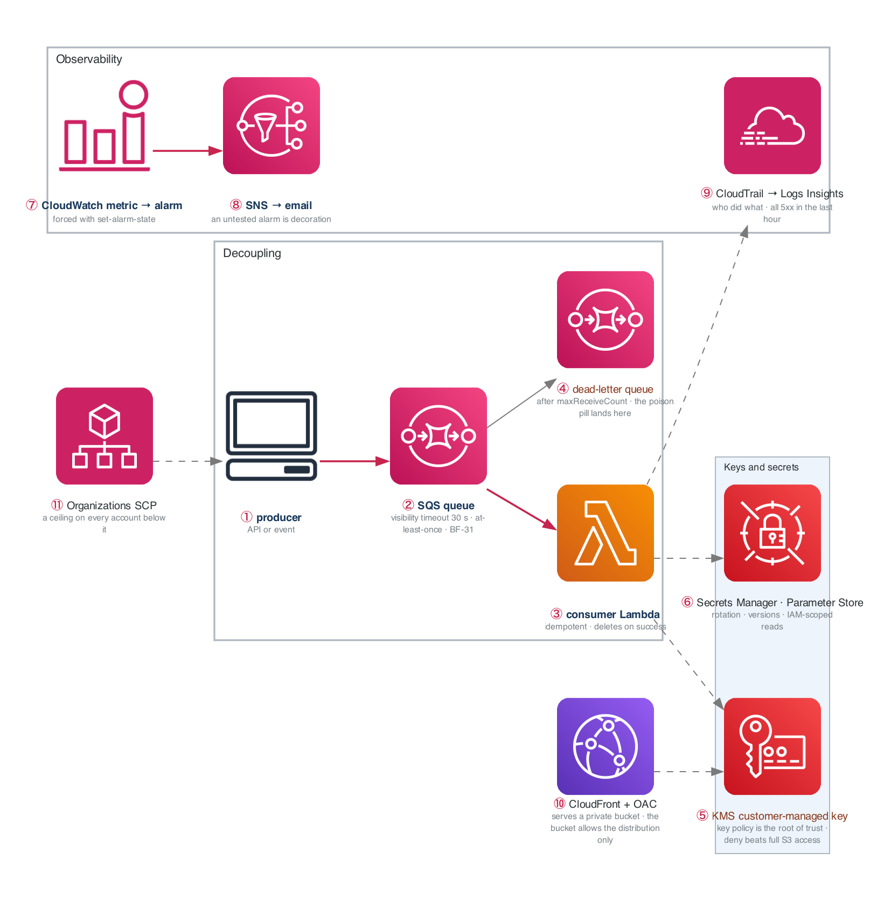

# Figure 8.1 — Decouple, encrypt, observe, and know what it costs

> Week 8 · badges ① to ⑪ · about four minutes at a normal pace. Point at each badge as you say its line. Blue is the path to follow first; orange-red is where something refuses or fails.



Three short paths rather than one: a queue that absorbs load, a key that can say no, and an alarm that you force to fire. The DR strategies are the table under the figure.

## What to say, badge by badge

- **Open.** “The last of the SAA surface area, and the services you will touch every day afterwards. Three small stories: a queue that protects a consumer, a key that can refuse an administrator, and an alarm you do not trust until you have forced it to fire.”
- **① producer.** “Anything that emits work: an API, an event, a schedule. It writes to the queue and returns immediately. It never waits on the consumer.”
- **② SQS queue.** “Messages are delivered at least once. When a consumer reads one, it becomes invisible for the visibility timeout, 30 seconds by default. If the consumer takes longer and does not extend it, the message reappears and is processed twice. That is BF-31, and you reproduce it on purpose.”
- **③ consumer Lambda.** “Because delivery is at-least-once, the consumer must be idempotent: doing the work twice must be safe. It deletes the message only after success.”
- **④ dead-letter queue.** “A message that fails maxReceiveCount times moves here instead of blocking the queue forever. Send a poison pill and watch it land. Without a DLQ, one bad message can stall everything behind it.”
- **⑤ KMS customer-managed key.** “The key policy, not IAM, is the root of trust for a key. The lab gives a principal full S3 access and then denies it in the key policy. The object reads fail. That is the demonstration that encryption is an access control, not just a checkbox.”
- **⑥ Secrets Manager and Parameter Store.** “Secrets Manager rotates and costs per secret. Parameter Store is cheaper and fine for configuration. Either way, the application reads at runtime with an IAM-scoped call and nothing lives in an environment file.”
- **⑦ CloudWatch alarm.** “A metric crosses a threshold for N periods and the alarm changes state. Force the state with `set-alarm-state` and watch the notification arrive. If you have not forced it, you do not know it works.”
- **⑧ SNS to email.** “The alarm publishes to a topic; the topic fans out to email, SMS, Lambda, or a queue. Confirm the subscription or nothing arrives.”
- **⑨ CloudTrail and Logs Insights.** “CloudTrail is who did what, to which resource, from where. Logs Insights is a query language over log groups. The exit criterion is one query: all 5xx in the last hour.”
- **⑩ CloudFront with OAC.** “A distribution in front of a private bucket. Origin Access Control signs the requests, and the bucket policy allows that distribution and nobody else. The bucket stays private and the content is public.”
- **⑪ Organizations SCP.** “A service control policy is a ceiling applied to every account under an OU. It grants nothing; it only removes. Deny leaving the organization, deny disabling CloudTrail, deny regions you do not use.”
- **Close.** “Four disaster-recovery strategies finish the week, and the one-line version is this: backup and restore is hours and cheap, pilot light is tens of minutes, warm standby is minutes, multi-site is seconds and costs double. RTO and RPO are what you are buying.”

## Use it

- Read the figure before the day plan. Say the script out loud on Friday with the file closed.
- Each badge line is a thirty-second interview answer; the whole script is the three-minute version.
- Regenerate after editing the spec in `_shared/diagrams/week_figures/`:

```bash
python3 ../../_shared/diagrams/generate-week-figures.py --only 8
```
