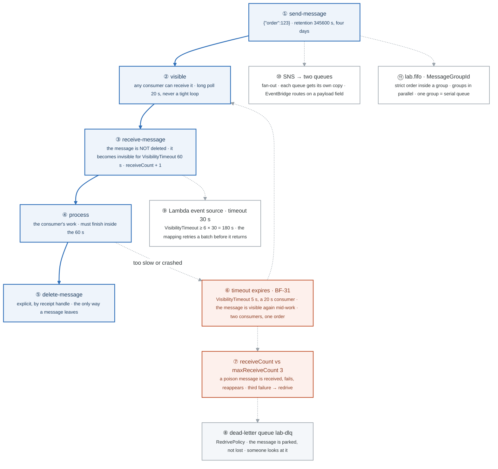
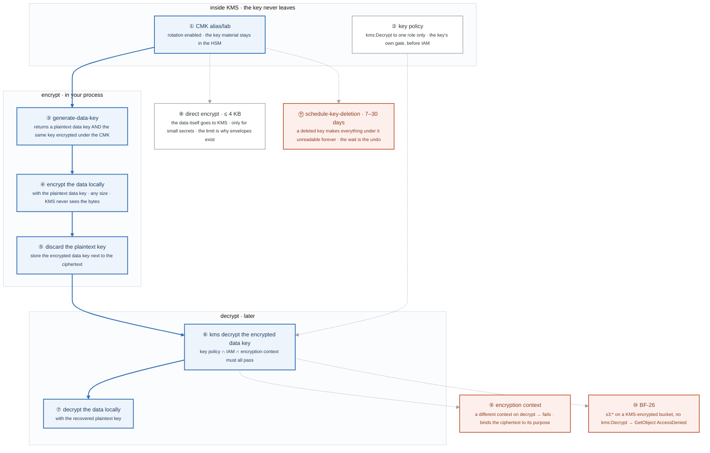
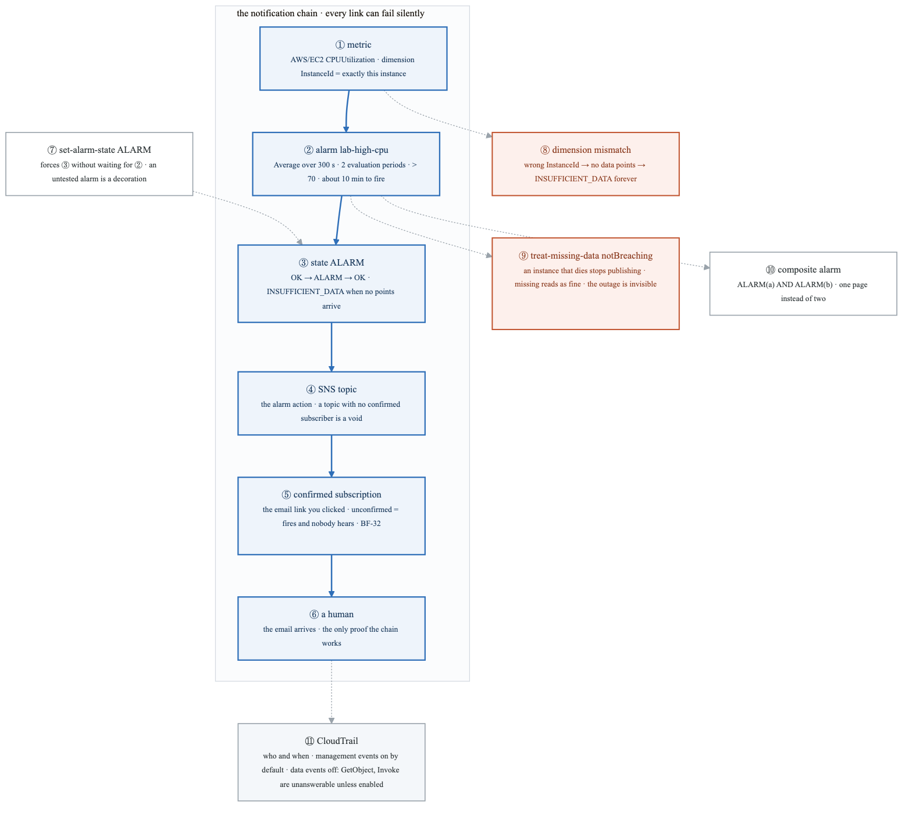
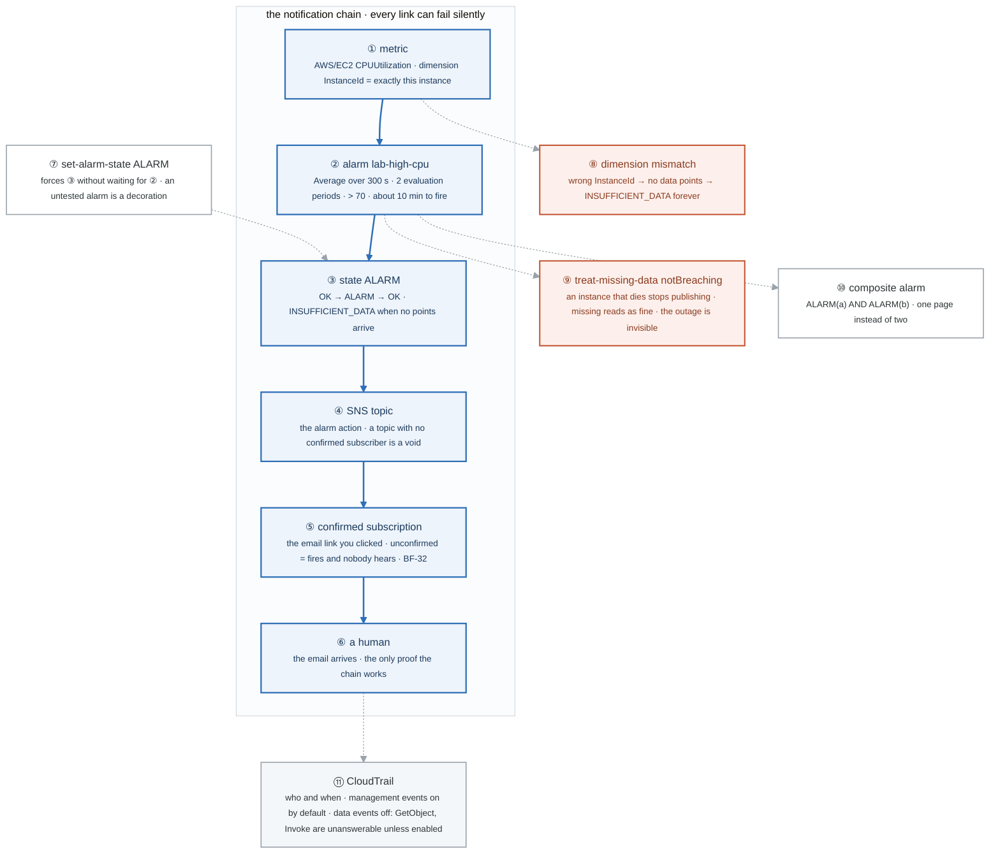
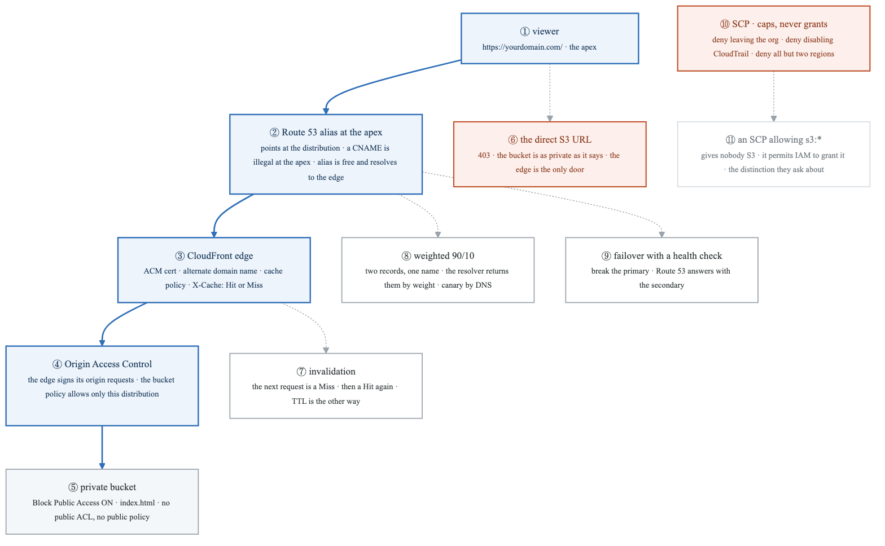
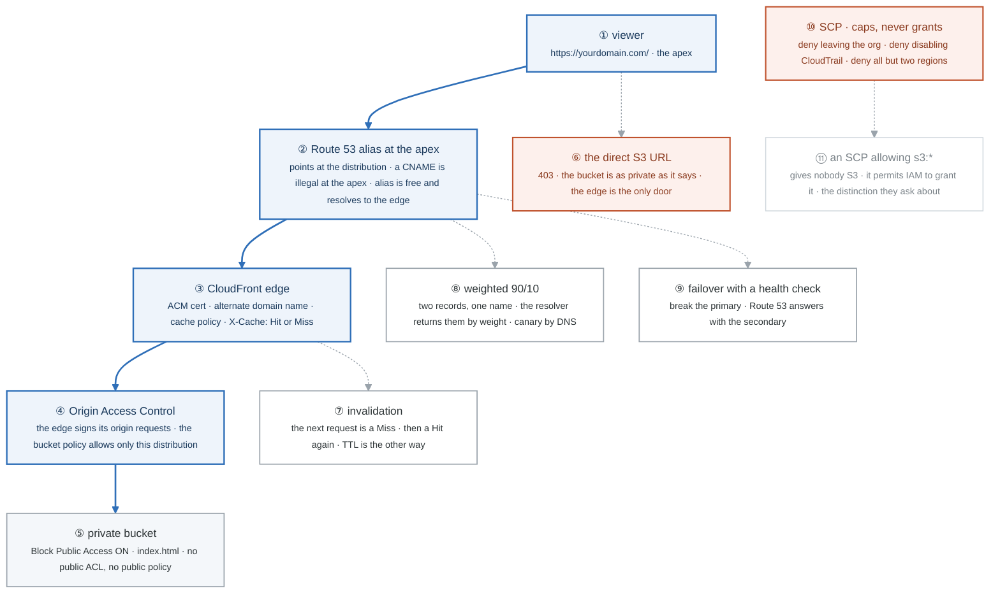
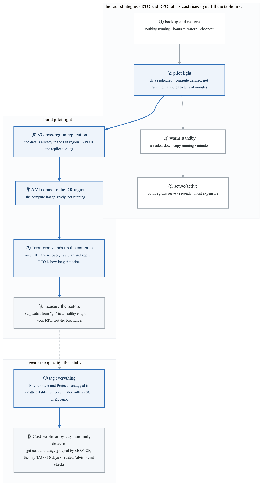
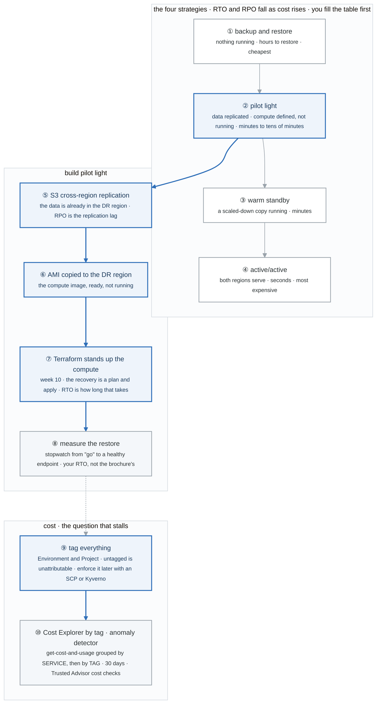

# Week 8 — Lab figures

> One figure per lab, numbered 8.2 to 8.6. Figure 8.1 is the week figure in
> [`../content/FIGURE.md`](../content/FIGURE.md); these five go one level down, to the mechanism each
> lab makes you touch. Same language: gray is structure, **blue is the path to follow first**,
> orange-red is where something refuses, washed boxes are stores. Each badge line is a thirty-second
> interview answer; each whole script is under three minutes.

**The protocol per figure**

1. **Before the lab:** read the figure, say the badges out loud once. You now know what you are about to prove.
2. **During the lab:** every badge has a **Prove it** command. Run it and watch the badge happen. A badge you cannot see happen is one you are taking on faith.
3. **After the lab:** close the file, redraw the figure, say the script. Check against the file. The badge where the order slipped goes in the *Figures redrawn* column of `progress.md`.
4. **Own the numbers.** The *Numbers to own* table is what separates "I know SQS" from "visibility timeout at least six times the function timeout, because the event source mapping retries a batch up to six times before it goes back on the queue."
5. **Answer the question.** Each figure ends with the question a senior interviewer asks about it. Answer it cold, in under a minute, before the gate.

---

## Figure 8.2 — Lab 1: the life of a message, and the timeout that duplicates it

> Lab 1 · badges ① to ⑪ · about three and a half minutes. Reads top-down, as a state machine.

<!-- figure: generated from the Mermaid below by _shared/diagrams/embed-figures.py — do not edit the image -->


<details>
<summary>Diagram source (Mermaid)</summary>



</details>

### Say it, badge by badge

- **Open.** "A queue is a state machine with one trap in it. Receiving does not delete. Everything surprising about SQS, duplicates, poison messages, the six-times rule, comes from that one fact. Follow the blue path, then the orange loop."
- **① send-message.** "A body, up to the retention period: four days here, fourteen at most. The producer is done the moment the call returns; it never learns who consumed it."
- **② visible.** "Available to any consumer. Receive with a twenty-second wait, long polling, so an empty queue costs one request per twenty seconds instead of one per millisecond. Short polling in a loop can cost more than the compute."
- **③ receive-message.** "The message comes back with a receipt handle and goes invisible for the visibility timeout, sixty seconds. It is still in the queue. Its receive count went up by one."
- **④ process.** "Your work. It has to finish inside the visibility window, because the window is the only thing keeping other consumers off this message."
- **⑤ delete-message.** "By receipt handle, explicitly, after the work succeeded. This is the only way a message leaves the queue before retention expires. Forget it and the message comes back."
- **⑥ timeout expires.** "Set the timeout to five seconds and give the consumer twenty seconds of work. At second five the message is visible again while the first consumer is still on it; a second consumer picks it up. One order, processed twice. BF-31, and the fix is a timeout longer than the work, plus idempotent consumers, because the timeout is a bet, not a lock."
- **⑦ receiveCount.** "A poison message fails every time and comes back every time. The redrive policy counts receives; at the third, maxReceiveCount, the queue moves it instead of serving it again."
- **⑧ dead-letter queue.** "A plain queue that receives the rejects. Nothing is lost; something is parked where a human or a replay job can look. Alarm on its depth."
- **⑨ Lambda event source.** "The event source mapping receives a batch and invokes the function; on failure it retries the batch, and AWS's guidance is a visibility timeout of at least six times the function timeout so those retries fit inside one window. Thirty-second function, hundred-and-eighty-second timeout."
- **⑩ SNS fan-out.** "A topic with two queues subscribed; one publish, two copies, two independent consumers. EventBridge does the same with a rule that matches on a field in the payload and routes to different targets."
- **⑪ FIFO.** "Order is strict inside a message group and parallel across groups. The group ID is the throughput decision: one group ID for everything is a serial queue; one per order is parallel with per-order ordering."
- **Close.** "Send, visible, receive, process, delete. Miss the delete or outrun the timeout and the message returns; fail three times and it is parked. Six times the function timeout for Lambda, a group ID for order. The trap is one word: receiving is not consuming."

### Numbers to own

| Number | Where it comes from | Why it matters |
|---|---|---|
| `60` s | `VisibilityTimeout` on lab-queue | the window the consumer has; must exceed the work |
| `5` s vs `20` s | the BF-31 reproduction | timeout shorter than the work means a duplicate consumer mid-work |
| `345600` s | `MessageRetentionPeriod` | four days; the max is fourteen (week 9 numbers list) |
| `3` | `maxReceiveCount` | the third failed receive redrives to the DLQ |
| `20` s | `--wait-time-seconds` | long polling; the cost difference between a queue and a hot loop |
| `6 ×` | AWS guidance for Lambda event sources | 30 s function → ≥ 180 s visibility timeout, so retries of a batch fit in one window |
| `256` KB, `12` h | message size and max visibility (week 9 numbers list) | the two ceilings people hit first |
| 1 group ID | FIFO | one group is a serial queue; the ID is the throughput design |

### Prove it

```bash
aws sqs send-message --queue-url $Q --message-body '{"order":123}'                                                   # ①
aws sqs receive-message --queue-url $Q --wait-time-seconds 20 --attribute-names ApproximateReceiveCount            # ③ ⑦ receipt handle, count
aws sqs get-queue-attributes --queue-url $Q --attribute-names ApproximateNumberOfMessagesNotVisible                  # ③ invisible, not gone
sleep 61; aws sqs receive-message --queue-url $Q                                                                     # ⑥ it came back
aws sqs set-queue-attributes --queue-url $Q --attributes VisibilityTimeout=5                                          # ⑥ then run two 20 s consumers
aws sqs get-queue-attributes --queue-url $DLQ --attribute-names ApproximateNumberOfMessages                          # ⑧ the poison message landed
```

### The question a senior interviewer asks

*"Why must the visibility timeout be at least six times the Lambda timeout, and what exactly happens to a message the consumer never deletes?"*
Badge ⑨ for the first half: the event source mapping retries a failed batch, and those retries have to fit in one invisibility window or the batch is processed concurrently by another poller. Badges ③ ⑥ ⑦ ⑧ for the second: it reappears when the timeout expires, its receive count climbs, and at maxReceiveCount it is redriven to the DLQ. Then say the word idempotent before they ask.

---

## Figure 8.3 — Lab 2: envelope encryption, and why KMS never sees your data

> Lab 2 · badges ① to ⑪ · about three and a half minutes.

<!-- figure: generated from the Mermaid below by _shared/diagrams/embed-figures.py — do not edit the image -->


<details>
<summary>Diagram source (Mermaid)</summary>



</details>

### Say it, badge by badge

- **Open.** "KMS has one job: hold a key that never leaves and perform a few operations with it. Everything else, including encrypting your actual data, happens in your process. That split is envelope encryption, and the four-kilobyte limit is the clue."
- **① CMK.** "A customer master key behind an alias, rotation on. The key material lives in an HSM and is never exported. You can ask KMS to use it; you cannot ask for it."
- **② key policy.** "The key's own resource policy. Grant kms:Decrypt to one role and nobody else, regardless of what IAM says. The key policy is evaluated first, and a key policy that trusts no one makes the key useless to everyone, including you."
- **③ generate-data-key.** "One call, two things back: a fresh plaintext data key and that same key encrypted under the CMK. The plaintext copy is yours for seconds; the encrypted copy is yours forever."
- **④ encrypt locally.** "Use the plaintext data key to encrypt the data in your process. Any size, any speed. The data never crosses the wire to KMS. That is what 'KMS never sees your data' means, literally."
- **⑤ discard the plaintext key.** "Drop it from memory, store the encrypted data key next to the ciphertext. The envelope is the ciphertext plus its wrapped key; the CMK is the only thing that can open the wrapper."
- **⑥ decrypt the data key.** "Send the encrypted data key to KMS. Key policy, IAM policy, and encryption context all have to agree. If they do, the plaintext data key comes back."
- **⑦ decrypt locally.** "Unwrap the data with the recovered key, drop the key again. Two KMS calls per object lifetime, one per direction, regardless of object size."
- **⑧ direct encrypt.** "The encrypt API takes the data itself, up to four kilobytes. Fine for a password or a token. The limit exists because KMS was never meant to be a bulk cipher; it was meant to wrap keys."
- **⑨ encryption context.** "Key-value pairs bound into the ciphertext. Decrypt with a different context and it fails. Use it to tie a data key to the object, the tenant, or the table it protects, so a ciphertext cannot be replayed somewhere else."
- **⑩ BF-26.** "A role with s3:* on a KMS-encrypted bucket and no kms:Decrypt. GetObject fails with AccessDenied from S3, because S3 tried to unwrap the data key on your behalf and KMS said no. The error names the wrong service; the fix is in the other one."
- **⑪ key deletion.** "Seven to thirty days of mandatory waiting. A deleted key makes every data key wrapped under it, and so every object, unreadable with no recovery. The waiting period is the only undo, which is why disable-first is the habit."
- **Close.** "Generate, encrypt locally, discard, store the wrapper. Later: unwrap through policy and context, decrypt locally. Four kilobytes direct for small things. One missing kms:Decrypt is a 403 that blames S3."

### Numbers to own

| Number | Where it comes from | Why it matters |
|---|---|---|
| `4` KB | the direct-encrypt limit | why envelope encryption exists; anything larger is wrapped, not sent |
| 2 outputs | `generate-data-key` | plaintext key for now, encrypted key for later |
| 2 KMS calls per object | one generate, one decrypt | cost and latency are per key, not per byte |
| 3 gates on decrypt | key policy, IAM, encryption context | all must pass; the key policy is checked before IAM |
| `7–30` days | `schedule-key-deletion` | the mandatory wait; the only undo for a key you did not mean to delete |
| 1 role | the key policy you write | kms:Decrypt scoped to one principal, regardless of IAM |

### Prove it

```bash
aws kms generate-data-key --key-id alias/lab --key-spec AES_256 --query '[Plaintext,CiphertextBlob]'            # ③ two outputs
aws kms encrypt --key-id alias/lab --plaintext fileb://<(head -c 5000 /dev/zero)                                 # ⑧ fails: over 4 KB
aws kms encrypt --key-id alias/lab --plaintext "$(echo -n secret | base64)" --encryption-context purpose=lab --query CiphertextBlob --output text > /tmp/ct
aws kms decrypt --ciphertext-blob fileb://<(base64 -d /tmp/ct) --encryption-context purpose=other               # ⑨ InvalidCiphertextException
aws s3 cp s3://$KMS_BUCKET/obj - --profile s3-only-role                                                           # ⑩ AccessDenied, from S3
aws kms describe-key --key-id alias/lab --query 'KeyMetadata.[KeyState,DeletionDate]'                              # ⑪ PendingDeletion and when
```

### The question a senior interviewer asks

*"Walk me through envelope encryption end to end, and explain why KMS never sees the data."*
Badges ③ ④ ⑤ then ⑥ ⑦, in order, with the word "wrapped" in it. Then badge ⑧ unprompted: the four-kilobyte limit is the evidence. The follow-up is BF-26, badge ⑩: "a role has full S3 access and still gets AccessDenied on one bucket; why?"

---

## Figure 8.4 — Lab 3: from a metric to a human, and every link that silently breaks

> Lab 3 · badges ① to ⑪ · about three and a half minutes.

<!-- figure: generated from the Mermaid below by _shared/diagrams/embed-figures.py — do not edit the image -->


<details>
<summary>Diagram source (Mermaid)</summary>



</details>

### Say it, badge by badge

- **Open.** "An alarm that nobody receives is a decoration. Between a metric and a person there are five links, each one fails without a sound, and this lab breaks them one at a time. Follow the blue chain, then the three orange ways it goes quiet."
- **① metric.** "A namespace, a name, and dimensions. AWS/EC2 CPUUtilization for exactly one InstanceId. The dimensions have to match the published points exactly; close is the same as wrong."
- **② alarm.** "Average over a three-hundred-second period, two periods in a row above seventy. That is about ten minutes from the condition starting to the alarm firing. Period times evaluation periods is your detection latency; write it down."
- **③ state.** "OK, ALARM, or INSUFFICIENT_DATA. The third one is the quiet failure: no points arrived, so the alarm has no opinion. An alarm that has been INSUFFICIENT_DATA since creation has never seen its metric."
- **④ SNS topic.** "The alarm action publishes to a topic. The topic fans out to subscriptions. A topic is not a destination; it is a router with possibly nobody on the other end."
- **⑤ confirmed subscription.** "An email subscription is pending until the recipient clicks the link. Pending subscriptions receive nothing. The alarm fires, SNS publishes, and the message goes nowhere. BF-32's most annoying cause, because every console page looks green."
- **⑥ a human.** "The email in the inbox. This is the only proof the chain works. Everything above it is configuration; this is the outcome."
- **⑦ set-alarm-state.** "Force the state to ALARM with a reason, without waiting for CPU. If the email arrives, four links are proven. Do this the day you create any alarm, and again after any change to the topic."
- **⑧ dimension mismatch.** "A typo in the instance ID and no points ever match. The alarm sits in INSUFFICIENT_DATA and looks like it is waiting. It is waiting for a metric that does not exist."
- **⑨ treat-missing-data notBreaching.** "Missing data counts as fine. An instance that dies stops publishing CPU, so its CPU alarm sees missing data, treats it as OK, and the outage is invisible to the alarm meant to catch it. For a heartbeat metric, missing must be breaching."
- **⑩ composite alarm.** "ALARM(a) AND ALARM(b): page only when both are true. One page for one incident, instead of five alarms for one cause. Week 20 does this with Alertmanager."
- **⑪ CloudTrail.** "Who called what, when, and whether it failed, with the real errorCode. Management events are on by default. Data events, GetObject and Invoke, are off because of volume: 'who read this object' has no answer unless you turned them on before it happened."
- **Close.** "Metric, alarm, state, topic, subscription, human. Test it with set-alarm-state. Then break a dimension and a missing-data policy and watch the chain stay silent. The alarm you have not forced has not been tested."

### Numbers to own

| Number | Where it comes from | Why it matters |
|---|---|---|
| `300` s × `2` periods | `put-metric-alarm` | about ten minutes of detection latency; period × evaluation periods, always |
| `70` | the threshold | Average over the period, not the peak |
| 5 links | metric → alarm → state → topic → subscription → human | each one fails silently; test the whole chain, not the alarm |
| 0 emails | an unconfirmed subscription | BF-32's most common cause |
| 3 states | OK · ALARM · INSUFFICIENT_DATA | the third is where a wrong dimension hides |
| `3600` s, `limit 50` | the Logs Insights query | the window and the cap on the first look at an incident |
| 2 event classes | management on, data off by default | "who read the object" needs data events enabled in advance |

### Prove it

```bash
aws cloudwatch set-alarm-state --alarm-name lab-high-cpu --state-value ALARM --state-reason "verifying the notification path"   # ⑦ then check the inbox
aws sns list-subscriptions-by-topic --topic-arn $SNS_TOPIC --query 'Subscriptions[].[Endpoint,SubscriptionArn]'                 # ⑤ PendingConfirmation is the bug
aws cloudwatch describe-alarms --alarm-names lab-high-cpu --query 'MetricAlarms[0].[StateValue,StateReason]'                    # ③ ⑧
aws cloudwatch describe-alarm-history --alarm-name lab-high-cpu --max-items 5                                                     # ③ every transition
aws cloudtrail lookup-events --lookup-attributes AttributeKey=EventName,AttributeValue=DeleteBucket --max-results 10              # ⑪ who, when
```

### The question a senior interviewer asks

*"An alarm never fired during an outage. List every link in the chain that could have broken silently."*
Badges ⑧ ⑨ ⑤ ④, then ② : wrong dimensions, missing data treated as fine, unconfirmed subscription, a topic with no subscribers, and a period-times-evaluations window longer than the outage. Then badge ⑦: "and how do you prove it works?" Force the state and watch for the email.

---

## Figure 8.5 — Lab 4: a private bucket served to the world, and the record that cannot be a CNAME

> Lab 4 · badges ① to ⑪ · about three and a half minutes.

<!-- figure: generated from the Mermaid below by _shared/diagrams/embed-figures.py — do not edit the image -->


<details>
<summary>Diagram source (Mermaid)</summary>



</details>

### Say it, badge by badge

- **Open.** "How do you host static content publicly? Not with a public bucket. This is the chain from a viewer at your apex domain to a bucket that nobody but CloudFront can read, plus the Route 53 tricks and the organisation guardrail that gets asked in the same breath."
- **① viewer.** "A browser at the apex, yourdomain.com with nothing in front. That one detail decides the record type in the next badge."
- **② Route 53 alias.** "The DNS standard says the apex holds SOA and NS records and a CNAME cannot coexist with them. An alias is a Route 53 record that resolves to the target's addresses at query time, so the apex can point at a distribution. Alias queries to AWS targets are free."
- **③ CloudFront edge.** "The request lands at the nearest edge. The ACM certificate and the alternate domain name make it answer for your hostname. The cache policy decides what is a cache key; the X-Cache header tells you whether this request was served from the edge or fetched from the origin."
- **④ Origin Access Control.** "On a miss the edge requests the object from S3 and signs that request as the distribution. The bucket policy allows s3:GetObject only when the caller is this distribution's ARN. Nobody else matches."
- **⑤ private bucket.** "Block Public Access on, all four settings. No public ACL, no public policy, and the generated policy is not public: it names one principal. The bucket is private in every sense the console checks."
- **⑥ the direct URL.** "Hit the S3 URL and you get 403. That 403 is the proof the design works. If it returns the page, you have a public bucket with CloudFront in front of it, which is the thing you were avoiding."
- **⑦ invalidation.** "Tell the edge to forget the object. The next request is a Miss, fetched from the origin, then a Hit again. The other knob is TTL: short TTLs cost origin fetches, invalidations cost money past a free quota. Pick one deliberately."
- **⑧ weighted routing.** "Two records with the same name and different weights, ninety and ten. The resolver answers by weight, so a tenth of clients land on the second target. A canary with no proxy in the path."
- **⑨ failover routing.** "A primary with a health check and a secondary without. Break the primary, the health check fails, and Route 53 starts answering with the secondary. DNS failover is bounded by TTL on the client side; it is not instant."
- **⑩ SCP.** "An organisation policy that caps what any principal in the account can do: no leaving the org, no disabling CloudTrail, no regions but two. Even the account's root user is inside the cap."
- **⑪ an SCP allowing s3:*.** "It grants nothing. An SCP is a filter on what IAM may grant; a principal still needs an identity policy that allows S3. The exam and the interviewer both ask this, in those words."
- **Close.** "Alias at the apex, edge with a certificate, signed origin requests, a bucket only the edge may read. The direct URL 403s and that is the point. Weighted and failover for routing; SCPs cap and never grant."

### Numbers to own

| Number | Where it comes from | Why it matters |
|---|---|---|
| `403` | the direct S3 URL | the proof that OAC is the only door |
| 4 settings | Block Public Access | all on; the bucket policy that OAC generates is not public because it names one principal |
| `90/10` | weighted routing | a canary by DNS, no proxy |
| 2 regions | the SCP you write | deny everything else; the cap applies to root too |
| 0 permissions | an SCP that allows s3:* | caps, never grants; IAM still has to allow |
| 1 header | `X-Cache: Hit from cloudfront` | the single observable that tells you the cache is working |

### Prove it

```bash
curl -I https://$CF_DOMAIN/index.html | grep -i x-cache                                                   # ③ Miss, then Hit
curl -I https://$BUCKET.s3.amazonaws.com/index.html                                                       # ⑥ 403
aws s3api get-bucket-policy --bucket $BUCKET --query Policy --output text | jq '.Statement[].Condition'    # ④ the distribution ARN
aws cloudfront create-invalidation --distribution-id $DIST --paths '/index.html'; curl -I https://$CF_DOMAIN/index.html | grep -i x-cache   # ⑦ Miss again
for i in $(seq 20); do dig +short canary.yourdomain.com; done | sort | uniq -c                            # ⑧ roughly 18 to 2
aws route53 list-resource-record-sets --hosted-zone-id $ZONE --query "ResourceRecordSets[?Name=='yourdomain.com.'].[Type,AliasTarget.DNSName]"   # ② A alias, not CNAME
```

### The question a senior interviewer asks

*"How does OAC keep the bucket private while CloudFront serves it, and why does an SCP allowing s3:* grant nothing?"*
Badges ④ ⑤ ⑥: signed origin requests, a bucket policy naming one principal, and a 403 on the direct URL as proof. Then badges ⑩ ⑪: an SCP is a cap on what IAM may grant, evaluated alongside identity policies, never instead of them. If you add "and the apex is an alias because a CNAME is illegal there", badge ②, you have answered the next question too.

---

## Figure 8.6 — Lab 5: choose a DR tier, build pilot light, and know what it costs

> Lab 5 · badges ① to ⑩ · about three minutes. The Friday scenarios use the shared loop, [Figure BF.0](../../_shared/breakfix/FIGURE.md).

<!-- figure: generated from the Mermaid below by _shared/diagrams/embed-figures.py — do not edit the image -->


<details>
<summary>Diagram source (Mermaid)</summary>



</details>

### Say it, badge by badge

- **Open.** "Disaster recovery is a spectrum with a price tag at every point. You pick the point from the RTO and RPO someone else owns, you build it, and you measure it, because a recovery you have not timed is a hope. Then you learn what the whole thing costs, by tag, because that is the conversation that stalls."
- **① backup and restore.** "Backups exist in another region; nothing runs there. Recovery is rebuild everything from scratch: hours. The cheapest tier, and the right one for things that can be down for a day."
- **② pilot light.** "The data is live-replicated and the compute is defined but off. Recovery is turning it on. Minutes to tens of minutes, for a fraction of the running cost. This is the one you build today."
- **③ warm standby.** "A scaled-down copy of the whole stack is running. Recovery is scaling it up and moving DNS. Minutes, and you pay for the small copy all year."
- **④ active/active.** "Both regions serve traffic all the time. Recovery is a DNS or routing shift: seconds. You pay for two full stacks and for the data layer that keeps them consistent, which is the hard part."
- **⑤ S3 cross-region replication.** "Objects written in the primary region are copied to the DR bucket as they arrive. Your RPO for that data is the replication lag, usually seconds to minutes. Turn it on before the disaster, obviously."
- **⑥ AMI copy.** "The compute image copied to the DR region. It costs storage, not instances. Without it the first step of recovery is 'build an image', which is where the hours go."
- **⑦ Terraform.** "The environment as code, parameterised by region. Recovery is `terraform apply` in the DR region against the copied AMI and the replicated bucket. Week 10 gives you this; week 13's clean-account test is this in disguise."
- **⑧ measure the restore.** "Stopwatch from the decision to a healthy endpoint. That is your RTO. Compare it to the RTO you were asked for; if it is longer, you are one tier too cheap."
- **⑨ tag everything.** "Environment and Project on every resource. Untagged spend cannot be attributed, so it cannot be argued about, so it does not get cut. Later, an SCP or a Kyverno policy refuses untagged resources; today you do it by hand."
- **⑩ Cost Explorer.** "Thirty days grouped by service, then by tag. The first grouping tells you what AWS is charging for; the second tells you who. An anomaly detector pages when a tag's spend jumps. Trusted Advisor lists the idle things."
- **Close.** "Four tiers, pick by RTO and RPO. Pilot light: replicate the data, copy the image, keep the code, time the restore. Tag everything so the cost of all of it has a name."

### Numbers to own

| Number | Where it comes from | Why it matters |
|---|---|---|
| 4 strategies | the table you fill in first | each is an RTO, an RPO, a cost, and a "what is running" |
| 1 measured restore time | the stopwatch | your RTO; the brochure number is not yours |
| `30` days | `get-cost-and-usage` | the window Cost Explorer answers for |
| 2 tags | `Environment` and `Project` | the minimum for attribution; enforce them later |
| 2 groupings | by SERVICE, then by TAG | what, then who |
| 15 min / 5 min | the week 9 whiteboard's RTO and RPO | the targets this lab's tiers are judged against |

### Prove it

```bash
aws s3api get-bucket-replication --bucket $BUCKET --query 'ReplicationConfiguration.Rules[0].[Status,Destination.Bucket]'           # ⑤
aws ec2 describe-images --owners self --region $DR_REGION --query 'Images[].[ImageId,Name]'                                            # ⑥
date +%T; terraform -chdir=dr apply -auto-approve -var region=$DR_REGION; until curl -sf http://$DR_ENDPOINT/health; do sleep 5; done; date +%T   # ⑦ ⑧
aws ce get-cost-and-usage --time-period Start=$(date -u -v-30d +%F),End=$(date -u +%F) --granularity MONTHLY --metrics UnblendedCost --group-by Type=TAG,Key=Environment   # ⑩
aws resourcegroupstaggingapi get-resources --query "ResourceTagMappingList[?!not_null(Tags[?Key=='Project'])].ResourceARN" | head     # ⑨ the untagged
```

### The question a senior interviewer asks

*"Pick a DR strategy for an RTO of fifteen minutes and an RPO of five, and justify the cost."*
Badge ② or ③, with badges ⑤ and ⑧ as the justification: replicated data gives the RPO, and your measured restore says whether pilot light meets fifteen minutes or you need warm standby. The follow-up is "what would you cut if the budget halved?" and the answer starts with badge ⑩: you cannot cut what you cannot attribute.

---

## Redraw schedule

Same cadence as the week figure, see [`../../FIGURES.md`](../../FIGURES.md): Friday of this week after break/fix, Sunday of week 10, and cold at the Gate 2 Sunday in week 9. Lab figures are redrawn **after** the week figure, one at a time, and only the badge order has to be right; the captions are the check, not the test.
