# Week 9 — SAA Consolidation ★ GATE 2

> **The only week where exam prep dominates — and it is capped at one week by design.**
> Certification study that displaces building is the failure mode of this whole program. One week,
> then back to building.

| | |
|---|---|
| **Hours** | 35–40 (and **not more** — see the Sunday rule) |
| **Deliverable** | Two full-length practice exams at 80%+ |
| **★ GATE 2** | 80%+ on two *different* full-length practice exams, and whiteboard the month-2 architecture from memory |

## The week in one figure

**Figure 9.1 — The consolidation loop that produces an 80 percent.** One week of exam prep, capped by design. The figure is the loop: take an exam cold, find the two weakest domains, rebuild them by hand, and test again. The gate is the number at the end. Badges are numbered in the order to walk them; the blue path is the one to follow first.

```mermaid
%%{init: {'theme':'base','themeVariables':{'fontFamily':'Helvetica, Arial, sans-serif','fontSize':'13px','primaryColor':'#ffffff','primaryTextColor':'#2d3436','primaryBorderColor':'#9aa3ab','lineColor':'#9aa3ab','textColor':'#2d3436','clusterBkg':'#fbfcfd','clusterBorder':'#d4dae0','edgeLabelBackground':'#ffffff','tertiaryColor':'#eef4fb'},'flowchart':{'curve':'basis','padding':14,'nodeSpacing':42,'rankSpacing':58}}}%%
flowchart LR
  classDef default fill:#ffffff,stroke:#9aa3ab,stroke-width:1.3px,color:#2d3436
  classDef n    fill:#ffffff,stroke:#9aa3ab,stroke-width:1.3px,color:#2d3436
  classDef crit fill:#eef4fb,stroke:#2f6fb8,stroke-width:1.8px,color:#1b3a5c
  classDef data fill:#f4f7fa,stroke:#9aa3ab,stroke-width:1.3px,color:#2d3436
  classDef mut  fill:#ffffff,stroke:#cfd6dc,stroke-width:1.1px,color:#7a8288
  classDef warn fill:#fdf0ec,stroke:#c0522d,stroke-width:1.6px,color:#8a3a1e

  E1["① practice exam 1, cold<br/><small>Monday · 4 h · score it honestly</small>"]:::crit
  CAT["② categorize every miss<br/><small>by SAA domain · a miss you guessed right is still a miss</small>"]:::crit
  WK["③ the two weakest domains<br/><small>only two · remediation, not re-reading</small>"]:::crit
  RB["④ rebuild by hand<br/><small>the services from weeks 5 to 8, from blank</small>"]:::crit
  AN["⑤ Anki cards<br/><small>one card per miss · reviewed daily</small>"]:::data
  E2["⑥ practice exam 2<br/><small>Thursday · review every question, including the ones you got right</small>"]:::crit
  E3["⑦ practice exam 3 + sweep<br/><small>comparison pairs · service limits · the commonly-confused list, twice</small>"]:::n
  WB["⑧ whiteboard from memory<br/><small>the 3-tier architecture · out loud · justify every choice</small>"]:::crit
  GATE["⑨ ★ Gate 2<br/><small>80 %+ on two different full-length exams</small>"]:::warn
  SUN["⑩ Sunday: rest<br/><small>no cramming · the rule, not a suggestion</small>"]:::mut
  BK["⑪ book the exam<br/><small>week 10, Tuesday · a date makes it real</small>"]:::n
  E1 ==> CAT ==> WK ==> RB ==> E2 ==> WB ==> GATE
  CAT --> AN
  E2 --> E3 --> WB
  GATE -.-> BK
  GATE -.-> SUN
  linkStyle 0,1,2,3,4,5 stroke:#2f6fb8,stroke-width:2px
```

**What to say, badge by badge** · about three minutes at a normal pace. Point at each badge as you say its line.

- **Open.** “This is the only week where exam prep is allowed to dominate, and it is one week on purpose. The picture is a loop, not a reading list: measure, find the two weak spots, rebuild them with your hands, measure again.”
- **① practice exam 1, cold.** “Monday morning, no review first. The point is a true baseline. Score it, and write the score down before you rationalize it.”
- **② categorize every miss.** “Every wrong answer goes into a domain bucket. So does every right answer you were not sure of. A guess that landed is a gap you have not seen yet.”
- **③ the two weakest domains.** “Two, not five. Remediation spread across everything is re-reading, and re-reading feels like progress without being any.”
- **④ rebuild by hand.** “For those two domains, build the services again from a blank console or CLI, the way you did in weeks 5 to 8. The exam asks what a thing is for; building it is how you remember.”
- **⑤ Anki cards.** “One card per miss, in your own words, reviewed every day for the rest of the program. The exam is in nine days; the cards outlast it.”
- **⑥ practice exam 2.** “Thursday. Different provider from Monday if you can. Review every question, including the ones you got right, because the explanation is where the comparisons live.”
- **⑦ practice exam 3 and the sweep.** “Friday: a third exam plus the comparison pairs and the service limits. The commonly-confused-services guide is read twice this week because the exam is built from it.”
- **⑧ whiteboard from memory.** “Saturday: draw the month-2 three-tier architecture with nothing open, out loud, and say why each choice is there. This is what the exam measures underneath the multiple choice.”
- **⑨ Gate 2.** “Eighty percent or better on two different full-length exams. Not one. If you are under, move the exam; a two-week slip costs less than a failed attempt.”
- **⑩ Sunday rest.** “No cramming. Fatigue costs more points than one more practice exam gains. The rule is written down because everyone breaks it.”
- **⑪ book the exam.** “A booked date is what turns prep into a deadline. Week 10, Tuesday.”
- **Close.** “Measure, narrow, rebuild, measure again. Then one more week and back to building, because certification that displaces building is how this whole program fails.”

---

## The week's shape

| Day | Activity | Hours |
|---|---|---|
| **Mon** | Full practice exam #1, **cold**. Score it. Categorize every miss by domain. | 4 |
| **Tue** | Targeted remediation: **the two weakest domains only**. Rebuild those services by hand. | 6 |
| **Wed** | Continue remediation. Re-read the notes for those domains. Write Anki cards for every miss. | 6 |
| **Thu** | Full practice exam #2. Review **every** question — including ones you got right by guessing. | 5 |
| **Fri** | Practice exam #3 + flashcard sweep of the comparison pairs and service limits | 5 |
| **Sat** | Whiteboard the full 3-tier architecture from memory, out loud, justifying every choice. Book the exam if you haven't. | 3 |
| **Sun** | **Rest.** Light review only. No cramming. | 1 |

## The Sunday rule

**Do not cram the day before the exam.** It measurably lowers scores — you arrive tired, your recall
is worse, and anything genuinely new learned in the last 24 hours won't be retrievable under time
pressure anyway. Light review, sleep, exercise, and go in fresh.

## Materials

**Practice exams** (in the reference library, already written):
- `_reference/aws/phase-6-practice-review-practice-exams-practice-exam-1.md`
- `-practice-exam-2.md`
- `-practice-exam-3.md`

**Review guides by exam domain:**
- `-review-guides-domain-1-secure-architectures.md`
- `-review-guides-domain-2-resilient-architectures.md`
- `-review-guides-domain-3-high-performing-architectures.md`
- `-review-guides-domain-4-cost-optimized-architectures.md`
- **`-review-guides-commonly-confused-services.md`** ← read this twice

**Final cheat sheets:**
- `-final-cheat-sheets-ultimate-cheat-sheet.md`
- `-final-cheat-sheets-service-limits-and-numbers.md`
- `-final-cheat-sheets-port-numbers-protocols.md`

**Exam strategy:**
- `-exam-strategies-exam-day-guide.md`
- `-exam-strategies-keyword-decision-matrix.md`
- `-exam-strategies-last-minute-review.md`

**Drills:** `_shared/drills/aws-comparisons.md` — the whole file, twice. It is ~40% of the exam.

## How to review a practice exam properly

Most people score an exam, feel bad about the misses, and move on. That wastes the exam.

For **every** question — right or wrong:

1. **Why is the correct answer correct?**
2. **Why is each wrong answer wrong?** (This is where the learning is. Distractors are chosen to
   match a plausible misconception.)
3. **Which qualifier decided it?** "Most cost-effective" vs "least operational overhead" vs "highest
   availability" select different answers from the same scenario.
4. **Did I get it right for the right reason, or did I guess?** Track guesses separately. A 78% with
   15% guessing is really a 63%.

Then write an Anki card, in your own words, for every miss and every lucky guess. Same day.

## The exam-day heuristic

Read the **last sentence first**. The qualifier picks the answer:

| Qualifier | Bias toward |
|---|---|
| "most cost-effective" | Spot, S3 lifecycle, Savings Plans, serverless, gateway endpoints |
| "least operational overhead" | Managed — Fargate, Aurora, Lambda, RDS over self-managed |
| "highest availability" | Multi-AZ, multi-region, ASG across AZs |
| "most secure" | IAM roles over keys, KMS, private subnets, VPC endpoints, least privilege |
| "real-time / sub-second" | Kinesis, DynamoDB, ElastiCache, NLB |
| "decouple" | SQS |
| "fan-out" | SNS |
| "existing on-premises" | Direct Connect, Site-to-Site VPN, Storage Gateway, Outposts |

Then eliminate. AWS questions typically have two obviously wrong options and two plausible ones, and
the difference between the final two is almost always **cost** or **operational overhead**.

## Booking

**Book the exam now if you haven't.** An unbooked exam slips forever; a booked one creates the
deadline that makes the studying happen. Morning slot, test center over online proctoring if you can
— online proctoring adds avoidable failure modes (room scans, connection drops) on the one day they
are most expensive.

Non-native English speakers: request the **additional 30 minutes** from AWS in advance. It's granted
routinely and is not noted on the result.

See [`../../CERTIFICATIONS.md`](../../CERTIFICATIONS.md) §7 for full exam tactics.

## ★ GATE 2

- [ ] **80%+ on two different full-length practice exams**
- [ ] Whiteboard the month-2 architecture from memory, out loud, justifying every choice
- [ ] Recite the IAM policy evaluation order
- [ ] Recite the four DR strategies with RTO/RPO
- [ ] All comparison pairs in `_shared/drills/aws-comparisons.md` answerable in one sentence each

**If you fail the gate, move the exam by a week.** A retake costs more time, more money, and more
morale than a one-week delay. This is a genuinely rational choice, not a concession.

See [assessment.md](assessment.md) for the gate itself.
