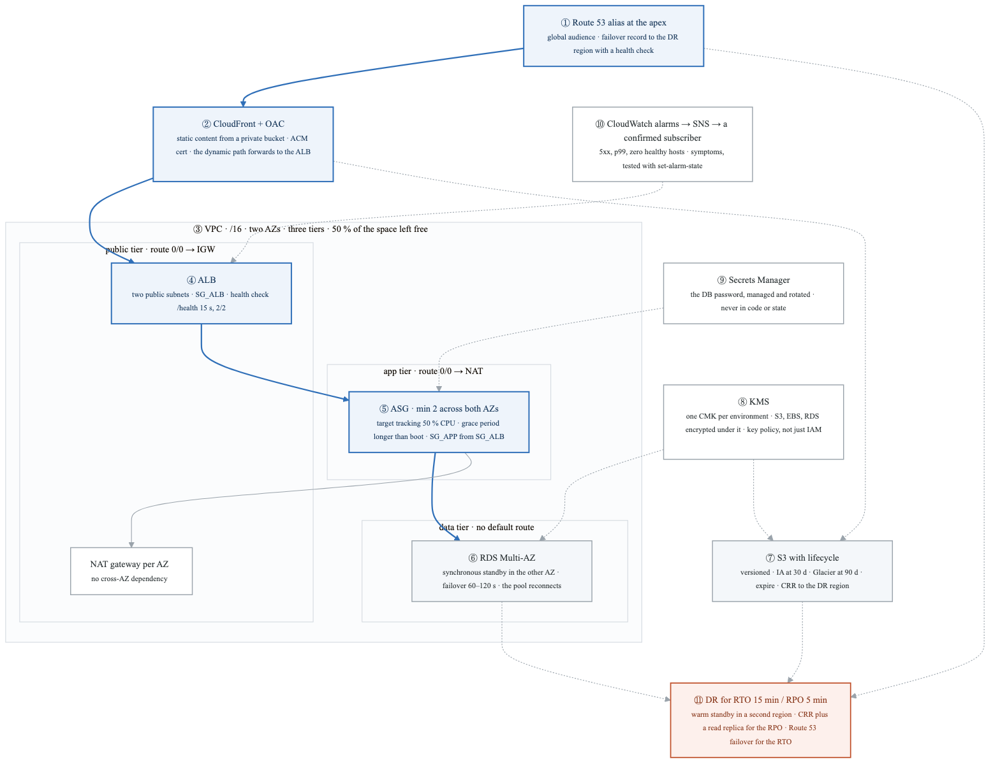
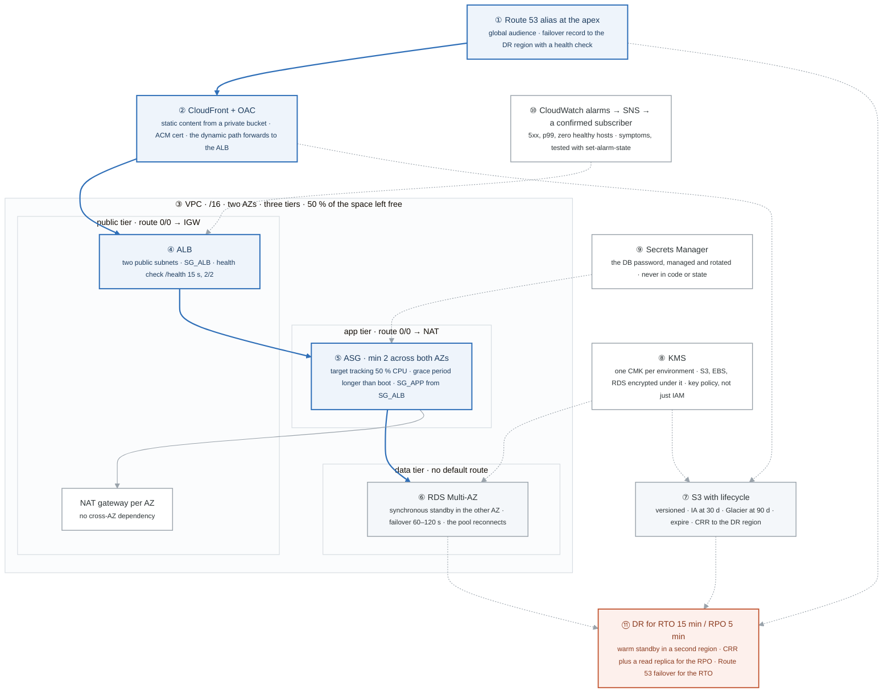
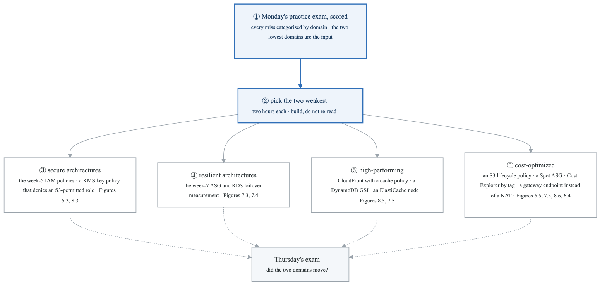
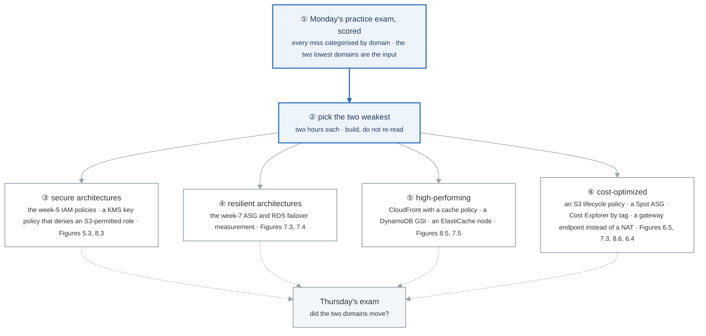

# Week 9 — Activity figures

> One entry per activity, numbered 9.2 to 9.6. Figure 9.1 is the week figure in
> [`../content/FIGURE.md`](../content/FIGURE.md). Week 9 has no new labs; two of the five activities
> have a mechanism worth drawing, and the other three say so and point at what to do instead. Same
> language: gray is structure, **blue is the path to follow first**, orange-red is where something
> refuses, washed boxes are stores.

**The protocol per figure**

1. **Before the activity:** read the figure, say the badges out loud once.
2. **During the activity:** every badge has a **Prove it** command or check. A badge you cannot see happen is one you are taking on faith.
3. **After the activity:** close the file, redraw the figure, say the script. The badge where the order slipped goes in the *Figures redrawn* column of `progress.md`.
4. **Own the numbers.** This week, the numbers *are* the activity: Activity 4's list is reproduced below as the table to own.
5. **Answer the question.** Each figure ends with the question a senior interviewer asks about it. Answer it cold, in under a minute, before Gate 2.

---

## Figure 9.2 — Activity 1: the whiteboard, with the badges you narrate in order

> Activity 1 · badges ① to ⑪ · twenty minutes on paper, about four minutes spoken. Reads top-down. This is the month-2 architecture Gate 2 asks you to draw from memory.

<!-- figure: generated from the Mermaid below by _shared/diagrams/embed-figures.py — do not edit the image -->


<details>
<summary>Diagram source (Mermaid)</summary>



</details>

### Say it, badge by badge

- **Open.** "Highly available, secure, cost-conscious, three tiers, global, relational, fifteen minutes to recover and five minutes of data at most. Every word in that sentence is a box on this drawing. Blue is the request path; everything else justifies a word."
- **① Route 53 alias.** "The apex cannot hold a CNAME, so an alias points at CloudFront. A failover record with a health check is what makes the DR region reachable without anyone editing DNS during the incident."
- **② CloudFront with OAC.** "Static assets from a private bucket that only the distribution can read; the dynamic path forwards to the ALB. 'Global audience' is answered here: the edge is close to the user, the origin is not."
- **③ VPC.** "A /16, two AZs, three tiers. Public has the IGW route, app has the NAT route, data has no default route at all. Half the address space is left free because the next thing is always EKS. Each decision maps to one lab in week 6."
- **④ ALB.** "In both public subnets, with its own security group. Health check every fifteen seconds, two to flip. It is where TLS ends and where 'is this instance alive' is decided."
- **⑤ ASG.** "Minimum two, one per AZ, so an AZ failure leaves one serving while the group launches a replacement in the surviving AZ. Target tracking at fifty percent CPU, grace period longer than boot, security group that trusts the ALB's group, not a CIDR."
- **⑥ RDS Multi-AZ.** "Synchronous standby in the other AZ, so an AZ failure is a failover of sixty to a hundred and twenty seconds, which you have measured. The endpoint name stays; the pool must reconnect. Data tier has no route out."
- **⑦ S3 with lifecycle.** "Versioned, Infrequent Access at thirty days, Glacier at ninety, expire after a year, abort incomplete uploads at seven. Cross-region replication to the DR bucket, because that is how the data is already there when you need it."
- **⑧ KMS.** "One customer key per environment; S3, EBS, and RDS encrypt under it. The key policy, not IAM alone, decides who can decrypt. 'Secure' in the brief is this badge plus ⑨."
- **⑨ Secrets Manager.** "The database password is generated and rotated by RDS into Secrets Manager. The app reads it at start; it is never in Terraform, never in state, never in a repo."
- **⑩ CloudWatch alarms.** "Symptom alarms: 5xx rate, p99 latency, zero healthy hosts. Each publishes to SNS and someone has confirmed the subscription, and you have forced the state once to prove it. An alarm chain is a decoration until tested."
- **⑪ DR.** "Fifteen minutes RTO and five minutes RPO rule out backup-and-restore. Warm standby in a second region: cross-region replication for objects, a cross-region read replica for the database, Route 53 failover for the switch. Cost-conscious means you say why not active/active: two full stacks and a consistency problem you did not need."
- **Close.** "Then the four questions, unprompted: an AZ fails and the ALB, ASG, and RDS each absorb it in their own way; the database fails over and the pool must reconnect; the NAT gateways and the standby cost the most and would go first at half the budget; and the single biggest risk is the one region, which is why ⑪ exists."

### Numbers to own

| Number | Where it comes from | Why it matters |
|---|---|---|
| 20 minutes, 3 times | the activity | the drawing must be fluent, not correct once |
| RTO `15` min, RPO `5` min | the brief | the two numbers that pick the DR tier |
| `/16`, 2 AZs, 3 tiers, 50 % free | week 6 lab 1, week 2 lab 3 | the subnet plan you justify first |
| `15` s, `2/2` | week 7 lab 1 | the ALB's flip time, about 30 s |
| min `2` | week 7 lab 2 | one instance per AZ survives an AZ loss |
| `60–120` s | week 7 lab 3 | the failover you measured; say your number |
| `30` / `90` / `365` days | week 6 lab 4 | the lifecycle ladder |
| 4 questions | the activity | AZ failure · DB failover · cost at half budget · biggest risk |

### Prove it

```bash
# This activity is paper. The proof is a recording and a comparison.
ls curriculum/week-0{5,6,7,8}/labs/FIGURES.md            # every badge here is a figure you already redrew
# Record yourself once, play it back, and mark every badge where you paused or said a tool name instead of a reason.
```

### The question a senior interviewer asks

*"An availability zone just went down. Walk me through what happens, second by second, in your design."*
Badges ④ ⑤ ⑥ in order: the ALB stops routing to targets in that AZ within about thirty seconds, the ASG notices unhealthy instances and launches replacements in the surviving AZ, and RDS promotes the standby within one to two minutes while the application reconnects. Then badge ③ unprompted: the NAT is per AZ, so the surviving AZ never depended on the lost one.

---

## Figure 9.3 — Activity 2: no figure

The comparison sprint is recall, not mechanism: cover the right column of
[`aws-comparisons.md`](../../_shared/drills/aws-comparisons.md) and say each distinction in one
sentence, the whole file in fifteen minutes, Tuesday, Thursday, and Saturday. The figures that back
each comparison are the week 5 to 8 lab figures; when a row stalls, that figure is the one to redraw.

---

## Figure 9.4 — Activity 3: from the weakest exam domain to the thing you rebuild

> Activity 3 · badges ① to ⑥ · about two minutes. Reads top-down, as a decision.

<!-- figure: generated from the Mermaid below by _shared/diagrams/embed-figures.py — do not edit the image -->


<details>
<summary>Diagram source (Mermaid)</summary>



</details>

### Say it, badge by badge

- **Open.** "A score tells you where you are weak; it does not fix it. The fix is building the thing again, because you already have the vocabulary and what you are missing is the connection between the word and the object."
- **① the scored exam.** "Every missed question tagged with its domain. Two misses in a domain is noise; eight is a signal. The two lowest counts are the input to this figure."
- **② pick two.** "Two domains, two hours each, in the console or the CLI. Reading the notes again is the thing that feels productive and is not."
- **③ secure.** "Rebuild the week-5 policies from a blank editor, then write a KMS key policy that denies a role which has full S3, and watch GetObject fail. The evaluation order and the key-policy gate are what the exam is really asking."
- **④ resilient.** "The ASG with a deliberate short grace period, then the RDS failover with the probe running. Both produce a number, and numbers are what you remember under exam pressure."
- **⑤ high-performing.** "A CloudFront cache policy you can read in the X-Cache header, a GSI that turns a scan into a query, an ElastiCache node in front of a read. Each one is a latency you can measure before and after."
- **⑥ cost-optimized.** "A lifecycle policy, a Spot mixed-instances ASG, a Cost Explorer view by tag, and a gateway endpoint replacing a NAT gateway for S3 traffic. The last one is the exam's favourite: free, and it removes a bill."
- **Close.** "Score, pick two, build two, test again Thursday. If a domain did not move, you re-read instead of building. Rebuild it."

### Numbers to own

| Number | Where it comes from | Why it matters |
|---|---|---|
| 2 domains | the activity | focus; four domains in a week is reading, not building |
| 2 hours each | the activity | enough to build and break one thing per domain |
| `80 %+` on 2 different exams | Gate 2 | the number the week is judged by |
| 4 rebuild targets | the table | each maps to lab figures you have already redrawn |

### Prove it

```bash
grep -c . progress/exam-misses.md                              # ① one line per miss, tagged with a domain
sort -k2 progress/exam-misses.md | uniq -c -f1 | sort -rn      # ① ② the two biggest counts are the two domains
```

### The question a senior interviewer asks

*"Your practice score was weakest in one domain. What did you do about it, specifically?"*
Badges ② and whichever of ③ to ⑥ applies, with the artefact you built and the number it produced. "I re-read the notes" is the answer that loses; "I rebuilt the ASG with a thirty-second grace period and watched it loop, then fixed it" is the one that wins.

---

## Figure 9.5 — Activity 4: no figure, but the table is the point

Service limits are recall, not mechanism. The activity's list is the **Numbers to own** table for the
whole month; it goes here so it is in the same place as every other number you own.

| Number | Service | Why it matters |
|---|---|---|
| `5` TB object · `5` GB single PUT · `100` buckets soft · 11 nines | S3 | multipart above 5 GB; durability is a design claim you quote |
| `5` VPCs per region soft · `/16` to `/28` · `5` reserved IPs per subnet | VPC | why a /28 has 11 usable addresses; why subnet math subtracts five |
| gp3 `3,000` IOPS / `125` MB/s baseline · io2 Block Express `256,000` IOPS | EBS | gp3 performance is independent of size; gp2 was not |
| `15` min max · `10` GB memory · `512` MB to `10` GB ephemeral · `1,000` default concurrency | Lambda | the ceiling on what belongs in a function; concurrency is the first limit you hit |
| `256` KB message · `14` day max retention · `12` h max visibility timeout | SQS | the three ceilings people hit first |
| `400` KB item · `20` GSIs / `5` LSIs · `10` GB per LSI partition | DynamoDB | why blobs go to S3 with a pointer; the index budget |
| `5` read replicas (most engines) · `15` for Aurora | RDS | the read-scaling ceiling |
| `60` s idle timeout default | ALB | long-polling and slow uploads need it raised |
| `4` KB direct encrypt · `7–30` day deletion window | KMS | why envelopes exist; the only undo for a deleted key |

Say each row as a sentence, Tuesday, Thursday, and Saturday, alongside the comparison sprint.

---

## Figure 9.6 — Activity 5: no figure

Booking the exam and reading week 10's README is administration. The only thing to draw is already
drawn: Figure 10.1, what Terraform does when you type apply, which is what the day after the exam
starts with. Read it on Sunday so the exam stays in proportion.

---

## Redraw schedule

Figure 9.2 is the Gate 2 drawing itself: three times this week from blank paper, then cold at the
Gate 3 Sunday in week 13 as the warm-up before the Terraform figures. See
[`../../FIGURES.md`](../../FIGURES.md).
