# Week 10 — ★ SAA EXAM · Terraform I

> **Thesis:** month 2 built it by hand so month 3 can prove it belongs in code. Terraform
> immediately after SAA is the correct order — you already know what the resources *are*, so
> Terraform is a syntax-and-lifecycle problem rather than two problems at once.

| | |
|---|---|
| **Hours** | 35–45 |
| **★ Milestone** | **AWS Solutions Architect – Associate exam** |
| **⚑ Milestone** | **Project ALPHA kickoff** |
| **Break/Fix** | BF-33, BF-35 |
| **Exit check** | `terraform import` an existing resource and plan to empty |

## The week in one figure

**Figure 10.1 — What Terraform does when you type apply.** Terraform is a syntax-and-lifecycle problem once you know what the resources are, and month 2 taught you that. The blue path is the lifecycle: read config, read the world, diff, call the API, record the result. Badges are numbered in the order to walk them; the blue path is the one to follow first.

```mermaid
%%{init: {'theme':'base','themeVariables':{'fontFamily':'Helvetica, Arial, sans-serif','fontSize':'13px','primaryColor':'#ffffff','primaryTextColor':'#2d3436','primaryBorderColor':'#9aa3ab','lineColor':'#9aa3ab','textColor':'#2d3436','clusterBkg':'#fbfcfd','clusterBorder':'#d4dae0','edgeLabelBackground':'#ffffff','tertiaryColor':'#eef4fb'},'flowchart':{'curve':'basis','padding':14,'nodeSpacing':42,'rankSpacing':58}}}%%
flowchart LR
  classDef default fill:#ffffff,stroke:#9aa3ab,stroke-width:1.3px,color:#2d3436
  classDef n    fill:#ffffff,stroke:#9aa3ab,stroke-width:1.3px,color:#2d3436
  classDef crit fill:#eef4fb,stroke:#2f6fb8,stroke-width:1.8px,color:#1b3a5c
  classDef data fill:#f4f7fa,stroke:#9aa3ab,stroke-width:1.3px,color:#2d3436
  classDef mut  fill:#ffffff,stroke:#cfd6dc,stroke-width:1.1px,color:#7a8288
  classDef warn fill:#fdf0ec,stroke:#c0522d,stroke-width:1.6px,color:#8a3a1e

  CFG["① configuration<br/><small>*.tf · HCL · variables, outputs, providers</small>"]:::crit
  INIT["② terraform init<br/><small>downloads providers · configures the backend · .terraform.lock.hcl</small>"]:::crit
  PLAN["③ terraform plan<br/><small>refresh: read real resources · diff against state · build the graph</small>"]:::crit
  ST["④ state<br/><small>S3 backend · versioned · locked while an apply runs</small>"]:::data
  APPLY["⑤ terraform apply<br/><small>provider API calls, in dependency order</small>"]:::crit
  RES["⑥ real resources<br/><small>the week-5 EC2 instance, now in code</small>"]:::crit
  DRIFT["⑦ drift<br/><small>a console change · plan shows the diff · you decide who wins</small>"]:::warn
  IMP["⑧ terraform import<br/><small>adopt a console-made resource · plan to empty</small>"]:::n
  MV["⑨ state mv · moved block<br/><small>rename without destroy</small>"]:::n
  CORR["⑩ corrupted local state<br/><small>recover from the backend's previous version</small>"]:::warn
  ALPHA["⑪ ⚑ Alpha kickoff<br/><small>repo · modules/ · environments/dev · first module</small>"]:::n
  CFG ==> INIT ==> PLAN ==> APPLY ==> RES
  PLAN --> ST
  APPLY --> ST
  RES -.-> DRIFT -.-> PLAN
  RES -.-> IMP -.-> ST
  ST -.-> MV
  ST -.-> CORR
  RES -.-> ALPHA
  linkStyle 0,1,2,3 stroke:#2f6fb8,stroke-width:2px
```

**What to say, badge by badge** · about three and a half minutes at a normal pace. Point at each badge as you say its line.

- **Open.** “Tuesday you sit the SAA. Wednesday you start Terraform, and the reason that order works is this picture: you already know what every resource is, so all that is left is the lifecycle. Five boxes on the blue line.”
- **① configuration.** “HCL files describe the desired world: resources, variables, outputs, and which providers to use. Nothing happens by writing them. They are a declaration, not a script.”
- **② terraform init.** “Downloads the providers, pins their versions in the lock file, and configures where state will live. The lock file is committed; it is what makes two machines produce the same plan.”
- **③ terraform plan.** “Three steps in one command. Refresh reads the real resources through the provider. Then Terraform diffs the configuration against the state. Then it builds a dependency graph and prints what it would do. Read the plan every time. Read the graph once, with `terraform graph`, so you believe the order.”
- **④ state.** “The map from configuration addresses to real resource IDs. It lives in an S3 bucket, versioned, and a lock object stops two applies colliding. Losing state does not destroy anything, but it loses the map, and rebuilding the map is the import work in badge 8.”
- **⑤ terraform apply.** “The provider calls the API, in dependency order, and writes each result into state as it goes. An apply that fails halfway leaves a partial state that is still correct about what exists.”
- **⑥ real resources.** “The week-5 EC2 instance, now reproducible. Destroy it and apply it until the loop is muscle memory. That loop is what makes the clean-account test in week 13 possible.”
- **⑦ drift.** “Change something in the console. The next plan shows the difference. Terraform does not decide who wins; you do. Drift you did not expect is an incident; drift you expected is a plan you have not applied yet.”
- **⑧ terraform import.** “Adopt a resource someone created by hand: write the configuration, import the ID into state, and plan. The goal is a plan with no changes. That is the exit criterion, and it is how brownfield accounts get into code.”
- **⑨ state mv and moved blocks.** “Renaming a resource in configuration looks like destroy-and-create to Terraform. A moved block, or state mv, tells it the resource only changed names. Week 11 does this across module boundaries.”
- **⑩ corrupted local state.** “Corrupt the local copy on purpose, then recover it from the backend's previous version. Versioning on the state bucket is the recovery path, and you should have used it once before you need it.”
- **⑪ Alpha kickoff.** “Saturday: the repository, a modules directory, a dev environment, and the first module. Nothing fancy; the structure is what matters, because weeks 11 to 13 fill it in.”
- **Close.** “Declare, init, plan, apply, record. Everything else, drift and import and moved, is the state map disagreeing with the world and you deciding which one is right.”

---

## Day plan
| Day | Focus |
|---|---|
| **Mon** | Final light review. `_reference/aws/phase-6-practice-review-exam-strategies-last-minute-review.md`. Early night. |
| **Tue** | **★ SIT THE EXAM.** Then take the rest of the day off. Genuinely. |
| Wed | Terraform: HCL, providers, resources, variables, outputs (Lab 1) |
| Thu | **State** — what it is, backends, locking, drift (Lab 2) |
| Fri | `import`, `state mv`, `moved` blocks + Break/Fix (Lab 3) |
| Sat | **⚑ Project Alpha kickoff** — repo, structure, first module (Lab 4) |
| Sun | Review; read week 11 |

## Reading map
- `_reference/terraform/labs/phase-1-foundations-lab-1.1-environment-setup.md` → `1.4`
- `_reference/terraform/labs/phase-2-core-lab-2.1-providers.md` → `2.4-state-management.md`
- `_reference/terraform/drills/feynman-domains-01-resource-lifecycle.md`
- `_reference/terraform/drills/feynman-domains-05-providers.md`
- `_reference/terraform/drills/week2-state-providers-day1-state-backends-README.md`
- `_reference/terraform/drills/week2-state-providers-day3-import-README.md`
- **Drill:** `_shared/drills/terraform-recall.md` — Tiers 1, 2, 5

**Free primary sources:** developer.hashicorp.com/terraform — the tutorials are genuinely good, and
the provider registry docs are the reference you will live in.

## Labs
[labs/LABS.md](labs/LABS.md) · [solutions/SOLUTIONS.md](solutions/SOLUTIONS.md) ·
Project Alpha starter: [`../projects/alpha-cloud-foundation/`](../projects/alpha-cloud-foundation/)

| # | Lab | Time |
|---|---|---|
| 1 | HCL fundamentals — Terraform the week-5 instance | 3h |
| 2 | State: remote backend, locking, corruption recovery | 3h |
| 3 | Import, state manipulation, drift + Break/Fix | 3h |
| 4 | **Project Alpha kickoff** | 4h |

## Exit criteria
- [ ] SAA exam sat (pass or a scheduled retake)
- [ ] Terraform the week-5 EC2 instance; `destroy` and `apply` until it's muscle memory
- [ ] Remote backend on S3 with locking; recover from deliberately corrupted local state
- [ ] `terraform import` a console-created resource and plan to **empty**
- [ ] Change something in the console and read the drift in `plan`
- [ ] Alpha repo created with the directory structure and the first module
