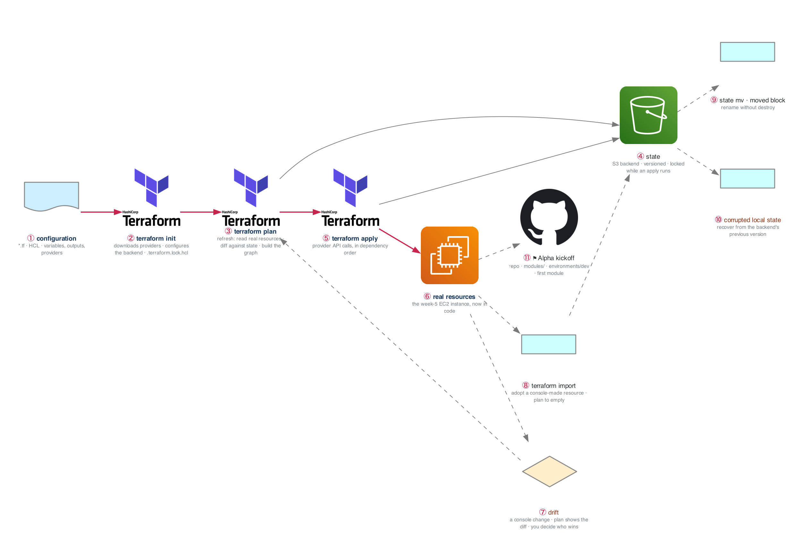

# Figure 10.1 — What Terraform does when you type apply

> Week 10 · badges ① to ⑪ · about three and a half minutes at a normal pace. Point at each badge as you say its line. Blue is the path to follow first; orange-red is where something refuses or fails.



Terraform is a syntax-and-lifecycle problem once you know what the resources are, and month 2 taught you that. The blue path is the lifecycle: read config, read the world, diff, call the API, record the result.

## What to say, badge by badge

- **Open.** “Tuesday you sit the SAA. Wednesday you start Terraform, and the reason that order works is this picture: you already know what every resource is, so all that is left is the lifecycle. Five boxes on the blue line.”
- **① configuration.** “HCL files describe the desired world: resources, variables, outputs, and which providers to use. Nothing happens by writing them. They are a declaration, not a script.”
- **② terraform init.** “Downloads the providers, pins their versions in the lock file, and configures where state will live. The lock file is committed; it is what makes two machines produce the same plan.”
- **③ terraform plan.** “Three steps in one command. Refresh reads the real resources through the provider. Then Terraform diffs the configuration against the state. Then it builds a dependency graph and prints what it would do. Read the plan every time. Read the graph once, with `terraform graph`, so you believe the order.”
- **④ state.** “The map from configuration addresses to real resource IDs. It lives in an S3 bucket, versioned, and a lock object stops two applies colliding. Losing state does not destroy anything, but it loses the map, and rebuilding the map is the import work in badge 8.”
- **⑤ terraform apply.** “The provider calls the API, in dependency order, and writes each result into state as it goes. An apply that fails halfway leaves a partial state that is still correct about what exists.”
- **⑥ real resources.** “The week-5 EC2 instance, now reproducible. Destroy it and apply it until the loop is muscle memory. That loop is what makes the clean-account test in week 13 possible.”
- **⑦ drift.** “Change something in the console. The next plan shows the difference. Terraform does not decide who wins; you do. Drift you did not expect is an incident; drift you expected is a plan you have not applied yet.”
- **⑧ terraform import.** “Adopt a resource someone created by hand: write the configuration, import the ID into state, and plan. The goal is a plan with no changes. That is the exit criterion, and it is how brownfield accounts get into code.”
- **⑨ state mv and moved blocks.** “Renaming a resource in configuration looks like destroy-and-create to Terraform. A moved block, or state mv, tells it the resource only changed names. Week 11 does this across module boundaries.”
- **⑩ corrupted local state.** “Corrupt the local copy on purpose, then recover it from the backend's previous version. Versioning on the state bucket is the recovery path, and you should have used it once before you need it.”
- **⑪ Alpha kickoff.** “Saturday: the repository, a modules directory, a dev environment, and the first module. Nothing fancy; the structure is what matters, because weeks 11 to 13 fill it in.”
- **Close.** “Declare, init, plan, apply, record. Everything else, drift and import and moved, is the state map disagreeing with the world and you deciding which one is right.”

**Print it:** [`figure-10.1-numbered-spoken.pdf`](figure-10.1-numbered-spoken.pdf) is the two-page version, the figure on page one and this script on page two.

## Use it

- Read the figure before the day plan. Say the script out loud on Friday with the file closed.
- Each badge line is a thirty-second interview answer; the whole script is the three-minute version.
- Regenerate after editing the spec in `_shared/diagrams/week_figures/`:

```bash
python3 ../../_shared/diagrams/generate-week-figures.py --only 10
```
