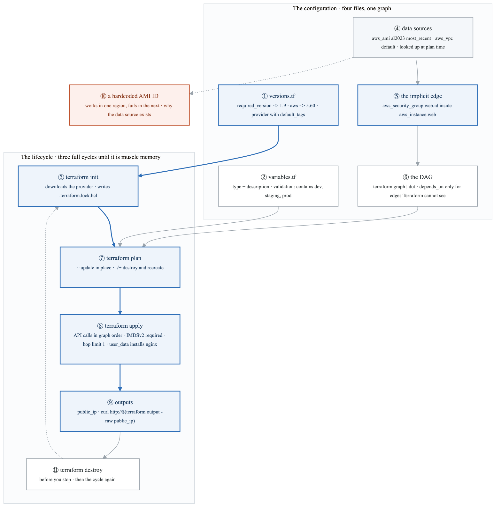
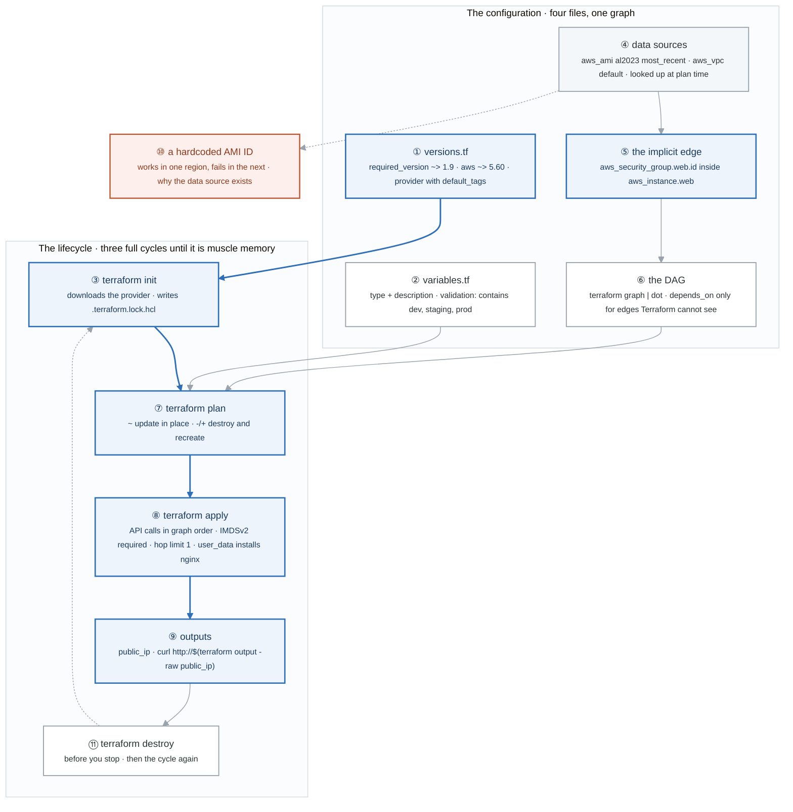
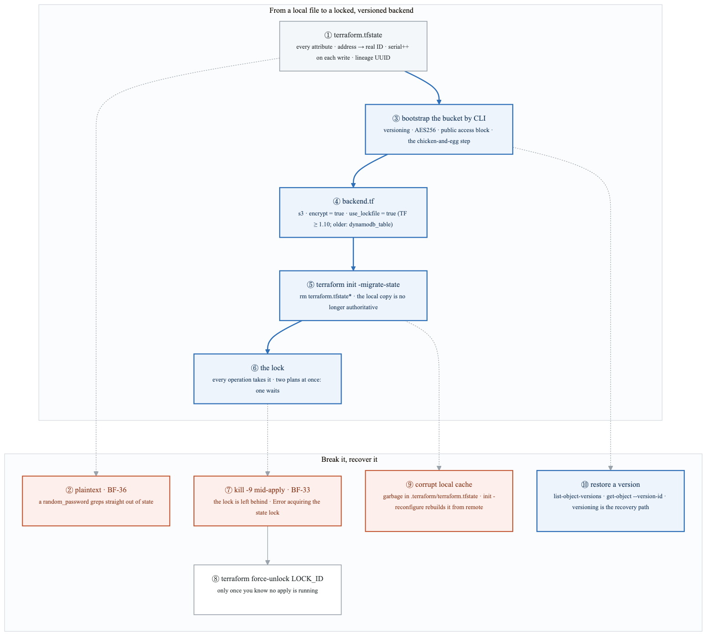
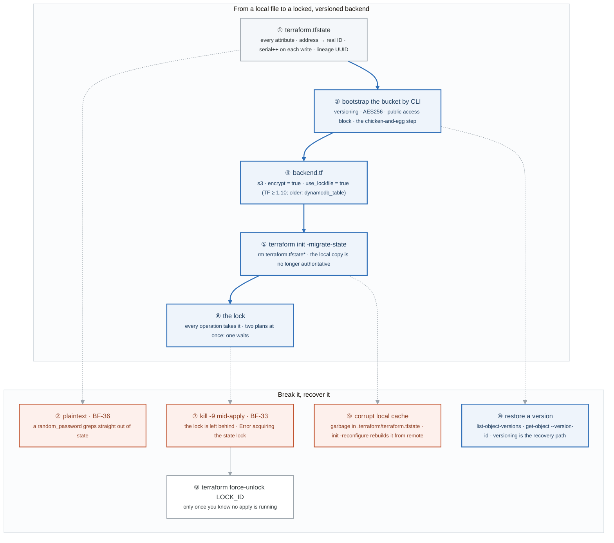
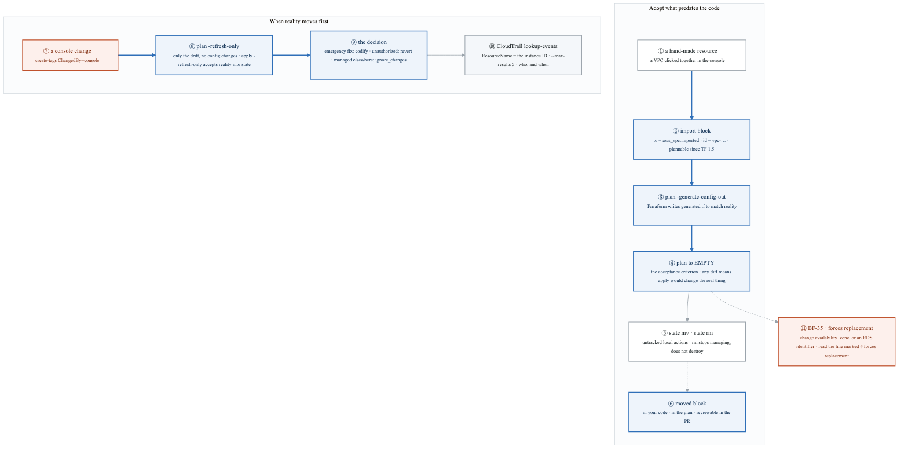
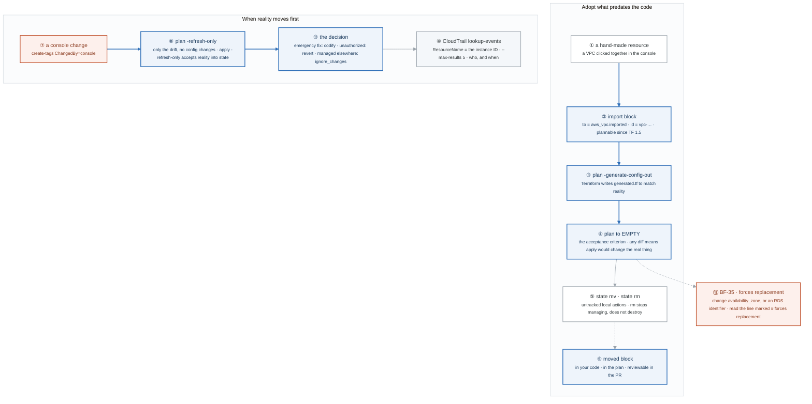
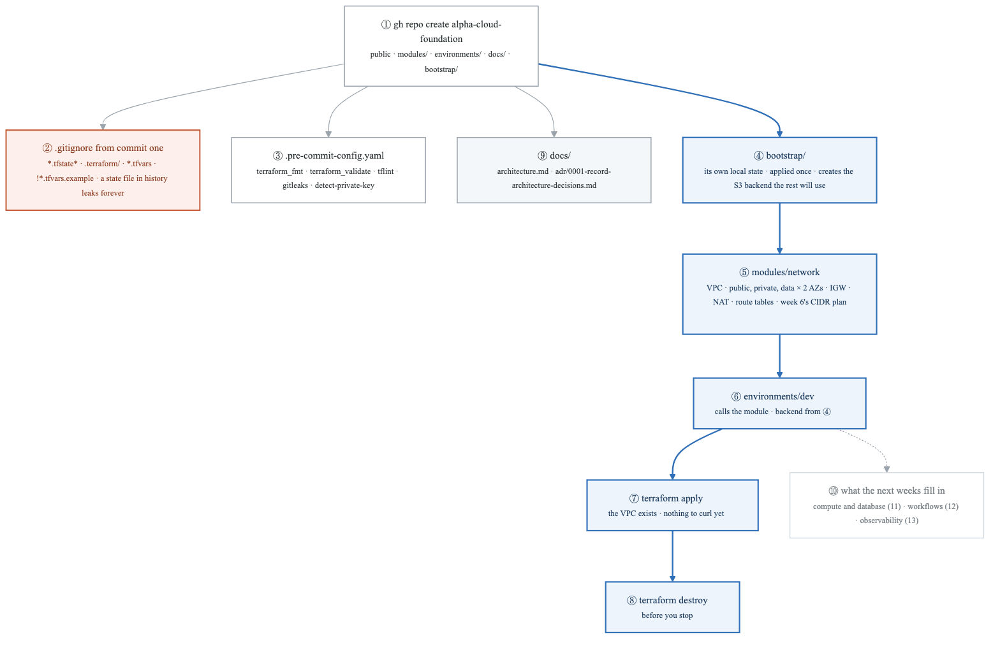
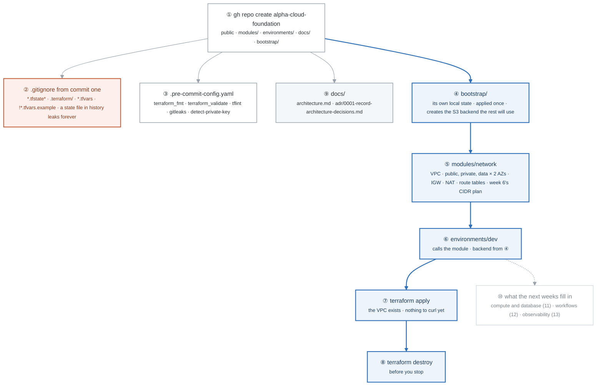

# Week 10 — Lab figures

> One figure per lab, numbered 10.2 to 10.5. Figure 10.1 is the week figure in
> [`../content/FIGURE.md`](../content/FIGURE.md); these four go one level down, to the mechanism each
> lab makes you touch. Same language: gray is structure, **blue is the path to follow first**,
> orange-red is where something refuses, washed boxes are stores. Each badge line is a thirty-second
> interview answer; each whole script is under three minutes.

**The protocol per figure**

1. **Before the lab:** read the figure, say the badges out loud once. You now know what you are about to prove.
2. **During the lab:** every badge has a **Prove it** command. Run it and watch the badge happen. A badge you cannot see happen is one you are taking on faith.
3. **After the lab:** close the file, redraw the figure, say the script. Check against the file. The badge where the order slipped goes in the *Figures redrawn* column of `progress.md`.
4. **Own the numbers.** The *Numbers to own* table is what separates "I know Terraform" from "a plan with `-/+` means the attribute forces replacement, and `~` means it updates in place."
5. **Answer the question.** Each figure ends with the question a senior interviewer asks about it. Answer it cold, in under a minute, before the gate.

---

## Figure 10.2 — Lab 1: from HCL to a running instance, and the graph underneath

> Lab 1 · badges ① to ⑪ · about three and a half minutes.

<!-- figure: generated from the Mermaid below by _shared/diagrams/embed-figures.py — do not edit the image -->


<details>
<summary>Diagram source (Mermaid)</summary>



</details>

### Say it, badge by badge

- **Open.** "Terraform is four files and one graph. The files declare; nothing happens by writing them. The blue path is the lifecycle that turns the declaration into an instance you can curl, and the graph underneath is why the order is never something you specify."
- **① versions.tf.** "Pins the Terraform version and the provider version. The provider block carries default_tags, so every resource is tagged Project, ManagedBy, Environment without repeating it. Loose pins are how a plan changes with no commit."
- **② variables.tf.** "Every variable has a type and a description. The validation block rejects `production` at plan time with your sentence instead of at apply time with an API error. Read the error once; that is the shape of every good guardrail."
- **③ terraform init.** "Downloads the provider that versions.tf named and writes the lock file. The lock file is what makes your laptop and CI resolve the same provider build; week 12 breaks it on purpose."
- **④ data sources.** "The AMI and the default VPC are looked up, not typed. `most_recent` with an owner and a name filter gives you the current Amazon Linux in whatever region you run in."
- **⑤ the implicit edge.** "The instance references `aws_security_group.web.id`. That reference is the dependency. Terraform reads it and knows the group must exist before the instance. You wrote no ordering; the reference is the ordering."
- **⑥ the DAG.** "Every reference is an edge; the edges make a directed acyclic graph; apply walks it. `depends_on` is the escape hatch for edges Terraform cannot see, usually IAM propagation or something outside Terraform. Adding it where a reference already exists changes nothing, and the lab makes you prove that."
- **⑦ terraform plan.** "Reads the real resources, diffs them against the configuration, prints the actions. `~` is an update in place; `-/+` is destroy and recreate because an attribute forces replacement. Change the instance type and read which one you get, and why."
- **⑧ terraform apply.** "The provider calls the API in graph order and writes each result into state. The instance comes up with IMDSv2 required and a hop limit of 1, which is week 5's lesson written into code, and user_data installs nginx."
- **⑨ outputs.** "public_ip and instance_id are the module's answers to the outside. `terraform output -raw` is how a script, or the next module, reads them."
- **⑩ a hardcoded AMI ID.** "Replace the data source with a literal ID and run in another region: the ID does not exist there and the apply fails. That failure is the argument for data sources, and you should have seen it once."
- **⑪ terraform destroy.** "Then init, plan, apply, destroy again, three times, until you stop reading the commands. Week 13's clean-account test is this loop from nothing."
- **Close.** "Declare in four files, let references build the graph, let the lifecycle walk it. Everything after this week is a richer graph and a more careful plan."

### Numbers to own

| Number | Where it comes from | Why it matters |
|---|---|---|
| `~> 1.9` and `~> 5.60` | versions.tf | pessimistic pins: patch and minor may move, major may not; a plan that changes with no commit is a pin that was too loose |
| 3 allowed environments | the validation block | `dev`, `staging`, `prod`; `production` is rejected at plan time with your error message |
| `t3.micro`, port 80 | the variable default and the security group | the one ingress rule, from anywhere; egress is everything |
| hop limit `1` | metadata_options | the IMDSv2 setting from week 5 that stops a container or an SSRF reaching the credential endpoint |
| `~` vs `-/+` | the plan output | update in place versus forced replacement; the second one is the destructive plan you read twice |
| 3 cycles | the tasks | init, plan, apply, destroy until it is muscle memory |

### Prove it

```bash
terraform init && ls .terraform.lock.hcl                        # ③ the lock file exists
terraform apply -var environment=production                     # ② the validation fires, read it
terraform graph | dot -Tpng -o graph.png                        # ⑥ the edges you never typed
terraform state show aws_instance.web | grep -E 'ami|http_tokens'   # ④ ⑧ the resolved AMI, IMDSv2 required
curl "http://$(terraform output -raw public_ip)"                # ⑨ the instance answers
```

### The question a senior interviewer asks

*"Why did the instance already depend on the security group without `depends_on`, and when is `depends_on` actually needed?"*
Badges ⑤ and ⑥: the reference is the edge; `depends_on` is for dependencies Terraform cannot see, such as an IAM policy that must propagate before a role is usable, or a resource created outside the graph. If you answer "to make sure things are created in order", you have described what references already do.

---

## Figure 10.3 — Lab 2: state, the lock, and the recovery path

> Lab 2 · badges ① to ⑩ · about three and a half minutes.

<!-- figure: generated from the Mermaid below by _shared/diagrams/embed-figures.py — do not edit the image -->


<details>
<summary>Diagram source (Mermaid)</summary>



</details>

### Say it, badge by badge

- **Open.** "State is the map from your configuration to real resource IDs. Lose the map and nothing is destroyed, but Terraform no longer knows what it owns. This figure moves the map somewhere safe, locks it, and then breaks it three ways on purpose."
- **① terraform.tfstate.** "Every attribute of every resource, the address-to-ID map, the dependency graph, a serial that increments on every write, and a lineage UUID that says which history this file belongs to. `jq` it once so it stops being a black box."
- **② plaintext.** "All of it, in the clear. Create an RDS instance with a random_password and grep state for it; it is there. Anyone with the state file has the password. That is BF-36, and Lab 5 writes the remediation order."
- **③ bootstrap the bucket by CLI.** "The backend cannot create itself, so the bucket is made once by hand: versioning on, encryption on, public access blocked. Versioning is the single most important setting, because it is the only recovery path in badge ten."
- **④ backend.tf.** "Points at the bucket and the key, encrypts, and turns on the lock file. From Terraform 1.10 S3 locks natively; before that it needed a DynamoDB table, and you will meet both in the wild."
- **⑤ terraform init -migrate-state.** "Pushes the local file to the bucket. Delete the local copy; it is no longer authoritative. A plan still works, because it reads from S3 now."
- **⑥ the lock.** "Every plan and apply takes the lock first. Run two plans in two terminals and watch one wait. That wait is the only thing between two engineers and a corrupted state."
- **⑦ kill -9 mid-apply.** "Start an apply, kill it after two seconds. The lock is still held by a process that no longer exists. The next plan says Error acquiring the state lock. BF-33, and in CI it is what a cancelled job leaves behind."
- **⑧ force-unlock.** "Takes the lock ID from the error and releases it. Do it only once you know nothing is actually applying; forcing a lock under a live apply is how state gets two writers."
- **⑨ corrupt local cache.** "Write garbage into the local cache file, watch the plan fail, then `init -reconfigure` rebuilds the cache from the backend. The remote copy was fine the whole time; the local file is a cache, not the truth."
- **⑩ restore a version.** "Delete the state object entirely. List the object versions, fetch an older one by version ID. That is the whole disaster recovery plan for state, and it exists only because badge three turned versioning on."
- **Close.** "Map, bucket, lock. Plaintext, so guard it; locked, so one writer at a time; versioned, so a deleted map comes back. Every Terraform incident after this week is one of these three failing."

### Numbers to own

| Number | Where it comes from | Why it matters |
|---|---|---|
| `serial` increments every write | the state file | two states with the same lineage and different serials tell you which is newer |
| TF `>= 1.10` | the backend comment | `use_lockfile` is S3-native locking; older code uses `dynamodb_table` for the same job |
| `AES256` | put-bucket-encryption | server-side encryption on the state bucket; the file is still plaintext to anyone allowed to read it |
| 4 public-access-block flags | the bootstrap | all four true; a state bucket is never public |
| `sleep 2 && kill -9` | the stuck-lock reproduction | the time it takes for an apply to acquire the lock before you kill it |
| 2 terminals | task 3 | the proof the lock works: one plan waits for the other |

### Prove it

```bash
cat terraform.tfstate | jq '.serial, .lineage, .terraform_version'             # ① the metadata
terraform state pull | grep -i -E 'password|secret' | head                       # ② plaintext
terraform init -migrate-state && aws s3 ls "s3://$BUCKET/tf-lab/basics/"         # ⑤ the object exists
terraform apply & sleep 2 && kill -9 %1; terraform plan                          # ⑦ the stuck lock
aws s3api list-object-versions --bucket "$BUCKET" --prefix tf-lab/basics/terraform.tfstate --output table   # ⑩ the history
```

### The question a senior interviewer asks

*"Your state object was deleted during an incident and a lock is still held. Walk me through recovery, and tell me why versioning is the setting you would never skip."*
Badges ⑧ then ⑩: confirm no apply is running, force-unlock, restore the previous object version, plan to confirm it matches reality. Versioning is the answer to "what if the state is gone"; nothing else is.

---

## Figure 10.4 — Lab 3: import, move, drift, and who did it

> Lab 3 · badges ① to ⑪ · about three and a half minutes.

<!-- figure: generated from the Mermaid below by _shared/diagrams/embed-figures.py — do not edit the image -->


<details>
<summary>Diagram source (Mermaid)</summary>



</details>

### Say it, badge by badge

- **Open.** "Most companies have infrastructure older than their code. This figure is the two directions state can disagree with the world: something exists that Terraform does not know about, and something Terraform knows about has changed behind its back. Each has a blue path and one acceptance criterion."
- **① a hand-made resource.** "A VPC or security group created in the console. It is real, it is billing, and no state file mentions it."
- **② import block.** "Since Terraform 1.5 an import is a block in code: the address it will get and the real ID. It shows in the plan like any other change. The older `terraform import` command does the same thing imperatively and is what most existing repositories still use."
- **③ plan -generate-config-out.** "Terraform reads the real resource and writes the HCL for you. The generated file is a starting point, not a finished one; it includes every attribute, and you trim it to what you mean."
- **④ plan to EMPTY.** "Iterate until the plan says no changes. Any remaining diff means your configuration does not match reality, and applying it would change a resource that is in use. Empty is the only acceptable answer."
- **⑤ state mv and state rm.** "Rename an address, or stop managing a resource without destroying it. Both are local, untracked actions that nobody reviews. Know they exist, and know `state push` is the one that can overwrite a good state with a bad one."
- **⑥ moved block.** "The reviewable form of a rename: from and to, in code, visible in the plan, approved in a pull request. Prefer it, and say so in interviews; week 11 uses it to pull resources into modules with zero destroys."
- **⑦ a console change.** "Someone adds a tag by hand. Now the world and the state disagree, and the next plan will show that as a change it wants to make."
- **⑧ plan -refresh-only.** "Shows only the drift, with no configuration changes mixed in. `apply -refresh-only` writes reality into state without touching infrastructure. That separates 'what changed out there' from 'what I am about to change'."
- **⑨ the decision.** "Three cases. An emergency fix made under pressure: codify it, update the code to match. Unauthorized or accidental: revert it, a normal apply restores the declared state. Legitimately managed by something else: `ignore_changes` on that attribute. Terraform never decides; you do."
- **⑩ CloudTrail.** "Before deciding, find out who. `lookup-events` on the resource name returns the principal and the time. The decision in badge nine is usually obvious once you know whether it was a person at 2am or an autoscaler."
- **⑪ BF-35.** "Change an attribute that cannot be updated in place, an availability zone or an RDS identifier, and the plan marks it `# forces replacement`. The lab makes you cause it so you recognise the line before it costs a database."
- **Close.** "Import until the plan is empty; move with blocks, not commands; refresh to see drift, CloudTrail to see who, then codify, revert, or ignore. Both directions end in the same place: a plan that says nothing."

### Numbers to own

| Number | Where it comes from | Why it matters |
|---|---|---|
| TF `>= 1.5` | the import block comment | plannable imports and `-generate-config-out`; before that, the imperative `terraform import` only |
| 0 changes | "plan to empty" | the acceptance criterion for an import, and for a move |
| 3 drift outcomes | the decision table | codify, revert, `ignore_changes`; each matches a cause, not a preference |
| `--max-results 5` | the CloudTrail lookup | enough to see the last writer without paging |
| `# forces replacement` | the BF-35 plan | the one line in a plan that means destroy and recreate |

### Prove it

```bash
terraform plan -generate-config-out=generated.tf && cat generated.tf             # ③ Terraform wrote it
terraform plan                                                                     # ④ iterate until: No changes
terraform state rm aws_instance.web && aws ec2 describe-instances --instance-ids <id>   # ⑤ still exists, unmanaged
aws ec2 create-tags --resources $(terraform output -raw instance_id) --tags Key=ChangedBy,Value=console && terraform plan -refresh-only   # ⑦ ⑧
aws cloudtrail lookup-events --lookup-attributes AttributeKey=ResourceName,AttributeValue=$(terraform output -raw instance_id) --max-results 5   # ⑩
```

### The question a senior interviewer asks

*"How would you bring infrastructure that predates your IaC under Terraform without changing it, and how do you decide whether drift gets reverted or codified?"*
Badges ② to ④ for the first half, with "plan to empty" as the sentence they are listening for. Badges ⑩ then ⑨ for the second: find who and why, then codify an emergency fix, revert an accident, ignore what another system owns.

---

## Figure 10.5 — Lab 4: Alpha kickoff, the repository skeleton

> Lab 4 · badges ① to ⑩ · about three minutes.

<!-- figure: generated from the Mermaid below by _shared/diagrams/embed-figures.py — do not edit the image -->


<details>
<summary>Diagram source (Mermaid)</summary>



</details>

### Say it, badge by badge

- **Open.** "Alpha starts today as a skeleton with one real module in it. The structure is the deliverable; weeks 11 to 13 fill it in. The blue path is the eight tasks in order, and the orange box is the mistake that cannot be undone."
- **① the repository.** "Public, because a hiring manager will read it. Modules, environments, docs, and a bootstrap directory. The layout is the one every later week assumes."
- **② .gitignore from commit one.** "State files, the .terraform directory, and every tfvars except the example. A state file committed once is in the history forever, with every secret inside it. This line comes before any apply."
- **③ pre-commit.** "Format, validate, lint, and two secret scanners, run before every commit. The gates from week 11 and the CI from week 12 are these same checks, moved to the server."
- **④ bootstrap.** "The backend bucket cannot be created by the configuration that depends on it. So a separate directory with its own local state creates the bucket once, and is never run again. That is the standard answer to the chicken-and-egg question."
- **⑤ modules/network.** "The VPC from week 6, as code: three tiers across two availability zones, an internet gateway, NAT, and the route tables. The CIDR plan you drew by hand is now a variable."
- **⑥ environments/dev.** "A root module that calls the network module with dev-sized inputs and stores its state in the bucket from badge four. Prod will be the same call with different numbers; week 11 makes that the rule."
- **⑦ terraform apply.** "The VPC exists. There is nothing to curl yet, and that is correct; a network module has no endpoint."
- **⑧ terraform destroy.** "Before you stop. The habit from Lab 1, now with real NAT gateways that bill by the hour."
- **⑨ docs.** "An architecture document and ADR 0001, which records that you record decisions. Week 13 judges the repository by these as much as by the code."
- **⑩ what the next weeks fill in.** "Compute and database modules in week 11, the workflows directory in week 12, observability in week 13. Leave the empty directories; they are the plan."
- **Close.** "Skeleton, ignore file, hooks, a bootstrap that runs once, one module, one environment, apply, destroy. Nothing fancy, and nothing you will have to restructure later."

### Numbers to own

| Number | Where it comes from | Why it matters |
|---|---|---|
| 8 tasks | the lab | repo, .gitignore, pre-commit, bootstrap, network module, dev environment, apply, destroy, in that order |
| 5 pre-commit hooks | task 3 | fmt, validate, tflint, gitleaks, detect-private-key |
| 2 AZs, 3 tiers | task 5 | public, private, data per availability zone, from the week 6 plan |
| 1 bootstrap apply | task 4 | run once with local state; never part of the environment's plan |
| 7 ignore patterns | the .gitignore block | `**/.terraform/*`, `*.tfstate`, `*.tfstate.*`, `*.tfvars`, `!*.tfvars.example`, `crash.log`, `override.tf`, `.terraformrc` |

### Prove it

```bash
git check-ignore -v terraform.tfstate environments/dev/terraform.tfvars          # ② both ignored
git check-ignore -v environments/dev/terraform.tfvars.example || echo "committed, as intended"   # ② the exception
pre-commit run --all-files                                                       # ③ the five hooks
terraform -chdir=bootstrap state list                                            # ④ the bucket, in its own state
terraform -chdir=environments/dev apply && aws ec2 describe-vpcs --filters Name=tag:Project,Values=alpha   # ⑦
```

### The question a senior interviewer asks

*"How do you solve the backend chicken-and-egg problem, and why can't the state bucket live in the state it stores?"*
Badge ④: a bootstrap root with its own local state creates the bucket once. If the bucket were in the main state, destroying or recreating the environment would try to delete the place its own state lives, and the first apply would have nowhere to write.

---

## Redraw schedule

Same cadence as the week figure, see [`../../FIGURES.md`](../../FIGURES.md): Friday of this week after break/fix, Sunday of week 12, and cold at the Gate 3 Sunday in week 13. Lab figures are redrawn **after** the week figure, one at a time, and only the badge order has to be right; the captions are the check, not the test.
