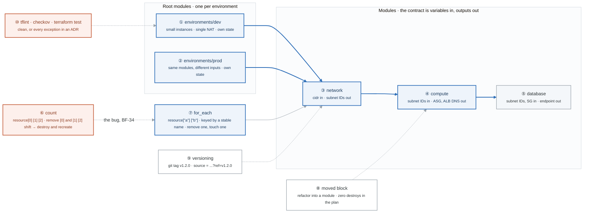

# Week 11 — Terraform II: Modules, Patterns, Testing

> **Thesis:** anyone can write a `main.tf`. The skill that gets paid is **module design** — building
> something a second engineer can consume without reading your implementation, and refactoring it
> later without destroying production.

| | |
|---|---|
| **Hours** | 35–45 |
| **Deliverable** | Blog post #6 — "count vs for_each: the day I deleted three subnets by removing one" |
| **⚑ Alpha** | network, compute, and database modules complete; dev **and** prod deploying |
| **Break/Fix** | BF-34, BF-36, BF-40 |

## The week in one figure

**Figure 11.1 — Module contract, environments, and the count index shift.** The skill that gets paid is module design: a contract another engineer can consume without reading your implementation, and refactoring that never destroys production. The orange box is the bug that makes blog post 6. Badges are numbered in the order to walk them; the blue path is the one to follow first.

**What to say, badge by badge** · about three and a half minutes at a normal pace. Point at each badge as you say its line.

- **Open.** “Anyone can write a main.tf. This week is about the shape of code a second engineer can consume, two environments that share it, and the one iteration mistake that deletes production subnets. The orange box is that mistake.”
- **① environments/dev.** “A root module with its own state file and small, cheap inputs: one NAT, small instances. It calls the same three modules prod does.”
- **② environments/prod.** “Same modules, different variable values, separate state. The test that you got this right: a change to a module shows up in both plans, and a change to an input shows up in one.”
- **③ network module.** “Takes a CIDR, returns subnet IDs. The caller never sees route tables or NAT gateways. That is the contract: variables in, outputs out, implementation private.”
- **④ compute module.** “Takes subnet IDs, returns the ASG and the ALB's DNS name. It knows nothing about how the subnets were made. Modules compose through outputs, never by reaching into each other.”
- **⑤ database module.** “Takes subnet IDs and a security group, returns an endpoint. The password is generated by RDS and lands in Secrets Manager; Terraform never holds it.”
- **⑥ count.** “Three subnets as resource[0], [1], [2]. Remove the first and Terraform sees [1] become [0] and [2] become [1]: it plans to modify two and destroy one. In production that is three subnets gone to remove one. BF-34, and you reproduce it before you fix it.”
- **⑦ for_each.** “The same three subnets keyed by a stable name: resource["a"], ["b"], ["c"]. Remove "a" and the plan touches exactly one. The migration from count to for_each is a set of state mv commands, which you also do by hand.”
- **⑧ moved block.** “Pull a resource into a module and the address changes. A moved block says old address, new address, and the plan shows zero destroys. The exit criterion is that zero.”
- **⑨ versioning.** “Tag the module repository and pin the ref in the source string. An environment on v1.2.0 does not change when v1.3.0 lands. Unpinned modules are how prod changes when nobody touched it.”
- **⑩ validation and testing.** “tflint for mistakes the provider would reject, checkov for security findings, `terraform test` for behaviour. Clean, or every exception written down in an ADR with a reason.”
- **Close.** “Contract, composition, stable keys, and refactors that destroy nothing. By Saturday dev and prod both deploy from the same modules, and Alpha is a real project.”

---

## Day plan
| Day | Focus | Lab |
|---|---|---|
| Mon | Module design: inputs, outputs, composition, versioning | Lab 1 |
| Tue | `for_each` vs `count`, dynamic blocks, expressions | Lab 2 |
| Wed | Environments, remote state, `moved` refactoring | Lab 3 |
| Thu | Validation and security: tflint, checkov, `terraform test` | Lab 4 |
| Fri | Break/Fix + ⚑ Alpha modules | Lab 5 |
| Sat | ⚑ Alpha: prod environment, both deploying | — |
| Sun | Blog post #6; plan week 12 | — |

## Reading map
- `_reference/terraform/labs/phase-3-intermediate-lab-3.3-modules.md`
- `_reference/terraform/labs/phase-3-intermediate-lab-3.2-functions-expressions.md`
- `_reference/terraform/labs/phase-2-core-lab-2.2-resources-meta-arguments.md`
- `_reference/terraform/labs/phase-5-professional-lab-5.2-policy-as-code.md`
- `_reference/terraform/drills/week1-authoring-modules-day4-module-design-README.md`
- `_reference/terraform/drills/week1-authoring-modules-day5-terraform-test-README.md`
- **`_reference/terraform/drills/feynman-teach-backs-example-for_each-vs-count.md`** ← read this one
- **Drill:** `_shared/drills/terraform-recall.md` — Tiers 3, 4, 6

## Labs
[labs/LABS.md](labs/LABS.md) · [solutions/SOLUTIONS.md](solutions/SOLUTIONS.md) ·
Reference: [`../projects/alpha-cloud-foundation/modules/`](../projects/alpha-cloud-foundation/modules/)

## Exit criteria
- [ ] Alpha refactored into `network/`, `compute/`, `database/` modules
- [ ] `dev/` and `prod/` deploy from the **same modules** with different inputs
- [ ] Demonstrate the `count` index-shift bug, then fix it with `for_each`
- [ ] Refactor a resource into a module using a `moved` block — **zero destroys in the plan**
- [ ] `tflint` and `checkov` clean, or every exception documented in an ADR
- [ ] At least one `terraform test` run passing
- [ ] Blog post #6 published
