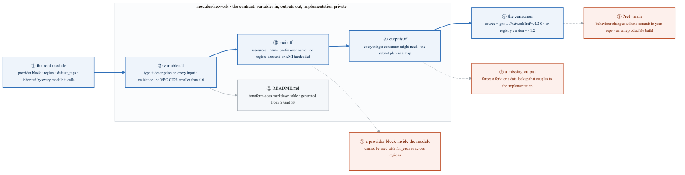
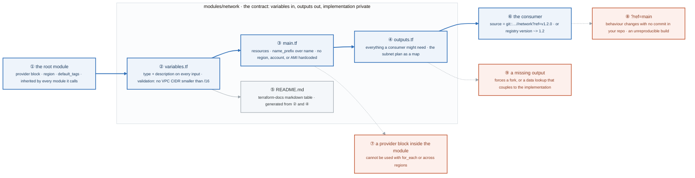
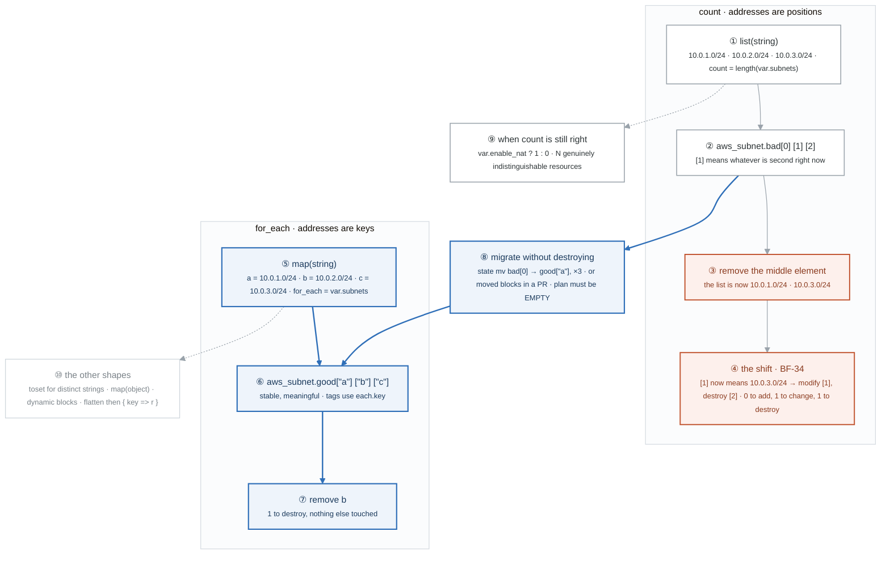
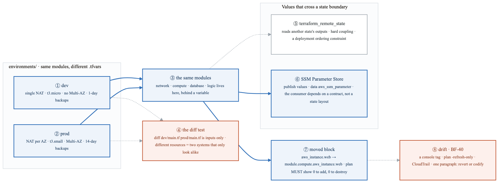
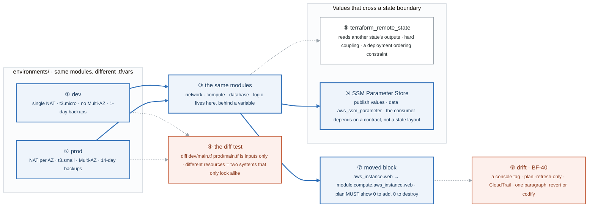
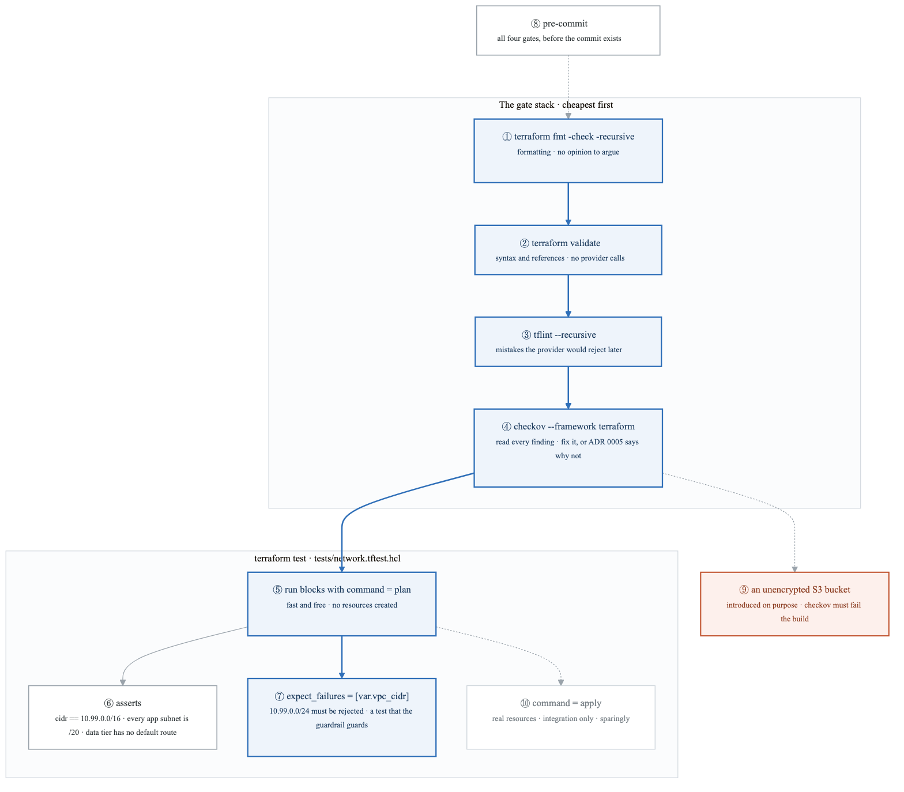
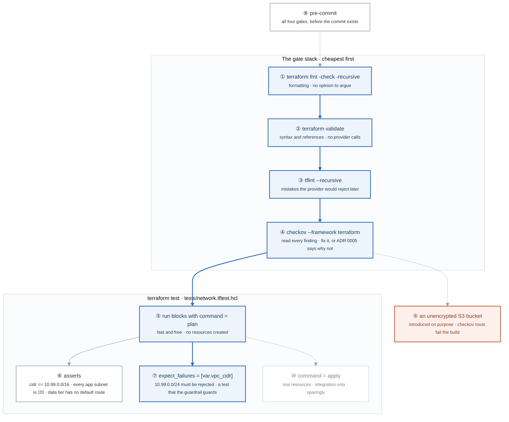
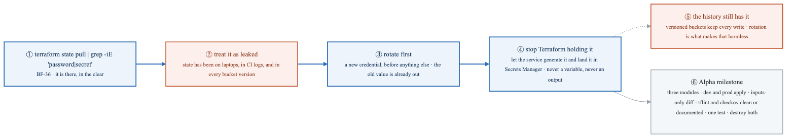

# Week 11 — Lab figures

> One figure per lab, numbered 11.2 to 11.6. Figure 11.1 is the week figure in
> [`../content/FIGURE.md`](../content/FIGURE.md); these five go one level down, to the mechanism each
> lab makes you touch. Same language: gray is structure, **blue is the path to follow first**,
> orange-red is where something refuses, washed boxes are stores. Each badge line is a thirty-second
> interview answer; each whole script is under three minutes.

**The protocol per figure**

1. **Before the lab:** read the figure, say the badges out loud once. You now know what you are about to prove.
2. **During the lab:** every badge has a **Prove it** command. Run it and watch the badge happen. A badge you cannot see happen is one you are taking on faith.
3. **After the lab:** close the file, redraw the figure, say the script. Check against the file. The badge where the order slipped goes in the *Figures redrawn* column of `progress.md`.
4. **Own the numbers.** The *Numbers to own* table is what separates "I know modules" from "removing the middle element of a three-item `count` list plans one change and one destroy, and neither is the subnet you removed."
5. **Answer the question.** Each figure ends with the question a senior interviewer asks about it. Answer it cold, in under a minute, before the gate.

---

## Figure 11.2 — Lab 1: a module is an API

> Lab 1 · badges ① to ⑨ · about three minutes.

<!-- figure: generated from the Mermaid below by _shared/diagrams/embed-figures.py — do not edit the image -->


<details>
<summary>Diagram source (Mermaid)</summary>



</details>

### Say it, badge by badge

- **Open.** "A module is an API. Its consumer should never need to open main.tf. The blue path is the contract, inputs to resources to outputs to a pinned consumer, and the three orange boxes are the ways people break it."
- **① the root module.** "Configures the provider: region, default tags. Every module it calls inherits that provider. The root is the only place a provider block belongs."
- **② variables.tf.** "Every input has a type and a description, because terraform-docs builds the README from them and because an untyped variable fails with an error nobody can read. A validation rejects a VPC CIDR smaller than /16 at plan time, in your words, instead of at apply time in AWS's."
- **③ main.tf.** "The resources, with name_prefix instead of name so create_before_destroy works and replacement never collides with the old name. No region, no account ID, no AMI typed in; each one of those kills reuse."
- **④ outputs.tf.** "Everything a consumer might need, each with a description. The subnet plan goes out as a map so the root can address subnets by name instead of by position."
- **⑤ README.md.** "Generated, not written. `terraform-docs markdown table` reads the variables and outputs and produces the reference. If the README is wrong, a description is wrong."
- **⑥ the consumer.** "Calls the module by a git ref that is a tag, or a registry version with a pessimistic constraint. Version 1.2.0 on Tuesday is version 1.2.0 on Friday."
- **⑦ a provider block inside the module.** "Makes the module impossible to call with for_each, and impossible to use in two regions from one root. The rule has no exceptions worth learning."
- **⑧ ?ref=main.** "Tracking a branch means the module can change under you with no commit in your repository. CI starts producing a different plan and nobody can see why. Never track a branch."
- **⑨ a missing output.** "If the consumer needs a value the module does not export, they fork the module or reach in with a data source, and now they depend on your implementation. Output generously."
- **Close.** "Typed inputs with validations, resources with no hardcoded context, generous outputs, a generated README, a pinned consumer. The refactor in task 2 turns your Alpha into exactly that."

### Numbers to own

| Number | Where it comes from | Why it matters |
|---|---|---|
| 5 files | the module table | main, variables, outputs, versions, README; nothing else in the module root |
| `/16` | task 4's validation | the smallest VPC CIDR the module accepts; the test is that the rejection fires |
| 2 validations | the Alpha reference's variables.tf | the pattern to copy: a confusing failure gets a plan-time message |
| `?ref=v1.2.0` or `~> 1.2` | the versioning block | a tag or a pessimistic constraint; a branch is neither |
| 0 provider blocks | the rules table | inside a module; providers are inherited from the root |

### Prove it

```bash
grep -c 'description' modules/network/variables.tf                                   # ② one per input
grep -rn 'provider "' modules/                                                       # ⑦ must print nothing
terraform-docs markdown table --output-file README.md ./modules/network              # ⑤ generated
terraform plan -var vpc_cidr=10.99.0.0/24                                            # ② the validation fires
terraform output -json subnet_plan | jq .                                            # ④ the map
```

### The question a senior interviewer asks

*"Why must a module never contain a provider block, and what incident does `?ref=main` cause?"*
Badges ⑦ and ⑧. A module with its own provider cannot be instantiated with for_each or pointed at a second region, because the provider is fixed inside it. A branch ref changes the module with no commit in the consuming repo, so a plan changes and the diff that caused it is in someone else's history.

---

## Figure 11.3 — Lab 2: count and for_each, before and after removing one

> Lab 2 · badges ① to ⑩ · about three and a half minutes. Read the two boxes side by side.

<!-- figure: generated from the Mermaid below by _shared/diagrams/embed-figures.py — do not edit the image -->


<details>
<summary>Diagram source (Mermaid)</summary>



</details>

### Say it, badge by badge

- **Open.** "This is the one Terraform bug that deletes production subnets to remove one. The top box is the bug; the bottom box is the fix; the blue path between them is how you get from one to the other without destroying anything."
- **① list(string).** "Three CIDRs in a list, and count equal to its length. Reasonable-looking code; it is in thousands of repositories."
- **② bad[0], bad[1], bad[2].** "The addresses are positions. `[1]` does not mean the second subnet you created; it means whatever is second in the list right now."
- **③ remove the middle element.** "Delete 10.0.2.0/24 from the list. You intend to remove one subnet."
- **④ the shift.** "Terraform sees `[1]` is now 10.0.3.0/24, a different subnet, and plans to modify it; `[2]` no longer exists, so it plans to destroy it. Zero to add, one to change, one to destroy. In production that is two subnets touched to remove one, and the one it destroys is not the one you removed. BF-34."
- **⑤ map(string).** "The same three CIDRs keyed a, b, c, with for_each. The key is the identity."
- **⑥ good["a"], good["b"], good["c"].** "Addresses are the keys. Remove any one and the others do not move. The Name tag uses each.key, so the subnet is called what its address is called."
- **⑦ remove b.** "One to destroy, nothing else in the plan. That line is the whole argument for for_each."
- **⑧ migrate without destroying.** "An existing count deployment moves to for_each by renaming addresses: three state mv commands, or three moved blocks so the rename is in the PR. Plan afterwards; it must be empty. If it is not, the mapping is wrong and you stop."
- **⑨ when count is still right.** "Two cases only. The conditional, `? 1 : 0`, for a resource that exists or does not. And N resources that are genuinely indistinguishable, where position is the only identity they have."
- **⑩ the other shapes.** "`toset` for a list of distinct strings, a map of objects for services with ports and replicas, dynamic blocks for repeated nested blocks, and flatten plus a for expression to turn a nested loop into a keyed map. Build each and look at the addresses in state."
- **Close.** "Positions shift; keys do not. Migrate with moved blocks, plan to empty, and keep count for the conditional and for things with no name."

### Numbers to own

| Number | Where it comes from | Why it matters |
|---|---|---|
| 3 subnets | the variable default | `10.0.1.0/24`, `10.0.2.0/24`, `10.0.3.0/24`, as a list and then as a map |
| `0 to add, 1 to change, 1 to destroy` | the plan after removing the middle element under `count` | the shift: modify `[1]`, destroy `[2]`; neither is the subnet you removed |
| `1 to destroy` | the same removal under `for_each` | the fix, in one line of plan |
| 3 `state mv` commands, or 3 `moved` blocks | Part 3 | one per address; the plan after them must be empty |
| 2 cases for `count` | the task | `? 1 : 0`, and N indistinguishable resources |

### Prove it

```bash
terraform state list                                   # ② aws_subnet.bad[0], [1], [2]
terraform plan                                         # ④ after removing the middle CIDR: 1 to change, 1 to destroy
terraform plan                                         # ⑦ after removing b from the map: 1 to destroy
terraform state mv 'aws_subnet.bad[0]' 'aws_subnet.good["a"]' && terraform plan   # ⑧ toward EMPTY
terraform state list | grep -E '\["'                   # ⑥ ⑩ keyed addresses, for every shape you built
```

### The question a senior interviewer asks

*"Explain exactly why removing one list element rewrites an unrelated subnet, and name the two cases where `count` is still the right choice."*
Badges ② and ④ for the first half: addresses are positions, so the plan modifies `[1]` and destroys `[2]`. Badge ⑨ for the second: the conditional, and resources with no identity of their own. Then say how you would migrate an existing deployment, badge ⑧, because that is the follow-up.

---

## Figure 11.4 — Lab 3: two environments, one set of modules

> Lab 3 · badges ① to ⑧ · about three minutes.

<!-- figure: generated from the Mermaid below by _shared/diagrams/embed-figures.py — do not edit the image -->


<details>
<summary>Diagram source (Mermaid)</summary>



</details>

### Say it, badge by badge

- **Open.** "Dev is only useful if it predicts prod. That happens when both are the same modules with different numbers, and stops happening the moment they contain different resources. This figure is that rule, plus the two ways values cross between stacks and the refactor that must destroy nothing."
- **① dev.** "One NAT gateway, small instances, no Multi-AZ, one day of backups. Cheap, and shaped exactly like prod."
- **② prod.** "A NAT per availability zone, larger instances, Multi-AZ, fourteen days of backups. Every one of those is an input, not a different block of code."
- **③ the same modules.** "Network, compute, database, called by both. If dev needs something prod does not, that is a variable in the module with a different value, never a resource that exists in one directory and not the other."
- **④ the diff test.** "Diff the two main.tf files. The diff should be inputs only. Logic in the diff is logic that belongs in a module behind a variable, and until it moves, dev has stopped predicting anything."
- **⑤ terraform_remote_state.** "A consumer reads the producer's outputs straight out of its state file. It works, and it welds the two together: the consumer now depends on the producer's state layout and must deploy after it. Use it sparingly."
- **⑥ SSM Parameter Store.** "The producer publishes the values it wants to share; the consumer reads them with a data source. The dependency is now on a named contract. Raise that distinction in a design discussion and people notice."
- **⑦ moved block.** "Pull a root-level resource into a module. The address changes, so without help Terraform plans a destroy and a create. The moved block says old address, new address, and the plan shows zero to add and zero to destroy. Zero is the acceptance criterion; anything else means the move is wrong."
- **⑧ drift.** "Tag something in the console, refresh-only to see it, CloudTrail to see who, then one paragraph deciding revert or codify. BF-40, which is Lab 3 of last week with a decision attached."
- **Close.** "Same modules, inputs-only diff, contracts over state coupling, moves with zero destroys. That is what a second engineer can consume."

### Numbers to own

| Number | Where it comes from | Why it matters |
|---|---|---|
| 1 NAT vs 1 per AZ | the environment table | the cost-versus-availability input that most separates dev from prod |
| `t3.micro` vs `t3.small` | the environment table | instance size as an input |
| 1-day vs 14-day backups | the environment table | retention as an input |
| 0 logic lines in the diff | task 1 | the diff of the two main.tf files is values only |
| `0 to add, 0 to destroy` | Part 3 | the acceptance criterion for a moved block |

### Prove it

```bash
diff environments/dev/main.tf environments/prod/main.tf                     # ④ inputs only
terraform -chdir=environments/prod plan | grep -c 'nat_gateway'             # ② one per AZ
aws ssm get-parameter --name /alpha/dev/app_subnet_ids                      # ⑥ the published contract
terraform plan | grep -E '^Plan:'                                           # ⑦ 0 to add, 0 to destroy after the moved block
terraform plan -refresh-only                                                # ⑧ only the drift
```

### The question a senior interviewer asks

*"`terraform_remote_state` versus SSM parameters: what coupling does each create between teams?"*
Badges ⑤ and ⑥. Remote state couples the consumer to the producer's state file and its deployment order; a parameter couples it to a named value the producer chose to publish. One is reaching into someone's implementation; the other is a contract.

---

## Figure 11.5 — Lab 4: the gate stack, and a test that tests the guardrail

> Lab 4 · badges ① to ⑩ · about three minutes.

<!-- figure: generated from the Mermaid below by _shared/diagrams/embed-figures.py — do not edit the image -->


<details>
<summary>Diagram source (Mermaid)</summary>



</details>

### Say it, badge by badge

- **Open.** "Four gates in order of cost, then tests that cost nothing because they only plan. The interesting badge is the seventh: a test that proves your validation rejects what it should. Testing the guardrail is worth more than testing the happy path."
- **① fmt -check.** "Formatting, with no flag to argue about. It fails the build so nobody reviews whitespace."
- **② validate.** "Syntax and internal references, with no provider calls. It catches the typo before anything expensive runs."
- **③ tflint.** "Rules the provider would reject at apply time: an invalid instance type, a deprecated argument. It moves the failure from the API to the pull request."
- **④ checkov.** "Security findings against the Terraform. Read every one. Each is either fixed or written into ADR 0005 with the reason it is accepted. A finding with neither is a finding you are hiding."
- **⑤ run blocks with command = plan.** "`terraform test` runs the module with test variables and asserts on the planned values. No resource is created, so it is fast and free, and it runs on every commit."
- **⑥ asserts.** "The VPC CIDR is what was passed in. Every app subnet is a /20, which is the week 2 sizing for pod IPs. The data tier has no default route, which is the week 6 isolation rule. Three design decisions, now enforced."
- **⑦ expect_failures.** "Pass a /24 and assert that the vpc_cidr validation rejects it. If someone deletes the validation, this test fails. That is the difference between a guardrail and a comment."
- **⑧ pre-commit.** "All four gates wired to run before the commit exists. Week 12 runs the same four on the server; this is the copy that catches it first."
- **⑨ an unencrypted S3 bucket.** "Add one on purpose and confirm checkov fails the build. A scanner you have never seen fail is a scanner you are trusting on reputation."
- **⑩ command = apply.** "Tests that need real resources exist, cost money, and take minutes. Use them for integration, sparingly, never as the default."
- **Close.** "Format, validate, lint, scan, then plan-only tests with one that proves the rejection. Clean, or every exception has an ADR."

### Numbers to own

| Number | Where it comes from | Why it matters |
|---|---|---|
| 4 gates | the gate stack | fmt, validate, tflint, checkov, in cost order |
| `10.99.0.0/16` | the test variables | the VPC CIDR the first assert checks |
| `/20` | the second assert | app subnets sized for pod IPs; the week 2 number, now a test |
| `0` routes | the third assert | the data tier's route table has no default route |
| `10.99.0.0/24` | the `expect_failures` run | the input the validation must reject |
| 4 test cases | task 2 | three happy-path asserts and one expected failure |

### Prove it

```bash
terraform fmt -check -recursive; terraform validate; tflint --recursive --format compact   # ① ② ③
checkov -d . --framework terraform                                                         # ④ read every finding
terraform test                                                                             # ⑤ ⑥ ⑦ four runs, plan only
sed -i '' '/validation {/,/}/d' modules/network/variables.tf && terraform test             # ⑦ delete the guardrail, watch the test fail; then git checkout
pre-commit run --all-files                                                                 # ⑧
```

### The question a senior interviewer asks

*"Why is an `expect_failures` test on your validation worth more than a happy-path test, and when would you pay for `command = apply`?"*
Badge ⑦: the happy path proves the module works when used correctly; the expected failure proves the module refuses to be used incorrectly, and it is the one that breaks when someone removes the guardrail. Badge ⑩: apply only when the behaviour under test exists only in the real API, and never on every commit.

---

## Figure 11.6 — Lab 5: Break/Fix and the Alpha milestone — a secret in state, rotation first

> Lab 5 · badges ① to ⑥ · about two minutes. The Friday loop itself is
> [Figure BF.0](../../_shared/breakfix/FIGURE.md); BF-34 is [Figure 11.3](#figure-113--lab-2-count-and-for_each-before-and-after-removing-one)
> and BF-40 is badge ⑧ of [Figure 11.4](#figure-114--lab-3-two-environments-one-set-of-modules).

```mermaid
%%{init: {'theme':'base','themeVariables':{'fontFamily':'Helvetica, Arial, sans-serif','fontSize':'13px','primaryColor':'#ffffff','primaryTextColor':'#2d3436','primaryBorderColor':'#9aa3ab','lineColor':'#9aa3ab','textColor':'#2d3436','clusterBkg':'#fbfcfd','clusterBorder':'#d4dae0','edgeLabelBackground':'#ffffff','tertiaryColor':'#eef4fb'},'flowchart':{'curve':'basis','padding':14,'nodeSpacing':42,'rankSpacing':58}}}%%
flowchart LR
  classDef default fill:#ffffff,stroke:#9aa3ab,stroke-width:1.3px,color:#2d3436
  classDef n    fill:#ffffff,stroke:#9aa3ab,stroke-width:1.3px,color:#2d3436
  classDef crit fill:#eef4fb,stroke:#2f6fb8,stroke-width:1.8px,color:#1b3a5c
  classDef data fill:#f4f7fa,stroke:#9aa3ab,stroke-width:1.3px,color:#2d3436
  classDef mut  fill:#ffffff,stroke:#cfd6dc,stroke-width:1.1px,color:#7a8288
  classDef warn fill:#fdf0ec,stroke:#c0522d,stroke-width:1.6px,color:#8a3a1e

  PULL["① terraform state pull | grep -iE 'password|secret'<br/><small>BF-36 · it is there, in the clear</small>"]:::crit
  LEAK["② treat it as leaked<br/><small>state has been on laptops, in CI logs, and in every bucket version</small>"]:::warn
  ROT["③ rotate first<br/><small>a new credential, before anything else · the old value is already out</small>"]:::crit
  STOP["④ stop Terraform holding it<br/><small>let the service generate it and land it in Secrets Manager · never a variable, never an output</small>"]:::crit
  HIST["⑤ the history still has it<br/><small>versioned buckets keep every write · rotation is what makes that harmless</small>"]:::warn
  MILE["⑥ Alpha milestone<br/><small>three modules · dev and prod apply · inputs-only diff · tflint and checkov clean or documented · one test · destroy both</small>"]:::data

  PULL ==> LEAK ==> ROT ==> STOP
  STOP -.-> HIST
  STOP --> MILE
  linkStyle 0,1,2 stroke:#2f6fb8,stroke-width:2px
```

<!-- figure: generated from the Mermaid below by _shared/diagrams/embed-figures.py — do not edit the image -->


<details>
<summary>Diagram source (Mermaid)</summary>



</details>

### Say it, badge by badge

- **Open.** "Friday replays three breaks from the week, and the one that has an order is the secret in state. The order matters because getting it backwards leaves the leak open while you tidy up."
- **① state pull and grep.** "Pull the state, grep for password or secret. The random_password from Lab 2 is in there, in plaintext, because state stores every attribute of every resource."
- **② treat it as leaked.** "The state file has been on every laptop that ran a plan, in any CI log that printed it, and in every version the bucket kept. You cannot know who has read it, so you assume everyone."
- **③ rotate first.** "A new credential, before any cleanup. Cleanup does not help while the old value is still valid; rotation is the only step that actually closes the exposure."
- **④ stop Terraform holding it.** "Have the service generate the password and land it in Secrets Manager, so Terraform references a secret it never sees. Never a variable, never an output. The week 11 database module already works this way."
- **⑤ the history still has it.** "Versioned buckets keep every write, so the old state versions still contain the old value. That is fine only because badge three made the old value worthless. If rotation had come last, the history would still be a live credential."
- **⑥ Alpha milestone.** "Three modules complete, dev and prod both apply, the diff between them is inputs only, tflint and checkov clean or documented, at least one test passing, and destroy both before you stop."
- **Close.** "Find it, assume it is out, rotate, then make Terraform stop holding it. Rotation first is the sentence; everything after it is hygiene."

### Numbers to own

| Number | Where it comes from | Why it matters |
|---|---|---|
| 3 scenarios | the lab | BF-34, BF-36, BF-40, replayed cold on Friday |
| step 1 of the remediation | the lab | rotation; every other step assumes the old value is already worthless |
| 3 modules, 2 environments, 1 test | the milestone | the week's deliverable, checked before destroy |
| 0 logic lines in the dev/prod diff | the milestone | the Lab 3 rule, now a checkbox |

### Prove it

```bash
terraform state pull | grep -i -E 'password|secret' | head                 # ① the leak
grep -rn 'manage_master_user_password\|secretsmanager' modules/database/   # ④ Terraform never holds it
terraform -chdir=environments/dev apply && terraform -chdir=environments/prod apply   # ⑥ both apply
terraform test                                                             # ⑥ at least one passing
```

### The question a senior interviewer asks

*"You found a database password in Terraform state. What is your remediation order, and why does rotation come first?"*
Badges ② to ⑤. Assume it is leaked; rotate so the leaked value is dead; then change the design so Terraform never holds the new one; then note that the bucket history still has the old one, which is harmless only because of the rotation. Any order that starts with cleanup leaves a live credential in the open while you work.

---

## Redraw schedule

Same cadence as the week figure, see [`../../FIGURES.md`](../../FIGURES.md): Friday of this week after break/fix, then cold on Sunday of week 13, which is both the two-week redraw and the Gate 3 Sunday. Lab figures are redrawn **after** the week figure, one at a time, and only the badge order has to be right; the captions are the check, not the test.
