# Week 12 — CI/CD with GitHub Actions and OIDC

> **Thesis:** static AWS keys in GitHub secrets is the most common amateur tell in a junior
> portfolio. Killing them takes three hours and reads as three years of experience.

| | |
|---|---|
| **Hours** | 35–45 |
| **Deliverable** | Blog post #7 — "Deleting every AWS access key from my CI, with OIDC" |
| **⚑ Alpha** | Fully CI-deployed: plan on PR, apply on merge, zero static credentials |
| **Break/Fix** | BF-37, BF-38, BF-39 |

## The week in one figure

**Figure 12.1 — OIDC: how a workflow gets AWS credentials with no secret anywhere.** Static keys in GitHub secrets are the most common amateur tell. The blue path replaces them with a short-lived token that AWS verifies by signature and by claim. Two roles, deliberately different, sit at the end. Badges are numbered in the order to walk them; the blue path is the one to follow first.

```mermaid
%%{init: {'theme':'base','themeVariables':{'fontFamily':'Helvetica, Arial, sans-serif','fontSize':'13px','primaryColor':'#ffffff','primaryTextColor':'#2d3436','primaryBorderColor':'#9aa3ab','lineColor':'#9aa3ab','textColor':'#2d3436','clusterBkg':'#fbfcfd','clusterBorder':'#d4dae0','edgeLabelBackground':'#ffffff','tertiaryColor':'#eef4fb'},'flowchart':{'curve':'basis','padding':14,'nodeSpacing':42,'rankSpacing':58}}}%%
flowchart LR
  classDef default fill:#ffffff,stroke:#9aa3ab,stroke-width:1.3px,color:#2d3436
  classDef n    fill:#ffffff,stroke:#9aa3ab,stroke-width:1.3px,color:#2d3436
  classDef crit fill:#eef4fb,stroke:#2f6fb8,stroke-width:1.8px,color:#1b3a5c
  classDef data fill:#f4f7fa,stroke:#9aa3ab,stroke-width:1.3px,color:#2d3436
  classDef mut  fill:#ffffff,stroke:#cfd6dc,stroke-width:1.1px,color:#7a8288
  classDef warn fill:#fdf0ec,stroke:#c0522d,stroke-width:1.6px,color:#8a3a1e

  PR["① pull request or merge<br/><small>triggers the workflow</small>"]:::crit
  GH["② GitHub OIDC issuer<br/><small>token.actions.githubusercontent.com · signs a JWT</small>"]:::crit
  JWT["③ the token<br/><small>sub = repo:org/repo:ref:refs/heads/main · aud = sts.amazonaws.com · minutes, not days</small>"]:::data
  IDP["④ IAM OIDC provider<br/><small>trusts the issuer · one per account</small>"]:::crit
  STS["⑤ AssumeRoleWithWebIdentity<br/><small>signature checked · trust-policy condition on sub</small>"]:::crit
  RP["⑥ plan role<br/><small>read-only · any branch · PRs must plan</small>"]:::n
  RA["⑦ apply role<br/><small>pinned to environment:prod · protected, approval required</small>"]:::warn
  PIPE["⑧ the pipeline<br/><small>fmt → validate → tflint → checkov → plan → PR comment → approval → apply</small>"]:::crit
  ECR["⑨ container build<br/><small>multi-arch · ECR · semver tag + git SHA</small>"]:::data
  BP["⑩ branch protection<br/><small>all checks green · concurrency: cancel-in-progress false</small>"]:::n
  BAD["⑪ the dangerous trust policy<br/><small>sub = repo:org/repo:* lets any branch apply</small>"]:::warn
  PR ==> GH ==> JWT ==> IDP ==> STS ==> RA ==> PIPE
  STS --> RP --> PIPE
  PIPE -.-> ECR
  BP -.-> PR
  BAD -.-> STS
  linkStyle 0,1,2,3,4,5 stroke:#2f6fb8,stroke-width:2px
```

**What to say, badge by badge** · about three and a half minutes at a normal pace. Point at each badge as you say its line.

- **Open.** “Three hours of work this week read as three years of experience, and this is the picture of it. No access key exists. A workflow proves who it is with a signed token, and AWS decides what that identity may do. Follow the blue path, then look at the two roles.”
- **① pull request or merge.** “The workflow starts with a context: which repository, which branch or environment, which event. That context is about to become the identity.”
- **② GitHub OIDC issuer.** “GitHub runs an OpenID Connect issuer. On request, it signs a JSON Web Token with its private key and publishes the public key at a well-known URL. Anyone can verify; only GitHub can sign.”
- **③ the token.** “The claims are the whole story. `sub` says repo, and ref or environment. `aud` says who the token is for: sts.amazonaws.com. It expires in minutes. There is nothing in it worth stealing for long.”
- **④ IAM OIDC provider.** “One per AWS account, pointing at GitHub's issuer. This is AWS agreeing to check signatures from that issuer. It grants nothing by itself.”
- **⑤ AssumeRoleWithWebIdentity.** “The workflow hands the token to STS. STS verifies the signature against the published key, then evaluates the role's trust policy against the claims. The condition on `sub` is the access control. STS returns temporary credentials, and the job runs.”
- **⑥ plan role.** “Read-only. Trusted for any branch, because a pull request from any branch must be able to produce a plan. Read-only means a malicious PR can look but not touch.”
- **⑦ apply role.** “Trusted only for `environment:prod`, a GitHub environment with required reviewers. Merging is not enough; a human approves the deployment, and only then does a token with that claim exist.”
- **⑧ the pipeline.** “fmt, validate, tflint, checkov, plan, a comment on the PR with the plan, approval, apply. Cheap checks first, so a formatting error does not spend a plan. The plan comment is what the reviewer actually reads.”
- **⑨ container build.** “Multi-arch, pushed to ECR with two tags: a semver for humans and the git SHA for provenance. Week 18 signs the digest; this is where the digest is born.”
- **⑩ branch protection.** “Every check green before merge. The concurrency group has cancel-in-progress false, because cancelling an apply halfway through is how you get a half-built environment.”
- **⑪ the dangerous trust policy.** “`repo:org/repo:*` matches every branch and every PR. On the plan role it is fine. On the apply role it means anyone who can push a branch can deploy to production. Say this in the interview; it is the question they ask.”
- **Close.** “So: no key exists, identity is a signed claim, and the claim decides the role. The exit criterion is a grep for AKIA that returns nothing, in the tree and in the history.”

---

## Day plan
| Day | Focus | Lab |
|---|---|---|
| Mon | GitHub Actions fundamentals: workflows, jobs, matrices, caching | Lab 1 |
| Tue | **OIDC federation to AWS** — the week's centerpiece | Lab 2 |
| Wed | The Terraform pipeline: plan-on-PR, apply-on-merge, approvals | Lab 3 |
| Thu | Container builds, ECR, reusable workflows, releases | Lab 4 |
| Fri | Break/Fix + branch protection + ⚑ Alpha | Lab 5 |
| Sat | ⚑ Alpha fully CI-deployed | — |
| Sun | Blog post #7 (this one gets read); plan week 13 | — |

## Reading map
- `_reference/cicd-gitops/01-cicd-fundamentals.md`
- `_reference/cicd-gitops/03-github-actions.md`
- `_reference/cicd-gitops/06-deployment-strategies.md`
- `_reference/cicd-gitops/07-pipeline-security.md`
- **`_reference/devsecops/implementation/cross-cutting-oidc-workload-identity.md`** ← the key doc
- `_reference/devsecops/implementation/01-cicd-pipelines-architecture.md`
- `_reference/terraform/labs/phase-4-advanced-lab-4.2-cicd-integration.md`
- `_reference/kubernetes/04-platform/02-cicd-pipelines-exercises-02-github-actions.md`

## Labs
[labs/LABS.md](labs/LABS.md) · [solutions/SOLUTIONS.md](solutions/SOLUTIONS.md) ·
Reference workflows: [`../projects/alpha-cloud-foundation/.github/workflows/`](../projects/alpha-cloud-foundation/.github/workflows/)

## Exit criteria
- [ ] **`git grep -E 'AKIA[0-9A-Z]{16}'` returns nothing**, in the working tree *and* in history
- [ ] OIDC provider + two roles (plan read-only, apply scoped to a protected environment)
- [ ] Pipeline: `fmt` → `validate` → `tflint` → `checkov` → `plan` → PR comment → approval → `apply`
- [ ] Branch protection requiring all checks before merge
- [ ] `concurrency` group with `cancel-in-progress: false`
- [ ] Multi-arch container build pushed to ECR with both a semver tag and the git SHA
- [ ] Explain why `repo:org/repo:*` in a trust policy is dangerous for an apply role
