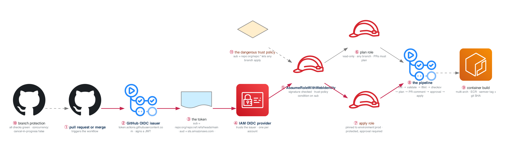

# Week 12 — CI/CD with GitHub Actions and OIDC

> **Thesis:** static AWS keys in GitHub secrets is the most common amateur tell in a junior
> portfolio. Killing them takes three hours and reads as three years of experience.

| | |
|---|---|
| **Hours** | 35–45 |
| **Deliverable** | Blog post #7 — "Deleting every AWS access key from my CI, with OIDC" |
| **⚑ Alpha** | Fully CI-deployed: plan on PR, apply on merge, zero static credentials |
| **Break/Fix** | BF-37, BF-38, BF-39 |

## The week in one figure

**Figure 12.1 — OIDC: how a workflow gets AWS credentials with no secret anywhere.** Static keys in GitHub secrets are the most common amateur tell. The blue path replaces them with a short-lived token that AWS verifies by signature and by claim. Two roles, deliberately different, sit at the end.

**Say it, badge by badge:** [`content/FIGURE.md`](content/FIGURE.md) — the spoken script for each of the 11 badges, about three and a half minutes; [`content/figure-12.1-numbered-spoken.pdf`](content/figure-12.1-numbered-spoken.pdf) is the printable two-page version. Read the figure before the day plan; say the script on Friday.

---

## Day plan
| Day | Focus | Lab |
|---|---|---|
| Mon | GitHub Actions fundamentals: workflows, jobs, matrices, caching | Lab 1 |
| Tue | **OIDC federation to AWS** — the week's centerpiece | Lab 2 |
| Wed | The Terraform pipeline: plan-on-PR, apply-on-merge, approvals | Lab 3 |
| Thu | Container builds, ECR, reusable workflows, releases | Lab 4 |
| Fri | Break/Fix + branch protection + ⚑ Alpha | Lab 5 |
| Sat | ⚑ Alpha fully CI-deployed | — |
| Sun | Blog post #7 (this one gets read); plan week 13 | — |

## Reading map
- `_reference/cicd-gitops/01-cicd-fundamentals.md`
- `_reference/cicd-gitops/03-github-actions.md`
- `_reference/cicd-gitops/06-deployment-strategies.md`
- `_reference/cicd-gitops/07-pipeline-security.md`
- **`_reference/devsecops/implementation/cross-cutting-oidc-workload-identity.md`** ← the key doc
- `_reference/devsecops/implementation/01-cicd-pipelines-architecture.md`
- `_reference/terraform/labs/phase-4-advanced-lab-4.2-cicd-integration.md`
- `_reference/kubernetes/04-platform/02-cicd-pipelines-exercises-02-github-actions.md`

## Labs
[labs/LABS.md](labs/LABS.md) · [labs/FIGURES.md](labs/FIGURES.md) (figures 12.2 to 12.6, one per lab) · [solutions/SOLUTIONS.md](solutions/SOLUTIONS.md) ·
Reference workflows: [`../projects/alpha-cloud-foundation/.github/workflows/`](../projects/alpha-cloud-foundation/.github/workflows/)

## Exit criteria
- [ ] **`git grep -E 'AKIA[0-9A-Z]{16}'` returns nothing**, in the working tree *and* in history
- [ ] OIDC provider + two roles (plan read-only, apply scoped to a protected environment)
- [ ] Pipeline: `fmt` → `validate` → `tflint` → `checkov` → `plan` → PR comment → approval → `apply`
- [ ] Branch protection requiring all checks before merge
- [ ] `concurrency` group with `cancel-in-progress: false`
- [ ] Multi-arch container build pushed to ECR with both a semver tag and the git SHA
- [ ] Explain why `repo:org/repo:*` in a trust policy is dangerous for an apply role
