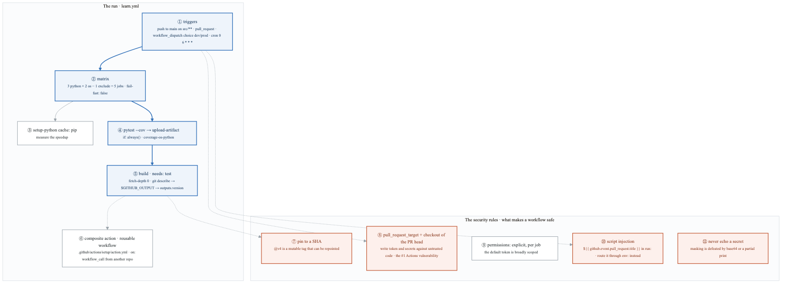
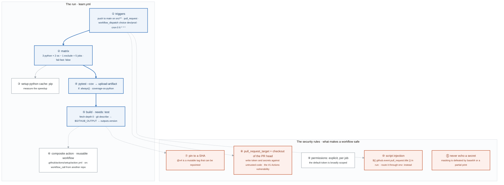
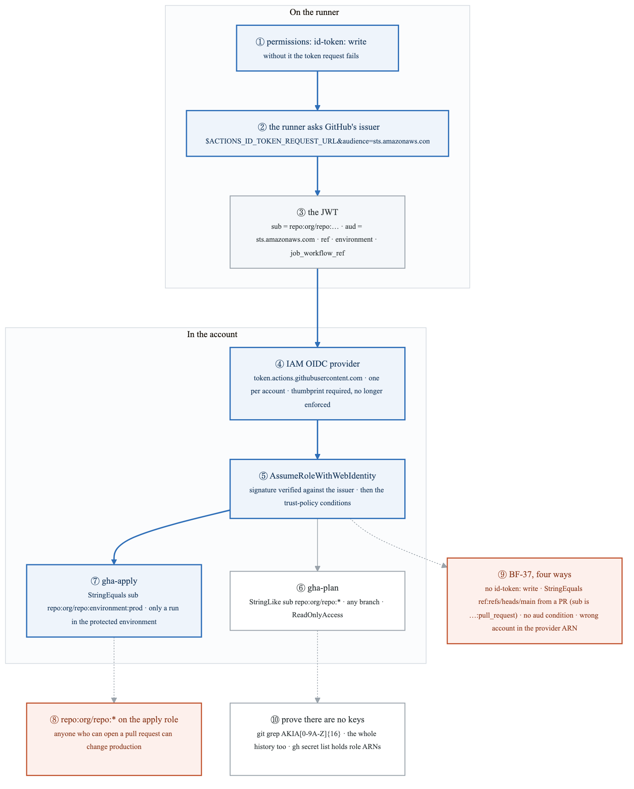
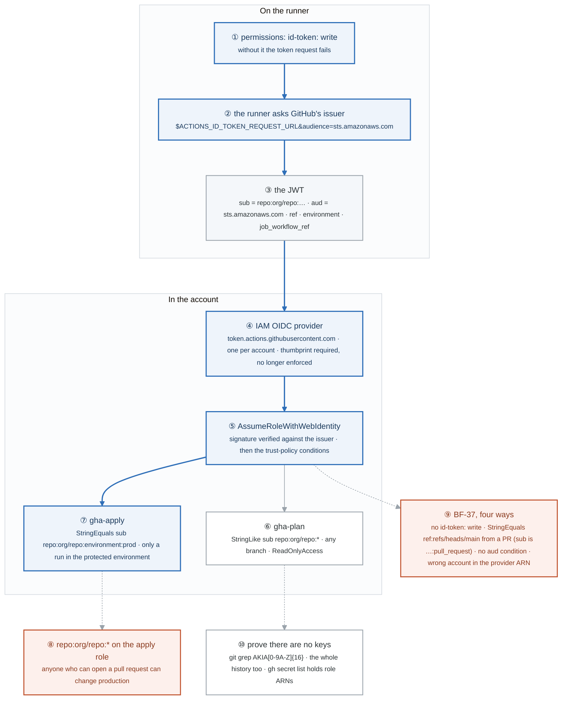
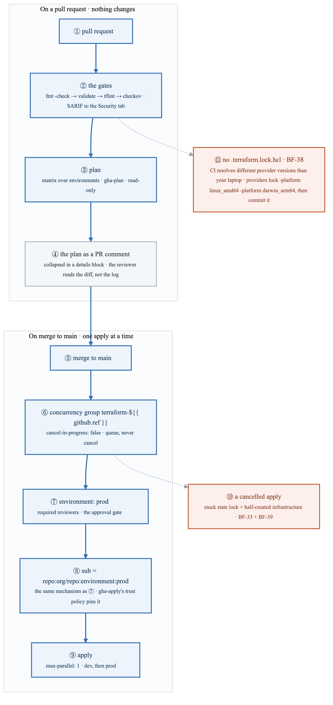
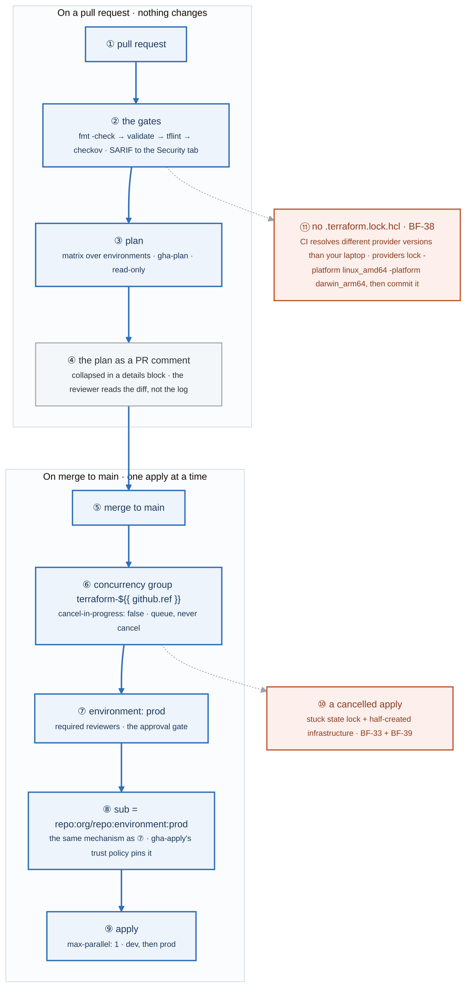
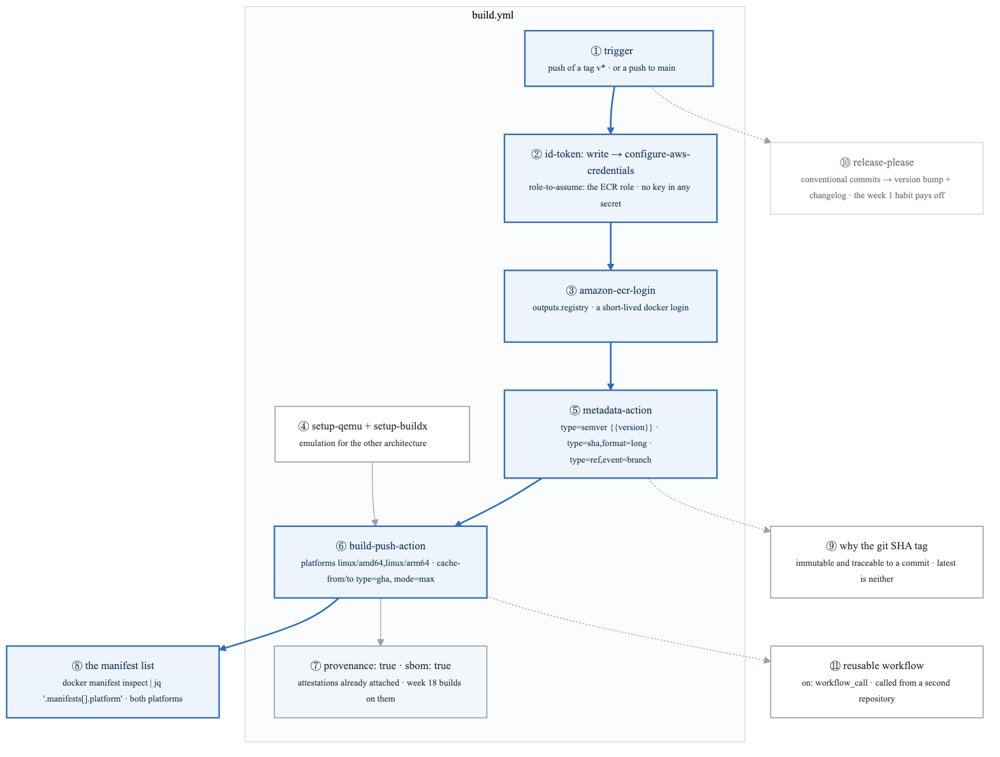
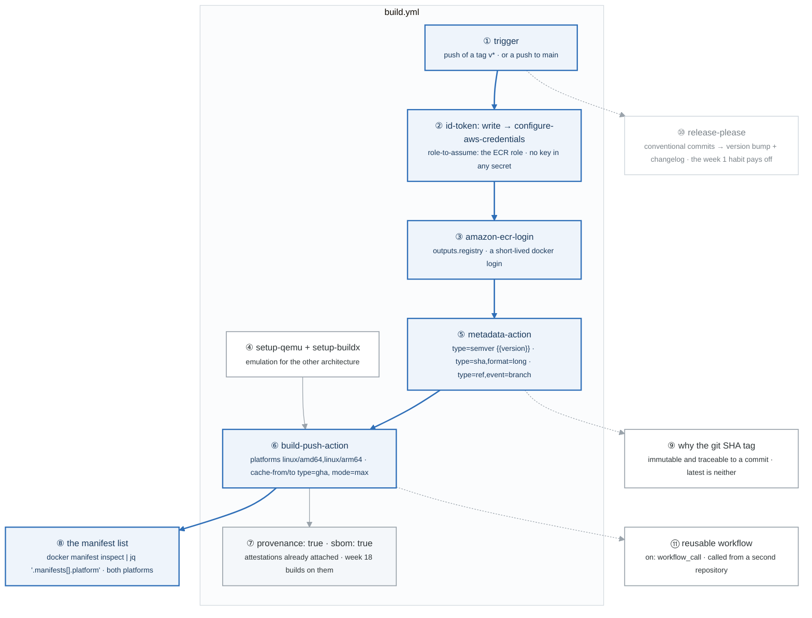
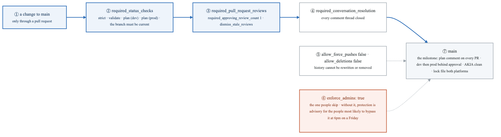
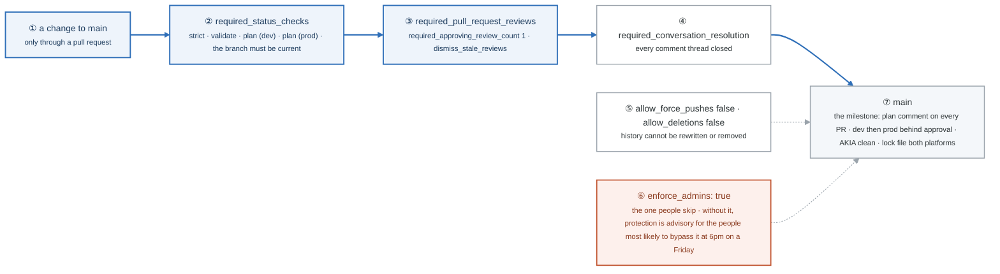

# Week 12 — Lab figures

> One figure per lab, numbered 12.2 to 12.6. Figure 12.1 is the week figure in
> [`../content/FIGURE.md`](../content/FIGURE.md); these five go one level down, to the mechanism each
> lab makes you touch. Same language: gray is structure, **blue is the path to follow first**,
> orange-red is where something refuses, washed boxes are stores. Each badge line is a thirty-second
> interview answer; each whole script is under three minutes.

**The protocol per figure**

1. **Before the lab:** read the figure, say the badges out loud once. You now know what you are about to prove.
2. **During the lab:** every badge has a **Prove it** command. Run it and watch the badge happen. A badge you cannot see happen is one you are taking on faith.
3. **After the lab:** close the file, redraw the figure, say the script. Check against the file. The badge where the order slipped goes in the *Figures redrawn* column of `progress.md`.
4. **Own the numbers.** The *Numbers to own* table is what separates "we use OIDC" from "the apply role's trust policy is StringEquals on `sub` = `repo:org/repo:environment:prod`, so only a run that passed the environment's reviewers can assume it."
5. **Answer the question.** Each figure ends with the question a senior interviewer asks about it. Answer it cold, in under a minute, before the gate.

---

## Figure 12.2 — Lab 1: a workflow run from trigger to artifact, and the five rules

> Lab 1 · badges ① to ⑪ · about three and a half minutes.

<!-- figure: generated from the Mermaid below by _shared/diagrams/embed-figures.py — do not edit the image -->


<details>
<summary>Diagram source (Mermaid)</summary>



</details>

### Say it, badge by badge

- **Open.** "A workflow is an event, a fan-out, and a chain of jobs that pass values to each other. The top row is that. The bottom row is the five rules that decide whether the same workflow is a build system or a remote shell for strangers."
- **① triggers.** "Four events: a push to main that touched src, any pull request, a manual dispatch with a dev-or-prod choice, and a cron at six every morning. The event is also the context: which branch, which actor, which PR. That context becomes the OIDC identity in Lab 2."
- **② matrix.** "Three Python versions times two operating systems, minus one excluded pair, is five jobs in parallel. fail-fast false means one red job does not cancel the other four, so you see every failure in one run."
- **③ cache.** "setup-python caches the pip downloads between runs. Measure the second run against the first; the number is the argument for caching everything deterministic."
- **④ pytest and the artifact.** "Tests run with coverage; the report is uploaded even when the tests fail, because if: always() overrides the default skip-on-failure. A failed run with no artifact is a failure you cannot read."
- **⑤ build, needs test.** "The build job waits on test. It checks out full history so git describe can see tags, writes the version into GITHUB_OUTPUT, and exposes it as a job output. That is how one job hands a value to the next."
- **⑥ composite action and reusable workflow.** "A composite action packages steps; a reusable workflow packages a whole job and is called from another repository with workflow_call. Both exist so the same setup is not copied into twenty files."
- **⑦ pin to a SHA.** "A tag like v4 can be moved to point at different code tomorrow. For anything that touches credentials, the reference is a commit SHA, which cannot."
- **⑧ pull_request_target.** "It runs with a write token and the repository's secrets, and if the job checks out the PR's head it runs the stranger's code with them. That combination is the most exploited mistake in GitHub Actions."
- **⑨ permissions.** "The default token can do a lot. Declare permissions explicitly, least privilege, per job, so a compromised step has nothing to spend."
- **⑩ script injection.** "A PR title inside a run: line is shell code written by whoever opened the PR. Pass it through an env: variable and it becomes a string. Same data, no execution."
- **⑪ never echo a secret.** "Logs mask the exact secret string. base64 of it, or half of it, is not the exact string, and it prints. Treat the log as public."
- **Close.** "Event, matrix, artifact, outputs, reuse. Then pin, no pull_request_target with foreign code, explicit permissions, env for untrusted input, nothing secret in logs. The top row is table stakes; the bottom row is what the OIDC lab assumes you already do."

### Numbers to own

| Number | Where it comes from | Why it matters |
|---|---|---|
| 5 jobs | the matrix: 3 × 2 − 1 exclude | the fan-out you watch run in parallel in task 1 |
| `0 6 * * *` | the schedule trigger | six o'clock UTC daily; the first cron most people write and the first one to run at the wrong hour |
| `fetch-depth: 0` | the build job | full history so `git describe --tags` can find a tag |
| 5 rules | the security table | SHA pins, no pull_request_target with the PR head, explicit permissions, no echoed secrets, event data is untrusted |
| 1 line to inject | the vulnerable example | a PR title in `run:` is remote code execution |

### Prove it

```bash
gh run list --workflow learn.yml --limit 1 && gh run view --job <id>      # ② five jobs, one run
gh run view <id> --log | grep -i 'cache hit'                               # ③ the cache worked
gh run download <id> -n coverage-ubuntu-latest-3.12                        # ④ the artifact exists after a failure too
grep -nE 'uses: .*@v[0-9]' .github/workflows/*.yml                         # ⑦ every line printed is an unpinned action
grep -n 'pull_request_target' .github/workflows/*.yml || echo "none, good" # ⑧
```

### The question a senior interviewer asks

*"Show me how a pull request title becomes code execution on your runner, and why moving it into `env:` fixes it."*
Badge ⑩: the expression is substituted into the script text before the shell runs, so a title containing a backtick or a semicolon is executed. Through env: the value arrives as a variable the shell quotes, never as script. Then badge ⑧, because the follow-up is "and what token was that code holding?"

---

## Figure 12.3 — Lab 2: OIDC federation, the token, two trust policies, and no keys anywhere

> Lab 2 · badges ① to ⑩ · about three and a half minutes.

<!-- figure: generated from the Mermaid below by _shared/diagrams/embed-figures.py — do not edit the image -->


<details>
<summary>Diagram source (Mermaid)</summary>



</details>

### Say it, badge by badge

- **Open.** "No access key exists anywhere in this picture. A workflow proves who it is with a token GitHub signs, and AWS decides what that identity may do by reading the claims. Follow the blue path from a permission line to an assumed role, then read the two trust policies, because the difference between them is the whole lab."
- **① id-token: write.** "The job must be allowed to request an identity token. Without this line the request fails before anything else happens, and that is the first of the four BF-37 breaks."
- **② the runner asks the issuer.** "A curl to the request URL with audience sts.amazonaws.com. The audience is baked into the token so it cannot be presented to a different service."
- **③ the JWT.** "Decode it once and read the claims. sub says repo, and then ref or environment or pull_request. aud says who it is for. There are also repository, ref, environment, job_workflow_ref. Seeing them is what makes trust policies stop being guesswork."
- **④ IAM OIDC provider.** "One per account, pointing at GitHub's issuer. The thumbprint argument is required by the API and no longer enforced by AWS for this provider. Creating it grants nothing; it only says whose signatures to check."
- **⑤ AssumeRoleWithWebIdentity.** "STS verifies the signature against the issuer's public keys, then evaluates the role's trust policy conditions against the claims. Pass both and you get temporary credentials with a session name you chose."
- **⑥ gha-plan.** "StringLike on sub matching repo:org/repo:* — any branch, any PR — with ReadOnlyAccess attached. Pull requests must be able to plan, and a plan cannot change anything, so the trust is wide and the permissions are narrow."
- **⑦ gha-apply.** "StringEquals on sub equal to repo:org/repo:environment:prod. Only a run that is executing inside the prod GitHub Environment carries that claim, and the environment has required reviewers. The approval and the credential are one mechanism."
- **⑧ the wildcard on apply.** "Put repo:org/repo:* on the apply role and anyone who can open a pull request can change production. That is the single most important sentence in the lab."
- **⑨ BF-37, four ways.** "Remove id-token: write. Pin the trust to ref:refs/heads/main and run from a PR, where sub ends in pull_request. Drop the aud condition and think about a token minted for a different audience. Put the wrong account ID in the provider ARN. Reproduce each and read its error."
- **⑩ prove there are no keys.** "Grep the tree and the whole history for the AKIA prefix; both must be clean. The repository secrets contain role ARNs, which are not secrets, and nothing else."
- **Close.** "Permission, token, claims, provider, STS, role. Wide trust with read-only for plan; exact trust pinned to a protected environment for apply. The claims are the identity, and the trust policy is the only place it is checked."

### Numbers to own

| Number | Where it comes from | Why it matters |
|---|---|---|
| 1 OIDC provider per account | Part 1 | `token.actions.githubusercontent.com`; a second one is a configuration error |
| `6938fd4d98bab03faadb97b34396831e3780aea1` | the thumbprint argument | required by the API, no longer enforced by AWS for GitHub's issuer |
| 2 roles | Part 2 | `gha-plan` (StringLike, any branch, read-only) and `gha-apply` (StringEquals, `environment:prod`) |
| `aud = sts.amazonaws.com` | the token and both trust policies | the audience check; omitting it is break 3 of BF-37 |
| 4 breaks | BF-37 | no id-token, wrong ref from a PR, no aud, wrong account |
| `AKIA[0-9A-Z]{16}` | Part 5 | the access-key-ID pattern; zero matches in tree and history |

### Prove it

```bash
aws iam list-open-id-connect-providers                                                    # ④ one, for GitHub
echo "$TOKEN" | cut -d. -f2 | base64 -d 2>/dev/null | jq '{sub, aud, ref, environment}'   # ③ the real claims, in the job log
aws iam get-role --role-name gha-apply --query Role.AssumeRolePolicyDocument               # ⑦ StringEquals on environment:prod
aws sts get-caller-identity                                                               # ⑤ in the job: an assumed-role ARN, no user
git grep -InE 'AKIA[0-9A-Z]{16}'; git log -p --all | grep -cE 'AKIA[0-9A-Z]{16}'          # ⑩ zero and zero
```

### The question a senior interviewer asks

*"Why does `repo:org/repo:*` on an apply role let any PR author change production, and what exactly does `environment:prod` in `sub` prove?"*
Badges ⑥, ⑦, ⑧. The wildcard matches the sub of a pull_request run, so a PR from anyone the repo accepts PRs from can assume the role. `environment:prod` appears in sub only when the job is running inside that GitHub Environment, which means its required reviewers approved this run. The trust policy is checking the approval, not the branch name.

---

## Figure 12.4 — Lab 3: the pipeline: gates, queue, approval, and the claim that pins prod

> Lab 3 · badges ① to ⑪ · about three and a half minutes.

<!-- figure: generated from the Mermaid below by _shared/diagrams/embed-figures.py — do not edit the image -->


<details>
<summary>Diagram source (Mermaid)</summary>



</details>

### Say it, badge by badge

- **Open.** "Two halves. On a pull request, everything runs and nothing changes. On merge, one apply at a time, behind an approval that is also the credential. The two orange boxes are the settings people get wrong, and both have a BF number."
- **① pull request.** "The event. It carries the branch, the author, and a sub claim that ends in pull_request."
- **② the gates.** "Format check, validate, tflint, checkov, in that order, the same four from week 11's pre-commit. checkov writes SARIF so its findings land in the Security tab, where they persist instead of scrolling past in a log."
- **③ plan.** "A matrix over the environments, each with the read-only plan role from Lab 2. Any branch may plan; a plan changes nothing."
- **④ the plan as a comment.** "Posted on the PR, collapsed in a details block. The reviewer reads the resource diff next to the code diff, which is the only way a Terraform review is a real review."
- **⑤ merge to main.** "The second event. Same workflow file, different branch, different sub claim."
- **⑥ concurrency.** "A group keyed on the ref, with cancel-in-progress false. Two merges within a minute queue; the second waits for the first apply to finish. Queue, never cancel."
- **⑦ environment: prod.** "The apply job declares a GitHub Environment with required reviewers. The job pauses until a reviewer approves. That is the human gate."
- **⑧ the sub claim.** "Because the job runs inside that environment, its OIDC token carries environment:prod in sub, and the apply role's trust policy requires exactly that. The approval gate and the credential scope are the same mechanism; approving is what mints the credential."
- **⑨ apply.** "max-parallel one over the environment matrix, so dev applies before prod. Dev is the canary; if it fails, prod never starts."
- **⑩ a cancelled apply.** "Cancel a running apply and the state lock stays held and the infrastructure is half-created. BF-33 and BF-39 together. That is why badge six says never cancel."
- **⑪ no lock file.** "Delete .terraform.lock.hcl and push. CI resolves whatever provider version is newest, which is not what your laptop ran, and the plan differs. BF-38. Generate the lock for both platforms you use and commit it."
- **Close.** "Gates, plan, comment on the PR. Merge, queue, approve, which is the credential, then apply dev before prod. Never cancel, always commit the lock."

### Numbers to own

| Number | Where it comes from | Why it matters |
|---|---|---|
| 4 gates | the requirements | fmt, validate, tflint, checkov, before any plan |
| `cancel-in-progress: false` | the concurrency block | the one setting that prevents BF-33 + BF-39 |
| `max-parallel: 1` | the apply matrix | dev applies before prod, never alongside |
| 2 PRs within 1 minute | task 3 | the BF-39 reproduction: the second waits in the queue |
| 2 platforms | `providers lock` | `linux_amd64` for CI and `darwin_arm64` for the laptop, both in one lock file |
| 1 required reviewer | the prod environment | the approval that becomes `environment:prod` in the token |

### Prove it

```bash
gh pr view <n> --comments | grep -A3 'Terraform plan'                     # ④ the plan comment
gh run list --workflow terraform.yml --limit 3                             # ⑥ two merges: one running, one queued
gh run view <id> | grep -i 'waiting for approval'                          # ⑦ the gate
rm .terraform.lock.hcl && git commit -am 'bf-38' && git push               # ⑪ watch CI resolve a different provider
terraform providers lock -platform=linux_amd64 -platform=darwin_arm64 && git add .terraform.lock.hcl   # ⑪ the fix
```

### The question a senior interviewer asks

*"Explain why the approval gate and the credential scope are the same mechanism, and why you never cancel an in-progress apply."*
Badges ⑦ and ⑧: the environment's reviewers approve the job; running inside the environment puts `environment:prod` in the token's sub; the apply role trusts only that sub. Badge ⑩: a cancelled apply leaves the state lock held and resources half-created, so the next run fails on the lock and the account has orphans.

---

## Figure 12.5 — Lab 4: a container build with no keys: ECR, multi-arch, tags, attestations

> Lab 4 · badges ① to ⑪ · about three minutes.

<!-- figure: generated from the Mermaid below by _shared/diagrams/embed-figures.py — do not edit the image -->


<details>
<summary>Diagram source (Mermaid)</summary>



</details>

### Say it, badge by badge

- **Open.** "The same OIDC identity from Lab 2, now pushing an image. The blue path is one workflow from a tag push to a manifest that lists two architectures. Nothing in it is a long-lived credential."
- **① trigger.** "A pushed tag matching v*, or a push to main. The tag is what the semver pattern below reads."
- **② OIDC to the ECR role.** "id-token: write, then configure-aws-credentials with a role ARN. The ARN sits in a repository secret, and it is not a secret; it is an address."
- **③ amazon-ecr-login.** "Exchanges the temporary credentials for a short-lived docker login and outputs the registry hostname the later steps use."
- **④ qemu and buildx.** "Emulation so one runner can build the architecture it is not. buildx is the builder that understands platforms and manifest lists."
- **⑤ metadata-action.** "Computes the tags from the event: the semver version from the tag, the long git SHA, and the branch name. Three tags on one image, each answering a different question."
- **⑥ build-push-action.** "Builds for amd64 and arm64, pushes, and uses the GitHub Actions cache for layers in both directions with mode max. Time the second run against the first; that is task 3."
- **⑦ provenance and SBOM.** "Two booleans, and the image already carries a provenance attestation and a software bill of materials. Week 18 signs and verifies them; this is where they come from."
- **⑧ the manifest list.** "Inspect the manifest and read the platforms. If only one appears, the build was not multi-arch, whatever the log said."
- **⑨ why the SHA tag.** "A semver tag can be moved. latest means whatever was pushed last. The git SHA is immutable and traces the running container to a commit, which is the question you get asked during an incident."
- **⑩ release-please.** "Conventional commits from week 1 become automatic version bumps and a changelog. The habit you started before you knew why."
- **⑪ reusable workflow.** "Wrap the build in on: workflow_call and call it from a second repository. One build definition, every service."
- **Close.** "Tag, assume, login, tag the image three ways, build for two platforms with a cache, and read the manifest. The attestations are free; week 18 makes them mandatory."

### Numbers to own

| Number | Where it comes from | Why it matters |
|---|---|---|
| 2 platforms | `platforms: linux/amd64,linux/arm64` | both must appear in the manifest list, task 1 |
| 3 tag types | metadata-action | semver, long SHA, branch; the SHA is the one that traces to a commit |
| `mode=max` | cache-to | every layer cached, not only the final ones; measure the saving |
| 2 booleans | `provenance: true`, `sbom: true` | attestations attached at build time |
| 0 access keys | the secrets list | the only secret is a role ARN |

### Prove it

```bash
gh secret list                                                              # ② an ARN, not a key
docker manifest inspect <registry>/alpha-app:<sha> | jq '.manifests[].platform'   # ⑧ two platforms
aws ecr describe-images --repository-name alpha-app --query 'imageDetails[0].imageTags'   # ⑤ three tags, one digest
gh run list --workflow build.yml --limit 2 --json durationMs                # ⑥ second run faster: the cache
docker buildx imagetools inspect <image> --format '{{json .Provenance}}' | head -c 300   # ⑦ provenance present
```

### The question a senior interviewer asks

*"Why does the git SHA tag matter when you already have semver, and what does `provenance: true` give you?"*
Badge ⑨: semver tags can be re-pushed and latest is a moving pointer; the SHA is immutable and names the commit, which is what you need at 3am. Badge ⑦: a signed statement of how and from what the image was built, which week 18 verifies at admission.

---

## Figure 12.6 — Lab 5: branch protection that binds admins, and the Alpha milestone

> Lab 5 · badges ① to ⑦ · about two minutes. The three Friday breaks are elsewhere: BF-37 is
> [Figure 12.3](#figure-123--lab-2-oidc-federation-the-token-two-trust-policies-and-no-keys-anywhere),
> BF-38 and BF-39 are badges ⑪ and ⑩ of [Figure 12.4](#figure-124--lab-3-the-pipeline-gates-queue-approval-and-the-claim-that-pins-prod),
> and the loop itself is [Figure BF.0](../../_shared/breakfix/FIGURE.md).

<!-- figure: generated from the Mermaid below by _shared/diagrams/embed-figures.py — do not edit the image -->


<details>
<summary>Diagram source (Mermaid)</summary>



</details>

### Say it, badge by badge

- **Open.** "The pipeline from Lab 3 only means something if main cannot be reached around it. This is the protection rule, applied through the API so it is reproducible, and the one flag that makes it real."
- **① a change to main.** "Only through a pull request. Direct pushes are refused by the rule, not by convention."
- **② required status checks.** "validate, plan dev, plan prod must be green, and strict means the branch must be up to date with main first, so the plan you reviewed is the plan that applies."
- **③ required reviews.** "One approving review, and a new push dismisses stale approvals, so what was approved is what merges."
- **④ conversation resolution.** "Every review thread closed before merge. A question left open is a decision nobody made."
- **⑤ no force pushes, no deletions.** "History on main cannot be rewritten and the branch cannot be removed. The audit trail is the audit trail."
- **⑥ enforce_admins.** "Without this flag every rule above is advisory for administrators, who are exactly the people who will bypass it under pressure. With it, the rule applies to everyone. This is the setting people skip."
- **⑦ main, and the milestone.** "Every push runs the gates, every PR gets a plan comment, merge applies dev then prod behind approval, no access key ID in tree or history, lock file committed for both platforms, protection on with admins enforced."
- **Close.** "Checks, review, resolution, no rewrites, and the flag that binds admins. The pipeline is the easy part; the rule is what makes it the only path."

### Numbers to own

| Number | Where it comes from | Why it matters |
|---|---|---|
| 3 required contexts | `required_status_checks.contexts` | `validate`, `plan (dev)`, `plan (prod)`; rename a job and the rule silently stops matching |
| 1 approving review | `required_approving_review_count` | the human in the loop, dismissed on a new push |
| `enforce_admins: true` | the API payload | the flag that turns advice into a rule |
| 0 force pushes, 0 deletions | the two `allow_` flags | history on main is permanent |
| 3 breaks | BF-37, BF-38, BF-39 | replayed Friday; each has a figure above |

### Prove it

```bash
gh api repos/:owner/:repo/branches/main/protection | jq '{enforce_admins: .enforce_admins.enabled, contexts: .required_status_checks.contexts}'   # ② ⑥
git push origin HEAD:main                                     # ① refused
gh pr merge <n> --squash                                      # ② ③ refused until checks and a review exist
git grep -InE 'AKIA[0-9A-Z]{16}' || echo clean                # ⑦ the milestone check
```

### The question a senior interviewer asks

*"Why is `enforce_admins: true` the setting that makes branch protection real?"*
Badge ⑥: every other rule exempts administrators by default, and administrators are the people under the most pressure to bypass a gate. With the flag on there is no one the rule does not apply to, so the pipeline is the only route to main.

---

## Redraw schedule

Same cadence as the week figure, see [`../../FIGURES.md`](../../FIGURES.md): Friday of this week after break/fix, Sunday of week 14, and cold at the Gate 4 Sunday in week 17. Lab figures are redrawn **after** the week figure, one at a time, and only the badge order has to be right; the captions are the check, not the test.
