# Week 13 — Alpha Completion + Terraform Associate Prep ★ GATE 3

> **Thesis:** shipping is a skill. A project that is "almost done" in week 16 is worth nothing;
> a project shipped in week 13 with three known rough edges is worth a great deal. Finish it.

| | |
|---|---|
| **Hours** | 35–45 |
| **⚑ Deliverable** | **Project ALPHA shipped** — public, documented, diagrammed, cost-annotated |
| **★ GATE 3** | `terraform apply` from a **clean AWS account** produces a working Alpha, CI runs plan-on-PR and apply-on-merge, zero static credentials, state remote and locked |
| **Next week** | Terraform Associate exam + **applications begin** |

## The week in one figure

**Figure 13.1 — Project Alpha as a reviewer sees it.** Shipping is a skill. The figure is the gate: one command in a clean account produces a working three-tier environment, delivered by a pipeline with no static credentials, with the documentation that lets a stranger believe it. Badges are numbered in the order to walk them; the blue path is the one to follow first.

```mermaid
%%{init: {'theme':'base','themeVariables':{'fontFamily':'Helvetica, Arial, sans-serif','fontSize':'13px','primaryColor':'#ffffff','primaryTextColor':'#2d3436','primaryBorderColor':'#9aa3ab','lineColor':'#9aa3ab','textColor':'#2d3436','clusterBkg':'#fbfcfd','clusterBorder':'#d4dae0','edgeLabelBackground':'#ffffff','tertiaryColor':'#eef4fb'},'flowchart':{'curve':'basis','padding':14,'nodeSpacing':42,'rankSpacing':58}}}%%
flowchart LR
  classDef default fill:#ffffff,stroke:#9aa3ab,stroke-width:1.3px,color:#2d3436
  classDef n    fill:#ffffff,stroke:#9aa3ab,stroke-width:1.3px,color:#2d3436
  classDef crit fill:#eef4fb,stroke:#2f6fb8,stroke-width:1.8px,color:#1b3a5c
  classDef data fill:#f4f7fa,stroke:#9aa3ab,stroke-width:1.3px,color:#2d3436
  classDef mut  fill:#ffffff,stroke:#cfd6dc,stroke-width:1.1px,color:#7a8288
  classDef warn fill:#fdf0ec,stroke:#c0522d,stroke-width:1.6px,color:#8a3a1e

  ACCT["① a clean AWS account<br/><small>nothing in it · the only honest test</small>"]:::crit
  CMD["② one command<br/><small>terraform apply · from the README, no tribal knowledge</small>"]:::crit
  subgraph OUT["What appears"]
    direction LR
    NET["③ network<br/><small>VPC · 2 AZs · 3 tiers</small>"]:::crit
    CMP["④ compute<br/><small>ALB → ASG · IMDSv2</small>"]:::crit
    DBM["⑤ database<br/><small>RDS Multi-AZ · secret never in Terraform</small>"]:::data
    OBS["⑥ observability<br/><small>symptom alarms · dashboard</small>"]:::n
  end
  CI["⑦ delivery<br/><small>plan on PR · apply on merge · OIDC · zero static credentials</small>"]:::crit
  STATE["⑧ state<br/><small>remote · versioned · locked</small>"]:::data
  ENV["⑨ dev and prod<br/><small>same modules · different inputs</small>"]:::n
  DOCS["⑩ documentation<br/><small>README · diagram · ADRs · cost table · what broke</small>"]:::crit
  NUM["⑪ measured numbers<br/><small>ASG recovery · RDS failover · apply time · monthly cost</small>"]:::warn
  TD["⑫ teardown verified<br/><small>destroy to zero · bill checked</small>"]:::warn
  TFA["⑬ Terraform Associate prep<br/><small>15 h · HCP Terraform objectives are the gap</small>"]:::mut
  ACCT ==> CMD ==> NET ==> CMP ==> DBM
  CMP --> OBS
  CI ==> CMD
  CI --> STATE
  ENV -.-> CMD
  DBM ==> DOCS
  NUM -.-> DOCS
  CMD -.-> TD
  DOCS -.-> TFA
  linkStyle 0,1,2,3,5,8 stroke:#2f6fb8,stroke-width:2px
```

**What to say, badge by badge** · about three and a half minutes at a normal pace. Point at each badge as you say its line.

- **Open.** “This is Alpha the way a hiring manager would review it. Not the code, the claims. Every box is a claim the README makes, and Thursday you prove the whole picture in an account that has nothing in it.”
- **① a clean AWS account.** “Ideally a separate account. Otherwise destroy everything, empty the state bucket, and start from nothing. Any leftover resource makes the test a lie.”
- **② one command.** “The README says what to run, and that is all you run. If a step lives only in your head, write it down or automate it. This is the one-command claim, and Gate 3 is checking it literally.”
- **③ network.** “The week-6 VPC: two AZs, three tiers, data tier with no route out. Produced by the network module with a CIDR as its only required input.”
- **④ compute.** “The week-7 ALB in front of an auto-scaling group, instances on IMDSv2, no SSH port anywhere. Produced by the compute module.”
- **⑤ database.** “RDS Multi-AZ. The password is generated by RDS and stored in Secrets Manager; Terraform never sees the value and it is not in state in the clear.”
- **⑥ observability.** “The module you finish Monday and Tuesday: alarms on symptoms, 5xx rate and latency, not on causes, and a dashboard that shows them. Week 20 goes deeper; this is enough to be honest.”
- **⑦ delivery.** “Plan on every pull request, apply on merge after approval, both through the week-12 OIDC roles. The grep for AKIA returns nothing. That is the single most credible line in the project.”
- **⑧ state.** “Remote in S3, versioned, locked during apply. A reviewer who asks what happens when two people apply at once gets an answer.”
- **⑨ dev and prod.** “Two environments from the same modules with different inputs. Prod has a NAT per AZ and bigger instances; dev has one NAT and small ones. The difference is a variables file.”
- **⑩ documentation.** “A README with the one command, an architecture diagram, ADRs for the decisions you would be asked about, a cost table, and a section called what broke. The last one is read more than any other.”
- **⑪ measured numbers.** “ASG recovery time, RDS failover downtime, how long the apply takes, what a month costs. Your numbers, from Thursday's run. Numbers are what turn a project into a story.”
- **⑫ teardown verified.** “Destroy, then check the bill the next day. A project that costs money after it is done is not done.”
- **⑬ Terraform Associate prep.** “Fifteen hours is enough, and most of it goes to the one domain a self-taught project never touches: HCP Terraform workspaces, VCS-driven runs, remote execution. Book the exam for Monday.”
- **Close.** “One command, a clean account, no credentials, numbers you measured, and a document a stranger can follow. Ship it with three known rough edges rather than polish it into week 16.”

---

## Day plan
| Day | Focus |
|---|---|
| Mon–Tue | ⚑ Alpha to acceptance criteria: observability module, runbooks, teardown verification |
| Wed | ⚑ Alpha docs: README, architecture diagram, ADRs, cost table, "what broke" |
| Thu | ⚑ **Deploy into a clean AWS account** to prove the one-command claim. Measure everything. |
| Fri | Terraform Associate: objectives sweep + practice exam #1 |
| Sat | Terraform Associate: practice exam #2 + weak-area remediation. **Book the exam.** |
| Sun | **Week 14 prep** — résumé, LinkedIn, target list. Read `JOB-SEARCH.md`. |

## Terraform Associate prep — 15 hours is enough

After four weeks of real Terraform you do not need a course. You need an **objectives sweep** to
close the gaps that real work skips.

**The gaps, specifically:**
| Topic | Why it's a gap |
|---|---|
| **HCP Terraform / Terraform Cloud** | Heavily examined, rarely used in a self-taught project. Workspaces, VCS-driven runs, variable sets, remote execution modes, private module registry. |
| Sentinel and policy as code | Concept-level only, but it appears |
| The exact CLI workflow | `init`/`get`/`providers`/`workspace` subcommand behavior, flag names |
| Terraform Cloud vs CLI state | Where state lives in each execution mode |
| Provisioners | You should never use them; the exam still asks |
| `terraform.io` docs navigation | Exam questions quote the docs |

**Materials:**
- `_reference/terraform/drills/week3-hcp-collab-day1-hcp-fundamentals-README.md` → `day5-sentinel-opa`
- `_reference/terraform/drills/week4-cicd-mock-day4-mock-exam-mcq.md` + `-answers-mcq-key.md`
- `_reference/terraform/drills/week4-cicd-mock-day4-mock-exam-mcq-extension.md` + key
- `_reference/terraform/drills/feynman-exam-traps.md` ← read this twice
- `_reference/terraform/drills/FLASHCARDS.md`
- The official HashiCorp study guide and exam objectives (short, and genuinely sufficient)

## Labs
[labs/LABS.md](labs/LABS.md) · [solutions/SOLUTIONS.md](solutions/SOLUTIONS.md)

## ★ GATE 3 — see [assessment.md](assessment.md)
