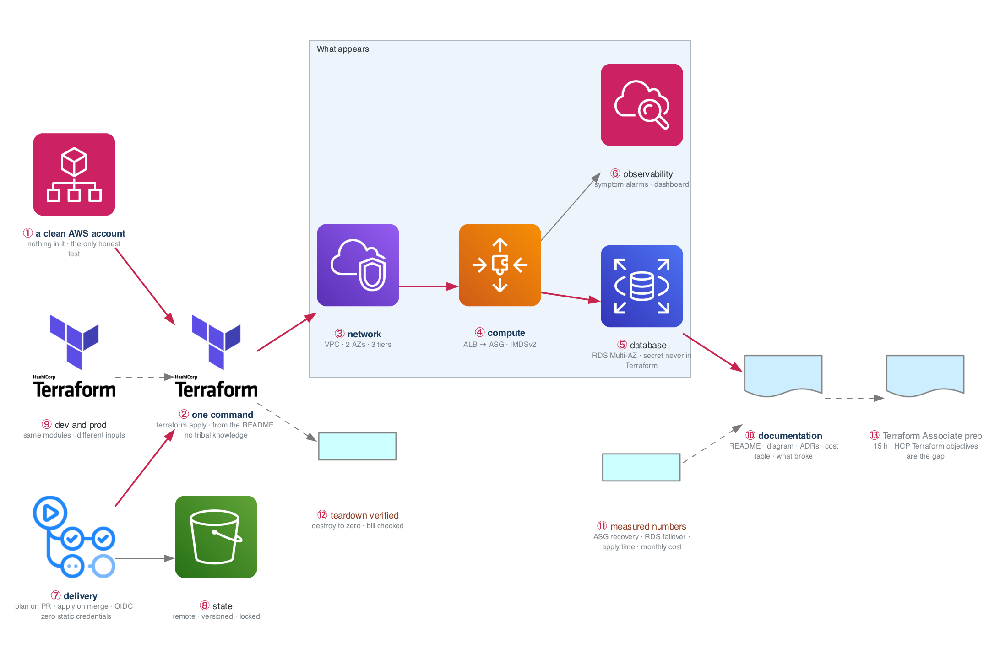

# Figure 13.1 — Project Alpha as a reviewer sees it

> Week 13 · badges ① to ⑬ · about three and a half minutes at a normal pace. Point at each badge as you say its line. Blue is the path to follow first; orange-red is where something refuses or fails.



Shipping is a skill. The figure is the gate: one command in a clean account produces a working three-tier environment, delivered by a pipeline with no static credentials, with the documentation that lets a stranger believe it.

## What to say, badge by badge

- **Open.** “This is Alpha the way a hiring manager would review it. Not the code, the claims. Every box is a claim the README makes, and Thursday you prove the whole picture in an account that has nothing in it.”
- **① a clean AWS account.** “Ideally a separate account. Otherwise destroy everything, empty the state bucket, and start from nothing. Any leftover resource makes the test a lie.”
- **② one command.** “The README says what to run, and that is all you run. If a step lives only in your head, write it down or automate it. This is the one-command claim, and Gate 3 is checking it literally.”
- **③ network.** “The week-6 VPC: two AZs, three tiers, data tier with no route out. Produced by the network module with a CIDR as its only required input.”
- **④ compute.** “The week-7 ALB in front of an auto-scaling group, instances on IMDSv2, no SSH port anywhere. Produced by the compute module.”
- **⑤ database.** “RDS Multi-AZ. The password is generated by RDS and stored in Secrets Manager; Terraform never sees the value and it is not in state in the clear.”
- **⑥ observability.** “The module you finish Monday and Tuesday: alarms on symptoms, 5xx rate and latency, not on causes, and a dashboard that shows them. Week 20 goes deeper; this is enough to be honest.”
- **⑦ delivery.** “Plan on every pull request, apply on merge after approval, both through the week-12 OIDC roles. The grep for AKIA returns nothing. That is the single most credible line in the project.”
- **⑧ state.** “Remote in S3, versioned, locked during apply. A reviewer who asks what happens when two people apply at once gets an answer.”
- **⑨ dev and prod.** “Two environments from the same modules with different inputs. Prod has a NAT per AZ and bigger instances; dev has one NAT and small ones. The difference is a variables file.”
- **⑩ documentation.** “A README with the one command, an architecture diagram, ADRs for the decisions you would be asked about, a cost table, and a section called what broke. The last one is read more than any other.”
- **⑪ measured numbers.** “ASG recovery time, RDS failover downtime, how long the apply takes, what a month costs. Your numbers, from Thursday's run. Numbers are what turn a project into a story.”
- **⑫ teardown verified.** “Destroy, then check the bill the next day. A project that costs money after it is done is not done.”
- **⑬ Terraform Associate prep.** “Fifteen hours is enough, and most of it goes to the one domain a self-taught project never touches: HCP Terraform workspaces, VCS-driven runs, remote execution. Book the exam for Monday.”
- **Close.** “One command, a clean account, no credentials, numbers you measured, and a document a stranger can follow. Ship it with three known rough edges rather than polish it into week 16.”

**Print it:** [`figure-13.1-numbered-spoken.pdf`](figure-13.1-numbered-spoken.pdf) is the two-page version, the figure on page one and this script on page two.

## Use it

- Read the figure before the day plan. Say the script out loud on Friday with the file closed.
- Each badge line is a thirty-second interview answer; the whole script is the three-minute version.
- Regenerate after editing the spec in `_shared/diagrams/week_figures/`:

```bash
python3 ../../_shared/diagrams/generate-week-figures.py --only 13
```
