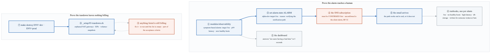
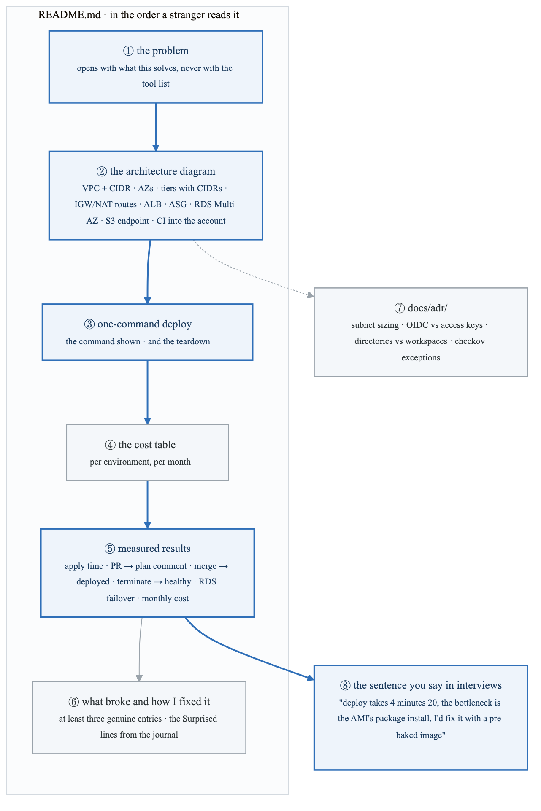
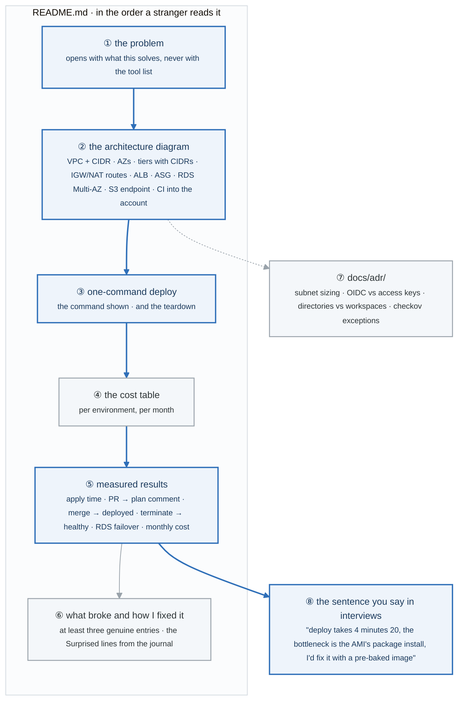
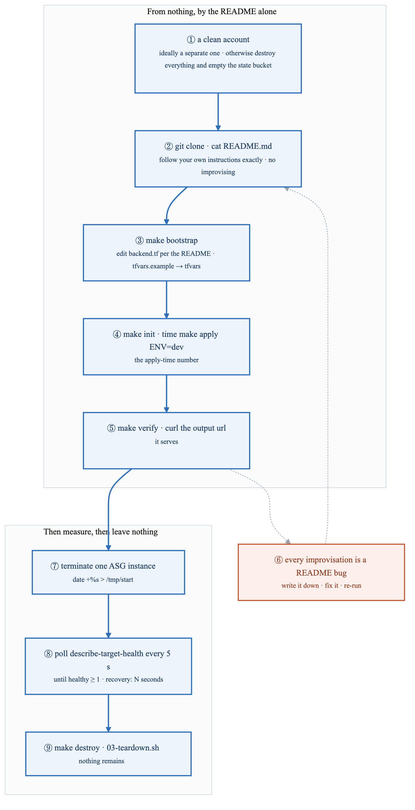
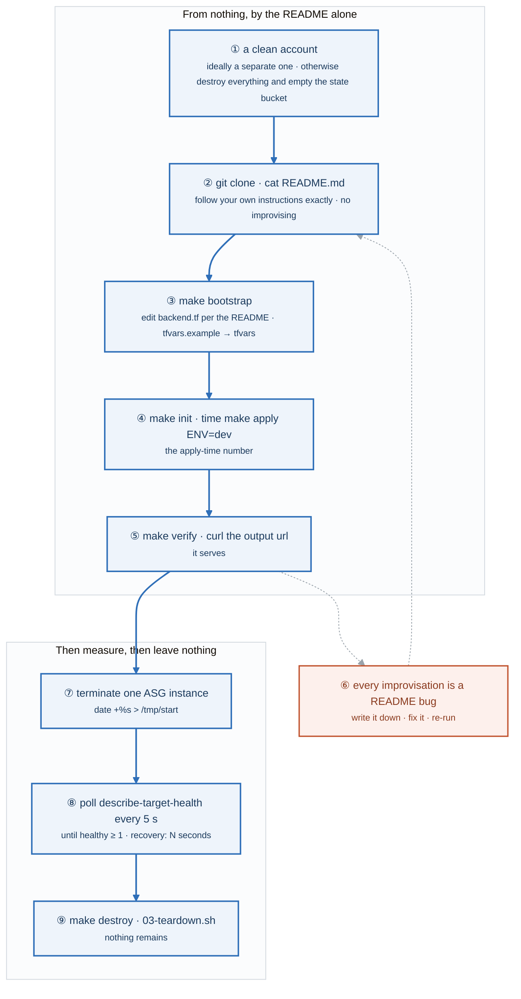
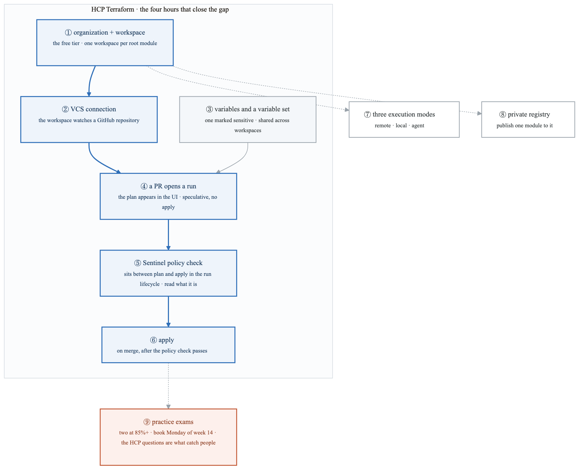
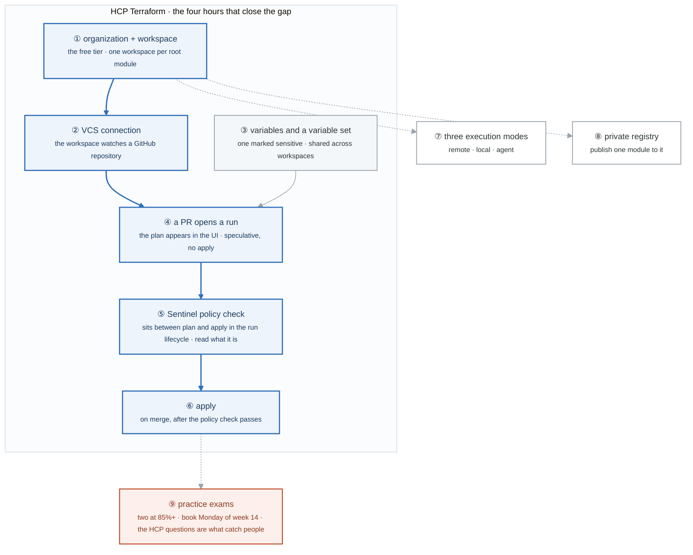
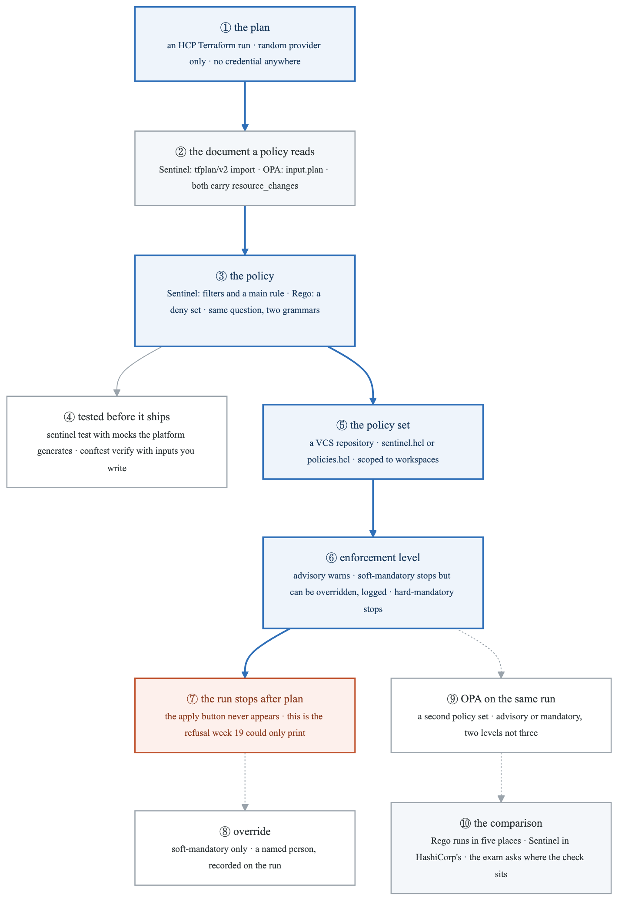
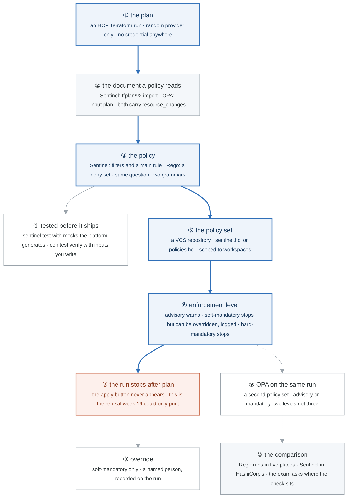

# Week 13 — Lab figures

> One figure per lab, numbered 13.2 to 13.7 (13.7 is the Go deeper lab). Figure 13.1 is the week figure in
> [`../content/FIGURE.md`](../content/FIGURE.md); these go one level down, to the mechanism each lab
> makes you touch. Same language: gray is structure, **blue is the path to follow first**,
> orange-red is where something refuses, washed boxes are stores. Each badge line is a thirty-second
> interview answer; each whole script is under three minutes. Week 13 is Gate 3, so two of these are
> about proving, not building.

**The protocol per figure**

1. **Before the lab:** read the figure, say the badges out loud once. You now know what you are about to prove.
2. **During the lab:** every badge has a **Prove it** command. Run it and watch the badge happen. A badge you cannot see happen is one you are taking on faith.
3. **After the lab:** close the file, redraw the figure, say the script. Check against the file. The badge where the order slipped goes in the *Figures redrawn* column of `progress.md`.
4. **Own the numbers.** The *Numbers to own* table is what separates "it deploys automatically" from "my deploy takes 4 minutes 20 and the bottleneck is the AMI's package install."
5. **Answer the question.** Each figure ends with the question a senior interviewer asks about it. Answer it cold, in under a minute, before the gate.

---

## Figure 13.2 — Lab 1: the alarm path, proven, and the teardown that finds what still bills

> Lab 1 · badges ① to ⑨ · about three minutes.

```mermaid
%%{init: {'theme':'base','themeVariables':{'fontFamily':'Helvetica, Arial, sans-serif','fontSize':'13px','primaryColor':'#ffffff','primaryTextColor':'#2d3436','primaryBorderColor':'#9aa3ab','lineColor':'#9aa3ab','textColor':'#2d3436','clusterBkg':'#fbfcfd','clusterBorder':'#d4dae0','edgeLabelBackground':'#ffffff','tertiaryColor':'#eef4fb'},'flowchart':{'curve':'basis','padding':14,'nodeSpacing':42,'rankSpacing':58}}}%%
flowchart TB
  classDef default fill:#ffffff,stroke:#9aa3ab,stroke-width:1.3px,color:#2d3436
  classDef n    fill:#ffffff,stroke:#9aa3ab,stroke-width:1.3px,color:#2d3436
  classDef crit fill:#eef4fb,stroke:#2f6fb8,stroke-width:1.8px,color:#1b3a5c
  classDef data fill:#f4f7fa,stroke:#9aa3ab,stroke-width:1.3px,color:#2d3436
  classDef mut  fill:#ffffff,stroke:#cfd6dc,stroke-width:1.1px,color:#7a8288
  classDef warn fill:#fdf0ec,stroke:#c0522d,stroke-width:1.6px,color:#8a3a1e

  subgraph ALARM["Prove the alarm reaches a human"]
    direction LR
    MOD["① modules/observability<br/><small>symptom-based alarms: target 5xx · p99 latency · zero healthy hosts</small>"]:::crit
    DASH["② the dashboard<br/><small>answers &quot;are users having a bad time&quot; in 5 seconds</small>"]:::data
    TEST["③ set-alarm-state ALARM<br/><small>alpha-dev-target-5xx · reason: verifying the notification path</small>"]:::crit
    SNS["④ the SNS subscription<br/><small>must be CONFIRMED first · unconfirmed is the silent alarm, BF-32</small>"]:::warn
    MAIL["⑤ the email arrives<br/><small>the path works end to end, or it does not</small>"]:::crit
    RB["⑥ runbooks, one per alarm<br/><small>5xx · no-healthy-hosts · high-latency · db-storage · written for someone woken at 3am</small>"]:::data
  end
  subgraph TEAR["Prove the teardown leaves nothing billing"]
    direction LR
    DESTROY["⑦ make destroy ENV=dev · ENV=prod"]:::crit
    SCAN["⑧ _setup/03-teardown.sh<br/><small>orphaned NAT gateways · EIPs · volumes · snapshots</small>"]:::crit
    BILL["⑨ anything listed is still billing<br/><small>fix it · re-run until the list is empty · part of the acceptance criteria</small>"]:::warn
  end

  MOD ==> TEST ==> SNS ==> MAIL
  DESTROY ==> SCAN
  MOD --> DASH
  MAIL --> RB
  SCAN -.-> BILL
  BILL -.-> SCAN
  linkStyle 0,1,2,3 stroke:#2f6fb8,stroke-width:2px
```

<!-- figure: generated from the Mermaid below by _shared/diagrams/embed-figures.py — do not edit the image -->


<details>
<summary>Diagram source (Mermaid)</summary>



</details>

### Say it, badge by badge

- **Open.** "Two things get proven this lab, and neither is the code. First, that an alarm actually reaches a person. Second, that destroying the project actually stops the bill. Both have a step people skip, and both steps are orange."
- **① modules/observability.** "The alarms are symptom-based: 5xx from the target group, p99 latency, zero healthy hosts. They fire when users are hurt, not when CPU is high. The reference module's comments explain each one; read why before you copy."
- **② the dashboard.** "One screen that answers 'are users having a bad time' in five seconds. If you have to read it, it has failed."
- **③ set-alarm-state.** "Force the 5xx alarm into ALARM with a reason. You are not testing the metric; you are testing everything downstream of it."
- **④ the SNS subscription.** "An email subscription that was never confirmed delivers nothing and reports nothing. The alarm goes to ALARM, SNS publishes, nobody receives. BF-32, and it is the most annoying cause of a silent alarm because every component says it worked."
- **⑤ the email arrives.** "Now the path is proven, from alarm state to a human inbox. Until this moment the alarm was decoration."
- **⑥ runbooks.** "One per alarm, from the template, written for someone woken at 3am who has never seen the system. That constraint is what makes them useful; a runbook that assumes context is a note to yourself."
- **⑦ make destroy.** "Both environments. The Terraform half of teardown."
- **⑧ the orphan scan.** "The teardown script lists NAT gateways, elastic IPs, volumes, and snapshots that Terraform never owned or lost track of. Those are the things destroy cannot see."
- **⑨ still billing.** "Anything the scan lists costs money every hour it exists. Fix it, re-run, repeat until the list is empty. That loop is part of the acceptance criteria, not an afterthought."
- **Close.** "Alarm to inbox, proven with a forced state. Destroy, then scan, until nothing is left. Both are the difference between a project that works and one you can say works."

### Numbers to own

| Number | Where it comes from | Why it matters |
|---|---|---|
| 3 symptom alarms | the module comment | 5xx, p99 latency, zero healthy hosts; none of them is a cause metric |
| 5 seconds | the dashboard requirement | the time a reader gets to answer "are users hurting" |
| 4 runbooks | the list | `5xx`, `no-healthy-hosts`, `high-latency`, `db-storage`, one per alarm |
| 1 forced alarm | `set-alarm-state` | the test of the whole notification path |
| 0 items | the orphan scan | the only acceptable final output of `03-teardown.sh` |
| 4 orphan types | the script | NAT gateways, EIPs, volumes, snapshots |

### Prove it

```bash
aws sns list-subscriptions-by-topic --topic-arn <arn> --query 'Subscriptions[].SubscriptionArn'   # ④ PendingConfirmation means silent
aws cloudwatch set-alarm-state --alarm-name alpha-dev-target-5xx --state-value ALARM --state-reason "verifying the notification path"   # ③
aws cloudwatch describe-alarm-history --alarm-name alpha-dev-target-5xx --max-items 3            # ③ the transition, and the action
ls docs/runbooks/                                                                                 # ⑥ four files
make destroy ENV=dev && bash ../../_setup/03-teardown.sh                                          # ⑦ ⑧ until it prints nothing
```

### The question a senior interviewer asks

*"Why alarm on symptoms rather than causes, and how do you prove the notification path works?"*
Badge ① then ③ to ⑤. A cause metric fires when something is busy; a symptom metric fires when users are affected, so it pages for the right reason and stays quiet otherwise. The path is proven by forcing the alarm state and receiving the email, which is also how you find the unconfirmed subscription.

---

## Figure 13.3 — Lab 2: the measurements a hiring manager reads in ninety seconds

> Lab 2 · badges ① to ⑧ · about two and a half minutes. The architecture diagram itself is in
> [`LABS.md`](LABS.md#the-architecture-diagram) and is not repeated here; this figure is the rest of the
> page around it.

<!-- figure: generated from the Mermaid below by _shared/diagrams/embed-figures.py — do not edit the image -->


<details>
<summary>Diagram source (Mermaid)</summary>



</details>

### Say it, badge by badge

- **Open.** "A hiring manager gives this repository ninety seconds. The README is the product, and the blue path is the order they read it. The last badge is why every number on the page exists."
- **① the problem.** "The first paragraph says what this solves. A tool list first tells them you built a tutorial."
- **② the architecture diagram.** "VPC and CIDR, the availability zones, every tier with its CIDR, which way the IGW and NAT routes point, the ALB, the ASG, RDS with Multi-AZ, the S3 endpoint, and the CI flow into the account. If one of those is missing, the diagram is a sketch."
- **③ one-command deploy.** "The command, shown, and the teardown next to it. The clean-account test tomorrow runs exactly these."
- **④ the cost table.** "Per environment, per month. A platform engineer who cannot say what it costs has not finished."
- **⑤ measured results.** "Six numbers, each with how it was measured: apply from a clean account, PR to plan comment, merge to deployed, instance terminated to healthy target, RDS failover downtime, monthly cost. Real numbers, from your runs, not estimates."
- **⑥ what broke.** "At least three genuine entries. These are the Surprised lines from the incident journal, written up. They are the most-read section after the diagram."
- **⑦ ADRs.** "Subnet sizing, OIDC over access keys, directories over workspaces, and the checkov exceptions. Each records a decision and the alternative you rejected."
- **⑧ the sentence.** "Deploy takes four minutes twenty, the bottleneck is the AMI's package install, and the fix is a pre-baked image. Number, bottleneck, fix. Compare that to 'it deploys automatically' and you hear the difference the measurements make."
- **Close.** "Problem, diagram, command, cost, numbers, failures, decisions. Every number becomes a sentence with a bottleneck and a fix, and those sentences are what the interview is made of."

### Numbers to own

| Number | Where it comes from | Why it matters |
|---|---|---|
| 90 seconds | the lab | how long a hiring manager spends; the README is designed for that budget |
| 6 measurements | the table | apply time, PR → plan, merge → deployed, terminate → healthy, RDS failover, monthly cost |
| 3 entries minimum | "what broke" | genuine failures with fixes; fewer reads as untested |
| 4 ADRs minimum | the list | sizing, OIDC, directories, checkov exceptions |
| `4 minutes 20` | the example sentence | the shape of an answer: a number, its bottleneck, the fix; your own number replaces it |

### Prove it

```bash
head -5 README.md                                                          # ① the problem, not the stack
time make apply ENV=dev                                                    # ⑤ the first measurement
gh run view <id> --json createdAt,updatedAt                                # ⑤ PR → plan comment, merge → deployed
grep -c '^## ' docs/adr/*.md | wc -l                                       # ⑦ at least four
grep -A2 -i 'what broke' README.md                                         # ⑥ three entries
```

### The question a senior interviewer asks

*"Give me your deploy time and its bottleneck, and tell me how you would fix it."*
Badges ⑤ and ⑧. A number from a measured run, the step that dominates it, and a concrete change with a reason. If you have the number but not the bottleneck, you measured; if you have both, you engineered.

---

## Figure 13.4 — Lab 3: the clean-account test, and the measured recovery

> Lab 3 · badges ① to ⑨ · about three minutes. This is Gate 3.

<!-- figure: generated from the Mermaid below by _shared/diagrams/embed-figures.py — do not edit the image -->


<details>
<summary>Diagram source (Mermaid)</summary>



</details>

### Say it, badge by badge

- **Open.** "This is the point of the whole month. A repository that only deploys from the laptop it was written on is a demo. The blue path is the proof that it deploys from nothing, by its own instructions, and then the two numbers you take away from it."
- **① a clean account.** "A genuinely separate AWS account if you can. Otherwise destroy everything, delete the state bucket contents, and start from nothing. The test is only honest if nothing is already there."
- **② clone and read.** "Clone the public repository. Open the README. Follow it exactly. The rule is no improvising: if the README does not say it, you do not do it."
- **③ bootstrap.** "Create the backend as the README says, point backend.tf at it, copy the example tfvars. Three steps that the README must spell out, because a stranger cannot guess them."
- **④ init and timed apply.** "Initialise and apply dev with `time` in front. The wall-clock number is the first measurement for the README, and whatever dominated it is the bottleneck you will be asked about."
- **⑤ verify and curl.** "The verify target, then curl the URL the output prints. A page comes back. That is a working deploy from a clean account."
- **⑥ every improvisation is a bug.** "Every place you had to know something the README did not say is a defect in the README. Write each one down, fix the README, run the test again. The loop ends when a run needs nothing from your memory."
- **⑦ terminate an instance.** "Record the time, then terminate one instance in the ASG. You are measuring the system's recovery, not yours."
- **⑧ poll until healthy.** "Every five seconds, ask the target group how many targets are healthy. When it is at least one, subtract the start time. That number is the recovery measurement, and it is the ASG health check, grace period, and boot time added together."
- **⑨ destroy, scan, nothing remains.** "Destroy, run the orphan script, confirm it lists nothing. The test is over only when the account is as empty as it started."
- **Close.** "Clean account, README only, timed apply, curl, fix every improvisation, then terminate and time the recovery, then leave nothing. Pass this and Alpha is a project; fail it and it is a folder."

### Numbers to own

| Number | Where it comes from | Why it matters |
|---|---|---|
| 0 improvisations | the rule | the exit condition for the README; each one found is a bug fixed |
| `time make apply` | step ④ | the apply-time measurement that goes in the README |
| 5 seconds | the poll interval | granularity of the recovery measurement |
| `>= 1` healthy target | the until loop | the moment recovery is declared |
| recovery in seconds | `$(date +%s) - start` | the number you quote, and the one you explain in terms of grace period and boot time |
| 0 items | the orphan scan after destroy | the account is as empty as it started |

### Prove it

```bash
aws sts get-caller-identity --query Account                              # ① the clean account
git clone https://github.com/you/alpha-cloud-foundation && cat README.md  # ②
time make apply ENV=dev                                                  # ④ the number
curl "$(terraform -chdir=environments/dev output -raw url)"              # ⑤
aws ec2 terminate-instances --instance-ids "$ID" && until [ "$(aws elbv2 describe-target-health --target-group-arn <tg> --query 'length(TargetHealthDescriptions[?TargetHealth.State==`healthy`])' --output text)" -ge 1 ]; do sleep 5; done; echo "recovery: $(( $(date +%s) - $(cat /tmp/start) ))s"   # ⑦ ⑧
```

### The question a senior interviewer asks

*"What does the clean-account test prove that your CI does not?"*
Badges ① and ⑥. CI runs in an account that already has the backend, the variables, and the history; it proves the code applies, not that a stranger can deploy it. The clean-account test proves the README is complete, because every gap in it shows up as something you had to improvise.

---

## Figure 13.5 — Lab 4: Terraform Associate prep, the HCP run lifecycle

> Lab 4 · badges ① to ⑨ · about two and a half minutes. The objectives sweep and the practice exams
> are drill; the four hours on HCP Terraform have a mechanism, and it is the one the exam weights.

<!-- figure: generated from the Mermaid below by _shared/diagrams/embed-figures.py — do not edit the image -->


<details>
<summary>Diagram source (Mermaid)</summary>



</details>

### Say it, badge by badge

- **Open.** "The exam is written by HashiCorp and weights their platform more than your self-taught experience would suggest. That is the single most common reason competent people fail it. Four hours on HCP Terraform closes the gap, and this is the run lifecycle those hours teach."
- **① organization and workspace.** "Sign up for the free tier, create an organization, create a workspace. A workspace is one root module with its own state and runs."
- **② VCS connection.** "Connect the workspace to a GitHub repository. From now on the repository drives the runs; nobody runs apply from a laptop."
- **③ variables and a variable set.** "Workspace variables, and a variable set that is shared across workspaces. Mark one sensitive and notice it never shows again."
- **④ a PR opens a run.** "Open a pull request and a speculative plan appears in the UI. It is a plan with no apply attached, the same shape as week 12's plan comment."
- **⑤ Sentinel policy check.** "Policy as code that sits between plan and apply in the run. A failing policy stops the apply. You need to know what it is and where it sits, not how to write it."
- **⑥ apply.** "On merge, after the plan and the policy check, the run applies. The order plan, policy, apply is an exam question."
- **⑦ three execution modes.** "Remote runs on HashiCorp's workers. Local runs on your machine and stores only state remotely. Agent runs on a worker you host inside your network. Know when each is the answer."
- **⑧ private registry.** "Publish a module to the organization's private registry. The source string changes to the registry form from week 11."
- **⑨ practice exams.** "Two of them, at 85 percent or better, then book Monday of week 14. The associate is shorter and more factual than the SAA; the questions that catch people are the HCP ones you just practised."
- **Close.** "Workspace, VCS, variables, PR plan, policy check, apply. Three execution modes and a registry on the side. Four hours, then two exams at 85, then book it."

### Numbers to own

| Number | Where it comes from | Why it matters |
|---|---|---|
| 4 hours | the lab | the time budgeted to close the HCP gap |
| 7 HCP steps | the list | organization, VCS, variable set, PR plan, execution modes, private registry, Sentinel |
| 3 execution modes | step 5 | remote, local, agent |
| `85%+` on 2 exams | the target | the threshold before booking |
| Monday of week 14 | the booking | the exam date; week 14's day plan starts with it |

### Prove it

```bash
# in the HCP UI: the workspace shows a run with a plan and a policy-check stage         # ④ ⑤
terraform login && terraform init                                                    # ① the cloud block resolves
git push origin feature && gh pr create                                               # ④ the speculative plan appears
grep -n 'source *= *"app.terraform.io' environments/dev/main.tf                       # ⑧ the registry form
```

### The question a senior interviewer asks

*"Where does a Sentinel policy check sit in an HCP Terraform run, and which execution mode would you choose for a network you cannot expose?"*
Badge ⑤: between plan and apply, and a failure stops the apply. Badge ⑦: agent mode, because the worker runs inside your network and only talks outward.

---

## Figure 13.6 — Lab 5: no figure

Lab 5 is the week 14 preparation checklist: the résumé draft, the LinkedIn headline, a target list
of 50 companies, the application tracker, 5 people to contact, and the GitHub profile README. It is
job-search work with no system mechanism to draw. Do it on Sunday as written; the figure that
belongs to this day is [Figure 25.1](../../week-25/content/FIGURE.md), the interview kit, which is
where this checklist ends up.

---

## Figure 13.7 — Go deeper: a policy that refuses an apply

> Go deeper · badges ① to ⑩ · about three minutes. This figure reads top-down.

<!-- figure: generated from the Mermaid below by _shared/diagrams/embed-figures.py — do not edit the image -->


<details>
<summary>Diagram source (Mermaid)</summary>



</details>

### Say it, badge by badge

- **Open.** "Week 19 put a policy in front of a reviewer. This puts one in front of apply, on a run that cannot continue if the policy says no, and does it in both languages the platform understands."
- **① the plan.** "A workspace on HCP Terraform's free tier running a configuration with only the random provider, so no cloud credential exists anywhere in this exercise. The plan is the same plan you have read all month."
- **② the document.** "After the plan, the platform hands the policy a document. Sentinel calls it the tfplan/v2 import; OPA sees it as input.plan. Both are the resource_changes list from week 19, so a rule you can write for one you can write for the other."
- **③ the policy.** "Sentinel filters the list down to the resources it cares about and a main rule says whether the filtered list is empty. Rego says the same as a deny set with the violations in it. Two grammars, one question: is there anything in this plan I refuse?"
- **④ tested first.** "sentinel test runs each policy against a mock the platform generated from a real plan, so the mock is not your guess about the document's shape. conftest verify runs the Rego against inputs you wrote. Either way, a policy nobody tested may match nothing."
- **⑤ the policy set.** "A repository the platform watches, with a manifest naming each policy and its level, attached to the workspaces it governs. Policy is versioned and reviewed the same way the infrastructure is."
- **⑥ enforcement level.** "Advisory warns and the run continues. Soft-mandatory stops the run, and someone with the permission can override it, with their name on the run. Hard-mandatory stops it, full stop. The exam asks you to name the three."
- **⑦ the run stops.** "This is the badge the lab exists for. The plan finished, the policy failed, and there is no apply button. Week 19's gate printed a failure in CI; this one makes the apply impossible."
- **⑧ override.** "Only for soft-mandatory, only by someone granted it, and it is recorded. That audit trail is the strongest argument a Terraform Enterprise shop has for Sentinel."
- **⑨ OPA on the same run.** "Attach a second policy set of kind OPA with the same rule in Rego. Two levels here, advisory and mandatory. Fail the run with both attached and read the two failures side by side."
- **⑩ the comparison.** "Rego runs in CI, at admission, in an application, and here. Sentinel runs in HashiCorp's products. Write policy in Rego; know Sentinel's levels and where it sits; and be able to say why a shop chose it without defending it as a general tool."
- **Close.** "Plan, document, policy, tested, set, level, refusal. The mechanism is the same one you built in week 19; the difference is who gets to press apply afterwards."

### Numbers to own

| Number | Where it comes from | Why it matters |
|---|---|---|
| 3 enforcement levels | Sentinel: advisory, soft-mandatory, hard-mandatory | the exam question, and the override audit trail lives in the middle one |
| 2 enforcement levels | OPA on HCP Terraform: advisory, mandatory | the same gate, one fewer knob |
| 2 places Sentinel runs | HCP Terraform and Terraform Enterprise (plus the enterprise Vault, Consul, Nomad tiers) | the ceiling on its hiring signal |
| 0 credentials | the random-provider workspace | the repository's no-credentials rule survives a SaaS workspace |
| 1 document | `tfplan/v2` and `input.plan` | both are the week-19 `resource_changes` list |
| 20 minutes | the from-memory target | three policies and the manifest, tested, files closed |

### Prove it

```bash
sentinel test -verbose                                  # ④ every policy against its mocks
sentinel apply -trace require-tags.sentinel             # ③ the filters' intermediate values
terraform plan                                          # ① ⑦ the run in the UI stops after plan on a hard-mandatory failure
```

### The question a senior interviewer asks

*"Where does a Sentinel policy check sit in a run, and what happens at each enforcement level?"*
Badges ⑥ and ⑦: between plan and apply; advisory warns, soft-mandatory stops with a logged override, hard-mandatory stops. The follow-up is "and why would you choose OPA instead?", which is badge ⑩.

---

## Redraw schedule

Week 13 is Gate 3, so the cadence from [`../../FIGURES.md`](../../FIGURES.md) folds: Friday of this
week after the clean-account test, cold on this Sunday alongside every figure since week 9, Sunday
of week 15, and again at the Gate 4 Sunday in week 17. Lab figures are redrawn **after** the week
figure, one at a time, and only the badge order has to be right; the captions are the check, not the
test.
