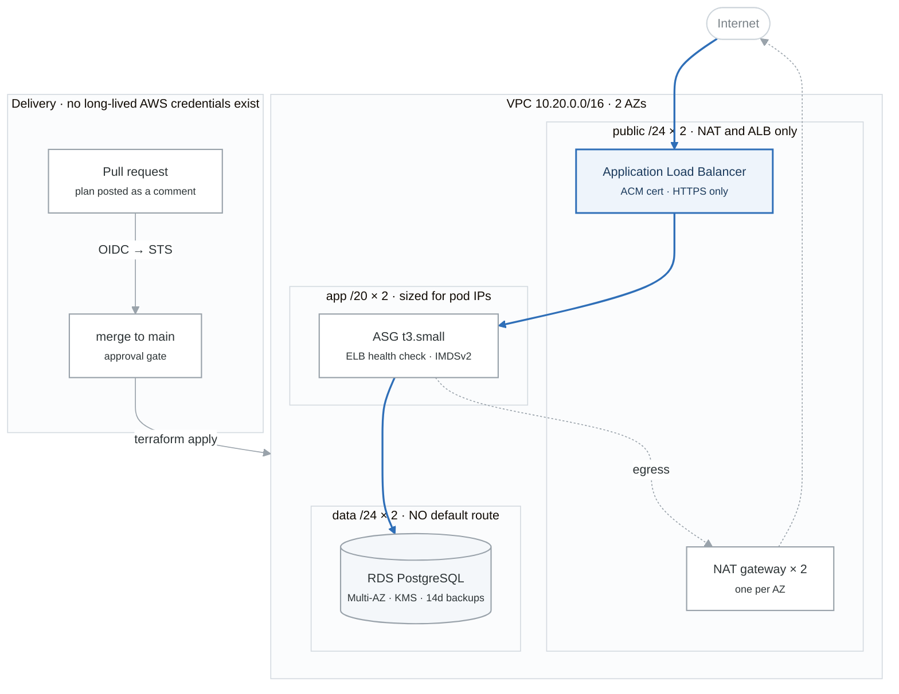

# Week 13 Labs

> **Figures:** one numbered mechanism figure per lab, with the spoken script, the numbers to own and
> the command that proves each badge, in [`FIGURES.md`](FIGURES.md) (13.2 to 13.7). Read a lab's figure
> before you start it; redraw it after.

---

# Lab 1 — ⚑ Alpha to Acceptance Criteria (Mon–Tue)

Work the checklist from [`../../../PROJECTS.md`](../../../PROJECTS.md) §2. Reference implementation:
[`../../projects/alpha-cloud-foundation/`](../../projects/alpha-cloud-foundation/)

## Remaining build work

### Observability module
```hcl
module "observability" {
  source = "../../modules/observability"
  # symptom-based alarms: 5xx, p99 latency, zero healthy hosts
  # plus a dashboard that answers "are users having a bad time" in 5 seconds
}
```
See `modules/observability/main.tf` in the reference for the alarm set and, importantly, the
comments explaining **why each alarm is symptom-based rather than cause-based**.

**Then test one:**
```bash
aws cloudwatch set-alarm-state --alarm-name alpha-dev-target-5xx \
  --state-value ALARM --state-reason "verifying the notification path"
```
Confirm the email arrives. **Confirm the SNS subscription first** — an unconfirmed subscription is
the most annoying cause of a silent alarm (BF-32).

### Runbooks
One per alarm, from `_shared/templates/RUNBOOK-template.md`:
- `docs/runbooks/5xx.md`
- `docs/runbooks/no-healthy-hosts.md`
- `docs/runbooks/high-latency.md`
- `docs/runbooks/db-storage.md`

**Write them for someone woken at 3am who has never seen the system.** That constraint is what makes
a runbook useful rather than decorative.

### Teardown verification
```bash
make destroy ENV=dev
make destroy ENV=prod
bash ../../_setup/03-teardown.sh     # finds orphaned NAT gateways, EIPs, volumes, snapshots
```
**Anything the orphan check lists is still billing.** Fix it, then re-run until clean. This is part
of the acceptance criteria, not an afterthought.

---

# Lab 2 — ⚑ Documentation (Wed)

The docs are the product. A hiring manager spends 90 seconds; make them legible.

## The architecture diagram

Draw it in Excalidraw, draw.io, or Mermaid. Must show: VPC and CIDR, AZs, subnet tiers with their
CIDRs, IGW/NAT/route direction, ALB, ASG, RDS with Multi-AZ, the S3 endpoint, and the CI flow into
the account.

<!-- figure: generated from the Mermaid below by _shared/diagrams/embed-figures.py — do not edit the image -->


<details>
<summary>Diagram source (Mermaid)</summary>



</details>

## README

Use `_shared/templates/PROJECT-README-template.md`. Non-negotiable sections:
- [ ] Opens with the **problem**, not the tech list
- [ ] Architecture diagram
- [ ] One-command deploy, with the command shown
- [ ] Teardown instructions
- [ ] **Cost table** — per environment, per month
- [ ] **Measured results** table with real numbers
- [ ] **"What broke and how I fixed it"** — at least three genuine entries
- [ ] Green CI badge

## ADRs

At minimum: the subnet sizing decision, OIDC vs access keys, directories vs workspaces, and your
checkov exceptions. See `docs/adr/` in the reference for the format and the depth expected.

## The measurements to collect

| Metric | How |
|---|---|
| `apply` time from clean account | `time make apply ENV=dev` |
| PR opened → plan comment | GitHub Actions run duration |
| Merge → deployed | Actions run duration |
| Instance terminated → healthy target | terminate, then poll `describe-target-health` |
| RDS failover downtime | the week-7 measurement loop |
| Monthly cost | AWS Pricing Calculator, or Cost Explorer after a full day |

**These numbers are what you say in interviews.** "My deploy takes 4 minutes 20, and the bottleneck
is the AMI's package install, which I'd fix with a pre-baked image" is a completely different answer
from "it deploys automatically."

---

# Lab 3 — ⚑ The Clean-Account Test (Thu)

**This is Gate 3 and the point of the whole month.**

## The test

```bash
# Ideally a genuinely separate AWS account. Otherwise: destroy everything,
# delete the state bucket contents, and start from nothing.
git clone https://github.com/you/alpha-cloud-foundation && cd alpha-cloud-foundation
cat README.md            # follow YOUR OWN instructions exactly. No improvising.
make bootstrap
# edit backend.tf per the README
cp environments/dev/terraform.tfvars.example environments/dev/terraform.tfvars
make init ENV=dev
time make apply ENV=dev
make verify ENV=dev
curl "$(terraform -chdir=environments/dev output -raw url)"
```

**Every place you have to improvise is a bug in your README.** Write it down, fix it, and re-run.

## Then measure

```bash
# ASG recovery
ID=$(aws autoscaling describe-auto-scaling-groups --auto-scaling-group-names <asg> \
  --query 'AutoScalingGroups[0].Instances[0].InstanceId' --output text)
date +%s > /tmp/start
aws ec2 terminate-instances --instance-ids "$ID"
until [ "$(aws elbv2 describe-target-health --target-group-arn <tg> \
  --query 'length(TargetHealthDescriptions[?TargetHealth.State==`healthy`])' --output text)" -ge 1 ]; do
  sleep 5
done
echo "recovery: $(( $(date +%s) - $(cat /tmp/start) ))s"
```

## Then destroy, and verify nothing remains

```bash
make destroy ENV=dev
bash ../../_setup/03-teardown.sh
```

---

# Lab 4 — Terraform Associate Prep (Fri–Sat)

## Objectives sweep

Work the official exam objectives list and mark each as confident / shaky. Focus the shaky ones.

## The HCP Terraform gap — 4 hours closes it

Sign up for the free tier and actually do this:
1. Create an organization and a workspace
2. Connect it to a GitHub repo (VCS-driven workflow)
3. Set variables and a **variable set**; mark one sensitive
4. Run a plan from a PR and watch it appear in the UI
5. Understand the three execution modes: **remote**, **local**, **agent**
6. Publish a module to the **private registry**
7. Read what Sentinel is and where a policy check sits in the run lifecycle

`_reference/terraform/drills/week3-hcp-collab-*` walks all of this.

**Why this matters for the exam specifically:** the exam is written by HashiCorp and weights their
platform more heavily than your self-taught experience would suggest. This is the single most common
reason otherwise-competent people fail it.

## Practice exams

- `_reference/terraform/drills/week4-cicd-mock-day4-mock-exam-mcq.md` (+ answer key)
- `-mcq-extension.md` and `-mcq-extension-2.md` (+ keys)
- `_reference/terraform/drills/feynman-exam-traps.md`

**Target: 85%+ on two.** The Terraform Associate is more forgiving than SAA — it's shorter, more
factual, and less scenario-based — but the HCP questions catch people.

## Book it
Book for **Monday of week 14**. See `../../CERTIFICATIONS.md` §7.

---

# Lab 5 — Week 14 Preparation (Sun)

**Week 14 is the hinge week of the whole program.** Two certs done, Alpha shipped, applications
begin. Prepare for it today so Tuesday isn't lost.

Read [`../../JOB-SEARCH.md`](../../../JOB-SEARCH.md) end to end. Then:

- [ ] Draft the résumé — **projects above work history**, certifications near the top
- [ ] Draft the LinkedIn headline and About section
- [ ] Build the target list: 50 companies, weighted toward MSPs, consultancies, mid-market,
      government contractors, and non-tech companies with tech teams
- [ ] Set up the application tracking spreadsheet
- [ ] Identify 5 people to reach out to in week 14
- [ ] Write the GitHub profile README

**Do not skip this.** The instinct to postpone applying "until I know Kubernetes" costs three months
of runway, and it is the single most common way this program fails.

---

# Go deeper — Sentinel and OPA at the apply gate (2h · ladder: policy as code, rung 3 and 4)

Optional inside the week; mandatory for the ladder ([`KUBERNETES-MASTERY.md`](../../../KUBERNETES-MASTERY.md),
the policy-as-code row). Week 19 puts a policy between `plan` and the reviewer. This lab puts one
between `plan` and `apply`, where a refusal is a run that stops, and does it in both languages HCP
Terraform understands.

## 1. The honest framing

Sentinel is HashiCorp's policy language. It is proprietary and it runs in exactly two places: HCP
Terraform and Terraform Enterprise (and the enterprise tiers of Vault, Consul and Nomad). Its hiring
signal is narrow: real in a shop on Terraform Enterprise, invisible elsewhere. OPA is open, CNCF
graduated, and runs anywhere, including on HCP Terraform since 2023. Two reasons to spend two hours
on Sentinel anyway: the Associate exam asks where a policy check sits in a run, and the apply gate is
the one place you should have felt a policy refuse an apply rather than a plan. Everything else in
this lab transfers to OPA, which you already write.

## 2. Local, no cloud: the Sentinel CLI

```bash
brew tap hashicorp/tap && brew install hashicorp/tap/sentinel
sentinel version
mkdir -p ~/sentinel-lab/test && cd ~/sentinel-lab
```

Three policies on the `tfplan/v2` import, the document HCP Terraform hands a policy after a plan.
It has the same shape you read in week 19: `resource_changes`, each with `type`, `mode`,
`change.actions` and `change.after`. These are written to the documented import and have not been
executed in this repository; the test step below is where you prove them.

```hcl
# require-tags.sentinel
import "tfplan/v2" as tfplan

required_tags = ["Environment", "Owner", "Project"]
taggable_types = ["aws_instance", "aws_db_instance", "aws_s3_bucket", "aws_vpc"]

taggable = filter tfplan.resource_changes as _, rc {
	rc.mode is "managed" and
	rc.type in taggable_types and
	rc.change.actions is not ["delete"]
}

has_all_tags = func(rc) {
	tags = rc.change.after.tags_all else {}
	return all required_tags as t { t in keys(tags) }
}

violations = filter taggable as _, rc { not has_all_tags(rc) }

main = rule { length(violations) is 0 }
```

```hcl
# deny-public-s3.sentinel
import "tfplan/v2" as tfplan

settings = ["block_public_acls", "block_public_policy", "ignore_public_acls", "restrict_public_buckets"]

blocks = filter tfplan.resource_changes as _, rc {
	rc.type is "aws_s3_bucket_public_access_block" and rc.change.actions is not ["delete"]
}

open = filter blocks as _, rc {
	any settings as s { rc.change.after[s] is false }
}

main = rule { length(open) is 0 }
```

```hcl
# restrict-instance-types.sentinel
import "tfplan/v2" as tfplan

allowed = ["t3.micro", "t3.small", "t3.medium"]

instances = filter tfplan.resource_changes as _, rc {
	rc.type is "aws_instance" and rc.change.actions is not ["delete"]
}

oversized = filter instances as _, rc { rc.change.after.instance_type not in allowed }

main = rule { length(oversized) is 0 }
```

```hcl
# sentinel.hcl -- the policy set: which policies, at which enforcement level
policy "require-tags" {
  source            = "./require-tags.sentinel"
  enforcement_level = "hard-mandatory"
}
policy "deny-public-s3" {
  source            = "./deny-public-s3.sentinel"
  enforcement_level = "hard-mandatory"
}
policy "restrict-instance-types" {
  source            = "./restrict-instance-types.sentinel"
  enforcement_level = "advisory"
}
```

**Mocks.** A Sentinel test runs a policy against a mock of the import, and you do not write mocks by
hand. Two sources: HashiCorp's `terraform-sentinel-policies` repository on GitHub ships
`mock-tfplan-v2.sentinel` files under each policy's `test/` directory, and any HCP Terraform run page
has **Download Sentinel mocks**, which gives you the real document from a real plan. Fetch one of
each kind for `aws_instance` and put them in `test/require-tags/`:

```hcl
# test/require-tags/pass.hcl
mock "tfplan/v2" {
  module {
    source = "mock-tfplan-pass.sentinel"
  }
}
test {
  rules = {
    main = true
  }
}
```

```bash
sentinel test -verbose                      # every test/<policy>/*.hcl
sentinel apply -trace require-tags.sentinel # with a mock in sentinel.hcl: the trace shows each filter's result
```

Read the trace. It prints every rule and every intermediate value, which is the thing Rego's
`conftest --trace` also does and the thing you use when a policy "does nothing": the filter emptied
the list before the rule ever ran.

## 3. HCP Terraform's free tier, with no credentials anywhere

The free tier includes policy enforcement. The only thing to protect is the repository rule that no
cloud credential lives in CI or in a SaaS workspace, so the configuration the workspace runs uses the
`random` provider and nothing else:

```hcl
# main.tf in a new repository, policy-lab
terraform {
  required_providers {
    random = { source = "hashicorp/random", version = "~> 3.6" }
  }
  cloud {
    organization = "YOUR_ORG"
    workspaces { name = "policy-lab" }
  }
}

resource "random_pet" "lab" { length = var.pet_length }
resource "random_integer" "port" {
  min = 1024
  max = 65535
}
variable "pet_length" { default = 2 }
```

1. Create the organization and a VCS-connected workspace on that repository. `terraform login`,
   `terraform init`, `terraform plan` from your laptop; watch the run appear in the UI.
2. A second repository, `policy-lab-sentinel`, with `sentinel.hcl` and two policies that fit this
   configuration: `pet-length.sentinel` (hard-mandatory: `random_pet.length` must be at most 2) and
   `high-port.sentinel` (advisory: `random_integer.min` must be at least 1024). Same shape as the
   three above; the resource types change.
3. Organization settings → Policy sets → connect the repository as a Sentinel policy set, scoped to
   the workspace.
4. Run with `pet_length = 3`: the run stops after the plan with the hard-mandatory failure, and the
   apply button never appears. Set it back to 2 and lower `min` to 80: the advisory policy warns,
   the run continues to apply. Then change `pet-length` to `soft-mandatory` and fail it again: now
   the run shows an **Override** button for anyone with the permission, and the override is logged
   with a name. That is the whole difference between the three levels, and the exam question.

## 4. The same rule as OPA, on the same run

HCP Terraform runs Rego natively. A second policy set, kind OPA, from a third repository:

```rego
# pet_length.rego
package terraform.policies.pet_length

import future.keywords.contains
import future.keywords.if

deny contains msg if {
	rc := input.plan.resource_changes[_]
	rc.type == "random_pet"
	rc.change.after.length > 2
	msg := sprintf("%s: length %d is more than 2", [rc.address, rc.change.after.length])
}
```

```hcl
# policies.hcl
policy "pet_length" {
  query             = "data.terraform.policies.pet_length.deny"
  enforcement_level = "mandatory"
}
```

The input document is `input.plan` (plus `input.state`, `input.config` and `input.run`), and OPA
policy sets have two enforcement levels, `advisory` and `mandatory`, not three. Fail the same run
with both sets attached and read the two failures side by side.

## 5. The comparison a staff engineer gives

| | Sentinel | OPA / Rego |
|---|---|---|
| Language | Imperative-looking, rules and filters, HashiCorp's own | Declarative, unification and sets, CNCF |
| Where it runs | HCP Terraform, Terraform Enterprise, enterprise Vault/Consul/Nomad | Anywhere: CI (Conftest), admission (Gatekeeper), HCP Terraform, an app's request path |
| Enforcement | advisory, soft-mandatory (overridable, logged), hard-mandatory | advisory, mandatory on HCP; whatever the caller decides elsewhere |
| Testing | `sentinel test` with mocks the platform generates | `opa test` or `conftest verify` with inputs you write |
| Cost model | Comes with the platform tier | Free; you run it |
| Portability of what you wrote | Zero outside HashiCorp products | The same file runs in five places |
| What the exam asks | Where the check sits (between plan and apply), the three levels | Nothing by name |

The honest recommendation: write policy in Rego, know Sentinel's three levels and where it sits,
and be able to say why a shop on Terraform Enterprise chose it (the mocks, the override audit
trail, the policy-set UI) without having to defend it as a general tool.

**From memory, timed:** write the three Sentinel policies and `sentinel.hcl` with the files closed,
run `sentinel test`, in under 20 minutes. Then the `pet_length` rule in Rego in under 5.
