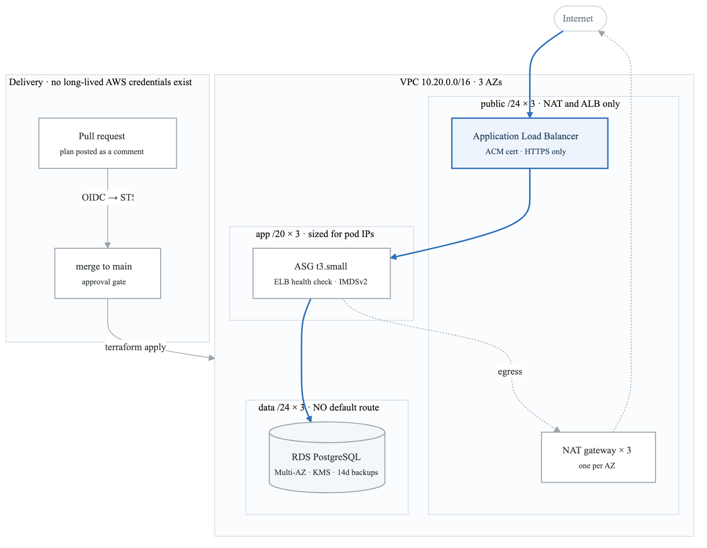

# Week 13 Labs

---

# Lab 1 — ⚑ Alpha to Acceptance Criteria (Mon–Tue)

Work the checklist from [`../../PROJECTS.md`](../../../PROJECTS.md) §2. Reference implementation:
[`../projects/alpha-cloud-foundation/`](../../projects/alpha-cloud-foundation/)

## Remaining build work

### Observability module
```hcl
module "observability" {
  source = "../../modules/observability"
  # symptom-based alarms: 5xx, p99 latency, zero healthy hosts
  # plus a dashboard that answers "are users having a bad time" in 5 seconds
}
```
See `modules/observability/main.tf` in the reference for the alarm set and, importantly, the
comments explaining **why each alarm is symptom-based rather than cause-based**.

**Then test one:**
```bash
aws cloudwatch set-alarm-state --alarm-name alpha-dev-target-5xx \
  --state-value ALARM --state-reason "verifying the notification path"
```
Confirm the email arrives. **Confirm the SNS subscription first** — an unconfirmed subscription is
the most annoying cause of a silent alarm (BF-32).

### Runbooks
One per alarm, from `_shared/templates/RUNBOOK-template.md`:
- `docs/runbooks/5xx.md`
- `docs/runbooks/no-healthy-hosts.md`
- `docs/runbooks/high-latency.md`
- `docs/runbooks/db-storage.md`

**Write them for someone woken at 3am who has never seen the system.** That constraint is what makes
a runbook useful rather than decorative.

### Teardown verification
```bash
make destroy ENV=dev
make destroy ENV=prod
bash ../../_setup/03-teardown.sh     # finds orphaned NAT gateways, EIPs, volumes, snapshots
```
**Anything the orphan check lists is still billing.** Fix it, then re-run until clean. This is part
of the acceptance criteria, not an afterthought.

---

# Lab 2 — ⚑ Documentation (Wed)

The docs are the product. A hiring manager spends 90 seconds; make them legible.

## The architecture diagram

Draw it in Excalidraw, draw.io, or Mermaid. Must show: VPC and CIDR, AZs, subnet tiers with their
CIDRs, IGW/NAT/route direction, ALB, ASG, RDS with Multi-AZ, the S3 endpoint, and the CI flow into
the account.

<!-- figure: generated from the Mermaid below by _shared/diagrams/embed-figures.py — do not edit the image -->


<details>
<summary>Diagram source (Mermaid)</summary>


</details>

## README

Use `_shared/templates/PROJECT-README-template.md`. Non-negotiable sections:
- [ ] Opens with the **problem**, not the tech list
- [ ] Architecture diagram
- [ ] One-command deploy, with the command shown
- [ ] Teardown instructions
- [ ] **Cost table** — per environment, per month
- [ ] **Measured results** table with real numbers
- [ ] **"What broke and how I fixed it"** — at least three genuine entries
- [ ] Green CI badge

## ADRs

At minimum: the subnet sizing decision, OIDC vs access keys, directories vs workspaces, and your
checkov exceptions. See `docs/adr/` in the reference for the format and the depth expected.

## The measurements to collect

| Metric | How |
|---|---|
| `apply` time from clean account | `time make apply ENV=dev` |
| PR opened → plan comment | GitHub Actions run duration |
| Merge → deployed | Actions run duration |
| Instance terminated → healthy target | terminate, then poll `describe-target-health` |
| RDS failover downtime | the week-7 measurement loop |
| Monthly cost | AWS Pricing Calculator, or Cost Explorer after a full day |

**These numbers are what you say in interviews.** "My deploy takes 4 minutes 20, and the bottleneck
is the AMI's package install, which I'd fix with a pre-baked image" is a completely different answer
from "it deploys automatically."

---

# Lab 3 — ⚑ The Clean-Account Test (Thu)

**This is Gate 3 and the point of the whole month.**

## The test

```bash
# Ideally a genuinely separate AWS account. Otherwise: destroy everything,
# delete the state bucket contents, and start from nothing.
git clone https://github.com/you/alpha-cloud-foundation && cd alpha-cloud-foundation
cat README.md            # follow YOUR OWN instructions exactly. No improvising.
make bootstrap
# edit backend.tf per the README
cp environments/dev/terraform.tfvars.example environments/dev/terraform.tfvars
make init ENV=dev
time make apply ENV=dev
make verify ENV=dev
curl "$(terraform -chdir=environments/dev output -raw url)"
```

**Every place you have to improvise is a bug in your README.** Write it down, fix it, and re-run.

## Then measure

```bash
# ASG recovery
ID=$(aws autoscaling describe-auto-scaling-groups --auto-scaling-group-names <asg> \
  --query 'AutoScalingGroups[0].Instances[0].InstanceId' --output text)
date +%s > /tmp/start
aws ec2 terminate-instances --instance-ids "$ID"
until [ "$(aws elbv2 describe-target-health --target-group-arn <tg> \
  --query 'length(TargetHealthDescriptions[?TargetHealth.State==`healthy`])' --output text)" -ge 1 ]; do
  sleep 5
done
echo "recovery: $(( $(date +%s) - $(cat /tmp/start) ))s"
```

## Then destroy, and verify nothing remains

```bash
make destroy ENV=dev
bash ../../_setup/03-teardown.sh
```

---

# Lab 4 — Terraform Associate Prep (Fri–Sat)

## Objectives sweep

Work the official exam objectives list and mark each as confident / shaky. Focus the shaky ones.

## The HCP Terraform gap — 4 hours closes it

Sign up for the free tier and actually do this:
1. Create an organization and a workspace
2. Connect it to a GitHub repo (VCS-driven workflow)
3. Set variables and a **variable set**; mark one sensitive
4. Run a plan from a PR and watch it appear in the UI
5. Understand the three execution modes: **remote**, **local**, **agent**
6. Publish a module to the **private registry**
7. Read what Sentinel is and where a policy check sits in the run lifecycle

`_reference/terraform/drills/week3-hcp-collab-*` walks all of this.

**Why this matters for the exam specifically:** the exam is written by HashiCorp and weights their
platform more heavily than your self-taught experience would suggest. This is the single most common
reason otherwise-competent people fail it.

## Practice exams

- `_reference/terraform/drills/week4-cicd-mock-day4-mock-exam-mcq.md` (+ answer key)
- `-mcq-extension.md` and `-mcq-extension-2.md` (+ keys)
- `_reference/terraform/drills/feynman-exam-traps.md`

**Target: 85%+ on two.** The Terraform Associate is more forgiving than SAA — it's shorter, more
factual, and less scenario-based — but the HCP questions catch people.

## Book it
Book for **Monday of week 14**. See `../../CERTIFICATIONS.md` §7.

---

# Lab 5 — Week 14 Preparation (Sun)

**Week 14 is the hinge week of the whole program.** Two certs done, Alpha shipped, applications
begin. Prepare for it today so Tuesday isn't lost.

Read [`../../JOB-SEARCH.md`](../../../JOB-SEARCH.md) end to end. Then:

- [ ] Draft the résumé — **projects above work history**, certifications near the top
- [ ] Draft the LinkedIn headline and About section
- [ ] Build the target list: 50 companies, weighted toward MSPs, consultancies, mid-market,
      government contractors, and non-tech companies with tech teams
- [ ] Set up the application tracking spreadsheet
- [ ] Identify 5 people to reach out to in week 14
- [ ] Write the GitHub profile README

**Do not skip this.** The instinct to postpone applying "until I know Kubernetes" costs three months
of runway, and it is the single most common way this program fails.
