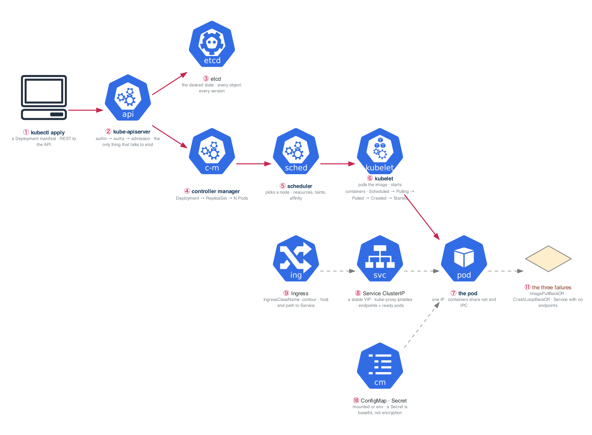

# Week 14 — ★ TF ASSOCIATE · ★ APPLICATIONS BEGIN · Kubernetes I

> ## This is the hinge week of the program.
> Two certifications done. Project Alpha shipped. **Your résumé is now true.**
> Applications start Tuesday. Not "when you know Kubernetes." Tuesday.

| | |
|---|---|
| **Hours** | 35–45 (of which **~6 go to the job search** — that is the point) |
| **★ Milestone** | HashiCorp Terraform Associate exam (Monday) |
| **★ Milestone** | **First 10 applications sent (Wednesday)** |
| **Break/Fix** | BF-41, BF-42, BF-47 |

## The week in one figure

**Figure 14.1 — What happens when you kubectl apply a Deployment.** The control plane is a loop of controllers watching one database. Follow the blue path from your terminal to a running container, then the dashed path back out through a Service and the Ingress.



**Say it, badge by badge:** [`content/FIGURE.md`](content/FIGURE.md) — the spoken script for each of the 11 badges, about four minutes; [`content/figure-14.1-numbered-spoken.pdf`](content/figure-14.1-numbered-spoken.pdf) is the printable two-page version. Read the figure before the day plan; say the script on Friday.

---

## Day plan
| Day | Focus |
|---|---|
| **Mon** | **★ Sit the Terraform Associate exam.** Rest after. |
| **Tue** | **Job search infrastructure** — résumé, LinkedIn, GitHub profile, target list, tracker |
| **Wed** | **★ Send the first 10 applications.** Then Kubernetes: architecture + pods (Lab 1) |
| Thu | Deployments, Services, Ingress (Lab 2) |
| Fri | ConfigMaps, Secrets, namespaces + Break/Fix (Lab 3, 4) |
| Sat | Multi-container patterns; rebuild the week-4 stack on Kubernetes (Lab 5) |
| Sun | Review; 5 more applications; plan week 15 |

## Tuesday is not optional

Read [`../../JOB-SEARCH.md`](../../JOB-SEARCH.md) end to end, then build:

- [ ] **Résumé** — projects above work history, certifications near the top, a number in every bullet
- [ ] **LinkedIn** — keyword-dense headline, open-to-work on, Alpha in Featured
- [ ] **GitHub profile README** — one-line positioning, three pinned repos
- [ ] **Target list** — 50 companies, weighted per JOB-SEARCH §2
- [ ] **Tracker** — company, role, date, source, status, notes
- [ ] **5 people to contact** this week

Then, from Wednesday: **10–15 quality applications per week, every week.** ~4 hours. It comes out of
the week's slack, not your study blocks.

> The instinct to postpone applying until you "know Kubernetes" is the single most common way this
> program fails. The pipeline has a 6–10 week lag. Starting now means offers land in months 6–10;
> starting in week 26 means month 9 at the earliest, with no income.

## Reading map — Kubernetes
- `_reference/kubernetes/01-foundation/02-kubernetes-architecture-README.md`
- `_reference/kubernetes/01-foundation/02-kubernetes-architecture-exercises-02-control-plane-deep-dive.md`
- `_reference/kubernetes/01-foundation/03-core-workloads-exercises-01-pods-containers.md`
- `_reference/kubernetes/01-foundation/03-core-workloads-exercises-02-deployments-replicasets.md`
- `_reference/kubernetes/02-core-ops/01-networking-deep-dive-exercises-03-services-deep-dive.md`
- `_reference/kubernetes/02-core-ops/01-networking-deep-dive-exercises-02-ingress-controllers.md`
- `_reference/kubernetes/02-core-ops/03-configuration-secrets-exercises-01-configmaps-secrets.md`
- `_reference/containers/07-kubernetes-architecture.md`, `09-kubernetes-networking.md`
- **Drill:** `_shared/drills/kubectl-speed.md` — start today, every day until week 26

## Setup
```bash
bash ../_setup/02-kind-cluster.sh mastery
kubectl cluster-info --context kind-mastery
```
**Local-first.** kind is free and iterates in seconds. EKS comes in week 16, for exactly two weeks.

## Labs
[labs/LABS.md](labs/LABS.md) · [labs/FIGURES.md](labs/FIGURES.md) (figures 14.2 to 14.6, one per lab) · [solutions/SOLUTIONS.md](solutions/SOLUTIONS.md)

## Exit criteria
- [ ] Terraform Associate sat
- [ ] **10+ applications sent**; résumé, LinkedIn, tracker live
- [ ] Explain the control plane and node components and what each does
- [ ] Deploy + Service + Ingress from a **blank file**, no reference
- [ ] Diagnose `ImagePullBackOff`, `CrashLoopBackOff`, and a Service with no endpoints
- [ ] The week-4 Compose stack running on Kubernetes
