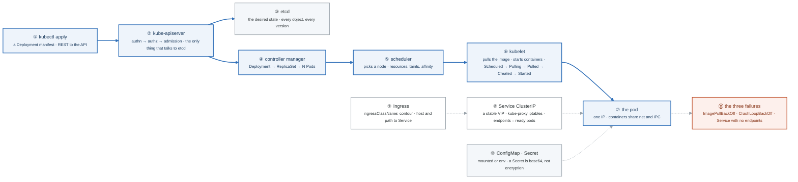

# Week 14 — ★ TF ASSOCIATE · ★ APPLICATIONS BEGIN · Kubernetes I

> ## This is the hinge week of the program.
> Two certifications done. Project Alpha shipped. **Your résumé is now true.**
> Applications start Tuesday. Not "when you know Kubernetes." Tuesday.

| | |
|---|---|
| **Hours** | 35–45 (of which **~6 go to the job search** — that is the point) |
| **★ Milestone** | HashiCorp Terraform Associate exam (Monday) |
| **★ Milestone** | **First 10 applications sent (Wednesday)** |
| **Break/Fix** | BF-41, BF-42, BF-47 |

## The week in one figure

**Figure 14.1 — What happens when you kubectl apply a Deployment.** The control plane is a loop of controllers watching one database. Follow the blue path from your terminal to a running container, then the dashed path back out through a Service and the Ingress. Badges are numbered in the order to walk them; the blue path is the one to follow first.



**What to say, badge by badge** · about four minutes at a normal pace. Point at each badge as you say its line.

- **Open.** “This is the hinge week, and Wednesday you also send ten applications. The technical picture is one loop: everything you ask for is written to one database, and controllers keep making the world match it. Follow the blue line from your terminal to a running container.”
- **① kubectl apply.** “kubectl turns a YAML file into an HTTP request to the API server. Nothing else in the cluster ever hears from you directly. `kubectl -v=8` shows the request if you want to see it.”
- **② kube-apiserver.** “Three gates in order: who are you, may you do this, and admission, which can mutate or reject the object. Then it writes to etcd. It is the only component that talks to etcd, which is why it is the thing every other component watches.”
- **③ etcd.** “The desired state of everything, with history. On kind it is a static pod on the control-plane node. Lose etcd without a backup and the cluster forgets what it was supposed to run.”
- **④ controller manager.** “A Deployment controller sees a new Deployment and creates a ReplicaSet. The ReplicaSet controller sees it and creates N Pods. Each controller watches one kind of object and makes one kind of child. That is the whole design, repeated.”
- **⑤ scheduler.** “A pod with no node assigned is the scheduler's queue. It filters nodes by resources, taints, and affinity, scores the rest, and writes the choice back. Pending forever means the filter emptied the list, and `kubectl describe` says why.”
- **⑥ kubelet.** “The agent on the node sees a pod assigned to it, pulls the image, and starts the containers. The events read Scheduled, Pulling, Pulled, Created, Started. Watch them with `kubectl get events -w`.”
- **⑦ the pod.** “One IP address, shared by all containers in it, who also share network and IPC namespaces. That is why a sidecar can talk to the app on localhost. The week-4 namespaces, grouped.”
- **⑧ Service.** “A stable virtual IP. kube-proxy writes iptables rules that spread it across the pod IPs whose readiness probe passes. A Service with no endpoints means the selector matched nothing or nothing is ready.”
- **⑨ Ingress.** “Host and path rules pointing at Services, implemented by Contour on this cluster. Without `ingressClassName`, the controller ignores the resource and you get a 404 that looks like a routing bug.”
- **⑩ ConfigMap and Secret.** “Configuration and secrets, mounted as files or injected as environment. A Secret is base64 encoded, not encrypted; week 19 is where real secret handling lives.”
- **⑪ the three failures.** “ImagePullBackOff is the registry, the tag, or credentials. CrashLoopBackOff is the process exiting; read the previous container's logs. No endpoints is the selector or readiness. Diagnose all three from events and logs, before week 15 adds six more.”
- **Close.** “Write to one database, let controllers converge, and route in through a Service and an Ingress. By Saturday the week-4 Compose stack runs here. And Tuesday the applications go out, because the pipeline has a ten-week lag.”

---

## Day plan
| Day | Focus |
|---|---|
| **Mon** | **★ Sit the Terraform Associate exam.** Rest after. |
| **Tue** | **Job search infrastructure** — résumé, LinkedIn, GitHub profile, target list, tracker |
| **Wed** | **★ Send the first 10 applications.** Then Kubernetes: architecture + pods (Lab 1) |
| Thu | Deployments, Services, Ingress (Lab 2) |
| Fri | ConfigMaps, Secrets, namespaces + Break/Fix (Lab 3, 4) |
| Sat | Multi-container patterns; rebuild the week-4 stack on Kubernetes (Lab 5) |
| Sun | Review; 5 more applications; plan week 15 |

## Tuesday is not optional

Read [`../../JOB-SEARCH.md`](../../JOB-SEARCH.md) end to end, then build:

- [ ] **Résumé** — projects above work history, certifications near the top, a number in every bullet
- [ ] **LinkedIn** — keyword-dense headline, open-to-work on, Alpha in Featured
- [ ] **GitHub profile README** — one-line positioning, three pinned repos
- [ ] **Target list** — 50 companies, weighted per JOB-SEARCH §2
- [ ] **Tracker** — company, role, date, source, status, notes
- [ ] **5 people to contact** this week

Then, from Wednesday: **10–15 quality applications per week, every week.** ~4 hours. It comes out of
the week's slack, not your study blocks.

> The instinct to postpone applying until you "know Kubernetes" is the single most common way this
> program fails. The pipeline has a 6–10 week lag. Starting now means offers land in months 6–10;
> starting in week 26 means month 9 at the earliest, with no income.

## Reading map — Kubernetes
- `_reference/kubernetes/01-foundation/02-kubernetes-architecture-README.md`
- `_reference/kubernetes/01-foundation/02-kubernetes-architecture-exercises-02-control-plane-deep-dive.md`
- `_reference/kubernetes/01-foundation/03-core-workloads-exercises-01-pods-containers.md`
- `_reference/kubernetes/01-foundation/03-core-workloads-exercises-02-deployments-replicasets.md`
- `_reference/kubernetes/02-core-ops/01-networking-deep-dive-exercises-03-services-deep-dive.md`
- `_reference/kubernetes/02-core-ops/01-networking-deep-dive-exercises-02-ingress-controllers.md`
- `_reference/kubernetes/02-core-ops/03-configuration-secrets-exercises-01-configmaps-secrets.md`
- `_reference/containers/07-kubernetes-architecture.md`, `09-kubernetes-networking.md`
- **Drill:** `_shared/drills/kubectl-speed.md` — start today, every day until week 26

## Setup
```bash
bash ../_setup/02-kind-cluster.sh mastery
kubectl cluster-info --context kind-mastery
```
**Local-first.** kind is free and iterates in seconds. EKS comes in week 16, for exactly two weeks.

## Labs
[labs/LABS.md](labs/LABS.md) · [solutions/SOLUTIONS.md](solutions/SOLUTIONS.md)

## Exit criteria
- [ ] Terraform Associate sat
- [ ] **10+ applications sent**; résumé, LinkedIn, tracker live
- [ ] Explain the control plane and node components and what each does
- [ ] Deploy + Service + Ingress from a **blank file**, no reference
- [ ] Diagnose `ImagePullBackOff`, `CrashLoopBackOff`, and a Service with no endpoints
- [ ] The week-4 Compose stack running on Kubernetes
