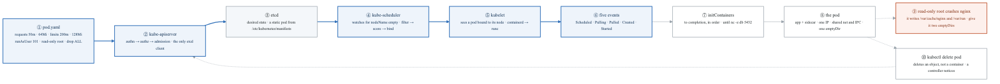
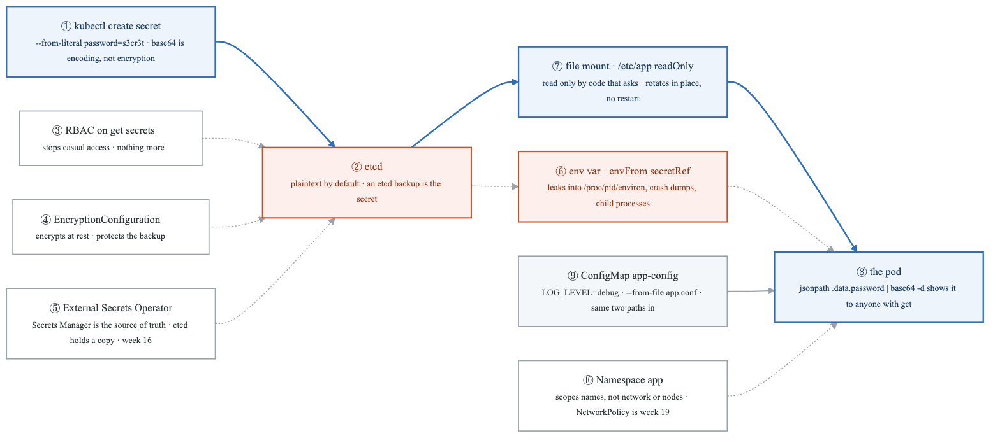
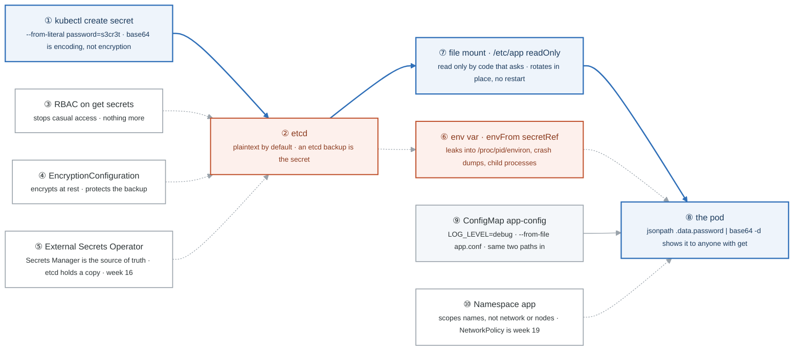
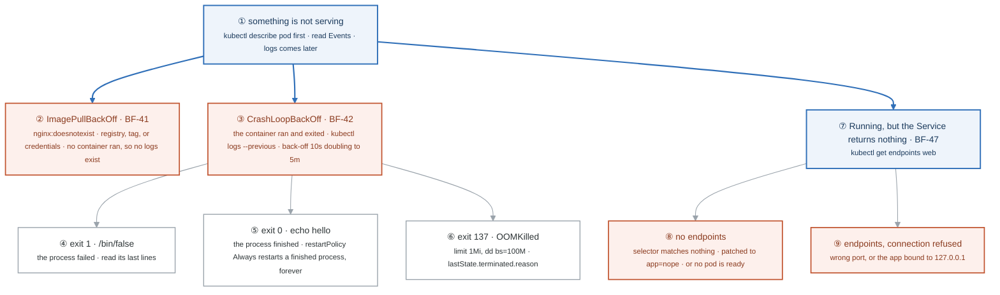
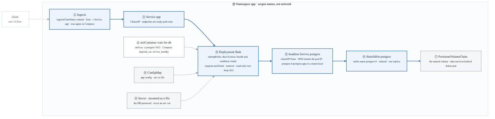
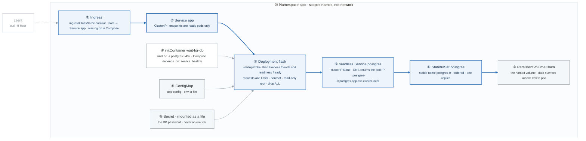

# Week 14 — Lab figures

> One figure per lab, numbered 14.2 to 14.6. Figure 14.1 is the week figure in
> [`../content/FIGURE.md`](../content/FIGURE.md); these five go one level down, to the mechanism each
> lab makes you touch. Same language: gray is structure, **blue is the path to follow first**,
> orange-red is where something refuses, washed boxes are stores. Each badge line is a thirty-second
> interview answer; each whole script is under three minutes.

**The protocol per figure**

1. **Before the lab:** read the figure, say the badges out loud once. You now know what you are about to prove.
2. **During the lab:** every badge has a **Prove it** command. Run it and watch the badge happen. A badge you cannot see happen is one you are taking on faith.
3. **After the lab:** close the file, redraw the figure, say the script. Check against the file. The badge where the order slipped goes in the *Figures redrawn* column of `progress.md`.
4. **Own the numbers.** The *Numbers to own* table is what separates "I know Kubernetes" from "maxSurge 1 with maxUnavailable 0 means four pods at the peak and never fewer than three ready."
5. **Answer the question.** Each figure ends with the question a senior interviewer asks about it. Answer it cold, in under a minute, before the gate.

---

## Figure 14.2 — Lab 1: a pod from manifest to running, and why delete is not kill

> Lab 1 · badges ① to ⑩ · about three minutes.

```mermaid
%%{init: {'theme':'base','themeVariables':{'fontFamily':'Helvetica, Arial, sans-serif','fontSize':'13px','primaryColor':'#ffffff','primaryTextColor':'#2d3436','primaryBorderColor':'#9aa3ab','lineColor':'#9aa3ab','textColor':'#2d3436','clusterBkg':'#fbfcfd','clusterBorder':'#d4dae0','edgeLabelBackground':'#ffffff','tertiaryColor':'#eef4fb'},'flowchart':{'curve':'basis','padding':14,'nodeSpacing':42,'rankSpacing':58}}}%%
flowchart LR
  classDef default fill:#ffffff,stroke:#9aa3ab,stroke-width:1.3px,color:#2d3436
  classDef n    fill:#ffffff,stroke:#9aa3ab,stroke-width:1.3px,color:#2d3436
  classDef crit fill:#eef4fb,stroke:#2f6fb8,stroke-width:1.8px,color:#1b3a5c
  classDef data fill:#f4f7fa,stroke:#9aa3ab,stroke-width:1.3px,color:#2d3436
  classDef mut  fill:#ffffff,stroke:#cfd6dc,stroke-width:1.1px,color:#7a8288
  classDef warn fill:#fdf0ec,stroke:#c0522d,stroke-width:1.6px,color:#8a3a1e

  YAML["① pod.yaml<br/><small>requests 50m · 64Mi · limits 200m · 128Mi<br/>runAsUser 101 · read-only root · drop ALL</small>"]:::crit
  API["② kube-apiserver<br/><small>authn → authz → admission · the only etcd client</small>"]:::crit
  ETCD["③ etcd<br/><small>desired state · a static pod from /etc/kubernetes/manifests</small>"]:::data
  SCHED["④ kube-scheduler<br/><small>watches for nodeName empty · filter → score → bind</small>"]:::crit
  KUBELET["⑤ kubelet<br/><small>sees a pod bound to its node · containerd → runc</small>"]:::crit
  EV["⑥ five events<br/><small>Scheduled · Pulling · Pulled · Created · Started</small>"]:::crit
  INIT["⑦ initContainers<br/><small>to completion, in order · until nc -z db 5432</small>"]:::n
  POD["⑧ the pod<br/><small>app + sidecar · one IP · shared net and IPC · one emptyDir</small>"]:::n
  RO["⑨ read-only root crashes nginx<br/><small>it writes /var/cache/nginx and /var/run · give it two emptyDirs</small>"]:::warn
  DEL["⑩ kubectl delete pod<br/><small>deletes an object, not a container · a controller notices</small>"]:::n

  YAML ==> API ==> ETCD ==> SCHED ==> KUBELET ==> EV
  EV --> INIT --> POD
  POD -.-> RO
  POD -.-> DEL -.-> API
  linkStyle 0,1,2,3,4 stroke:#2f6fb8,stroke-width:2px
```

<!-- figure: generated from the Mermaid below by _shared/diagrams/embed-figures.py — do not edit the image -->


<details>
<summary>Diagram source (Mermaid)</summary>



</details>

### Say it, badge by badge

- **Open.** "Nothing in Kubernetes is imperative. You write an object, one database stores it, and a chain of components each notices one thing and does one thing. Follow the blue path from a YAML file to five events on a running container."
- **① pod.yaml.** "A Pod spec with requests, limits, and a security context that drops everything. The numbers matter: 50m and 64Mi is what the scheduler reserves; 200m and 128Mi is where the kernel throttles or kills. UID 101 is the nginx user in the alpine image."
- **② kube-apiserver.** "kubectl turns the file into an HTTP request. The server authenticates, authorizes, runs admission, and writes. It is the only component that talks to etcd, which is why everything else watches it instead."
- **③ etcd.** "The desired state of the whole cluster, with history. On kind it is a static pod the kubelet starts from a manifest on disk, which is the answer to 'who starts the thing that starts everything'."
- **④ kube-scheduler.** "It watches for pods with no nodeName. Filter removes nodes that cannot fit the requests, taints, and affinity; score ranks the rest; bind writes the chosen node back. A pod stuck Pending is a filter that emptied the list."
- **⑤ kubelet.** "The agent on the chosen node sees a pod bound to it, asks containerd through the CRI to pull and start, and reports status back. runc does the actual namespaces and cgroups you met in week 4."
- **⑥ five events.** "Scheduled, Pulling, Pulled, Created, Started. That order is the whole lifecycle, and `kubectl describe pod` prints it. Where the list stops is where the problem is."
- **⑦ initContainers.** "They run to completion, in order, before any app container starts. `until nc -z db 5432` is Compose's `depends_on: service_healthy`, rebuilt with one line of shell."
- **⑧ the pod.** "One IP, one network namespace, one IPC namespace, shared by every container in it. That is why a sidecar reads the app's logs from a shared emptyDir and talks to it on localhost."
- **⑨ read-only root crashes nginx.** "Set readOnlyRootFilesystem and nginx dies, because it writes its cache and its pid file. Finding the two paths is the lab. Mounting writable emptyDirs at exactly those paths is the pattern, for every image you harden."
- **⑩ kubectl delete pod.** "You delete an object. The kubelet stops the container because the object is gone; a controller, if one owns the pod, makes a new one because the count is wrong. Delete is a request to the database, never a signal to a process."
- **Close.** "Write, store, schedule, run, report. Every other object in Kubernetes rides this same loop; the next four figures are that loop with a different controller in the middle."

### Numbers to own

| Number | Where it comes from | Why it matters |
|---|---|---|
| `50m` / `64Mi` requests | the pod spec | what the scheduler subtracts from the node; too low and the node overcommits, too high and pods go Pending |
| `200m` / `128Mi` limits | the pod spec | CPU over the limit is throttled; memory over the limit is OOMKilled, exit 137 (week 15) |
| UID `101` | nginx in the alpine image | `runAsNonRoot: true` with a username fails; a numeric UID is what the kubelet can verify |
| 4 static-pod manifests | `/etc/kubernetes/manifests` on the control-plane node | etcd, apiserver, controller-manager, scheduler: the control plane is itself pods the kubelet starts from disk |
| 5 events | `kubectl describe pod` | Scheduled · Pulling · Pulled · Created · Started; the diagnosis is wherever the list stops |
| `nc -z db 5432`, `sleep 2` | the init container | the dependency wait, polled every two seconds, with no application code |

### Prove it

```bash
docker exec -it mastery-control-plane ls /etc/kubernetes/manifests/     # ③ the four static pods
kubectl run nginx --image=nginx && kubectl get events --sort-by=.lastTimestamp | tail -10   # ⑥ the five events
kubectl apply -f pod.yaml && kubectl get pod demo -w                     # ⑨ remove the emptyDirs first and watch it crash
kubectl get pods -w                                                      # ⑦ Init:0/1 → PodInitializing → Running
```

### The question a senior interviewer asks

*"Walk me through what happens, component by component, when you delete a pod that belongs to a Deployment."*
The answer is badges ⑩ → ② → ③, then the controller-manager noticing the ReplicaSet is one short, then ④ → ⑤ → ⑥ for the replacement. If you say "the container gets killed and restarted" you have described a symptom, not the mechanism.

---

## Figure 14.3 — Lab 2: a rollout, and the datapath that reaches it

> Lab 2 · badges ① to ⑪ · about three and a half minutes.

```mermaid
%%{init: {'theme':'base','themeVariables':{'fontFamily':'Helvetica, Arial, sans-serif','fontSize':'13px','primaryColor':'#ffffff','primaryTextColor':'#2d3436','primaryBorderColor':'#9aa3ab','lineColor':'#9aa3ab','textColor':'#2d3436','clusterBkg':'#fbfcfd','clusterBorder':'#d4dae0','edgeLabelBackground':'#ffffff','tertiaryColor':'#eef4fb'},'flowchart':{'curve':'basis','padding':14,'nodeSpacing':42,'rankSpacing':58}}}%%
flowchart LR
  classDef default fill:#ffffff,stroke:#9aa3ab,stroke-width:1.3px,color:#2d3436
  classDef n    fill:#ffffff,stroke:#9aa3ab,stroke-width:1.3px,color:#2d3436
  classDef crit fill:#eef4fb,stroke:#2f6fb8,stroke-width:1.8px,color:#1b3a5c
  classDef data fill:#f4f7fa,stroke:#9aa3ab,stroke-width:1.3px,color:#2d3436
  classDef mut  fill:#ffffff,stroke:#cfd6dc,stroke-width:1.1px,color:#7a8288
  classDef warn fill:#fdf0ec,stroke:#c0522d,stroke-width:1.6px,color:#8a3a1e

  DEP["① Deployment web<br/><small>replicas 3 · nginx:1.27-alpine · one template hash per version</small>"]:::crit
  RS["② ReplicaSet<br/><small>one per rollout · the old one stays at scale 0 · undo is instant</small>"]:::crit
  ROLL["③ RollingUpdate<br/><small>maxSurge 1 · maxUnavailable 0 → 4 pods at peak, never below 3 ready</small>"]:::n
  PODS["④ three pods<br/><small>label app=web · containerPort 80</small>"]:::crit
  SVC["⑤ Service web<br/><small>ClusterIP · port 80 → targetPort 80 · selector app=web</small>"]:::crit
  EP["⑥ Endpoints<br/><small>pod IPs that match the selector AND pass readiness · the diagnostic</small>"]:::data
  KP["⑦ kube-proxy<br/><small>iptables on every node · iptables-save | grep web</small>"]:::n
  ING["⑧ Ingress web<br/><small>ingressClassName contour · host web.local · path / Prefix</small>"]:::crit
  CTR["⑨ Contour<br/><small>curl -H &quot;Host: web.local&quot; localhost · no class → ignored, 404</small>"]:::n
  B49["⑩ four ways to break it · BF-49<br/><small>no class · wrong service name · wrong port · Ingress in another namespace</small>"]:::warn
  B47["⑪ the one-line rule · BF-47<br/><small>no endpoints = selector · endpoints but refused = port or bind address</small>"]:::warn

  DEP ==> RS ==> PODS ==> SVC ==> ING
  RS --> ROLL
  SVC --> EP
  EP --> KP
  CTR -.-> ING
  ING -.-> B49
  EP -.-> B47
  linkStyle 0,1,2,3 stroke:#2f6fb8,stroke-width:2px
```

<!-- figure: generated from the Mermaid below by _shared/diagrams/embed-figures.py — do not edit the image -->


<details>
<summary>Diagram source (Mermaid)</summary>



</details>

### Say it, badge by badge

- **Open.** "Three objects you create, in order, and one request that flows back through them. The blue path is what you build. The two orange boxes are the two failures you will see for the rest of your career."
- **① Deployment.** "Declares the template and the count. It never touches a pod itself. Every change to the template gets a new hash, and that hash is what the next box is named after."
- **② ReplicaSet.** "The Deployment makes a new ReplicaSet per rollout and scales the old one down to zero instead of deleting it. That is why `rollout undo` is instant: the previous version is still there, at zero."
- **③ RollingUpdate.** "maxSurge 1, maxUnavailable 0. Four pods exist at the peak, and you never have fewer than three ready. One extra pod's worth of resources buys zero capacity loss. That is the default for anything user-facing."
- **④ three pods.** "Labelled app=web. The label is the only thing connecting them to the ReplicaSet and to the Service. Nothing holds a pointer; everything selects."
- **⑤ Service.** "A stable virtual IP with a selector. Port is what clients call; targetPort is what the container listens on. A ClusterIP exists only in iptables rules; nothing answers a ping to it."
- **⑥ Endpoints.** "The list of pod IPs that match the selector and pass their readiness probe. `kubectl get endpoints web` is the one command that splits every Service problem in half."
- **⑦ kube-proxy.** "Writes iptables rules on every node so the ClusterIP DNATs to one of the endpoint IPs. `iptables-save | grep web` on the worker shows the rules; that is the whole 'virtual' in virtual IP."
- **⑧ Ingress.** "Host and path rules pointing at a Service and a port. It is data, not a proxy. Without ingressClassName no controller claims it, and it sits there looking correct."
- **⑨ Contour.** "The controller that reads Ingress objects it owns and programs Envoy. `curl -H 'Host: web.local' localhost` is how you hit it on kind; the Host header is the routing key."
- **⑩ four ways to break it.** "No class: silently ignored. Wrong service name or port: 503 from the proxy. Ingress in a different namespace from the Service: it cannot see it, because Ingress backends are namespace-local. Break all four, read all four."
- **⑪ the one-line rule.** "No endpoints means the selector matched nothing, or nothing is ready. Endpoints present but connection refused means the port is wrong or the app bound to 127.0.0.1. Two symptoms, two different layers, one command to tell them apart."
- **Close.** "Deployment to ReplicaSet to pods by label. Service to endpoints by label and readiness. Ingress to Service by name, in the same namespace. Everything is a selector, and every failure is a selector that matched nothing."

### Numbers to own

| Number | Where it comes from | Why it matters |
|---|---|---|
| `replicas: 3` | the Deployment | the count the ReplicaSet controller reconciles toward; one less and it creates, one more and it deletes |
| `maxSurge: 1`, `maxUnavailable: 0` | the strategy block | 4 pods at the peak of a rollout, never fewer than 3 ready; costs one pod of headroom, buys zero capacity loss |
| 2 ReplicaSets after one rollout | `kubectl get rs` | one at 3, one at 0; the one at 0 is the rollback |
| `30000–32767` | the NodePort range | the same high port opened on every node; LoadBalancer is NodePort plus a cloud call |
| 5 Service types | the table in the lab | ClusterIP · NodePort · LoadBalancer · ExternalName · headless (`clusterIP: None`, DNS returns pod IPs) |
| 4 ways to break an Ingress | BF-49 | no class · wrong name · wrong port · wrong namespace |

### Prove it

```bash
kubectl set image deploy/web nginx=nginx:1.27 && kubectl get rs          # ② two ReplicaSets, one at 0
kubectl rollout undo deploy/web && kubectl rollout status deploy/web     # ② instant
kubectl get endpoints web                                                # ⑥ the diagnostic
docker exec mastery-worker iptables-save | grep web | head               # ⑦ the virtual IP is rules
kubectl patch svc web -p '{"spec":{"selector":{"app":"nope"}}}' && kubectl get endpoints web   # ⑪ <none>
```

### The question a senior interviewer asks

*"A Service returns nothing. What is the one command you run first, and what do its two possible answers tell you?"*
Badge ⑥ and badge ⑪. The answer is `kubectl get endpoints`, then selector-or-readiness versus port-or-bind-address. The follow-up is "and if the endpoints are there and curl hangs instead of refusing?" That is a NetworkPolicy or a node-level firewall, which is week 19.

---

## Figure 14.4 — Lab 3: where a Secret lives, and where it leaks

> Lab 3 · badges ① to ⑩ · about three minutes.

<!-- figure: generated from the Mermaid below by _shared/diagrams/embed-figures.py — do not edit the image -->


<details>
<summary>Diagram source (Mermaid)</summary>



</details>

### Say it, badge by badge

- **Open.** "A Secret is a ConfigMap with a different name and one false promise. This figure is where the value actually sits at each step and who can read it there. Blue is the path that leaks least; orange is where it leaks."
- **① kubectl create secret.** "The value goes in as base64. Base64 is a transport encoding; `base64 -d` undoes it in one command. The word Secret in the kind field encrypts nothing."
- **② etcd.** "By default the Secret is stored in etcd as that base64, which is to say in plaintext. Whoever can read etcd, or an etcd backup on a laptop, has every secret in the cluster."
- **③ RBAC.** "Restricting `get secrets` is the first rung. It stops a developer with a kubeconfig from listing them. It does nothing for the backup or the disk."
- **④ EncryptionConfiguration.** "The API server encrypts the value before writing to etcd, so the backup is ciphertext. The key sits on the control plane, so this protects the disk, not the API."
- **⑤ External Secrets Operator.** "The real value lives in Secrets Manager, and the operator syncs a copy into a Kubernetes Secret. Git never holds it, etcd holds a copy, and rotation happens upstream. Week 16 wires it to IRSA."
- **⑥ env var.** "`envFrom: secretRef` puts the value in the process environment. The environment is readable at `/proc/<pid>/environ`, inherited by every child process, and printed by most crash handlers. Rotation needs a restart."
- **⑦ file mount.** "A volume at `/etc/app`, read-only. Only code that opens the file sees it, subprocesses do not inherit it, and the kubelet updates the file when the Secret changes, without a restart. This is the default you argue for."
- **⑧ the pod.** "Whichever path you chose, anyone with `get secrets` reads the value with one jsonpath. The pod is not the boundary; RBAC and the upstream store are."
- **⑨ ConfigMap.** "Same two delivery paths, env or file, for configuration that is not secret. Keep them separate so the RBAC on Secrets means something."
- **⑩ Namespace.** "Scopes names. Two pods in different namespaces still reach each other on the network until a NetworkPolicy says otherwise. A namespace is an address book, not a wall."
- **Close.** "Encode, store, deliver. Encrypt the store, scope who can read it, keep the source of truth outside, and deliver as a file. Every rung is cheap, and the first one is the one most clusters skip."

### Numbers to own

| Number | Where it comes from | Why it matters |
|---|---|---|
| 1 command to reveal | `jsonpath='{.data.password}' \| base64 -d` | the demonstration that a Secret is not secret from anyone with `get` |
| 4 mitigations, in order | the lab's table | RBAC → encryption at rest → ESO → file mount; each fixes a different reader |
| 3 places an env var leaks | the lab | `/proc/<pid>/environ` · crash dumps · child processes |
| 0 restarts for a file rotation | kubelet volume refresh | the operational reason to mount, not inject |
| 0 network isolation from a namespace | the lab | a namespace scopes names only; NetworkPolicy (week 19) is the wall |

### Prove it

```bash
kubectl get secret db -o jsonpath='{.data.password}' | base64 -d            # ① ⑧ it was never hidden
kubectl exec deploy/web -- cat /proc/1/environ | tr '\0' '\n' | grep -i pass  # ⑥ the env var is on disk
kubectl exec deploy/web -- cat /etc/app/password                              # ⑦ the file path
kubectl get all -A                                                            # ⑩ names scoped, nothing else
```

### The question a senior interviewer asks

*"Why is a Secret mounted as a file safer than one injected as an environment variable?"*
Badges ⑥ and ⑦: inheritance, `/proc`, crash dumps, and rotation without a restart. Then say what a file does **not** fix, badge ⑧: anyone with `get secrets` still reads it, which is why the ladder ③ to ⑤ exists.

---

## Figure 14.5 — Lab 4: the diagnostic ladder, describe before logs

> Lab 4 · badges ① to ⑨ · about two and a half minutes. This figure reads top-down.

<!-- figure: generated from the Mermaid below by _shared/diagrams/embed-figures.py — do not edit the image -->


<details>
<summary>Diagram source (Mermaid)</summary>



</details>

### Say it, badge by badge

- **Open.** "Three failures, one entry point, and the mistake everyone makes once. The entry point is `describe`, because two of the three failures have no logs to read."
- **① describe first.** "`kubectl describe pod` prints the events in order. The events say whether the container ever started. Running `logs` first on a container that never started gives you nothing and costs you the ten minutes you spend wondering why."
- **② ImagePullBackOff.** "The kubelet asked containerd for an image and the registry said no. It is the registry name, the tag, or the pull credentials, in that order of likelihood. There are no logs, because nothing ran. BF-41."
- **③ CrashLoopBackOff.** "The container started and exited, and the kubelet is restarting it with a growing delay: ten seconds, doubling, capped at five minutes. The logs you want are from the previous attempt, so `logs --previous`. BF-42 has three variants, and the exit code tells them apart."
- **④ exit 1.** "The process failed. `/bin/false` is the pure form. Read the last lines it printed; that is the application's error."
- **⑤ exit 0.** "The process succeeded and finished. `echo hello` exits cleanly, and with restartPolicy Always the kubelet starts it again, and again. A one-shot command in a long-running pod is a crash loop with a happy exit code. That one takes people by surprise."
- **⑥ exit 137.** "128 plus 9: the kernel sent SIGKILL because the cgroup hit its memory limit. A 1Mi limit and a 100M dd. The reason is in `lastState.terminated.reason: OOMKilled`, and the fix is a limit that matches reality, week 15."
- **⑦ Running but nothing answers.** "The pod is fine; the path to it is not. The one command is `kubectl get endpoints`, and its answer sends you left or right."
- **⑧ no endpoints.** "The selector matched nothing, or every matched pod is failing readiness. The lab patches the selector to app=nope; in production it is a typo in a label, or a readiness probe on the wrong path."
- **⑨ endpoints but refused.** "The Service found the pods but the connection bounced. The targetPort is wrong, or the application bound to 127.0.0.1 and cannot be reached on the pod IP. Week 4's bind-address bug, back in a new costume."
- **Close.** "Describe, then classify: never pulled, pulled but exiting, or running but unreachable. Each branch has one command and one layer. By week 15 there are six more rungs, and they all hang off this ladder."

### Numbers to own

| Number | Where it comes from | Why it matters |
|---|---|---|
| exit `1` | `/bin/false` | a failed process: read its output |
| exit `0` | `echo hello` under `restartPolicy: Always` | a finished process restarted forever; looks like a crash, is a design mistake |
| exit `137` | `128 + SIGKILL(9)` | the kernel OOM-killed the cgroup; the reason field says `OOMKilled` |
| `1Mi` vs `bs=100M` | the lab's OOM variant | a limit the process cannot possibly fit in |
| 10s → 5m | kubelet CrashLoopBackOff | the restart delay doubles from ten seconds and caps at five minutes; it resets after the container runs cleanly for ten minutes |
| 3 BF scenarios | BF-41, BF-42, BF-47 | the Friday set; week 15 adds BF-43 to BF-48 |

### Prove it

```bash
kubectl set image deploy/web nginx=nginx:doesnotexist && kubectl describe pod -l app=web | tail -8   # ② events, no logs
kubectl run crash2 --image=busybox --command -- echo hello && kubectl get pod crash2 -w                # ⑤ Completed → CrashLoopBackOff
kubectl get pod crash3 -o jsonpath='{.status.containerStatuses[0].lastState.terminated}'                # ⑥ exitCode 137, OOMKilled
kubectl patch svc web -p '{"spec":{"selector":{"app":"nope"}}}' && kubectl get endpoints web           # ⑧ <none>
```

### The question a senior interviewer asks

*"A pod is in CrashLoopBackOff and the logs look completely normal. What is killing it?"*
Badge ⑤ or ⑥: either the process exits 0 and gets restarted, or it is OOMKilled with nothing printed. The proof is the exit code in `lastState.terminated`, not the logs. Week 15 adds the third answer: a liveness probe with too short an initial delay, BF-44.

---

## Figure 14.6 — Lab 5: the week-4 stack, as Kubernetes objects

> Lab 5 · badges ① to ⑩ · about three minutes.

<!-- figure: generated from the Mermaid below by _shared/diagrams/embed-figures.py — do not edit the image -->


<details>
<summary>Diagram source (Mermaid)</summary>



</details>

### Say it, badge by badge

- **Open.** "Same three services as week 4: a proxy, a Flask app, a Postgres. Every Compose line has a Kubernetes object, and most of them are two objects, because Kubernetes separates the thing from the way it is reached. Follow the blue path from the request to the disk."
- **① Ingress.** "What the nginx container did in Compose: terminate the host and route the path. Here it is a rule object; Contour does the proxying. Same class, same host-header test as Lab 2."
- **② Service app.** "The stable name the Ingress points at. Its endpoints are only the pods whose readiness probe passes, so a pod that is up but not ready gets no traffic. That is the half of `service_healthy` that happens on the way in."
- **③ Deployment flask.** "The app, with three probes doing three jobs: startup holds the others off until a slow boot finishes, liveness restarts a hung process, readiness pulls it out of the Service. Requests and limits on every container, and the week-4 security context: nonroot, read-only root, every capability dropped."
- **④ initContainer.** "The other half of `service_healthy`: wait for Postgres to answer on 5432 before the app process starts. Two mechanisms replace one Compose line, because startup order and traffic readiness are different questions."
- **⑤ headless Service.** "`clusterIP: None`. DNS returns the pod IP itself, not a virtual one, and each pod gets a stable name: `postgres-0.postgres.app.svc.cluster.local`. A database needs to be addressed, not load-balanced."
- **⑥ StatefulSet.** "Pods with stable names and ordered creation. postgres-0 is always postgres-0, and the PVC it claimed is still its PVC after it is rescheduled. A Deployment would hand the volume to whichever replica came up first."
- **⑦ PersistentVolumeClaim.** "The named volume from Compose. Delete the pod, and the claim and its data remain; the new postgres-0 mounts the same disk. That is the acceptance test in the lab: `kubectl delete pod` and the rows are still there."
- **⑧ ConfigMap.** "The `environment:` block that was not secret. Env or file, your call; the lab leaves it to you."
- **⑨ Secret as a file.** "The DB password, mounted, not injected. Figure 14.4 is the argument; the checklist makes it a requirement."
- **⑩ Namespace.** "All of it in one namespace, so names resolve without suffixes and RBAC has a boundary to attach to. Not a network boundary; that is a NetworkPolicy, week 19."
- **Close.** "Ingress to Service to pods by readiness, init container to database by port check, headless Service to a StatefulSet pod by stable name, pod to disk by claim. Fill in the Compose-to-Kubernetes table in the lab yourself; when every row has an object, the platform stops feeling foreign."

### Numbers to own

| Number | Where it comes from | Why it matters |
|---|---|---|
| 3 probes | the requirements list | startup · liveness · readiness; each answers a different question and only readiness affects traffic |
| 2 mechanisms for one Compose line | `depends_on: service_healthy` | an init container for startup order plus a readiness probe for traffic |
| `5432` | the init container's port check | the only dependency the app has, polled, with no application code |
| `clusterIP: None` | the headless Service | DNS returns pod IPs; the StatefulSet's pods become addressable by name |
| `postgres-0.postgres.app.svc.cluster.local` | pod name · headless service · namespace | the fully qualified name a client in another namespace would use |
| 1 acceptance test | "data survives `kubectl delete pod`" | the PVC, not the pod, owns the data |

### Prove it

```bash
kubectl get endpoints app                                                   # ② only ready pods
kubectl get pods -w                                                         # ④ Init:0/1 until postgres answers
kubectl run tmp --rm -it --image=nicolaka/netshoot -- nslookup postgres     # ⑤ a pod IP, not a ClusterIP
kubectl delete pod postgres-0 && kubectl get pvc                            # ⑦ the claim stays Bound
kubectl exec deploy/flask -- cat /etc/app/db-password                       # ⑨ a file, not the environment
```

### The question a senior interviewer asks

*"Map `depends_on: condition: service_healthy` to Kubernetes. Why does it take two mechanisms?"*
Badges ③ and ④. Compose conflates startup order with traffic readiness; Kubernetes splits them because a pod can be started and not ready, or ready and later not. If you answer with only the init container, the follow-up is "and what stops traffic reaching the app while it waits?"

---

## Redraw schedule

Same cadence as the week figure, see [`../../FIGURES.md`](../../FIGURES.md): Friday of this week after break/fix, Sunday of week 16, and cold at the Gate 4 Sunday in week 17. Lab figures are redrawn **after** the week figure, one at a time, and only the badge order has to be right; the captions are the check, not the test.
