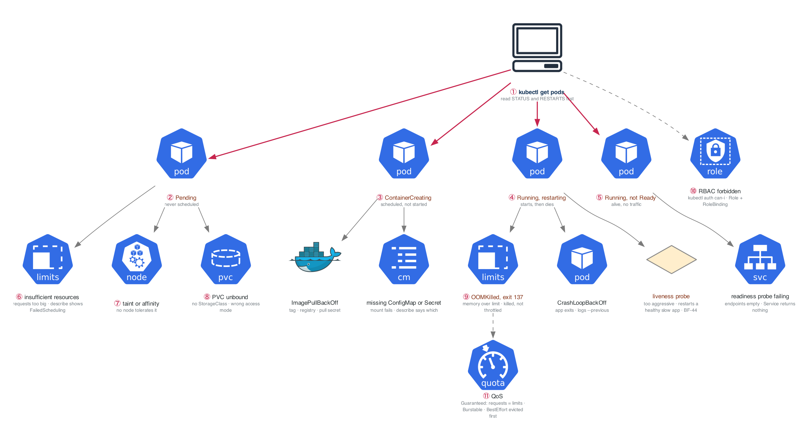

# Week 15 — Kubernetes II: Operations and Debugging

> **Thesis:** anyone can `kubectl apply`. What gets hired is diagnosing a broken cluster under time
> pressure while narrating the reasoning. That is a trainable skill and almost nobody trains it.

| | |
|---|---|
| **Hours** | 35–45 (incl. ~4h job search) |
| **Deliverable** | Blog post #8 — "Nine ways a pod fails to start, and how to tell them apart" (with a decision tree) |
| **Break/Fix** | BF-43, BF-44, BF-45, BF-46, BF-48 — **this is the Gate 4 set** |

## The week in one figure

**Figure 15.1 — Nine ways a pod fails to start, and where each one lives.** This is the decision tree from the week's blog post. Each branch is a phase you can read in one `kubectl get pods`, and each leaf names the command that proves it.

**Say it, badge by badge:** [`content/FIGURE.md`](content/FIGURE.md) — the spoken script for each of the 11 badges, about three and a half minutes; [`content/figure-15.1-numbered-spoken.pdf`](content/figure-15.1-numbered-spoken.pdf) is the printable two-page version. Read the figure before the day plan; say the script on Friday.

---

## Day plan
| Day | Focus | Lab |
|---|---|---|
| Mon | Probes, resources, QoS, OOMKilled | Lab 1 |
| Tue | HPA, PDB, affinity, taints, topology spread | Lab 2 |
| Wed | StatefulSets, PV/PVC/StorageClass, Jobs, DaemonSets | Lab 3 |
| Thu | RBAC and ServiceAccounts | Lab 4 |
| Fri | **Break/Fix — build the Gate 4 scenario set** | Lab 5 |
| Sat | Helm: consume and author | Lab 6 · 15 applications |
| Sun | Blog post #8; plan week 16 |

## Reading map
- `_reference/kubernetes/03-production/03-scaling-performance-exercises-01-horizontal-pod-autoscaler.md`
- `_reference/kubernetes/03-production/03-scaling-performance-exercises-04-resource-optimization.md`
- `_reference/kubernetes/03-production/03-scaling-performance-exercises-05-pod-disruption-budgets.md`
- `_reference/kubernetes/03-production/02-security-rbac-exercises-01-rbac-configuration.md`
- `_reference/kubernetes/02-core-ops/02-storage-systems-exercises-01-persistent-volumes.md`
- `_reference/kubernetes/02-core-ops/02-storage-systems-exercises-03-stateful-workloads.md`
- **`_reference/kubernetes/resources/troubleshooting-common-issues.md`** ← the whole file
- `_reference/kubernetes/resources/` — cheat sheets
- **Drill:** `_shared/drills/kubectl-speed.md` Tiers 2–4, daily

## Labs
[labs/LABS.md](labs/LABS.md) · [labs/FIGURES.md](labs/FIGURES.md) (figures 15.2 to 15.8, one per lab plus the Go deeper labs) · [solutions/SOLUTIONS.md](solutions/SOLUTIONS.md) · [Kubernetes thread](../KUBERNETES-THREAD.md#week-15)

## Exit criteria
- [ ] Explain requests vs limits, QoS classes, and why CPU is throttled but memory is killed
- [ ] Explain the three probes and the production disaster caused by getting liveness wrong
- [ ] Trigger and diagnose OOMKilled, a liveness restart loop, an unschedulable pod, a stuck PVC, and
      an RBAC denial
- [ ] Write a Role + RoleBinding from blank and verify with `kubectl auth can-i`
- [ ] Package the week-14 stack as a Helm chart with dev and prod values
- [ ] **The five Gate 4 scenarios reproducible on demand**
