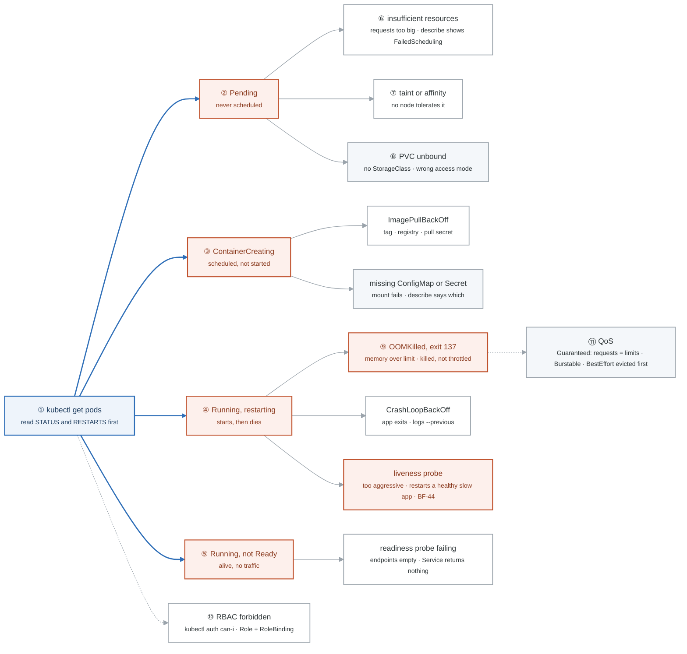

# Week 15 — Kubernetes II: Operations and Debugging

> **Thesis:** anyone can `kubectl apply`. What gets hired is diagnosing a broken cluster under time
> pressure while narrating the reasoning. That is a trainable skill and almost nobody trains it.

| | |
|---|---|
| **Hours** | 35–45 (incl. ~4h job search) |
| **Deliverable** | Blog post #8 — "Nine ways a pod fails to start, and how to tell them apart" (with a decision tree) |
| **Break/Fix** | BF-43, BF-44, BF-45, BF-46, BF-48 — **this is the Gate 4 set** |

## The week in one figure

**Figure 15.1 — Nine ways a pod fails to start, and where each one lives.** This is the decision tree from the week's blog post. Each branch is a phase you can read in one `kubectl get pods`, and each leaf names the command that proves it. Badges are numbered in the order to walk them; the blue path is the one to follow first.

**What to say, badge by badge** · about three and a half minutes at a normal pace. Point at each badge as you say its line.

- **Open.** “Anyone can apply a manifest. What gets hired is diagnosing a broken cluster under time pressure while saying what you are thinking. This tree is the thing you say. The first word of STATUS picks the branch.”
- **① kubectl get pods.** “Two columns tell you which branch: STATUS and RESTARTS. Pending and ContainerCreating have zero restarts and never ran. Running with climbing restarts is dying after it starts. Running with zero Ready is alive but excluded.”
- **② Pending.** “The scheduler could not place it. `kubectl describe pod` shows a FailedScheduling event with the reason. There are three usual reasons, badges 6 to 8.”
- **③ ContainerCreating.** “It has a node but the kubelet cannot start it. Almost always the image or a volume. Describe shows which, in the events at the bottom.”
- **④ Running, restarting.** “The container starts and dies. The exit code and the previous container's logs tell you whether the app quit, the kernel killed it, or the probe did.”
- **⑤ Running, not Ready.** “The process is alive but the readiness probe fails, so the Service removes it from the endpoints. The app looks down from outside and looks fine from inside.”
- **⑥ insufficient resources.** “Requests larger than any node has free. On kind this is easy to trigger: ask for 100 CPUs. In production it is the usual Monday-morning cause.”
- **⑦ taint or affinity.** “Every node has a taint the pod does not tolerate, or an affinity rule nothing satisfies. Describe names the taint.”
- **⑧ PVC unbound.** “The claim is waiting for a volume that cannot be provisioned: no default StorageClass, or an access mode the class cannot give. Stateful pods stall here.”
- **⑨ OOMKilled.** “Exit code 137. Memory over the limit is killed instantly, where CPU over the limit is only throttled. That asymmetry is the exit criterion and the question interviewers love. Requests equal to limits makes the pod Guaranteed and last to be evicted.”
- **⑩ RBAC forbidden.** “Not a pod state, but it looks like one when a controller cannot create what it needs. `kubectl auth can-i --as` answers it in one line; a Role plus a RoleBinding fixes it.”
- **⑪ QoS.** “Guaranteed when every container's requests equal its limits. Burstable when requests are lower. BestEffort when there are none, and those die first under pressure.”
- **Close.** “Read the status, pick the branch, run the one command that proves the leaf, say it out loud. Friday you build five of these on demand; they are Gate 4, two weeks from now.”

---

## Day plan
| Day | Focus | Lab |
|---|---|---|
| Mon | Probes, resources, QoS, OOMKilled | Lab 1 |
| Tue | HPA, PDB, affinity, taints, topology spread | Lab 2 |
| Wed | StatefulSets, PV/PVC/StorageClass, Jobs, DaemonSets | Lab 3 |
| Thu | RBAC and ServiceAccounts | Lab 4 |
| Fri | **Break/Fix — build the Gate 4 scenario set** | Lab 5 |
| Sat | Helm: consume and author | Lab 6 · 15 applications |
| Sun | Blog post #8; plan week 16 |

## Reading map
- `_reference/kubernetes/03-production/03-scaling-performance-exercises-01-horizontal-pod-autoscaler.md`
- `_reference/kubernetes/03-production/03-scaling-performance-exercises-04-resource-optimization.md`
- `_reference/kubernetes/03-production/03-scaling-performance-exercises-05-pod-disruption-budgets.md`
- `_reference/kubernetes/03-production/02-security-rbac-exercises-01-rbac-configuration.md`
- `_reference/kubernetes/02-core-ops/02-storage-systems-exercises-01-persistent-volumes.md`
- `_reference/kubernetes/02-core-ops/02-storage-systems-exercises-03-stateful-workloads.md`
- **`_reference/kubernetes/resources/troubleshooting-common-issues.md`** ← the whole file
- `_reference/kubernetes/resources/` — cheat sheets
- **Drill:** `_shared/drills/kubectl-speed.md` Tiers 2–4, daily

## Labs
[labs/LABS.md](labs/LABS.md) · [solutions/SOLUTIONS.md](solutions/SOLUTIONS.md)

## Exit criteria
- [ ] Explain requests vs limits, QoS classes, and why CPU is throttled but memory is killed
- [ ] Explain the three probes and the production disaster caused by getting liveness wrong
- [ ] Trigger and diagnose OOMKilled, a liveness restart loop, an unschedulable pod, a stuck PVC, and
      an RBAC denial
- [ ] Write a Role + RoleBinding from blank and verify with `kubectl auth can-i`
- [ ] Package the week-14 stack as a Helm chart with dev and prod values
- [ ] **The five Gate 4 scenarios reproducible on demand**
