# Week 15 — Lab figures

> One figure per lab, numbered 15.2 to 15.8. Figure 15.1 is the week figure in
> [`../content/FIGURE.md`](../content/FIGURE.md); these six go one level down, to the mechanism each
> lab makes you touch. Same language: gray is structure, **blue is the path to follow first**,
> orange-red is where something refuses, washed boxes are stores. Each badge line is a thirty-second
> interview answer; each whole script is under three minutes.

**The protocol per figure**

1. **Before the lab:** read the figure, say the badges out loud once. You now know what you are about to prove.
2. **During the lab:** every badge has a **Prove it** command. Run it and watch the badge happen. A badge you cannot see happen is one you are taking on faith.
3. **After the lab:** close the file, redraw the figure, say the script. Check against the file. The badge where the order slipped goes in the *Figures redrawn* column of `progress.md`.
4. **Own the numbers.** The *Numbers to own* table is what separates "I know Kubernetes" from "a 1-second initial delay on a 20-second boot with a failure threshold of 1 is a restart loop with clean logs."
5. **Answer the question.** Each figure ends with the question a senior interviewer asks about it. Answer it cold, in under a minute, before the gate.

---

## Figure 15.2 — Lab 1: what the kubelet throttles, kills, and restarts

> Lab 1 · badges ① to ⑩ · about three minutes. Reads top-down: resources first, probes second.

<!-- figure: generated from the Mermaid below by _shared/diagrams/embed-figures.py — do not edit the image -->
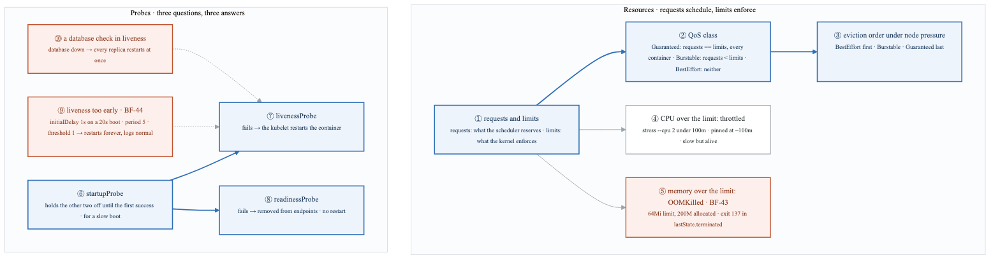

<details>
<summary>Diagram source (Mermaid)</summary>

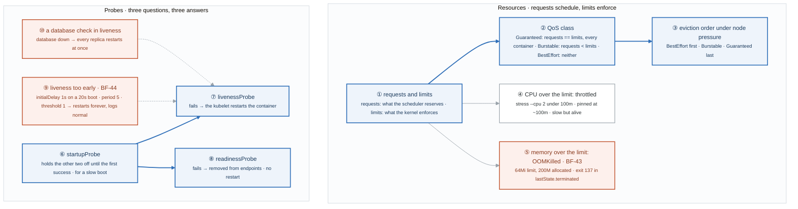

</details>

### Say it, badge by badge

- **Open.** "Two numbers decide where a pod runs and what happens when it misbehaves, and three probes decide whether it gets traffic or gets restarted. The two orange boxes on the bottom row are the production outages you cause yourself this week so that they become stories."
- **① requests and limits.** "Requests are what the scheduler subtracts from the node when it places the pod. Limits are what the kernel enforces once it is running. Different components, different moments, and the gap between them is the QoS class."
- **② QoS class.** "Requests equal to limits on every container is Guaranteed. Requests below limits is Burstable. Nothing set is BestEffort. The class is computed, not declared; `kubectl get pods -o custom-columns` shows it."
- **③ eviction order.** "When the node runs short, the kubelet evicts BestEffort first, Burstable next, Guaranteed last. The class is an eviction priority, which is why a database gets requests equal to limits."
- **④ CPU over the limit.** "CPU is compressible. Two stress threads under a 100m limit get throttled to about 100m and stay alive, slowly. The pod is fine; it is just late."
- **⑤ memory over the limit.** "Memory is not compressible. Allocate 200M under a 64Mi limit and the kernel kills the process with SIGKILL: exit 137, reason OOMKilled in lastState.terminated. That sentence, throttled versus killed, is the clean interview answer."
- **⑥ startupProbe.** "Runs first and alone. Until it succeeds once, the kubelet ignores liveness and readiness. It is how a 20-second boot survives a 5-second liveness period."
- **⑦ livenessProbe.** "Asks 'is this process stuck'. A failure restarts the container. That is the only thing it should do, which is why it must only check the process itself."
- **⑧ readinessProbe.** "Asks 'can this pod take traffic right now'. A failure pulls the pod out of the Service endpoints and nothing restarts. Dependencies belong here, not in liveness."
- **⑨ liveness too early.** "A 1-second initial delay, a 5-second period, a threshold of 1, on an app that boots in 20. The kubelet kills it before it ever answers, forever, and the logs are completely normal because the app did nothing wrong. Something external is killing it; `describe` says Liveness probe failed."
- **⑩ a database check in liveness.** "Put the database in the liveness probe, take the database down, and every replica fails liveness within one period and restarts at the same moment. A dependency blip becomes a full outage. In readiness, the same blip would have drained traffic and kept the processes alive."
- **Close.** "Requests place, limits enforce, class decides who dies first. Startup gates, liveness restarts, readiness drains. The two disasters are both the right check in the wrong probe."

### Numbers to own

| Number | Where it comes from | Why it matters |
|---|---|---|
| `64Mi` limit vs `200M` allocated | the BF-43 break | the kernel cannot compress memory; the gap is the kill |
| exit `137` | `128 + SIGKILL(9)`, a kernel convention | the proof of an OOM kill is the exit code, not the logs |
| `100m` limit vs `--cpu 2` | the throttling demo | CPU is compressible: the pod stays alive at roughly 100m |
| 3 QoS classes | the table in the lab | Guaranteed · Burstable · BestEffort, evicted in reverse order |
| `100m` / `128Mi` for both requests and limits | the Guaranteed pod | requests must equal limits on every container, not just one |
| `initialDelaySeconds: 1`, `periodSeconds: 5`, `failureThreshold: 1`, a 20s boot | the BF-44 probe | the kubelet kills the container four times before it would have been ready |
| 3 probes | the correct set | startup · liveness · readiness; only readiness touches endpoints |

### Prove it

```bash
kubectl get pod oom -o jsonpath='{.status.containerStatuses[0].lastState.terminated}' | jq      # ⑤ exitCode 137, OOMKilled
kubectl get pods -o custom-columns=NAME:.metadata.name,QOS:.status.qosClass                      # ② the computed class
kubectl top pod cpu                                                                              # ④ pinned near 100m, still Running
kubectl describe pod <slow-app> | grep -i liveness                                               # ⑨ "Liveness probe failed" with normal logs
kubectl get pods -l app=<app> -w                                                                 # ⑩ every replica restarts in the same period
```

### The question a senior interviewer asks

*"Why does putting a database check in the liveness probe turn a database blip into a full outage?"*
Badges ⑦, ⑧ and ⑩. Liveness restarts; readiness drains. A dependency failure fails every replica's liveness in the same period, so every replica restarts together, and the restarts do nothing because the dependency is still down. The follow-up is "so what goes in liveness?" and the answer is: only whether this process is stuck.

---

## Figure 15.3 — Lab 2: who adds pods, who removes them, and who refuses to place them

> Lab 2 · badges ① to ⑨ · about three minutes. Three loops, top to bottom: scale, drain, schedule.

<!-- figure: generated from the Mermaid below by _shared/diagrams/embed-figures.py — do not edit the image -->
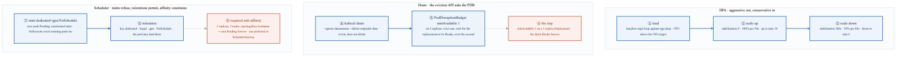

<details>
<summary>Diagram source (Mermaid)</summary>

```mermaid
%%{init: {'theme':'base','themeVariables':{'fontFamily':'Helvetica, Arial, sans-serif','fontSize':'13px','primaryColor':'#ffffff','primaryTextColor':'#2d3436','primaryBorderColor':'#9aa3ab','lineColor':'#9aa3ab','textColor':'#2d3436','clusterBkg':'#fbfcfd','clusterBorder':'#d4dae0','edgeLabelBackground':'#ffffff','tertiaryColor':'#eef4fb'},'flowchart':{'curve':'basis','padding':14,'nodeSpacing':42,'rankSpacing':58}}}%%
flowchart TB
  classDef default fill:#ffffff,stroke:#9aa3ab,stroke-width:1.3px,color:#2d3436
  classDef n    fill:#ffffff,stroke:#9aa3ab,stroke-width:1.3px,color:#2d3436
  classDef crit fill:#eef4fb,stroke:#2f6fb8,stroke-width:1.8px,color:#1b3a5c
  classDef data fill:#f4f7fa,stroke:#9aa3ab,stroke-width:1.3px,color:#2d3436
  classDef mut  fill:#ffffff,stroke:#cfd6dc,stroke-width:1.1px,color:#7a8288
  classDef warn fill:#fdf0ec,stroke:#c0522d,stroke-width:1.6px,color:#8a3a1e

  subgraph HPA["HPA · aggressive out, conservative in"]
    direction LR
    LOAD["① load<br/><small>busybox wget loop against app.shop · CPU above the 50% target</small>"]:::crit
    UP["② scale up<br/><small>stabilization 0 · 100% per 30s · up to max 10</small>"]:::crit
    DOWN["③ scale down<br/><small>stabilization 300s · 50% per 60s · down to min 2</small>"]:::crit
  end
  subgraph PDB["Drain · the eviction API asks the PDB"]
    direction LR
    DRAIN["④ kubectl drain<br/><small>--ignore-daemonsets --delete-emptydir-data · evicts, does not delete</small>"]:::crit
    BUDGET["⑤ PodDisruptionBudget minAvailable 1<br/><small>on 2 replicas: evict one, wait for the replacement to be Ready, evict the second</small>"]:::crit
    TRAP["⑥ the trap<br/><small>minAvailable 1 on a 1-replica Deployment · the drain blocks forever</small>"]:::warn
  end
  subgraph SCHED["Scheduler · taints refuse, tolerations permit, affinity constrains"]
    direction LR
    TAINT["⑦ taint dedicated=gpu:NoSchedule<br/><small>new pods Pending: untolerated taint · NoExecute evicts running pods too</small>"]:::crit
    TOL["⑧ toleration<br/><small>key dedicated · Equal · gpu · NoSchedule · the pod may land there</small>"]:::crit
    AA["⑨ required anti-affinity<br/><small>3 replicas, 2 nodes, topologyKey hostname → one Pending forever · use preferred or ScheduleAnyway</small>"]:::warn
  end

  LOAD ==> UP ==> DOWN
  DRAIN ==> BUDGET
  BUDGET -.-> TRAP
  TAINT ==> TOL
  TOL -.-> AA
  linkStyle 0,1,2,4 stroke:#2f6fb8,stroke-width:2px
```

</details>

### Say it, badge by badge

- **Open.** "Three different controllers change the pod count of a Deployment without you touching the replicas field: the autoscaler, the drain, and the scheduler saying no. Each has one rule and one trap."
- **① load.** "A busybox loop hammering the Service pushes average CPU over the 50 percent target. The HPA reads the metric every cycle and compares it to the target; the target is a ratio of requests, which is why requests must be set for the HPA to work at all."
- **② scale up.** "No stabilization window, 100 percent per 30 seconds, up to 10. Doubling every half minute is deliberate: under-provisioning costs users, over-provisioning costs money, and the cheaper mistake is the fast one."
- **③ scale down.** "A 300-second window and 50 percent per minute, down to 2. Scale-in waits five minutes of sustained low load before it starts, so a traffic dip does not flap the fleet. Same principle as the week-7 ASG."
- **④ kubectl drain.** "Drain does not delete pods; it asks the eviction API, and the eviction API consults the budget. That one indirection is the whole mechanism behind safe node upgrades."
- **⑤ PodDisruptionBudget.** "minAvailable 1 on a 2-replica Deployment: the drain evicts one pod, then waits until the replacement is Ready before evicting the other. Without a budget both go at once and the service is down during routine maintenance. Prefer minAvailable for small deployments and a maxUnavailable percentage for large ones."
- **⑥ the trap.** "minAvailable 1 on a 1-replica Deployment can never be satisfied during an eviction, so the drain blocks forever. Node upgrades hang and nobody knows why. A budget must be satisfiable with one pod gone."
- **⑦ taint.** "Tainting a node with NoSchedule makes the scheduler refuse new pods there; `describe pod` says untolerated taint. PreferNoSchedule is soft. NoExecute goes further and evicts the pods already running."
- **⑧ toleration.** "A toleration matching key, value and effect lets a pod be placed on the tainted node. It permits; it does not require. Pairing it with node affinity is what makes a dedicated pool."
- **⑨ required anti-affinity.** "Three replicas, two nodes, required anti-affinity on hostname: the third pod stays Pending forever because no node satisfies the rule. Preferred anti-affinity, or a topology spread with ScheduleAnyway, is almost always what you meant."
- **Close.** "Scale on a ratio of requests, out fast and in slow. Drain through the eviction API so the budget is honoured, and keep the budget satisfiable. Taints refuse, tolerations permit, and required rules that cannot be met leave pods Pending. Every Pending has a FailedScheduling event that says which one."

### Numbers to own

| Number | Where it comes from | Why it matters |
|---|---|---|
| `--cpu-percent=50 --min=2 --max=10` | the autoscale command | the target is a percentage of requests; min and max are the fleet's bounds |
| `scaleUp` 0s window, 100% per 30s | the behavior block | double every half minute; the cheap mistake is over-provisioning |
| `scaleDown` 300s window, 50% per 60s | the behavior block | five minutes of calm before halving; stops flapping |
| `minAvailable: 1` on 2 replicas | the PDB demo | one eviction at a time, waiting for Ready in between |
| `minAvailable: 1` on 1 replica | the trap | an unsatisfiable budget blocks every drain |
| 3 replicas, 2 nodes | the anti-affinity demo | required rules that outnumber nodes leave one pod Pending |
| 3 taint effects | the lab | NoSchedule · PreferNoSchedule · NoExecute, and only the last evicts |

### Prove it

```bash
kubectl get hpa -w                                                       # ② ③ targets and replicas moving
kubectl drain mastery-worker --ignore-daemonsets --delete-emptydir-data  # ④ ⑤ one pod at a time, with waits
kubectl taint nodes mastery-worker dedicated=gpu:NoSchedule && kubectl run test --image=nginx && kubectl describe pod test | grep -A3 Events   # ⑦ untolerated taint
kubectl get pods -o wide                                                 # ⑨ the third replica with no NODE
```

### The question a senior interviewer asks

*"A node upgrade has been hanging for an hour. What is the most likely cause, and how do you find it?"*
Badge ⑥. A PodDisruptionBudget that cannot be satisfied, usually minAvailable 1 on a single replica. `kubectl get pdb -A` shows ALLOWED DISRUPTIONS 0, and the drain output names the pod it cannot evict. The fix is a second replica or a budget that permits one disruption, never `--disable-eviction`.

---

## Figure 15.4 — Lab 3: a claim from Pending to Bound, and the modes that refuse

> Lab 3 · badges ① to ⑪ · about three and a half minutes.

<!-- figure: generated from the Mermaid below by _shared/diagrams/embed-figures.py — do not edit the image -->


<details>
<summary>Diagram source (Mermaid)</summary>

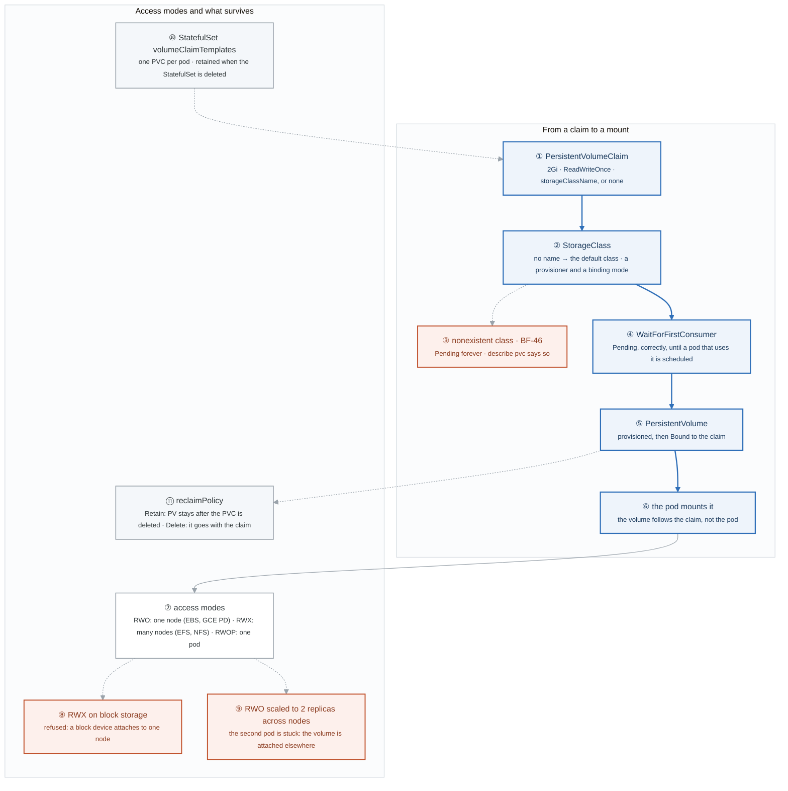

</details>

### Say it, badge by badge

- **Open.** "A claim is a request; a volume is the thing. The lab is the path between them, the three ways the path stops, and what is left behind when you delete things."
- **① PersistentVolumeClaim.** "Size, access mode, and optionally a class. Leave the class out and you get the cluster's default class; the first task is to find out which one that is."
- **② StorageClass.** "Names a provisioner and a binding mode. It is the contract between 'I need 2Gi' and 'here is an EBS volume'. `kubectl get storageclass` shows which one is marked default."
- **③ nonexistent class.** "Name a class that does not exist and the claim is Pending forever, with no provisioner to call. `describe pvc` says it plainly. BF-46, and it is a typo nine times out of ten."
- **④ WaitForFirstConsumer.** "With this binding mode the claim stays Pending on purpose until a pod that uses it is scheduled, so the volume is created in the zone the pod landed in. A Pending PVC is not always a problem; this is the case where it is correct."
- **⑤ PersistentVolume.** "The provisioner creates the volume and binds it to the claim. From here the claim is Bound and the volume's lifecycle is tied to the claim's."
- **⑥ the pod mounts it.** "The pod references the claim, never the volume. Delete the pod and the claim stays Bound; the next pod gets the same disk."
- **⑦ access modes.** "ReadWriteOnce is one node at a time, the shape of block storage. ReadWriteMany is many nodes, the shape of a file system like EFS or NFS. ReadWriteOncePod is exactly one pod. The mode describes what the backend can do, not what you would like."
- **⑧ RWX on block storage.** "Ask a block-storage class for ReadWriteMany and it refuses: a block device attaches to one node. The fix is a different backend, not a different YAML."
- **⑨ RWO scaled across nodes.** "Scale a Deployment with an RWO claim to two replicas on two nodes and the second pod sticks: the volume is already attached to the first node. Shared data needs RWX; per-pod data needs a StatefulSet."
- **⑩ StatefulSet volumeClaimTemplates.** "One claim per pod, named after the pod. Delete the StatefulSet and the claims are retained on purpose, because deleting a database by deleting its controller is not a decision Kubernetes makes for you."
- **⑪ reclaimPolicy.** "What happens to the volume when the claim is deleted. Retain keeps it, and you clean up by hand. Delete removes it. Set both and delete a claim each time; the difference is a disk you still have or do not."
- **Close.** "Claim, class, bind, mount. Pending is either a typo, or a mode waiting for a pod. Access modes describe the backend. And deletion stops at the claim unless you tell it otherwise."

### Numbers to own

| Number | Where it comes from | Why it matters |
|---|---|---|
| `2Gi`, `ReadWriteOnce`, class `standard` | the volumeClaimTemplate | the three fields every claim needs |
| 3 access modes | the lab | RWO one node · RWX many nodes · RWOP one pod |
| 2 replicas on RWO | task 5 | the second pod cannot mount a block volume attached elsewhere |
| 2 binding modes | the StorageClass | Immediate binds now; WaitForFirstConsumer binds where the pod lands |
| 2 reclaim policies | task 7 | Retain keeps the PV; Delete removes it with the claim |
| 7 tasks | the lab | each one is a different Pending or refusal to read |

### Prove it

```bash
kubectl get storageclass                                                 # ② which one is (default)
kubectl describe pvc <name> | tail -5                                    # ③ ④ the reason it is Pending
kubectl get pv,pvc -A                                                    # ⑤ Bound, and to what
kubectl delete statefulset db && kubectl get pvc                         # ⑩ the claims are still there
```

**CKA thread.** Lab 3 now ends with a Job (completions 3, parallelism 2, backoffLimit 1) and a CronJob with `concurrencyPolicy: Forbid`, then suspended. Not storage, but the exam's workloads domain; week 28 Lab 4 drills both under a clock.

### The question a senior interviewer asks

*"Why can't two pods on different nodes share an EBS-backed ReadWriteOnce volume, and what changes with EFS?"*
Badges ⑦ and ⑨. A block device attaches to one node, so RWO is a property of EBS, not a Kubernetes choice. EFS is a network file system, which many nodes can mount, so the class offers RWX. The follow-up is "and for a database?" and the answer is a StatefulSet with one RWO claim per pod, badge ⑩.

---

## Figure 15.5 — Lab 4: RBAC: who, may do what, where

> Lab 4 · badges ① to ⑪ · about three minutes.

<!-- figure: generated from the Mermaid below by _shared/diagrams/embed-figures.py — do not edit the image -->
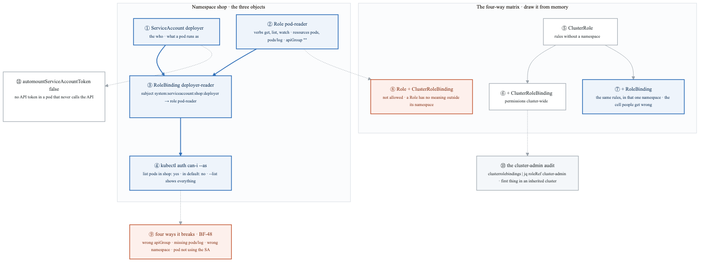

<details>
<summary>Diagram source (Mermaid)</summary>

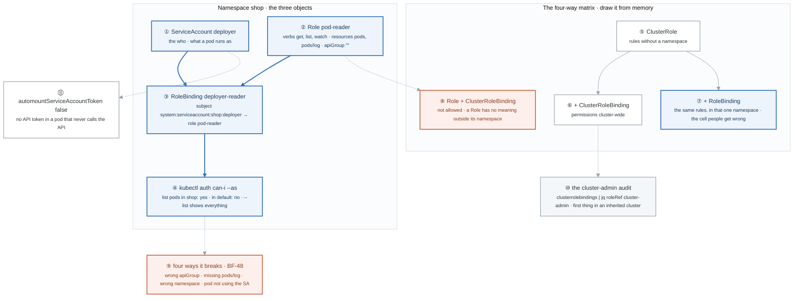

</details>

### Say it, badge by badge

- **Open.** "RBAC is three objects and one matrix. The three objects answer who, what, and the binding between them. The matrix is the part interviewers ask about, because one cell of it is counter-intuitive."
- **① ServiceAccount.** "The identity a pod runs as. Pods do not have users; they have a ServiceAccount, and the API server sees it as system:serviceaccount:namespace:name."
- **② Role.** "Verbs on resources in one namespace. Note `pods/log` is a separate sub-resource: reading pods does not let you read their logs. The empty apiGroup is the core group, and getting it wrong is break number one."
- **③ RoleBinding.** "Connects a subject to a role in the binding's namespace. No binding, no permission; a Role alone grants nothing."
- **④ auth can-i.** "Impersonate the ServiceAccount and ask. Yes in shop, no in default, and `--list` prints everything it may do. Test the denied path as carefully as the allowed one."
- **⑤ ClusterRole.** "Rules with no namespace attached. It is needed for cluster-scoped resources like nodes, and reusable across namespaces for everything else."
- **⑥ ClusterRoleBinding.** "Binds a ClusterRole everywhere. This is how cluster-admin is granted, and the next badge but one is how you find out who has it."
- **⑦ ClusterRole plus RoleBinding.** "The same ClusterRole, bound with a RoleBinding, grants its rules in that one namespace only. That cell exists so one reusable rule set can be scoped per namespace, and it is the cell people say is cluster-wide."
- **⑧ Role plus ClusterRoleBinding.** "Not allowed. A Role has no meaning outside its namespace, so there is nothing to bind cluster-wide."
- **⑨ four ways it breaks.** "Wrong apiGroup, missing sub-resource, wrong namespace, or the pod is not actually using the ServiceAccount. The Forbidden error names who, verb, resource, apiGroup and namespace; read it before you touch anything. BF-48."
- **⑩ the cluster-admin audit.** "Every ClusterRoleBinding whose roleRef is cluster-admin, with its subjects. One jq query, and it is the first thing you run in a cluster you inherited."
- **⑪ automountServiceAccountToken false.** "A pod that never calls the API should not carry a token that could. Switch it off on the ServiceAccount or the pod; it is one line and it removes a whole class of lateral movement."
- **Close.** "Who, what, binding. ClusterRole plus RoleBinding is namespaced, Role plus ClusterRoleBinding does not exist. Test with can-i, audit cluster-admin, and stop mounting tokens nobody uses."

### Numbers to own

| Number | Where it comes from | Why it matters |
|---|---|---|
| 3 verbs | `get,list,watch` | the read-only set; `watch` is what controllers and `-w` need |
| 2 resources | `pods,pods/log` | the sub-resource is separate; forgetting it is break number two |
| 4 cells | the matrix | Role+RB namespaced · ClusterRole+CRB cluster-wide · ClusterRole+RB that namespace · Role+CRB not allowed |
| 4 ways it breaks | BF-48 | apiGroup · sub-resource · namespace · the pod's SA |
| 5 fields in a Forbidden error | the error text | who · verb · resource · apiGroup · namespace |
| 1 audit query | task 4 | every binding to cluster-admin, with subjects |

### Prove it

```bash
kubectl auth can-i list pods --as=system:serviceaccount:shop:deployer -n shop      # ④ yes
kubectl auth can-i list pods --as=system:serviceaccount:shop:deployer -n default   # ④ no
kubectl auth can-i --list --as=system:serviceaccount:shop:deployer -n shop         # ④ everything it may do
kubectl get clusterrolebindings -o json | jq -r '.items[] | select(.roleRef.name=="cluster-admin") | .metadata.name'   # ⑩
```

### The question a senior interviewer asks

*"What does binding a ClusterRole with a RoleBinding grant, and why does that combination exist?"*
Badge ⑦. The ClusterRole's rules, in the binding's namespace only. It exists so a single reusable rule set, like "read everything", can be handed out per namespace without copying it into a Role each time. The trap answer is "cluster-wide", and the follow-up is badge ⑧: the reverse combination is not allowed.

---

## Figure 15.6 — Lab 5: the Gate 4 set, symptom to fault

> Lab 5 · badges ① to ⑦ · about two minutes. The method itself is
> [Figure BF.0](../../_shared/breakfix/FIGURE.md); this figure is the five faults `break.sh` injects.

<!-- figure: generated from the Mermaid below by _shared/diagrams/embed-figures.py — do not edit the image -->
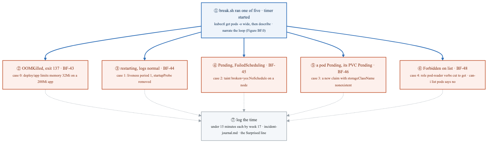

<details>
<summary>Diagram source (Mermaid)</summary>

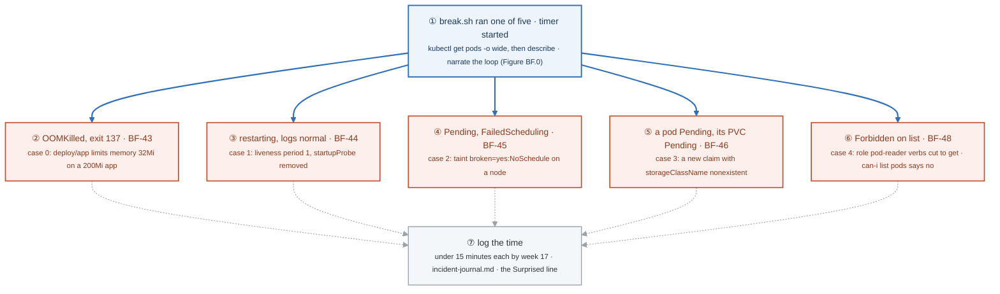

</details>

### Say it, badge by badge

- **Open.** "Five faults, one script, a partner who does not tell you which. By week 17 each one takes under fifteen minutes, narrated. This figure is the map from the first thing you see to the thing that was changed."
- **① the script ran.** "Start the timer, say the symptom, and run `get pods -o wide` then `describe`. The events tell you which of the five branches you are on before you form a hypothesis."
- **② OOMKilled.** "Exit 137 in lastState, reason OOMKilled. The limit was set to 32Mi on an app that needs 200Mi. The fix is the limit; the prevention is a limit chosen from measurement, figure 15.2."
- **③ restarting, logs normal.** "Liveness probe failed in the events, nothing wrong in the logs. The period was set to 1 and the startup probe removed, so the kubelet kills the app before it boots. Figure 15.2, badge ⑨."
- **④ Pending, FailedScheduling.** "The event says untolerated taint, verbatim. A node was tainted broken=yes:NoSchedule. `describe node | grep Taints` confirms, and the fix is to remove it or tolerate it. Figure 15.3."
- **⑤ PVC Pending.** "A pod is Pending because its claim is Pending because the class is named nonexistent and no provisioner answers to it. `describe pvc` names the missing class. The script creates a fresh claim, because a StatefulSet's volumeClaimTemplates are immutable. Figure 15.4, badge ③."
- **⑥ Forbidden on list.** "Pods are Running and the app is fine, but the deployer ServiceAccount gets Forbidden on list. The role's verbs were cut to get only. `auth can-i list pods --as=system:serviceaccount:shop:deployer` says no, and the Forbidden message names verb, resource and namespace. Figure 15.5, badge ⑨."
- **⑦ log the time.** "Every run goes in the incident journal with the minutes it took and the Surprised line. The number trending down across five runs is the Gate 4 evidence."
- **Close.** "Describe first. Exit code, probe event, scheduling event, claim event, Forbidden. Five branches, five first commands, and by week 17 none of them takes more than fifteen minutes."

### Numbers to own

| Number | Where it comes from | Why it matters |
|---|---|---|
| 5 scenarios | the Gate 4 set | BF-43 · BF-44 · BF-45 · BF-46 · BF-48 |
| 15 minutes | the target by week 17 | consistently, narrated, unaided |
| `32Mi` on a 200Mi app | case 0 | an OOM kill you can predict from the numbers |
| `periodSeconds: 1`, no startupProbe | case 1 | a liveness loop with clean logs |
| `broken=yes:NoSchedule` | case 2 | the taint `describe pod` quotes verbatim |
| `storageClassName: nonexistent` | case 3 | a new claim with no provisioner; the StatefulSet's template cannot be patched |
| verbs `[get]` on `pod-reader` | case 4 | list and watch gone; the pods were never the problem |

### Prove it

```bash
kubectl get pods -o wide -A | grep -v Running                              # ① which branch
kubectl -n shop get pod -l app=app -o jsonpath='{.items[0].status.containerStatuses[0].lastState.terminated.reason}'   # ② OOMKilled
kubectl describe node $(kubectl get nodes -o name | tail -1 | cut -d/ -f2) | grep Taints    # ④
kubectl -n shop describe pvc | grep -A3 Events                               # ⑤
kubectl auth can-i list pods --as=system:serviceaccount:shop:deployer -n shop   # ⑥ no
```

### The question a senior interviewer asks

*"A pod is restarting every few seconds and its logs look completely normal. What is killing it, and how do you prove it?"*
Badge ③. Something external: the liveness probe. `describe pod` shows Liveness probe failed and the restart count climbing; the logs are normal because the app did nothing wrong. The proof is the event; the fix is a startup probe or a realistic initial delay.

---

## Figure 15.7 — Lab 6: a chart to a release, revision by revision

> Lab 6 · badges ① to ⑩ · about three minutes.

<!-- figure: generated from the Mermaid below by _shared/diagrams/embed-figures.py — do not edit the image -->
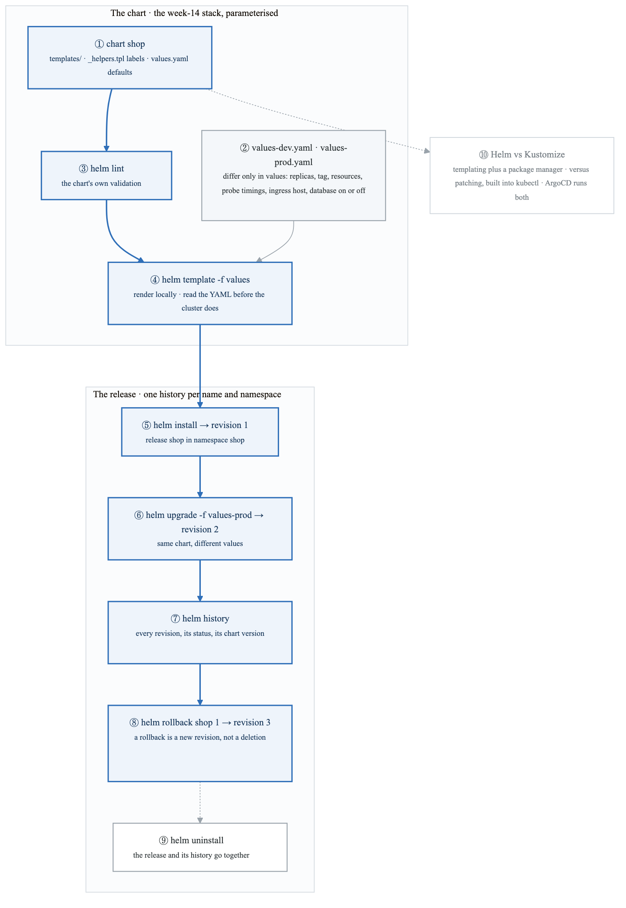

<details>
<summary>Diagram source (Mermaid)</summary>

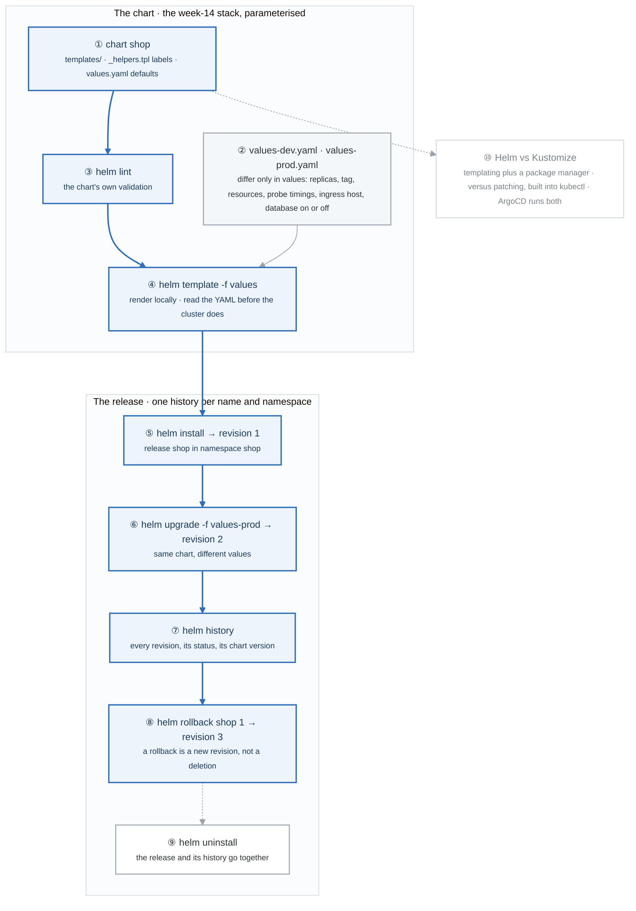

</details>

### Say it, badge by badge

- **Open.** "A chart is templates plus defaults; a release is one installation of it with a numbered history. The blue path is a chart becoming revision 3 of a release. Everything in it is the week-11 dev-prod discipline, applied to manifests."
- **① chart.** "`helm create` gives the skeleton. The templates are the week-14 stack with values substituted in, and `_helpers.tpl` holds the label block every object shares, so a release is findable by instance and version."
- **② values files.** "Dev and prod differ only in values: replicas, image tag, resources, probe timings, ingress host, and whether the database is enabled. If a template has to change between environments, the chart is wrong."
- **③ helm lint.** "Catches a malformed chart before anything touches the cluster. Cheap, so it runs first."
- **④ helm template.** "Renders the chart with a values file to plain YAML on your terminal. Read it. A chart you cannot read rendered is a chart you cannot debug."
- **⑤ helm install.** "Creates release revision 1 in the namespace. Helm records the rendered manifest and the values with the release, which is what makes everything after this possible."
- **⑥ helm upgrade.** "Same chart, the prod values: revision 2. Helm diffs the recorded manifest against the new one and applies the difference."
- **⑦ helm history.** "The list of revisions with status and chart version. It is the audit trail of the release, and it is per release name per namespace."
- **⑧ helm rollback.** "Rolling back to revision 1 produces revision 3 with revision 1's manifest. Nothing is deleted from the history; a rollback is just another forward step. That is why the history keeps growing and why it is safe."
- **⑨ helm uninstall.** "Removes the resources and the release history together. It is the only step on this figure that forgets."
- **⑩ Helm vs Kustomize.** "Helm is templating with a package manager: versions, dependencies, a registry, rollback. Kustomize is patching with no template language, built into kubectl. Helm for software you consume, either for your own manifests. ArgoCD, next week, runs both."
- **Close.** "Chart, values, lint, render, install, upgrade, history, rollback. Two values files, one chart, and a history that only moves forward."

### Numbers to own

| Number | Where it comes from | Why it matters |
|---|---|---|
| 6 things values must control | the task | replicas · image tag · resources · probe timings · ingress host · database enabled |
| 2 values files | the task | dev and prod, differing only in values; the week-11 split again |
| revision 1, 2, 3 | install, upgrade, rollback | a rollback is a new revision; the history never shrinks |
| 4 labels in `shop.labels` | `_helpers.tpl` | name · instance · version · managed-by; the standard set every object carries |
| `helm rollback shop 1` | the lab | the argument is the target revision, not how many steps back |

### Prove it

```bash
helm template shop -f values-dev.yaml | grep -c '^kind:'        # ④ how many objects the chart renders
helm install shop ./shop -n shop --create-namespace -f values-dev.yaml && helm history shop -n shop   # ⑤ ⑦ revision 1
helm upgrade shop ./shop -n shop -f values-prod.yaml && helm rollback shop 1 -n shop && helm history shop -n shop   # ⑥ ⑧ revisions 2 and 3
diff values-dev.yaml values-prod.yaml                             # ② only values differ
```

**CKA thread.** The lab now adds the same stack as Kustomize overlays, one strategic-merge patch and one JSON patch, applied with `kubectl apply -k`. The exam asks for both tools; week 28 Lab 1 does both timed.

### The question a senior interviewer asks

*"Helm or Kustomize for your own services, and why?"*
Badge ⑩, then a decision rather than a definition. Helm when you need versions, dependencies and a rollback history; Kustomize when the manifests are yours and the only difference between environments is a patch. Either is defensible; "we use Helm because everyone does" is not. The follow-up is badge ⑧: explain what `helm rollback` actually writes.

---

## Figure 15.8 — Go deeper: the scheduler, plugin by plugin

> Go deeper lab · badges ① to ⑩ · about three minutes. The scheduler is a queue and two phases; everything you configured in Lab 2 is a plugin in one of them.

<!-- figure: generated from the Mermaid below by _shared/diagrams/embed-figures.py — do not edit the image -->
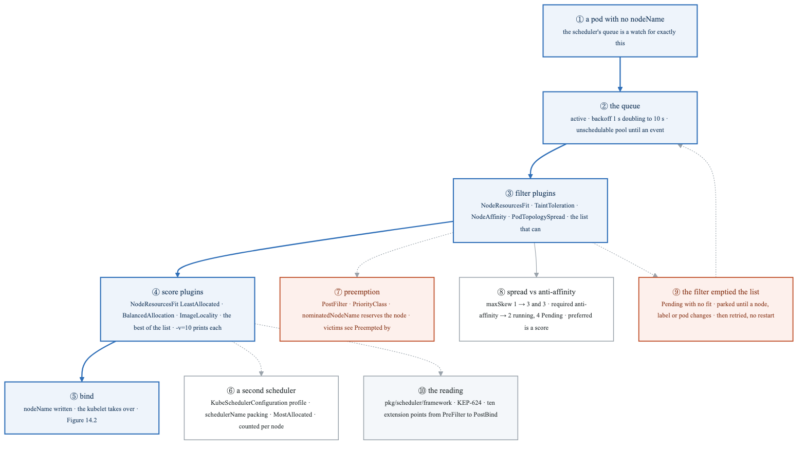

<details>
<summary>Diagram source (Mermaid)</summary>

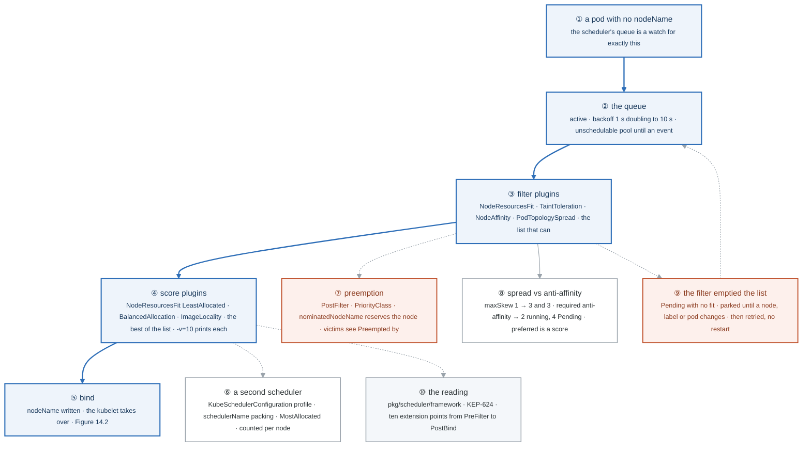

</details>

### Say it, badge by badge

- **Open.** "Lab 2 asked the scheduler for things. This lab reads how it answers: a queue, a filter phase that produces a list, a score phase that picks from it, and a bind. Every placement rule you know is a plugin in one of those two phases."
- **① a pod with no nodeName.** "That is the whole trigger. The scheduler watches for pods whose nodeName is empty; nothing else in the cluster asks it to do anything."
- **② the queue.** "Three pools. Active: try it now. Backoff: it failed, wait one second, then two, up to ten. Unschedulable: no node fits, so park it until something in the cluster changes that could matter."
- **③ filter plugins.** "Each plugin removes nodes: not enough allocatable, a taint without a toleration, an affinity rule unmet, a spread constraint that would be violated. What survives is the feasible list. The control plane node was never in it; TaintToleration took it out."
- **④ score plugins.** "Each plugin scores every feasible node, weighted and summed. NodeResourcesFit's strategy decides whether you spread or pack; ImageLocality prefers nodes that already have the image. At `-v=10` the log prints every score, and you can see why a node won."
- **⑤ bind.** "The scheduler writes nodeName. That is its only write, and it is the handoff to Figure 14.2, badge ⑤."
- **⑥ a second scheduler.** "A profile with a different name, one plugin disabled, MostAllocated instead of LeastAllocated, running as a Deployment with its own RBAC. Pods choose it by schedulerName. Six pods, three per scheduler, counted per node, show the two opinions."
- **⑦ preemption.** "A PostFilter plugin: when the filter list is empty, find a node where evicting lower-priority pods would make room, write nominatedNodeName so nobody else takes the space, delete the victims. The victim's event says who preempted it. Priority is the only input."
- **⑧ spread versus anti-affinity.** "Spread bounds the imbalance: maxSkew 1 across two workers gives three and three. Required anti-affinity forbids co-location and will leave four of six Pending on two nodes. Preferred is a score and bends. Across zones the first is almost always the one you want."
- **⑨ the filter emptied the list.** "No fit means Pending, not a loop. The pod sits in the unschedulable pool until a node joins, a label changes, or a pod leaves, then it is retried. Label the node and it binds in seconds with nothing restarted."
- **⑩ the reading.** "The scheduling framework: ten extension points from PreFilter to PostBind, every rule a plugin, the code under pkg/scheduler/framework. Read it once and 'the scheduler decided' stops being a sentence you say about a black box."
- **Close.** "Queue, filter, score, bind. Taints, affinity, spread and priority are plugins; a second scheduler is a profile; a Pending pod is a parked one. Say that and the scheduler is a thing you can modify, not just ask."

### Numbers to own

| Number | Where it comes from | Why it matters |
|---|---|---|
| 2 phases | the framework | filter produces the list, score picks from it |
| 10 extension points | PreFilter · Filter · PostFilter · PreScore · Score · Reserve · Permit · PreBind · Bind · PostBind | where a plugin can act; preemption is PostFilter |
| 1 s → 10 s | `podInitialBackoffSeconds`, `podMaxBackoffSeconds` | the retry backoff for a pod that failed to schedule |
| `-v=10` | the scheduler's log level | the only level that prints per-plugin, per-node scores |
| 3 and 3 | six replicas, `maxSkew: 1`, two workers | what a spread constraint produces |
| 2 running, 4 Pending | required anti-affinity on two workers | required means required |
| 1000000 | the PriorityClass value | large enough to outrank anything the week created |
| `nominatedNodeName` | the preempting pod's status | the reservation that stops a third pod stealing the freed space |

### Prove it

```bash
kubectl -n kube-system logs -l component=kube-scheduler --tail=2000 | grep 'Plugin scored node' | grep scored | head   # ④
kubectl get pods -o custom-columns='NAME:.metadata.name,SCHED:.spec.schedulerName,NODE:.spec.nodeName'                  # ⑥
kubectl get pod vip -o jsonpath='{.status.nominatedNodeName}{"\n"}'                                                   # ⑦
kubectl get events --sort-by=.lastTimestamp | grep Preempted | tail -2                                                 # ⑦
kubectl get pods -l app=spread -o jsonpath='{range .items[*]}{.spec.nodeName}{"\n"}{end}' | sort | uniq -c             # ⑧
kubectl label node mastery-worker2 disk=nvme && kubectl get pod stuck -o wide                                          # ⑨
```

### The question a senior interviewer asks

*"Your cluster autoscaler never scales down, even at night. What scheduler setting is fighting it, and what would you change?"*
Badges ④ and ⑥. The default LeastAllocated strategy spreads pods thinly across every node, so no node is ever empty enough to remove. A profile with MostAllocated packs them, and the autoscaler can drain and delete the empty ones. Then the follow-up you should raise yourself: packing concentrates blast radius, so pair it with spread constraints across zones for the tiers that need to survive a node loss.

---

## Redraw schedule

Same cadence as the week figure, see [`../../FIGURES.md`](../../FIGURES.md): Friday of this week after break/fix, and cold at the Gate 4 Sunday in week 17, which also serves as the two-week redraw. Lab figures are redrawn **after** the week figure, one at a time, and only the badge order has to be right; the captions are the check, not the test.
