# Week 16 — EKS and GitOps with ArgoCD

> **Thesis:** managed Kubernetes on AWS, and declarative delivery. IRSA is the week's centerpiece —
> it is the Kubernetes answer to the same question IMDSv2 answered in week 5: *how does a workload
> get cloud credentials without a credential?*

| | |
|---|---|
| **Hours** | 35–45 (incl. ~4h job search) |
| **Deliverable** | Blog post #9 — "IRSA explained: how a pod gets AWS credentials without any credentials" |
| **★ COST WEEK** | **EKS bills per hour. `terraform destroy` EVERY night. No exceptions.** |

> ## Cost discipline
> An EKS control plane is roughly **$0.10/hour = $73/month**, plus nodes, plus the ALB. Two
> deliberate weeks (16 and 19) with nightly teardown costs perhaps $15 total. Leaving one cluster
> running for the rest of the program costs several hundred dollars.
> ```bash
> bash ../_setup/03-teardown.sh     # every single night
> ```

## The week in one figure

**Figure 16.1 — IRSA: how a pod gets AWS credentials without any credentials.** The week-5 question again, how does a workload get cloud credentials without holding one, answered for a pod. The blue path is a token exchange. ArgoCD and the cost rule sit beside it. Badges are numbered in the order to walk them; the blue path is the one to follow first.

```mermaid
%%{init: {'theme':'base','themeVariables':{'fontFamily':'Helvetica, Arial, sans-serif','fontSize':'13px','primaryColor':'#ffffff','primaryTextColor':'#2d3436','primaryBorderColor':'#9aa3ab','lineColor':'#9aa3ab','textColor':'#2d3436','clusterBkg':'#fbfcfd','clusterBorder':'#d4dae0','edgeLabelBackground':'#ffffff','tertiaryColor':'#eef4fb'},'flowchart':{'curve':'basis','padding':14,'nodeSpacing':42,'rankSpacing':58}}}%%
flowchart LR
  classDef default fill:#ffffff,stroke:#9aa3ab,stroke-width:1.3px,color:#2d3436
  classDef n    fill:#ffffff,stroke:#9aa3ab,stroke-width:1.3px,color:#2d3436
  classDef crit fill:#eef4fb,stroke:#2f6fb8,stroke-width:1.8px,color:#1b3a5c
  classDef data fill:#f4f7fa,stroke:#9aa3ab,stroke-width:1.3px,color:#2d3436
  classDef mut  fill:#ffffff,stroke:#cfd6dc,stroke-width:1.1px,color:#7a8288
  classDef warn fill:#fdf0ec,stroke:#c0522d,stroke-width:1.6px,color:#8a3a1e

  SA["① ServiceAccount<br/><small>annotation: eks.amazonaws.com/role-arn</small>"]:::crit
  WH["② pod identity webhook<br/><small>mutating admission · injects a token volume + two env vars</small>"]:::crit
  TOK["③ projected SA token<br/><small>signed by the cluster · aud sts.amazonaws.com · 86400 s · sub system:serviceaccount:ns:name</small>"]:::data
  OIDC["④ cluster OIDC issuer<br/><small>public discovery URL · publishes the signing keys</small>"]:::n
  IDP["⑤ IAM OIDC provider<br/><small>trusts this cluster's issuer</small>"]:::crit
  SDK["⑥ SDK in the pod<br/><small>AWS_ROLE_ARN · AWS_WEB_IDENTITY_TOKEN_FILE · nothing else</small>"]:::crit
  STS["⑦ AssumeRoleWithWebIdentity<br/><small>signature via discovery · trust policy matches sub</small>"]:::crit
  CRED["⑧ temporary credentials<br/><small>scoped to one role · rotated by the SDK</small>"]:::crit
  S3["⑨ one S3 bucket<br/><small>the role allows this bucket, nothing else</small>"]:::data
  BRK["⑩ four ways it breaks<br/><small>wrong sub in trust · missing annotation · wrong audience · provider not created</small>"]:::warn
  ARGO["⑪ ArgoCD<br/><small>pull-based · app-of-apps · sync within 3 min · selfHeal reverts manual change</small>"]:::n
  COST["⑫ cost rule<br/><small>control plane $0.10/h ≈ $73/mo · destroy every night</small>"]:::warn
  SA ==> WH ==> TOK ==> SDK ==> STS ==> CRED ==> S3
  OIDC --> IDP --> STS
  STS -.-> BRK
  ARGO -.-> SA
  COST -.-> ARGO
  linkStyle 0,1,2,3,4,5 stroke:#2f6fb8,stroke-width:2px
```



**What to say, badge by badge** · about four minutes at a normal pace. Point at each badge as you say its line.

- **Open.** “A pod reads an S3 bucket with no credentials mounted anywhere, and you can explain every hop. That sentence is the exit criterion and the blog post. Week 5 answered it for an instance, week 12 for a workflow. Same shape, third time.”
- **① ServiceAccount.** “A Kubernetes ServiceAccount with one annotation: the ARN of the IAM role it may become. The annotation is a request, not a grant; AWS decides later.”
- **② pod identity webhook.** “A mutating admission webhook sees a pod using that ServiceAccount and injects two things: a projected volume holding a token, and two environment variables naming the role and the token file. The pod spec you wrote did not have them; the one that runs does.”
- **③ projected SA token.** “The API server signs a short-lived JWT for the ServiceAccount: audience sts.amazonaws.com, subject system:serviceaccount, the namespace, and the name, expiring in a day. It is mounted as a file and refreshed before expiry.”
- **④ cluster OIDC issuer.** “Every EKS cluster has a public OIDC discovery URL that publishes the keys the tokens are signed with. That URL is what lets AWS verify a token it did not issue.”
- **⑤ IAM OIDC provider.** “In IAM, an identity provider pointing at the cluster's issuer. One per cluster. Forget to create it and badge 7 fails with an error that names nothing useful; that is one of the four breaks.”
- **⑥ SDK in the pod.** “The SDK's credential chain finds AWS_ROLE_ARN and AWS_WEB_IDENTITY_TOKEN_FILE and knows what to do. Nothing in the container image, nothing in a Secret. `env` inside the pod shows exactly two variables.”
- **⑦ AssumeRoleWithWebIdentity.** “STS fetches the signing keys from the discovery URL, verifies the token, then evaluates the role's trust policy against the claims. The condition is on `sub`: this namespace, this ServiceAccount. A wildcard here is the same mistake as week 12's wildcard branch.”
- **⑧ temporary credentials.** “Scoped to the one role, expiring in an hour, refreshed by the SDK automatically. `aws sts get-caller-identity` from inside the pod shows assumed-role and the role name.”
- **⑨ one S3 bucket.** “The role allows one bucket. The pod can list it and read it, and a second bucket returns AccessDenied. Least privilege is the proof, not the policy.”
- **⑩ four ways it breaks.** “Wrong subject in the trust policy, missing annotation on the ServiceAccount, wrong audience on the token, OIDC provider never created. Break each one on purpose and note what the error looks like; three of the four errors are unhelpful.”
- **⑪ ArgoCD.** “Pull-based delivery: ArgoCD watches Git and makes the cluster match. App-of-apps means one application that declares the others. A Git change syncs within three minutes, and selfHeal reverts a manual kubectl edit, which you demonstrate.”
- **⑫ cost rule.** “The control plane alone is about ten cents an hour, seventy-three dollars a month, before nodes and the load balancer. Two deliberate weeks with nightly teardown cost about fifteen dollars total. Run the teardown script every night this week.”
- **Close.** “Annotation, injection, token, exchange, credentials. The pod is who it is, and AWS believes it because of a signature, not a secret. Sunday: destroy everything and check the bill.”

---

## Day plan
| Day | Focus | Lab |
|---|---|---|
| Mon | EKS via Terraform: cluster, node groups, access entries | Lab 1 |
| Tue | **IRSA** — the mechanism, end to end | Lab 2 |
| Wed | AWS Load Balancer Controller, External Secrets, EBS CSI | Lab 3 |
| Thu | ArgoCD: apps, app-of-apps, sync waves, drift | Lab 4 |
| Fri | Break/Fix + cost review | Lab 5 |
| Sat | Deploy the week-14/15 stack to EKS via ArgoCD; 15 applications | — |
| Sun | Blog post #9; **destroy everything**; plan week 17 | — |

## Reading map
- `_reference/kubernetes/04-platform/01-gitops-argocd-README.md`
- `_reference/kubernetes/04-platform/01-gitops-argocd-exercises-01-argocd-setup.md`
- `_reference/kubernetes/04-platform/01-gitops-argocd-exercises-02-app-of-apps.md`
- `_reference/kubernetes/04-platform/01-gitops-argocd-exercises-03-applicationsets.md`
- `_reference/kubernetes/03-production/02-security-rbac-exercises-07-workload-identity.md`
- `_reference/kubernetes/02-core-ops/03-configuration-secrets-exercises-03-secrets-management.md`
- `_reference/cicd-gitops/argocd/ARGOCD_MASTERY_ROADMAP.md`
- `_reference/cicd-gitops/argocd/phase-4-sync-lifecycle-README.md`
- `_reference/devsecops/implementation/cross-cutting-secret-management.md`

## Labs
[labs/LABS.md](labs/LABS.md) · [solutions/SOLUTIONS.md](solutions/SOLUTIONS.md)

## Exit criteria
- [ ] EKS provisioned by Terraform, destroyed and re-created at least twice
- [ ] A pod reading a specific S3 bucket with **no credentials mounted** — and you can explain the
      full token exchange
- [ ] ALB provisioned by an Ingress resource via the AWS Load Balancer Controller
- [ ] External Secrets pulling from AWS Secrets Manager into a Kubernetes Secret
- [ ] ArgoCD app-of-apps deployed; a Git change syncs within 3 minutes
- [ ] A manual cluster change **reverts automatically**
- [ ] **Everything destroyed; bill checked**
