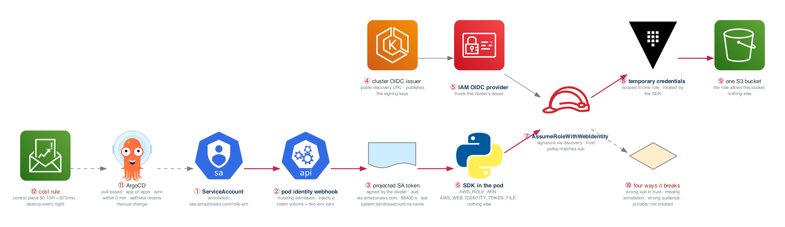

# Figure 16.1 — IRSA: how a pod gets AWS credentials without any credentials

> Week 16 · badges ① to ⑫ · about four minutes at a normal pace. Point at each badge as you say its line. Blue is the path to follow first; orange-red is where something refuses or fails.



The week-5 question again, how does a workload get cloud credentials without holding one, answered for a pod. The blue path is a token exchange. ArgoCD and the cost rule sit beside it.

## What to say, badge by badge

- **Open.** “A pod reads an S3 bucket with no credentials mounted anywhere, and you can explain every hop. That sentence is the exit criterion and the blog post. Week 5 answered it for an instance, week 12 for a workflow. Same shape, third time.”
- **① ServiceAccount.** “A Kubernetes ServiceAccount with one annotation: the ARN of the IAM role it may become. The annotation is a request, not a grant; AWS decides later.”
- **② pod identity webhook.** “A mutating admission webhook sees a pod using that ServiceAccount and injects two things: a projected volume holding a token, and two environment variables naming the role and the token file. The pod spec you wrote did not have them; the one that runs does.”
- **③ projected SA token.** “The API server signs a short-lived JWT for the ServiceAccount: audience sts.amazonaws.com, subject system:serviceaccount, the namespace, and the name, expiring in a day. It is mounted as a file and refreshed before expiry.”
- **④ cluster OIDC issuer.** “Every EKS cluster has a public OIDC discovery URL that publishes the keys the tokens are signed with. That URL is what lets AWS verify a token it did not issue.”
- **⑤ IAM OIDC provider.** “In IAM, an identity provider pointing at the cluster's issuer. One per cluster. Forget to create it and badge 7 fails with an error that names nothing useful; that is one of the four breaks.”
- **⑥ SDK in the pod.** “The SDK's credential chain finds AWS_ROLE_ARN and AWS_WEB_IDENTITY_TOKEN_FILE and knows what to do. Nothing in the container image, nothing in a Secret. `env` inside the pod shows exactly two variables.”
- **⑦ AssumeRoleWithWebIdentity.** “STS fetches the signing keys from the discovery URL, verifies the token, then evaluates the role's trust policy against the claims. The condition is on `sub`: this namespace, this ServiceAccount. A wildcard here is the same mistake as week 12's wildcard branch.”
- **⑧ temporary credentials.** “Scoped to the one role, expiring in an hour, refreshed by the SDK automatically. `aws sts get-caller-identity` from inside the pod shows assumed-role and the role name.”
- **⑨ one S3 bucket.** “The role allows one bucket. The pod can list it and read it, and a second bucket returns AccessDenied. Least privilege is the proof, not the policy.”
- **⑩ four ways it breaks.** “Wrong subject in the trust policy, missing annotation on the ServiceAccount, wrong audience on the token, OIDC provider never created. Break each one on purpose and note what the error looks like; three of the four errors are unhelpful.”
- **⑪ ArgoCD.** “Pull-based delivery: ArgoCD watches Git and makes the cluster match. App-of-apps means one application that declares the others. A Git change syncs within three minutes, and selfHeal reverts a manual kubectl edit, which you demonstrate.”
- **⑫ cost rule.** “The control plane alone is about ten cents an hour, seventy-three dollars a month, before nodes and the load balancer. Two deliberate weeks with nightly teardown cost about fifteen dollars total. Run the teardown script every night this week.”
- **Close.** “Annotation, injection, token, exchange, credentials. The pod is who it is, and AWS believes it because of a signature, not a secret. Sunday: destroy everything and check the bill.”

## Use it

- Read the figure before the day plan. Say the script out loud on Friday with the file closed.
- Each badge line is a thirty-second interview answer; the whole script is the three-minute version.
- Regenerate after editing the spec in `_shared/diagrams/week_figures/`:

```bash
python3 ../../_shared/diagrams/generate-week-figures.py --only 16
```
