# Week 16 — Lab figures

> One figure per lab, numbered 16.2 to 16.7. Figure 16.1 is the week figure in
> [`../content/FIGURE.md`](../content/FIGURE.md); these five go one level down, to the mechanism each
> lab makes you touch. Same language: gray is structure, **blue is the path to follow first**,
> orange-red is where something refuses, washed boxes are stores. Each badge line is a thirty-second
> interview answer; each whole script is under three minutes.

**The protocol per figure**

1. **Before the lab:** read the figure, say the badges out loud once. You now know what you are about to prove.
2. **During the lab:** every badge has a **Prove it** command. Run it and watch the badge happen. A badge you cannot see happen is one you are taking on faith.
3. **After the lab:** close the file, redraw the figure, say the script. Check against the file. The badge where the order slipped goes in the *Figures redrawn* column of `progress.md`.
4. **Own the numbers.** The *Numbers to own* table is what separates "I know EKS" from "the token's sub claim is system:serviceaccount:shop:s3-reader and the trust policy checks exactly that string."
5. **Answer the question.** Each figure ends with the question a senior interviewer asks about it. Answer it cold, in under a minute, before the gate.

---

## Figure 16.2 — Lab 1: what the EKS module creates, and what it costs

> Lab 1 · badges ① to ⑨ · about three minutes.

<!-- figure: generated from the Mermaid below by _shared/diagrams/embed-figures.py — do not edit the image -->
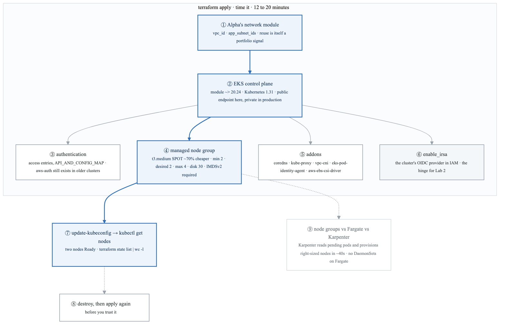

<details>
<summary>Diagram source (Mermaid)</summary>

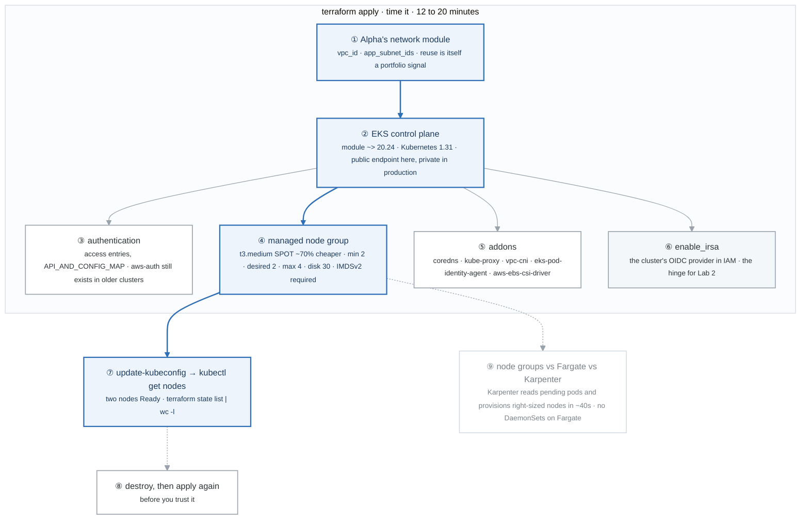

</details>

### Say it, badge by badge

- **Open.** "One module call, about fifteen minutes, and a managed cluster in the network you built in week 10. The blue path is what you wait for; the gray boxes are what the module quietly created alongside, and one of them is the whole point of Lab 2."
- **① Alpha's network module.** "The cluster takes a VPC ID and the app subnet IDs from the module you wrote in month 3. The subnets already carry the load-balancer tags Lab 3 needs. Reusing your own module in a second project is what a reviewer notices."
- **② EKS control plane.** "AWS runs the API server, etcd and the controllers; you never see those pods. The apply takes 12 to 20 minutes and the control plane is most of it. The endpoint is public in the lab; in production it is private, reached through a VPN or a bastion."
- **③ authentication.** "Who may talk to the API server. Access entries are the current mechanism; the aws-auth ConfigMap is the old one, and you will meet it in any cluster older than about 2024. The module turns on both and makes the creator an admin."
- **④ managed node group.** "Two t3.medium Spot instances, growing to four, 30 GB disks. Spot is roughly 70 percent cheaper and teaches interruption handling for free. Look at the launch template: HttpTokens required is IMDSv2 from week 5."
- **⑤ addons.** "CoreDNS, kube-proxy and the VPC CNI are the cluster's networking. The EBS CSI driver is what makes a PersistentVolumeClaim become a disk. The pod-identity agent is the alternative to IRSA."
- **⑥ enable_irsa.** "One flag, and the module registers the cluster's OIDC issuer as an identity provider in IAM. Nothing uses it yet. Lab 2 is entirely about what this makes possible."
- **⑦ kubeconfig.** "`update-kubeconfig` writes the cluster into your kubeconfig with an exec plugin that mints a token from your AWS identity. `get nodes` shows two Ready. Count the state entries to see how much one module call made."
- **⑧ destroy and apply again.** "A cluster you have only built once is a cluster you cannot rebuild. Destroy it and bring it back before you put anything on it."
- **⑨ node groups, Fargate, Karpenter.** "Managed node groups scale a fixed ASG shape. Fargate runs each pod on its own capacity, with no DaemonSets. Karpenter looks at pending pods and provisions instances that fit them, in about 40 seconds, and is the current best practice for variable load. Use the node group here, name Karpenter in the interview."
- **Close.** "Network in, control plane, nodes, addons, an OIDC provider, a kubeconfig. Fifteen minutes to build, and the one you should rebuild once before trusting."

### Numbers to own

| Number | Where it comes from | Why it matters |
|---|---|---|
| 12 to 20 minutes | the apply | the control plane dominates; plan the lab around it |
| `~> 20.24`, Kubernetes `1.31` | the module call | the pins a reviewer checks first |
| `t3.medium`, SPOT, 2 / 2 / 4, disk 30 | the node group | roughly 70% cheaper than on-demand; interruption is part of the lesson |
| 5 addons | the module call | coredns · kube-proxy · vpc-cni · pod-identity-agent · ebs-csi |
| ~40 seconds | the Karpenter row | node provisioning from a pending pod, versus an ASG round-trip |
| `HttpTokens: required` | the launch template | IMDSv2, the week-5 control, applied to every node |

### Prove it

```bash
time terraform apply                                                   # ② 12 to 20 minutes
terraform state list | wc -l                                           # ⑦ what one module call created
aws ec2 describe-launch-template-versions --launch-template-id <id> --query 'LaunchTemplateVersions[0].LaunchTemplateData.MetadataOptions'   # ④ HttpTokens required
aws eks describe-cluster --name mastery --query 'cluster.identity.oidc.issuer'   # ⑥ the issuer IRSA trusts
kubectl get nodes                                                      # ⑦ two Ready
```

### The question a senior interviewer asks

*"Why does Karpenter bin-pack better than an ASG-backed node group?"*
Badge ⑨. A node group scales one instance shape up and down; the autoscaler adds a node of that shape whenever pods are pending, whether or not they fit it well. Karpenter reads the pending pods' requests and chooses instance types that fit them, so the fleet matches the workload instead of the other way round. The follow-up is "when would you still use a node group?" and the answer is a stable, predictable baseline.

---

## Figure 16.3 — Lab 2: IRSA, the token's path from webhook to STS

> Lab 2 · badges ① to ⑪ · about three and a half minutes. The week's centerpiece.

<!-- figure: generated from the Mermaid below by _shared/diagrams/embed-figures.py — do not edit the image -->
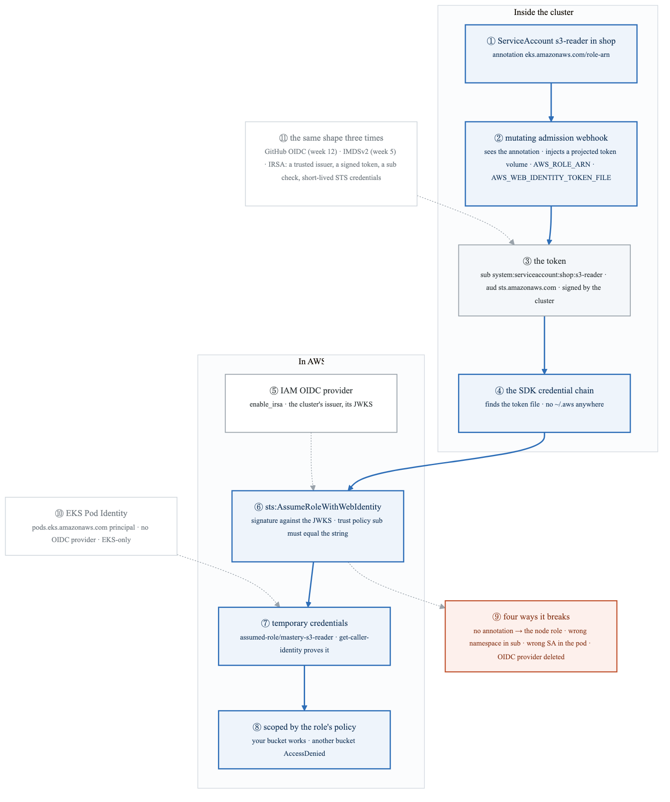

<details>
<summary>Diagram source (Mermaid)</summary>

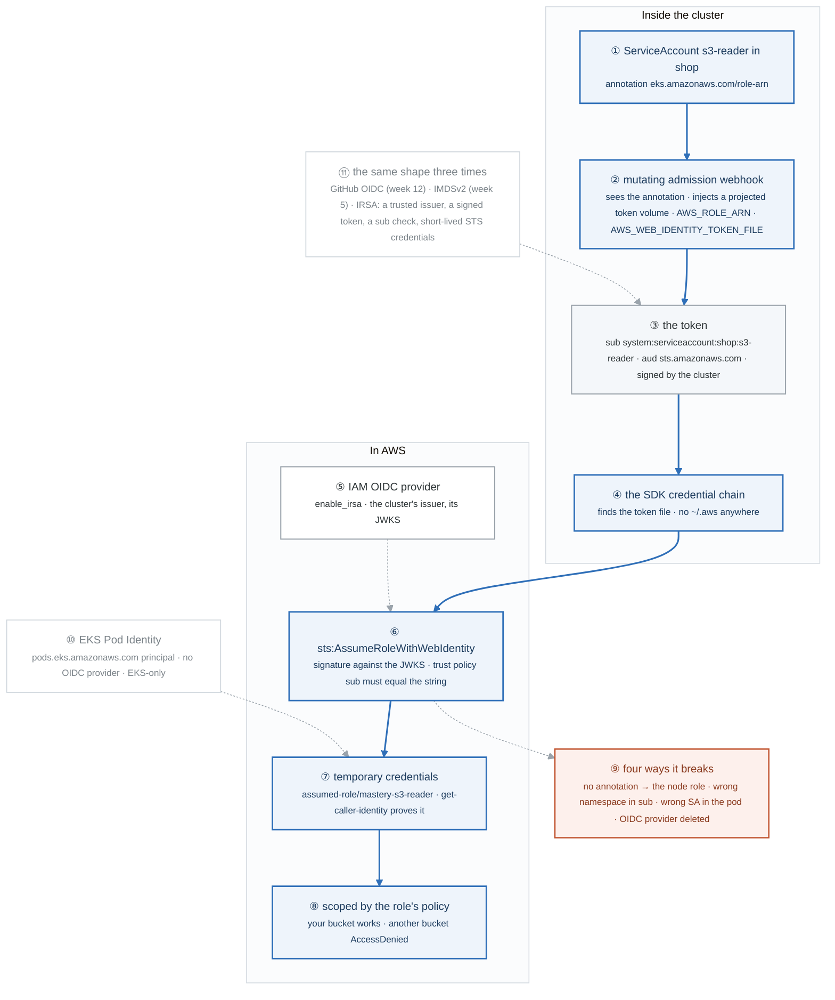

</details>

### Say it, badge by badge

- **Open.** "A pod needs to read one S3 bucket. Without this, it either borrows the node's role, so every pod on the node gets the same access, or it carries a static key in a Secret. IRSA gives the pod its own identity with nothing stored anywhere. Follow the token."
- **① ServiceAccount.** "One annotation: the ARN of the role this ServiceAccount may become. The Terraform module creates the role with a trust policy naming exactly shop:s3-reader."
- **② mutating admission webhook.** "When a pod using that ServiceAccount is created, the webhook mutates it: a projected volume with a signed token, and two environment variables telling the SDK where the token is and which role to ask for. The pod spec you wrote never mentioned any of it."
- **③ the token.** "A JWT signed by the cluster. Decode the middle segment and read it: sub is system:serviceaccount:shop:s3-reader, aud is sts.amazonaws.com. That one line is the moment IRSA stops being magic."
- **④ the SDK credential chain.** "Every AWS SDK walks the same chain: environment keys, shared credentials file, web identity token, instance metadata. It finds AWS_WEB_IDENTITY_TOKEN_FILE and stops there. `ls ~/.aws` prints nothing."
- **⑤ IAM OIDC provider.** "The cluster's issuer, registered in IAM by enable_irsa. It is how STS knows where to fetch the public keys to check the token's signature. Delete it and every IRSA call in the cluster fails at once."
- **⑥ AssumeRoleWithWebIdentity.** "STS verifies the signature against the issuer's JWKS, then evaluates the role's trust policy: the sub claim must equal system:serviceaccount:shop:s3-reader. A different namespace or a different ServiceAccount is a different string, and the assume is denied."
- **⑦ temporary credentials.** "Short-lived keys for the role. `get-caller-identity` shows assumed-role/mastery-s3-reader. They expire and the SDK refreshes them by presenting the token again."
- **⑧ scoped.** "The role's policy allows one bucket. Listing it works; listing any other bucket is AccessDenied. The pod has exactly the access its ServiceAccount was granted and nothing the node has."
- **⑨ four ways it breaks.** "Remove the annotation and the webhook does nothing, so the SDK falls through to the node role; it works, with the wrong identity, which is the dangerous failure. Change the trust policy's namespace, use a different ServiceAccount, or delete the OIDC provider, and you get AccessDenied on the assume."
- **⑩ EKS Pod Identity.** "Same goal, simpler plumbing: an association instead of an annotation, a service-principal trust policy instead of an OIDC sub condition, no per-cluster provider. EKS-only, where IRSA works on any Kubernetes. Know both, mention both."
- **⑪ the same shape three times.** "GitHub OIDC in week 12, IMDSv2 in week 5, IRSA now. A trusted issuer, a signed token, a claim checked by a trust policy, short-lived credentials from STS. Saying that pattern out loud is what makes three labs sound like one understanding."
- **Close.** "Annotate, mutate, sign, present, verify, assume, scope. Nothing is stored and nothing is long-lived. The only credential in the system is a signature AWS can check."

### Numbers to own

| Number | Where it comes from | Why it matters |
|---|---|---|
| `system:serviceaccount:shop:s3-reader` | the token's `sub` claim | the exact string the trust policy compares; namespace and name both matter |
| `sts.amazonaws.com` | the token's `aud` claim | who the token is for; a token for another audience is refused |
| 2 env vars | `AWS_ROLE_ARN`, `AWS_WEB_IDENTITY_TOKEN_FILE` | what the webhook injected and what the SDK reads |
| `/var/run/secrets/eks.amazonaws.com/serviceaccount/token` | the projected volume | where the token lives inside the pod |
| 4 causes of failure | the break section | no annotation · wrong namespace · wrong SA · provider deleted |
| 2 bad options without IRSA | the problem statement | the node role, shared by every pod; or a static key in etcd |
| `~> 5.44` | the IRSA role module | the pin for `iam-role-for-service-accounts-eks` |

### Prove it

```bash
kubectl -n shop run awscli --rm -it --overrides='{"spec":{"serviceAccountName":"s3-reader"}}' --image=amazon/aws-cli -- sh
env | grep AWS                                                            # ② the two injected variables
cat $AWS_WEB_IDENTITY_TOKEN_FILE | cut -d. -f2 | base64 -d 2>/dev/null     # ③ sub and aud
aws sts get-caller-identity                                               # ⑦ assumed-role/mastery-s3-reader
ls ~/.aws 2>/dev/null || echo "NO credentials file"                       # ④ nothing on disk
aws s3 ls s3://some-other-bucket                                          # ⑧ AccessDenied
```

### The question a senior interviewer asks

*"Walk the IRSA token from the webhook to STS, and tell me what it has in common with GitHub Actions OIDC."*
Badges ② to ⑦, then ⑪. The follow-up is badge ⑨: "the pod can suddenly read every bucket in the account; what happened?" The annotation was removed and the SDK fell through to the node role. Working with the wrong identity is the failure that does not page anyone.

---

## Figure 16.4 — Lab 3: two controllers that turn annotations into AWS resources

> Lab 3 · badges ① to ⑧ · about two and a half minutes.

<!-- figure: generated from the Mermaid below by _shared/diagrams/embed-figures.py — do not edit the image -->
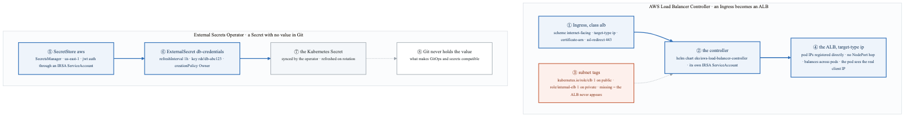

<details>
<summary>Diagram source (Mermaid)</summary>

```mermaid
%%{init: {'theme':'base','themeVariables':{'fontFamily':'Helvetica, Arial, sans-serif','fontSize':'13px','primaryColor':'#ffffff','primaryTextColor':'#2d3436','primaryBorderColor':'#9aa3ab','lineColor':'#9aa3ab','textColor':'#2d3436','clusterBkg':'#fbfcfd','clusterBorder':'#d4dae0','edgeLabelBackground':'#ffffff','tertiaryColor':'#eef4fb'},'flowchart':{'curve':'basis','padding':14,'nodeSpacing':42,'rankSpacing':58}}}%%
flowchart TB
  classDef default fill:#ffffff,stroke:#9aa3ab,stroke-width:1.3px,color:#2d3436
  classDef n    fill:#ffffff,stroke:#9aa3ab,stroke-width:1.3px,color:#2d3436
  classDef crit fill:#eef4fb,stroke:#2f6fb8,stroke-width:1.8px,color:#1b3a5c
  classDef data fill:#f4f7fa,stroke:#9aa3ab,stroke-width:1.3px,color:#2d3436
  classDef mut  fill:#ffffff,stroke:#cfd6dc,stroke-width:1.1px,color:#7a8288
  classDef warn fill:#fdf0ec,stroke:#c0522d,stroke-width:1.6px,color:#8a3a1e

  subgraph LB["AWS Load Balancer Controller · an Ingress becomes an ALB"]
    direction LR
    ING["① Ingress, class alb<br/><small>scheme internet-facing · target-type ip · certificate-arn · ssl-redirect 443</small>"]:::crit
    LBC["② the controller<br/><small>helm chart eks/aws-load-balancer-controller · its own IRSA ServiceAccount</small>"]:::crit
    TAGS["③ subnet tags<br/><small>kubernetes.io/role/elb 1 on public · role/internal-elb 1 on private · missing = the ALB never appears</small>"]:::warn
    ALB["④ the ALB, target-type ip<br/><small>pod IPs registered directly · no NodePort hop · balances across pods · the pod sees the real client IP</small>"]:::crit
  end
  subgraph ESO["External Secrets Operator · a Secret with no value in Git"]
    direction LR
    SS["⑤ SecretStore aws<br/><small>SecretsManager · us-east-1 · jwt auth through an IRSA ServiceAccount</small>"]:::crit
    ES["⑥ ExternalSecret db-credentials<br/><small>refreshInterval 1h · key rds!db-abc123 · creationPolicy Owner</small>"]:::crit
    SEC["⑦ the Kubernetes Secret<br/><small>synced by the operator · refreshed on rotation</small>"]:::data
    GIT["⑧ Git never holds the value<br/><small>what makes GitOps and secrets compatible</small>"]:::n
  end

  ING ==> LBC ==> ALB
  TAGS -.-> LBC
  SS ==> ES ==> SEC
  SEC -.-> GIT
  linkStyle 0,1,3,4 stroke:#2f6fb8,stroke-width:2px
```

</details>

### Say it, badge by badge

- **Open.** "Two controllers, same idea: you write a Kubernetes object, a controller running in the cluster with an IRSA identity calls AWS, and a real resource appears. One makes load balancers, one fetches secrets. Both fail in the same place: the identity, or the thing the controller needs to find."
- **① Ingress, class alb.** "The annotations are the ALB's configuration: internet-facing, pod IPs as targets, an ACM certificate, redirect 80 to 443. The Ingress itself is the same object as Lab 14.3; the class is what changes who acts on it."
- **② the controller.** "Installed by Helm into kube-system with a ServiceAccount that IRSA gives permission to create load balancers. Every ALB it makes is made with that identity."
- **③ subnet tags.** "The controller finds subnets by tag: role/elb on public ones, role/internal-elb on private. Without them it has nowhere to put the ALB and simply never provisions it. The number one failure, and Alpha's network module already sets the tags, which is why reusing it pays."
- **④ the ALB, target-type ip.** "Pod IPs go straight into the target group. No NodePort hop, so the balancer spreads across pods rather than nodes, and the pod sees the client's real address instead of a node's."
- **⑤ SecretStore.** "Where secrets come from and how to authenticate: Secrets Manager in us-east-1, through a ServiceAccount that IRSA maps to a role allowed to read them. IRSA again, for a controller instead of an app."
- **⑥ ExternalSecret.** "Which secret, how often, and what to call it in the cluster. The key is the secret RDS created for the week-13 database. Every hour the operator checks for a new version."
- **⑦ the Kubernetes Secret.** "The operator writes it and owns it. When the value rotates upstream, the Secret changes, and a pod that mounts it as a file sees the new value without a restart, figure 14.4."
- **⑧ Git never holds the value.** "The repository contains the ExternalSecret, which is a pointer. The value lives in Secrets Manager. That is the only arrangement in which a GitOps repository can be both public to the team and safe."
- **Close.** "Object in, controller acts, AWS resource out. Load balancers from Ingress annotations, Secrets from a pointer. Both controllers run as IRSA identities, and both fail silently when the thing they look for, a tag or a key, is missing."

### Numbers to own

| Number | Where it comes from | Why it matters |
|---|---|---|
| 2 subnet tags | `kubernetes.io/role/elb: 1`, `kubernetes.io/role/internal-elb: 1` | public and private discovery; missing tags are the number one controller failure |
| `443` | `ssl-redirect` | HTTP arrives, HTTPS is served |
| `target-type: ip` | the Ingress annotation | pod IPs as targets; no NodePort hop; real client IP |
| `refreshInterval: 1h` | the ExternalSecret | how long a rotated value takes to reach the cluster, at most |
| `rds!db-abc123` | the ExternalSecret key | the secret RDS manages itself, from week 13 |
| `creationPolicy: Owner` | the ExternalSecret | the operator owns the Secret; delete the ExternalSecret and the Secret goes |

### Prove it

```bash
kubectl logs -n kube-system -l app.kubernetes.io/name=aws-load-balancer-controller --tail=50   # ② ③ what it found, or could not
aws ec2 describe-subnets --filters Name=tag-key,Values=kubernetes.io/role/elb --query 'Subnets[].SubnetId'   # ③
aws elbv2 describe-target-groups --query 'TargetGroups[].TargetType'                          # ④ ip
kubectl -n shop get externalsecret db-credentials                                              # ⑥ SecretSynced
kubectl -n shop get secret db-credentials -o jsonpath='{.metadata.ownerReferences[0].kind}'    # ⑦ ExternalSecret
```

### The question a senior interviewer asks

*"Why does `target-type: ip` change both the load-balancing granularity and what the application sees?"*
Badge ④. With instance targets the ALB sends to a NodePort and kube-proxy picks a pod, so balancing is per node and the source address is rewritten. With ip targets the ALB holds pod IPs, balances per pod, and the connection arrives from the ALB with the client's address preserved. The follow-up is badge ③: "the ALB never appeared; where do you look?" The controller logs, then the subnet tags.

---

## Figure 16.5 — Lab 4: ArgoCD, the pull loop

> Lab 4 · badges ① to ⑩ · about three minutes.

<!-- figure: generated from the Mermaid below by _shared/diagrams/embed-figures.py — do not edit the image -->
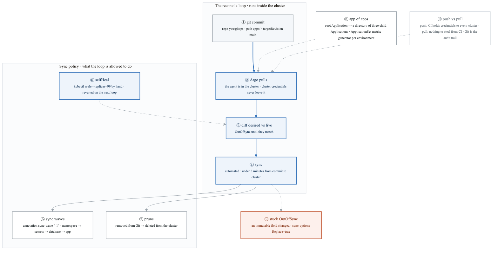

<details>
<summary>Diagram source (Mermaid)</summary>

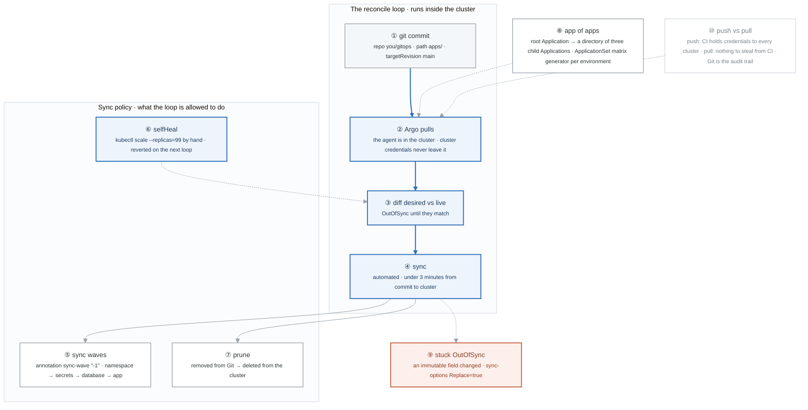

</details>

### Say it, badge by badge

- **Open.** "GitOps is one loop: the cluster pulls what Git says it should be, compares it to what it is, and closes the gap. The demo that makes it click is scaling something by hand and watching it get put back."
- **① git commit.** "A directory of manifests, or of Applications, on a branch. The commit is the deploy. There is no other way in, which is why the history is the audit trail."
- **② Argo pulls.** "The application controller runs inside the cluster and fetches the repo. The credentials to change the cluster never leave it; CI holds a Git token at most. That is the strong argument for pull, badge ⑩."
- **③ diff.** "Desired from Git, live from the API server. Any difference is OutOfSync, whether it came from a commit or from someone's kubectl."
- **④ sync.** "With automated sync, the gap is closed without a click, under three minutes from commit in the lab. Without it, OutOfSync waits for a human."
- **⑤ sync waves.** "An annotation with an integer. Lower waves apply first and must be healthy before the next: namespace at -1, then secrets, then the database, then the app. Ordering without a pipeline."
- **⑥ selfHeal.** "Scale the Deployment to 99 by hand. The next loop sees live differ from desired and puts it back. A manual change is drift, and drift gets reverted. This is the demo."
- **⑦ prune.** "Delete a manifest from Git and the resource is deleted from the cluster. Without prune, Git only ever adds. With it, Git is the complete description."
- **⑧ app of apps.** "A root Application pointing at a directory of Application manifests. Three children, each pointing at a path. ApplicationSets generate the same from a matrix: one Application per environment, from one template."
- **⑨ stuck OutOfSync.** "Change an immutable field, like a Service's clusterIP or a StatefulSet's volumeClaimTemplates, and the apply is rejected forever. Replace=true tells Argo to delete and recreate instead of patch. Read the error before you reach for it."
- **⑩ push vs pull.** "Push: CI deploys, so CI holds credentials to production, so compromising CI compromises production. Pull: the agent is in the cluster, drift is detected continuously, and when the cluster is down nothing deploys half-way. The credential argument is the one to lead with."
- **Close.** "Commit, pull, diff, sync. Waves order it, selfHeal reverts around it, prune completes it. Nothing outside the cluster can change the cluster, and the repository is the audit trail."

### Numbers to own

| Number | Where it comes from | Why it matters |
|---|---|---|
| under 3 minutes | task 2 | commit to synced; the loop's period is what you are measuring |
| `--replicas=99` | task 3 | the manual change selfHeal reverts; the demo |
| 3 child Applications | task 4 | the app of apps |
| wave `-1` then `0`, `1`, `2` | task 5 | namespace → secrets → database → app |
| `Replace=true` | task 6 | the escape hatch for an immutable field, not the default |
| 4 rows | the push-vs-pull table | credentials · drift · audit trail · cluster down |

### Prove it

```bash
kubectl -n argocd get secret argocd-initial-admin-secret -o jsonpath='{.data.password}' | base64 -d   # the first login
kubectl scale deploy/app -n shop --replicas=99 && sleep 60 && kubectl get deploy app -n shop          # ⑥ back to Git's number
argocd app diff shop                                                                                   # ③ ⑨ what differs, and why
kubectl -n argocd logs deploy/argocd-application-controller --tail=100 | grep -i sync                 # ④ the loop
```

### The question a senior interviewer asks

*"Why is the pull model's main win about credentials rather than drift?"*
Badge ⑩, then ②. Drift detection is a feature; credentials are a blast radius. In a push model every cluster's credentials sit in CI, so CI is the most valuable target in the company. In a pull model the cluster reaches out and CI holds nothing that can change production. The follow-up is badge ⑥: "someone hot-fixes production by hand at 2 a.m.; what happens?" selfHeal reverts it on the next loop, which is either the safety you wanted or the outage you caused, and the answer is to commit the fix.

---

## Figure 16.6 — Lab 5: three failures, and the bill

> Lab 5 · badges ① to ⑦ · about two minutes. The method is
> [Figure BF.0](../../_shared/breakfix/FIGURE.md); this figure is this week's three faults and the teardown.

<!-- figure: generated from the Mermaid below by _shared/diagrams/embed-figures.py — do not edit the image -->
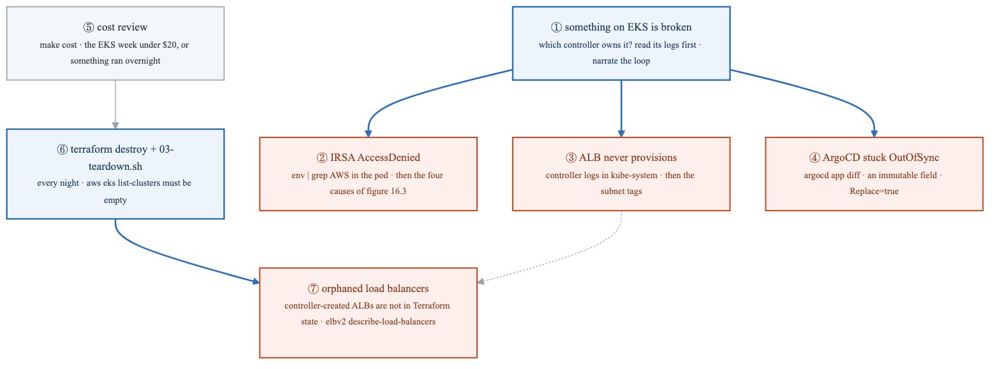

<details>
<summary>Diagram source (Mermaid)</summary>

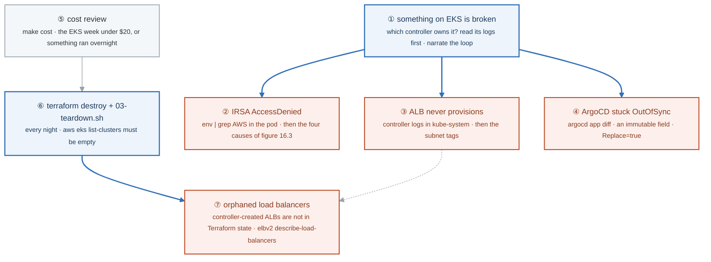

</details>

### Say it, badge by badge

- **Open.** "Three failures, each owned by a controller, and a teardown that has one trap. On EKS the first question is always 'which controller was supposed to do this', because the logs you need are that controller's."
- **① which controller.** "IRSA is the webhook and STS; the ALB is the load balancer controller; sync is Argo's application controller. Name the owner, read its logs, then start the loop."
- **② IRSA AccessDenied.** "`env | grep AWS` inside the pod. No variables means no annotation, and the pod is using the node role. Variables present means the assume failed: wrong namespace in the trust policy, wrong ServiceAccount, or the provider is gone."
- **③ ALB never provisions.** "The Ingress sits there with no ADDRESS. The controller's logs in kube-system say what it could not find, and it is the subnet tags. Remove them on purpose this week so the log line is familiar."
- **④ ArgoCD stuck OutOfSync.** "`argocd app diff` shows a field that will never converge because the API refuses to change it in place. Replace=true on that resource, after you have confirmed the field is actually immutable."
- **⑤ cost review.** "The EKS week should be under 20 dollars. More than that is a cluster or a load balancer that lived overnight. Run the cost command before the teardown so you know what you are paying for."
- **⑥ destroy and teardown.** "Terraform destroys what Terraform made, the teardown script catches the rest, and `list-clusters` returning nothing is the proof. Every night, not just Friday."
- **⑦ orphaned load balancers.** "The ALB controller created the load balancer, not Terraform, so Terraform does not know it exists and destroy leaves it running and billing. `describe-load-balancers` after the destroy, every time. This is a real and expensive gotcha."
- **Close.** "Controller, logs, loop. Cost, destroy, then check for the thing Terraform never knew about. The orphan check is the one step people skip and pay for."

### Numbers to own

| Number | Where it comes from | Why it matters |
|---|---|---|
| under $20 | the cost review | the budget for the whole EKS week; above it, something ran overnight |
| 3 failures | the break/fix list | IRSA · ALB · OutOfSync, each owned by a different controller |
| 4 causes | figure 16.3 | the IRSA diagnosis tree |
| 2 commands after destroy | `eks list-clusters`, `elbv2 describe-load-balancers` | both must return nothing |
| 0 ALBs in Terraform state | the orphan trap | the controller made them; destroy does not see them |

### Prove it

```bash
kubectl logs -n kube-system -l app.kubernetes.io/name=aws-load-balancer-controller --tail=50   # ③
argocd app diff shop                                                                           # ④
make cost                                                                                      # ⑤
terraform destroy && bash ../../_setup/03-teardown.sh                                          # ⑥
aws eks list-clusters && aws elbv2 describe-load-balancers --query 'LoadBalancers[].LoadBalancerName'   # ⑥ ⑦ both empty
```

### The question a senior interviewer asks

*"You ran `terraform destroy` on the cluster. What might still be billing you tomorrow, and why?"*
Badge ⑦. Load balancers the ALB controller created from Ingress objects; they were made by a Kubernetes controller with its own AWS identity, so they are not in Terraform's state and destroy never saw them. The follow-up is "how do you prevent it?" and the answer is to delete the Ingress objects, or the cluster's workloads, before the cluster, and to check `describe-load-balancers` after.

---

## Figure 16.7 — Go deeper: CSI, sidecar by sidecar

> Go deeper lab · badges ① to ⑪ · about three and a half minutes. One volume from a claim to a filesystem in a pod, as objects and gRPC calls; reads top-down.

<!-- figure: generated from the Mermaid below by _shared/diagrams/embed-figures.py — do not edit the image -->


<details>
<summary>Diagram source (Mermaid)</summary>

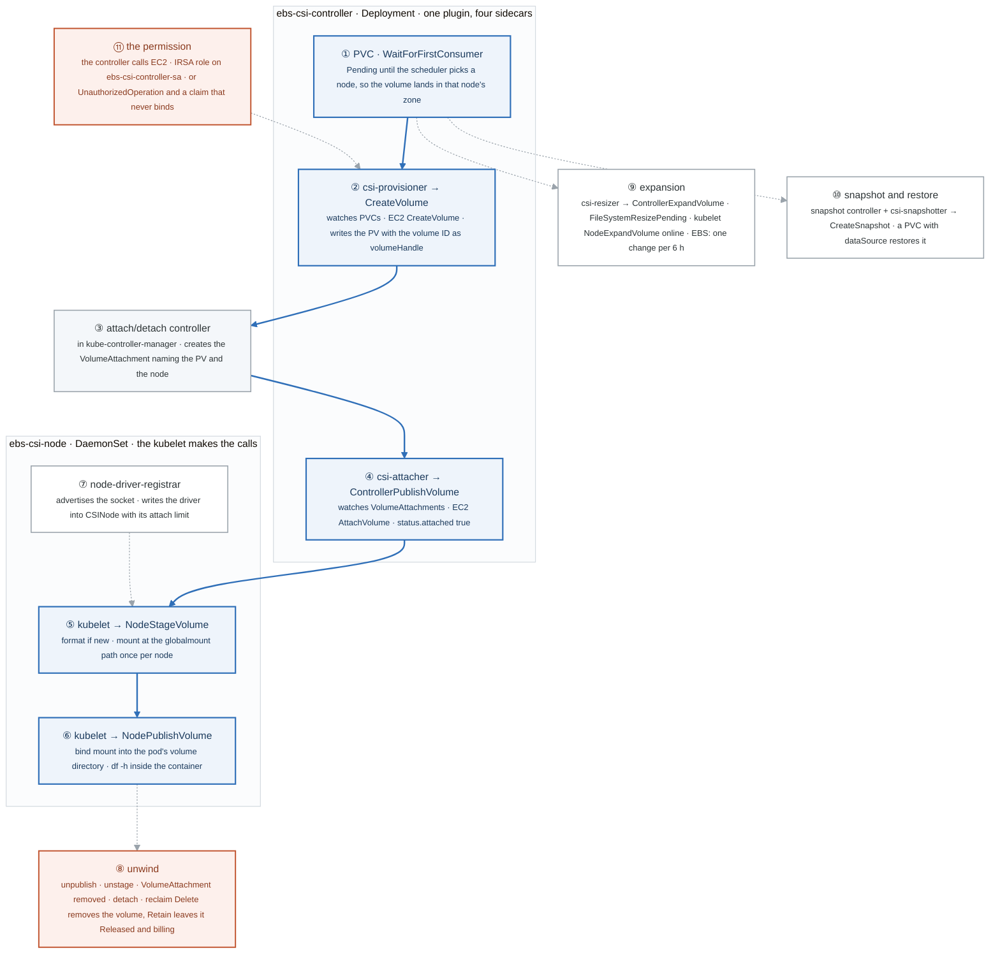

</details>

### Say it, badge by badge

- **Open.** "The EBS CSI driver is one program that speaks gRPC and six generic controllers around it, each watching one object and making one call. Follow one claim to a mounted filesystem and you have read the storage interface every driver implements."
- **① PVC, WaitForFirstConsumer.** "The claim stays Pending on purpose until the scheduler has chosen a node. A volume created before scheduling can land in the wrong availability zone, and EBS cannot cross zones. The binding mode is the fix."
- **② csi-provisioner.** "A sidecar that watches PVCs. When the claim has a selected node, it calls CreateVolume on the plugin, which calls EC2, and it writes the PersistentVolume with the EBS volume ID as the handle. The PVC goes Bound."
- **③ attach/detach controller.** "Not a sidecar: part of kube-controller-manager. It sees a pod on a node needing a volume and creates a VolumeAttachment object naming both. That object exists because the driver said attachRequired."
- **④ csi-attacher.** "Watches VolumeAttachments. Calls ControllerPublishVolume, which is EC2 AttachVolume, and sets status.attached when the device is on the instance. The event on the pod reads SuccessfulAttachVolume."
- **⑤ NodeStageVolume.** "Now the kubelet, over the socket the registrar advertised. Stage formats the device if it is new and mounts it once per node at the global path. Two pods on one node sharing a volume share this mount."
- **⑥ NodePublishVolume.** "A bind mount from the global path into the pod's directory. That is the filesystem df -h shows inside the container. Four calls from claim to here: Create, ControllerPublish, NodeStage, NodePublish."
- **⑦ node-driver-registrar.** "Tells the kubelet where the plugin's socket is and writes the driver into the node's CSINode object, including how many more volumes this node can take. A pod Pending on 'exceeds max volume count' is that number."
- **⑧ unwind.** "Delete the pod: unpublish, unstage, the VolumeAttachment disappears, detach. Delete the claim: reclaim policy Delete calls DeleteVolume; Retain leaves the PV Released and the EBS volume billing until a human clears the claimRef. That is what Retain means operationally."
- **⑨ expansion.** "Grow the claim. csi-resizer calls ControllerExpandVolume, EC2 ModifyVolume, and the PVC says FileSystemResizePending. The kubelet then grows the filesystem online; the pod never restarts. Only with allowVolumeExpansion, and EBS takes one change per volume every six hours."
- **⑩ snapshot and restore.** "The snapshot controller and CRDs are not part of the driver; install them. A VolumeSnapshot becomes a VolumeSnapshotContent, csi-snapshotter calls CreateSnapshot, and a new PVC with a dataSource restores it as a CreateVolume with a source. The old pod's dates are in the new volume."
- **⑪ the permission.** "The controller calls EC2, so it needs an identity: an IRSA role on its ServiceAccount, Lab 2 applied to a component you did not write. Without it the first claim hangs with UnauthorizedOperation in the provisioner's log. The node role with the policy attached works and is the wrong shape."
- **Close.** "Claim, provision, attach, stage, publish, and the same four steps in reverse. Swap the plugin and the sidecars stay; that is what an interface is for. Delete the volumes the Sunday destroy does not know about."

### Numbers to own

| Number | Where it comes from | Why it matters |
|---|---|---|
| 7 containers | the controller Deployment and node DaemonSet | plugin · provisioner · attacher · resizer · snapshotter · registrar · liveness probe |
| 4 gRPC calls to a mount | the CSI spec | CreateVolume · ControllerPublishVolume · NodeStageVolume · NodePublishVolume |
| 1 global mount per node | NodeStageVolume | pods on the same node share it; publish is a bind mount |
| `attachRequired: true` | the CSIDriver object | why VolumeAttachment objects exist; EFS says false |
| `allocatable.count` | the node's CSINode | the attach limit; "exceeds max volume count" is this |
| 6 hours | EBS ModifyVolume | the cooldown between two changes to one volume |
| `Released` | a Retained PV after its claim is deleted | data kept, volume billing, claimRef must be cleared by hand |
| 2 to 4 ¢ | a 20 GiB gp3 for a weekend, rough | the cost is the orphan, not the lab |

### Prove it

```bash
kubectl -n kube-system get deploy ebs-csi-controller -o jsonpath='{range .spec.template.spec.containers[*]}{.name}{"\n"}{end}'   # ① ⑦ the names
kubectl get pvc,pv,volumeattachment -w                                                                                      # ② ③ ④ in order
kubectl describe pod writer | grep -E 'SuccessfulAttachVolume|Mount'                                                       # ④ ⑤ ⑥
kubectl get csinode -o jsonpath='{.items[0].spec.drivers[0].allocatable.count}{"\n"}'                                      # ⑦
kubectl get pvc data -o jsonpath='{.status.conditions[*].type}{"\n"}'                                                      # ⑨ FileSystemResizePending
aws ec2 describe-volumes --filters Name=tag-key,Values=kubernetes.io/created-for/pvc/name --query 'Volumes[].VolumeId'     # ⑧ what is still billing
```

### The question a senior interviewer asks

*"A pod is stuck ContainerCreating with 'Multi-Attach error for volume'. What happened, and which component is involved?"*
Badges ③ and ④. The volume is still attached to a node the previous pod ran on, usually a node that died or was cordoned without draining; the attach/detach controller has not yet removed the VolumeAttachment, so the attacher cannot publish it elsewhere. Say that ReadWriteOnce is per node, name the VolumeAttachment object, and say what forces the detach: the old node coming back or being deleted from the API, or deleting the stale VolumeAttachment by hand with the risk that implies.

---

## Redraw schedule

Same cadence as the week figure, see [`../../FIGURES.md`](../../FIGURES.md): Friday of this week after break/fix, cold at the Gate 4 Sunday in week 17, and again on the Sunday of week 18. Lab figures are redrawn **after** the week figure, one at a time, and only the badge order has to be right; the captions are the check, not the test.
