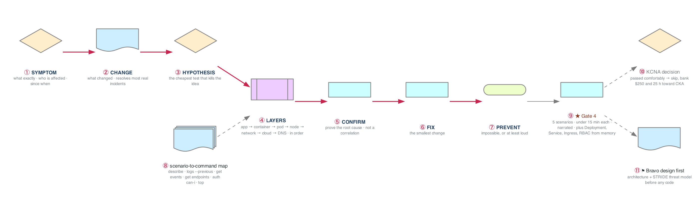

# Week 17 — Consolidation ★ GATE 4 · KCNA decision · Bravo design

> **Thesis:** a consolidation week is not a rest week. It is where scattered knowledge becomes
> retrievable under pressure — which is the only form that matters in an interview.

| | |
|---|---|
| **Hours** | 30–40 (incl. ~5h job search — you're 3 weeks into the pipeline now) |
| **★ GATE 4** | Diagnose 5 broken-cluster scenarios unaided, **under 15 min each, narrating aloud**. Write Deployment + Service + Ingress + RBAC from memory. |
| **◇ Decision** | KCNA: take it, or bank the hours toward CKA |
| **⚑ Bravo** | Design + threat model, **before** any code |

## The week in one figure

**Figure 17.1 — The diagnostic ladder you narrate at Gate 4.** Consolidation is not rest. The figure is the method you say out loud for five broken clusters, under fifteen minutes each, plus the two decisions the week asks for: KCNA and the Bravo design.



**Say it, badge by badge:** [`content/FIGURE.md`](content/FIGURE.md) — the spoken script for each of the 11 badges, about three minutes; [`content/figure-17.1-numbered-spoken.pdf`](content/figure-17.1-numbered-spoken.pdf) is the printable two-page version. Read the figure before the day plan; say the script on Friday.

---

## Day plan
| Day | Focus |
|---|---|
| Mon | Rebuild the whole stack in a fresh kind cluster **from memory** |
| Tue | Gate 4 rehearsal: 5 scenarios, timed, narrated |
| Wed | **Gate 4, for real.** Then the KCNA decision. |
| Thu | KCNA prep *or* **CKA foundations: Lab 4**, kubeadm by hand, once (whichever you chose) |
| Fri | ⚑ Project Bravo: architecture + STRIDE threat model |
| Sat | ⚑ Bravo: repo scaffolding + 15 applications |
| Sun | Month 4 retrospective; plan month 5 |

## The KCNA decision — evaluated Wednesday

Full analysis: [`../../CERTIFICATIONS.md`](../../CERTIFICATIONS.md) §3.

```
Passed Gate 4 comfortably?           -> SKIP KCNA. Bank the ~$250 and ~25 hours toward CKA
                                        (weeks 27-30, the module after Gate 6).
Gate 4 was a struggle?               -> TAKE KCNA in week 17-18 as a forcing function,
                                        then take the weeks 27-30 module after the first job.
```

**The honest read:** KCNA is an awareness credential. Hiring managers who care about Kubernetes
filter on **CKA**, which is hands-on and can't be faked. At ~$250 KCNA costs 3.5× the Terraform
Associate for meaningfully less signal. Take it only if you're buying structure and a confidence win
at the point in a 26-week program where motivation typically sags — that is a legitimate reason, just
be clear it's what you're buying.

## Reading map — consolidation, not new material
- `_reference/kubernetes/resources/troubleshooting-common-issues.md` — the whole file, again
- `_reference/kubernetes/resources/` — cheat sheets
- `_shared/breakfix/06-kubernetes.md` — BF-41 to BF-50
- **If taking KCNA:** the CNCF exam curriculum document (read the actual curriculum, not a course),
  plus `_reference/kubernetes/01-foundation/` for the fundamentals domain

## Labs
[labs/LABS.md](labs/LABS.md) · [labs/FIGURES.md](labs/FIGURES.md) (figures 17.2 to 17.5, one per lab) · [solutions/SOLUTIONS.md](solutions/SOLUTIONS.md) · [Kubernetes thread](../KUBERNETES-THREAD.md#week-17)

## ★ GATE 4 — [assessment.md](assessment.md)
