# Week 17 — Consolidation ★ GATE 4 · KCNA decision · Bravo design

> **Thesis:** a consolidation week is not a rest week. It is where scattered knowledge becomes
> retrievable under pressure — which is the only form that matters in an interview.

| | |
|---|---|
| **Hours** | 30–40 (incl. ~5h job search — you're 3 weeks into the pipeline now) |
| **★ GATE 4** | Diagnose 5 broken-cluster scenarios unaided, **under 15 min each, narrating aloud**. Write Deployment + Service + Ingress + RBAC from memory. |
| **◇ Decision** | KCNA: take it, or bank the hours toward CKA |
| **⚑ Bravo** | Design + threat model, **before** any code |

## The week in one figure

**Figure 17.1 — The diagnostic ladder you narrate at Gate 4.** Consolidation is not rest. The figure is the method you say out loud for five broken clusters, under fifteen minutes each, plus the two decisions the week asks for: KCNA and the Bravo design. Badges are numbered in the order to walk them; the blue path is the one to follow first.

```mermaid
%%{init: {'theme':'base','themeVariables':{'fontFamily':'Helvetica, Arial, sans-serif','fontSize':'13px','primaryColor':'#ffffff','primaryTextColor':'#2d3436','primaryBorderColor':'#9aa3ab','lineColor':'#9aa3ab','textColor':'#2d3436','clusterBkg':'#fbfcfd','clusterBorder':'#d4dae0','edgeLabelBackground':'#ffffff','tertiaryColor':'#eef4fb'},'flowchart':{'curve':'basis','padding':14,'nodeSpacing':42,'rankSpacing':58}}}%%
flowchart LR
  classDef default fill:#ffffff,stroke:#9aa3ab,stroke-width:1.3px,color:#2d3436
  classDef n    fill:#ffffff,stroke:#9aa3ab,stroke-width:1.3px,color:#2d3436
  classDef crit fill:#eef4fb,stroke:#2f6fb8,stroke-width:1.8px,color:#1b3a5c
  classDef data fill:#f4f7fa,stroke:#9aa3ab,stroke-width:1.3px,color:#2d3436
  classDef mut  fill:#ffffff,stroke:#cfd6dc,stroke-width:1.1px,color:#7a8288
  classDef warn fill:#fdf0ec,stroke:#c0522d,stroke-width:1.6px,color:#8a3a1e

  S1["① SYMPTOM<br/><small>what exactly · who is affected · since when</small>"]:::crit
  S2["② CHANGE<br/><small>what changed · resolves most real incidents</small>"]:::crit
  S3["③ HYPOTHESIS<br/><small>the cheapest test that kills the idea</small>"]:::crit
  S4["④ LAYERS<br/><small>app → container → pod → node → network → cloud → DNS · in order</small>"]:::crit
  S5["⑤ CONFIRM<br/><small>prove the root cause · not a correlation</small>"]:::crit
  S6["⑥ FIX<br/><small>the smallest change</small>"]:::crit
  S7["⑦ PREVENT<br/><small>impossible, or at least loud</small>"]:::crit
  MAP["⑧ scenario-to-command map<br/><small>describe · logs --previous · get events · get endpoints · auth can-i · top</small>"]:::data
  GATE["⑨ ★ Gate 4<br/><small>5 scenarios · under 15 min each · narrated · plus Deployment, Service, Ingress, RBAC from memory</small>"]:::warn
  KC["⑩ KCNA decision<br/><small>passed comfortably → skip, bank $250 and 25 h toward CKA</small>"]:::mut
  BR["⑪ ⚑ Bravo design first<br/><small>architecture + STRIDE threat model before any code</small>"]:::n
  S1 ==> S2 ==> S3 ==> S4 ==> S5 ==> S6 ==> S7
  MAP -.-> S4
  S7 --> GATE
  GATE -.-> KC
  GATE -.-> BR
  linkStyle 0,1,2,3,4,5 stroke:#2f6fb8,stroke-width:2px
```



**What to say, badge by badge** · about three minutes at a normal pace. Point at each badge as you say its line.

- **Open.** “Scattered knowledge becomes retrievable under pressure this week, which is the only form that matters in an interview. The figure is the seven words you say, in order, every time something is broken. Then the gate, then two decisions.”
- **① symptom.** “Say exactly what is broken, who it affects, and since when. Not 'the site is down' but 'checkout returns 503 for every user since 09:40'. Precision here halves the search.”
- **② change.** “What changed? A deploy, a config edit, a node replaced, a certificate expiring. Most real incidents are answered by this question alone, and juniors skip it to go straight to the exciting layer.”
- **③ hypothesis.** “Name a cause and the cheapest test that would disprove it. A ten-second `kubectl get endpoints` beats a ten-minute log dive. Cheap tests first, always.”
- **④ layers.** “App, container, pod, node, network, cloud, DNS. Walk them in order. The discipline is not skipping to the one you find interesting; the order is what makes you fast when you are nervous.”
- **⑤ confirm.** “Prove it. A restart that fixed the symptom is a correlation. A log line that names the cause is a confirmation. Interviewers notice the difference.”
- **⑥ fix.** “The smallest change that resolves it. A rollback is a fix. A rebuild is a last resort you announce as one.”
- **⑦ prevent.** “What makes this impossible, or at least loud, next time? A probe, a limit, a policy, an alert. The incident journal entry ends with this line.”
- **⑧ scenario-to-command map.** “Each scenario type has a first command. Describe for scheduling and events, logs --previous for crashes, get endpoints for a dead Service, auth can-i for RBAC, top for resources. Internalize the map so your hands move while you talk.”
- **⑨ Gate 4.** “Wednesday, for real: five scenarios, each under fifteen minutes, narrated. Then Deployment, Service, Ingress, and a Role with its binding, written from memory. Rehearse Tuesday with a timer.”
- **⑩ KCNA decision.** “If the gate was comfortable, skip KCNA and bank the money and the hours toward the CKA, which is the one hiring managers filter on. If the gate was a struggle, take KCNA as a forcing function, knowing that is what you are buying.”
- **⑪ Bravo design first.** “Friday: draw the Bravo architecture and write the STRIDE threat model before a line of code exists. Weeks 18 to 21 build controls against named threats, not against a vague sense of security.”
- **Close.** “Seven words, in order, out loud. That is the skill the gate measures and the skill the interview measures. Everything else this week is deciding what to spend the next month on.”

---

## Day plan
| Day | Focus |
|---|---|
| Mon | Rebuild the whole stack in a fresh kind cluster **from memory** |
| Tue | Gate 4 rehearsal: 5 scenarios, timed, narrated |
| Wed | **Gate 4, for real.** Then the KCNA decision. |
| Thu | KCNA prep *or* CKA foundations (whichever you chose) |
| Fri | ⚑ Project Bravo: architecture + STRIDE threat model |
| Sat | ⚑ Bravo: repo scaffolding + 15 applications |
| Sun | Month 4 retrospective; plan month 5 |

## The KCNA decision — evaluated Wednesday

Full analysis: [`../../CERTIFICATIONS.md`](../../CERTIFICATIONS.md) §3.

```
Passed Gate 4 comfortably?           -> SKIP KCNA. Bank the ~$250 and ~25 hours toward CKA.
Gate 4 was a struggle?               -> TAKE KCNA in week 17-18 as a forcing function,
                                        then target CKA after the first job.
```

**The honest read:** KCNA is an awareness credential. Hiring managers who care about Kubernetes
filter on **CKA**, which is hands-on and can't be faked. At ~$250 KCNA costs 3.5× the Terraform
Associate for meaningfully less signal. Take it only if you're buying structure and a confidence win
at the point in a 26-week program where motivation typically sags — that is a legitimate reason, just
be clear it's what you're buying.

## Reading map — consolidation, not new material
- `_reference/kubernetes/resources/troubleshooting-common-issues.md` — the whole file, again
- `_reference/kubernetes/resources/` — cheat sheets
- `_shared/breakfix/06-kubernetes.md` — BF-41 to BF-50
- **If taking KCNA:** the CNCF exam curriculum document (read the actual curriculum, not a course),
  plus `_reference/kubernetes/01-foundation/` for the fundamentals domain

## Labs
[labs/LABS.md](labs/LABS.md) · [solutions/SOLUTIONS.md](solutions/SOLUTIONS.md)

## ★ GATE 4 — [assessment.md](assessment.md)
