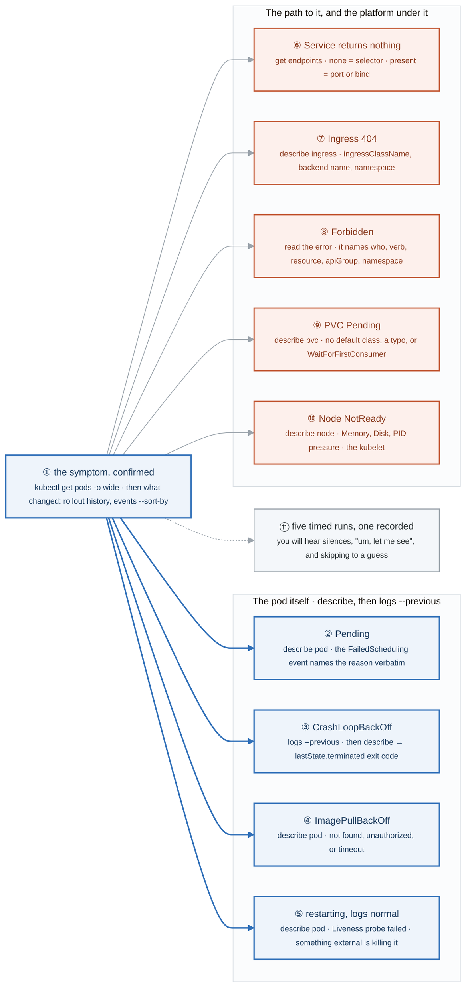
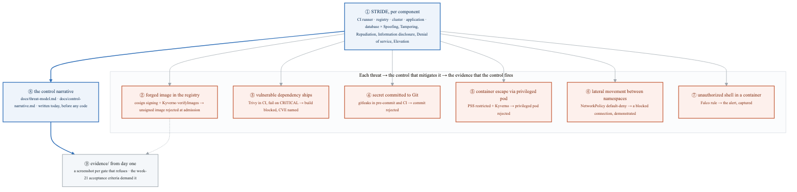

# Week 17 — Lab figures

> One figure per lab, numbered 17.2 to 17.5. Figure 17.1 is the week figure in
> [`../content/FIGURE.md`](../content/FIGURE.md); these three go one level down, to the mechanism each
> lab makes you touch. Same language: gray is structure, **blue is the path to follow first**,
> orange-red is where something refuses, washed boxes are stores. Each badge line is a thirty-second
> interview answer; each whole script is under three minutes.

**The protocol per figure**

1. **Before the lab:** read the figure, say the badges out loud once. You now know what you are about to prove.
2. **During the lab:** every badge has a **Prove it** command. Run it and watch the badge happen. A badge you cannot see happen is one you are taking on faith.
3. **After the lab:** close the file, redraw the figure, say the script. Check against the file. The badge where the order slipped goes in the *Figures redrawn* column of `progress.md`.
4. **Own the numbers.** The *Numbers to own* table is what separates "I can troubleshoot Kubernetes" from "nine symptoms, nine first commands, under fifteen minutes each."
5. **Answer the question.** Each figure ends with the question a senior interviewer asks about it. Answer it cold, in under a minute, before the gate.

---

## Figure 17.2 — Lab 1: no figure

The rebuild-from-memory lab is the redraw protocol applied to a whole cluster: the figure for it is
every figure from weeks 14 and 15, drawn with `kubectl` instead of a pen. Drawing it again here would
hand you the reference the lab tells you to close.

What to do instead: before you start, redraw figures 14.6, 15.2, 15.3, 15.4 and 15.5 cold, in that
order, because the ten checklist objects map onto them. Then time the rebuild against the 90-minute
target, with `kubectl explain` as the only reference.

| Checklist object | The figure it comes from |
|---|---|
| Namespace with PSS labels, ResourceQuota, LimitRange | 14.4 badge ⑩, 15.2 badge ① |
| ConfigMap and Secret | 14.4 |
| StatefulSet, headless Service, volumeClaimTemplates | 14.6 badges ⑤ to ⑦, 15.4 badge ⑩ |
| Deployment with init container, three probes, resources, securityContext | 14.6 badges ③ and ④, 15.2 badges ⑥ to ⑧ |
| Service with the right selector and a named target port | 14.3 badges ⑤ to ⑦ |
| Ingress with `ingressClassName` | 14.3 badges ⑧ and ⑨ |
| ServiceAccount, Role, RoleBinding | 15.5 badges ① to ③ |
| PodDisruptionBudget | 15.3 badge ⑤ |
| HorizontalPodAutoscaler | 15.3 badges ① to ③ |

```bash
kubectl explain deployment.spec.strategy.rollingUpdate            # the reference the exam allows
kubectl explain pod.spec.securityContext --recursive | head -40
```

---

## Figure 17.3 — Lab 2: nine symptoms, nine first commands

> Lab 2 · badges ① to ⑪ · about three and a half minutes. Reads left to right, one row per symptom. The narration is
> [Figure BF.0](../../_shared/breakfix/FIGURE.md); this is the map from what you see to what you type.

<!-- figure: generated from the Mermaid below by _shared/diagrams/embed-figures.py — do not edit the image -->


<details>
<summary>Diagram source (Mermaid)</summary>



</details>

### Say it, badge by badge

- **Open.** "Gate 4 is not whether you know Kubernetes; it is whether you can say what you are doing while you do it, under a timer, without guessing. Every row of this figure is one symptom and the one command that splits it. The blue four are about the pod; the orange five are about everything around it."
- **① the symptom, confirmed.** "`get pods -o wide` first: which pod, which node, which state, how many restarts. Then what changed: rollout history and events sorted by time. Saying 'the symptom is X, let me confirm' out loud is step one of the narration, and it stops the guess."
- **② Pending.** "`describe pod`. The FailedScheduling event quotes the reason: untolerated taint, insufficient memory, no node matched the affinity, a volume that could not bind. The scheduler explains itself if you read it."
- **③ CrashLoopBackOff.** "`logs --previous`, because the current container has not written anything yet. Then describe for lastState.terminated: exit 1 is the app, 0 is a one-shot command, 137 is the OOM killer."
- **④ ImagePullBackOff.** "`describe pod`. The event says which of three: not found is the name or tag, unauthorized is credentials, timeout is the network to the registry. Nothing ran, so there are no logs to read."
- **⑤ restarting, logs normal.** "`describe pod` and look for Liveness probe failed. The app is fine; the kubelet is killing it because the probe is wrong. Clean logs plus restarts is this row until proven otherwise."
- **⑥ Service returns nothing.** "`get endpoints`. None means the selector or readiness; present means the port or the bind address. One command, two halves."
- **⑦ Ingress 404.** "`describe ingress`. No ingressClassName and no controller claimed it; wrong backend name or port and the proxy has nowhere to go; Ingress in a different namespace from the Service and it cannot see it."
- **⑧ Forbidden.** "Read the error. It already says who was denied, which verb, on which resource, in which apiGroup and namespace. The fix is in the Role or the binding; the diagnosis is in the text."
- **⑨ PVC Pending.** "`describe pvc`. No default StorageClass, a class name typo, or WaitForFirstConsumer doing its job until a pod is scheduled. Only the first two are problems."
- **⑩ Node NotReady.** "`describe node`. The Conditions block shows memory, disk or PID pressure, or the kubelet not reporting. The pod is a victim here, not the patient."
- **⑪ five timed runs, one recorded.** "Run break.sh five times and time each. Record one. You will hear long silences, filler, and a jump to a guess before confirming the symptom. All three are fixable and all three cost interviews."
- **Close.** "Confirm, what changed, hypothesis, layers in order, confirm the cause, fix, prevent. Nine symptoms, nine first commands, and the voice saying each one before the hands move."

### Numbers to own

| Number | Where it comes from | Why it matters |
|---|---|---|
| 7 steps | the narration script | symptom · change · hypothesis · layers · root cause · fix · prevent |
| 5 layers, in order | step 4 | describe pod events → logs --previous → describe node → endpoints → networkpolicy |
| 9 rows | the scenario-to-command map | one first command each; memorise the left and middle columns |
| 5 runs | the lab | timed, with one recorded |
| 15 minutes | the Gate 4 target | per scenario, narrated, unaided |
| exit `1`, `0`, `137` | row ③ | the app · a one-shot command · the OOM killer |

### Prove it

```bash
kubectl get pods -o wide -A | grep -vE 'Running|Completed'                       # ① where to look
kubectl get events -A --sort-by=.lastTimestamp | tail -20                        # ① what changed
kubectl describe pod <pod> | grep -A8 '^Events'                                  # ② ④ ⑤ the event names the row
kubectl logs <pod> --previous | tail -20                                         # ③
kubectl get endpoints -n shop                                                    # ⑥
kubectl describe node <node> | grep -A6 '^Conditions'                            # ⑩
```

### The question a senior interviewer asks

*"A pod is restarting and the logs look completely normal. Walk me through it, out loud."*
Row ⑤, in the voice of the narration: confirm the restarts with `get pods`, check what changed, hypothesise the liveness probe, confirm with the Liveness probe failed event in `describe`, fix the probe's timing or add a startup probe, prevent by reviewing probe timings against measured boot time. The interviewer is listening for the order, not the answer.

---

## Figure 17.4 — Lab 3: threat, control, evidence

> Lab 3 · badges ① to ⑨ · about three minutes. The pipeline itself is already drawn in
> [`LABS.md`](LABS.md#the-architecture-to-draw); this figure is the threat model that justifies each gate in it.

```mermaid
%%{init: {'theme':'base','themeVariables':{'fontFamily':'Helvetica, Arial, sans-serif','fontSize':'13px','primaryColor':'#ffffff','primaryTextColor':'#2d3436','primaryBorderColor':'#9aa3ab','lineColor':'#9aa3ab','textColor':'#2d3436','clusterBkg':'#fbfcfd','clusterBorder':'#d4dae0','edgeLabelBackground':'#ffffff','tertiaryColor':'#eef4fb'},'flowchart':{'curve':'basis','padding':14,'nodeSpacing':42,'rankSpacing':58}}}%%
flowchart TB
  classDef default fill:#ffffff,stroke:#9aa3ab,stroke-width:1.3px,color:#2d3436
  classDef n    fill:#ffffff,stroke:#9aa3ab,stroke-width:1.3px,color:#2d3436
  classDef crit fill:#eef4fb,stroke:#2f6fb8,stroke-width:1.8px,color:#1b3a5c
  classDef data fill:#f4f7fa,stroke:#9aa3ab,stroke-width:1.3px,color:#2d3436
  classDef mut  fill:#ffffff,stroke:#cfd6dc,stroke-width:1.1px,color:#7a8288
  classDef warn fill:#fdf0ec,stroke:#c0522d,stroke-width:1.6px,color:#8a3a1e

  STRIDE["① STRIDE, per component<br/><small>CI runner · registry · cluster · application · database × Spoofing, Tampering, Repudiation, Information disclosure, Denial of service, Elevation</small>"]:::crit
  subgraph ROWS["Each threat → the control that mitigates it → the evidence that the control fires"]
    direction LR
    R1["② forged image in the registry<br/><small>cosign signing + Kyverno verifyImages → unsigned image rejected at admission</small>"]:::warn
    R2["③ vulnerable dependency ships<br/><small>Trivy in CI, fail on CRITICAL → build blocked, CVE named</small>"]:::warn
    R3["④ secret committed to Git<br/><small>gitleaks in pre-commit and CI → commit rejected</small>"]:::warn
    R4["⑤ container escape via privileged pod<br/><small>PSS restricted + Kyverno → privileged pod rejected</small>"]:::warn
    R5["⑥ lateral movement between namespaces<br/><small>NetworkPolicy default-deny → a blocked connection, demonstrated</small>"]:::warn
    R6["⑦ unauthorized shell in a container<br/><small>Falco rule → the alert, captured</small>"]:::warn
  end
  NARR["⑧ the control narrative<br/><small>docs/threat-model.md · docs/control-narrative.md · written today, before any code</small>"]:::crit
  EVID["⑨ evidence/ from day one<br/><small>a screenshot per gate that refuses · the week-21 acceptance criteria demand it</small>"]:::data

  STRIDE ==> NARR ==> EVID
  STRIDE --> R1
  STRIDE --> R2
  STRIDE --> R3
  STRIDE --> R4
  STRIDE --> R5
  STRIDE --> R6
  R1 -.-> EVID
  linkStyle 0,1 stroke:#2f6fb8,stroke-width:2px
```

<!-- figure: generated from the Mermaid below by _shared/diagrams/embed-figures.py — do not edit the image -->


<details>
<summary>Diagram source (Mermaid)</summary>



</details>

### Say it, badge by badge

- **Open.** "Bravo starts with a document, not a pipeline. The pipeline figure in the lab shows where each gate sits; this figure shows why each gate exists. Threat, control, evidence: three columns, and the table is how security work is communicated in a regulated environment."
- **① STRIDE, per component.** "Six threat categories, applied to each of five components: the CI runner, the registry, the cluster, the application, the database. Thirty cells; most are empty or shared, and the ones that are not become the rows below."
- **② forged image.** "Spoofing at the registry. The control is cosign signing the image digest in CI and Kyverno verifying the signature at admission. The evidence is an unsigned image being rejected, screenshot captured."
- **③ vulnerable dependency.** "Tampering in the build. Trivy scans the dependencies and the image in CI and fails the job on CRITICAL. The evidence is a blocked build with the CVE named in the log."
- **④ secret in Git.** "Information disclosure at the source. gitleaks runs in pre-commit and again in CI over the full history. The evidence is a rejected commit."
- **⑤ privileged pod.** "Elevation of privilege in the cluster. Pod Security Standards at restricted, with Kyverno enforcing the same rules with better messages. The evidence is a privileged pod refused by admission."
- **⑥ lateral movement.** "Elevation and information disclosure across namespaces. A default-deny NetworkPolicy, with DNS allowed, and explicit allows per dependency. The evidence is a demonstrated blocked connection from a pod that should not reach the database."
- **⑦ unauthorized shell.** "Elevation at runtime. A Falco rule fires on a terminal shell inside a container. The evidence is the alert itself, captured from the Falco output."
- **⑧ the control narrative.** "The table, as a document, next to the threat model. Both are written today, before any code, because the code is justified by them rather than the other way round. A junior who produces this unprompted is speaking the language of the job."
- **⑨ evidence from day one.** "An evidence directory in the repository from the first commit, and a screenshot added each time a gate refuses something. Week 21's acceptance criteria demand proof the pipeline says no, and reconstructing that proof later is much harder than capturing it as you go."
- **Close.** "Six threats, six controls, six pieces of evidence. The pipeline is the implementation; this table is the argument. Write the argument first."

### Numbers to own

| Number | Where it comes from | Why it matters |
|---|---|---|
| 6 STRIDE categories | the lab | Spoofing · Tampering · Repudiation · Information disclosure · Denial of service · Elevation of privilege |
| 5 components | the lab | CI runner · registry · cluster · application · database |
| 6 rows | the control-narrative table | each row is threat → control → evidence |
| 3 columns | the table | a control with no evidence is a claim |
| 2 documents written today | `docs/threat-model.md`, `docs/control-narrative.md` | before any code |
| 13 paths | the repo scaffolding | `evidence/` is the one to create first |

### Prove it

```bash
mkdir -p evidence docs/adr policies/kyverno policies/conftest gitops/apps gitops/manifests   # ⑨ the scaffold, day one
ls docs/threat-model.md docs/control-narrative.md                                            # ⑧ both exist before app/
grep -c '^|' docs/control-narrative.md                                                       # ⑧ at least six rows plus the header
```

### The question a senior interviewer asks

*"Pick one threat to this system. Which control mitigates it, and what evidence would convince an auditor the control actually works?"*
Any row ② to ⑦, in three parts. The trap is stopping after the control: "we sign images" is a claim, "here is the admission denial for an unsigned image" is evidence. The follow-up is badge ①: "what is a threat you have not mitigated?" and a candid answer, such as repudiation on the CI runner, beats a complete-sounding one.

---

## Figure 17.5 — Lab 4: no figure

> Thursday, only on the "skip KCNA" branch · kubeadm by hand, once.

The lab is a first encounter, and its figure already exists one module later: **Figure 27.2** draws the
cluster kubeadm writes, badge by badge, from `init` to an upgraded worker. Do the lab with the file
closed, then open [`../../week-27/content/FIGURE.md`](../../week-27/content/FIGURE.md) and check which
of its first five badges you could already name. Those are the ones you own; the rest are week 27.

### Numbers to own

| Number | Where it comes from | Why it matters |
|---|---|---|
| 2 CPUs | kubeadm preflight | below it, `init` refuses; the lab nodes are e2-medium for exactly this |
| 4 static pods | `/etc/kubernetes/manifests` | apiserver, controller-manager, scheduler, etcd, started by the kubelet with no API server involved |
| 24 hours | the join token | after that, `kubeadm token create --print-join-command` |
| 1 minor below | `kubernetes_minor` | so week 27 Lab 4 has an upgrade to perform |

### The question a senior interviewer asks

*"Why is a node NotReady right after kubeadm init?"*
No CNI yet. The kubelet reports the network as
unconfigured until a CNI plugin writes its config, and nothing is wrong. Say that before installing Calico.

---

## Redraw schedule

Same cadence as the week figure, see [`../../FIGURES.md`](../../FIGURES.md): this is a gate week, so the Gate 4 Sunday covers figures 14.2 to 17.5 cold; then the Sunday of week 19, and cold again at the Gate 5 Sunday in week 21. Lab figures are redrawn **after** the week figure, one at a time, and only the badge order has to be right; the captions are the check, not the test.
