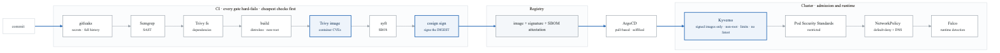

# Week 17 Labs

> **Figures:** one numbered mechanism figure per lab, with the spoken script, the numbers to own and
> the command that proves each badge, in [`FIGURES.md`](FIGURES.md) (17.2 to 17.4). Read a lab's figure
> before you start it; redraw it after.

---

# Lab 1 — Rebuild From Memory (Mon, 3h)

```bash
kind delete cluster --name mastery
bash ../../_setup/02-kind-cluster.sh mastery
```

**With no reference except `kubectl explain` and the official docs**, rebuild:

- [ ] Namespace with Pod Security Standards labels, ResourceQuota, LimitRange
- [ ] ConfigMap and Secret
- [ ] StatefulSet for Postgres with a headless Service and `volumeClaimTemplates`
- [ ] Deployment for the app with init container, all three probes, resource
      requests/limits, and a hardened `securityContext`
- [ ] Service with correct selector and named target port
- [ ] Ingress with `ingressClassName`
- [ ] ServiceAccount, Role, RoleBinding
- [ ] PodDisruptionBudget
- [ ] HorizontalPodAutoscaler

**Time it.** Target: under 90 minutes. Then:

```bash
kubectl explain deployment.spec.strategy.rollingUpdate
kubectl explain pod.spec.securityContext --recursive | head -40
```
**`kubectl explain` is available during the CKA exam** and is faster than the docs site. Using it
fluently is itself a scored skill in practice.

---

# Lab 2 — Gate 4 Rehearsal (Tue, 4h)

Use `break.sh` from week 15. Run it **five times**, timing each.

## The narration script — say this out loud, every time

```
1. "The symptom is X. Let me confirm what's actually broken."
      kubectl get pods -o wide
2. "What changed recently?"
      kubectl rollout history / kubectl get events --sort-by=.lastTimestamp
3. "My first hypothesis is Y. The cheapest test is Z."
4. "Let me check the layers in order."
      describe pod (EVENTS) -> logs --previous -> describe node -> endpoints -> networkpolicy
5. "Confirmed: the root cause is ___ because ___."
6. "The fix is ___."
7. "To prevent this: ___."
```

**Record yourself once.** You will hear: long silences, "um, let me see," and skipping straight to a
guess. All three are fixable and all three cost interviews.

## The scenario-to-command map — internalize this

| Symptom | First command | What you're looking for |
|---|---|---|
| Pending | `kubectl describe pod` | The `FailedScheduling` event names the reason verbatim |
| CrashLoopBackOff | `kubectl logs --previous` | Then `describe` → `lastState.terminated` for the exit code |
| ImagePullBackOff | `kubectl describe pod` | The event states: not found / unauthorized / timeout |
| Restarting, logs normal | `kubectl describe pod` | `Liveness probe failed` — something external is killing it |
| Service returns nothing | **`kubectl get endpoints`** | None = selector; present = port/bind |
| Ingress 404 | `kubectl describe ingress` | `ingressClassName`, backend name, namespace |
| Forbidden | Read the error | It names who, verb, resource, apiGroup, namespace |
| PVC Pending | `kubectl describe pvc` | No default SC / typo / WaitForFirstConsumer |
| Node NotReady | `kubectl describe node` | Conditions: Memory/Disk/PID pressure, kubelet |

---

# Lab 3 — ⚑ Project Bravo: Design First (Fri, 4h)

**Architecture and threat model before any code.** Spec:
[`../../PROJECTS.md`](../../../PROJECTS.md) §3.

## The architecture to draw

```mermaid
%%{init: {'theme':'base','themeVariables':{'fontFamily':'Helvetica, Arial, sans-serif','fontSize':'13px','primaryColor':'#ffffff','primaryTextColor':'#2d3436','primaryBorderColor':'#9aa3ab','lineColor':'#9aa3ab','textColor':'#2d3436','clusterBkg':'#fbfcfd','clusterBorder':'#d4dae0','edgeLabelBackground':'#ffffff','tertiaryColor':'#eef4fb'},'flowchart':{'curve':'basis','padding':14,'nodeSpacing':42,'rankSpacing':58}}}%%
flowchart LR
  classDef default fill:#ffffff,stroke:#9aa3ab,stroke-width:1.3px,color:#2d3436
  classDef n    fill:#ffffff,stroke:#9aa3ab,stroke-width:1.3px,color:#2d3436
  classDef crit fill:#eef4fb,stroke:#2f6fb8,stroke-width:1.8px,color:#1b3a5c
  classDef data fill:#f4f7fa,stroke:#9aa3ab,stroke-width:1.3px,color:#2d3436
  classDef mut  fill:#ffffff,stroke:#cfd6dc,stroke-width:1.1px,color:#7a8288
  classDef warn fill:#fdf0ec,stroke:#c0522d,stroke-width:1.6px,color:#8a3a1e

  DEV["commit"]:::mut

  subgraph CI["CI · every gate hard-fails · cheapest checks first"]
    direction TB
    G1["gitleaks<br/><small>secrets · full history</small>"]:::n
    G2["Semgrep<br/><small>SAST</small>"]:::n
    G3["Trivy fs<br/><small>dependencies</small>"]:::n
    G4["build<br/><small>distroless · non-root</small>"]:::n
    G5["Trivy image<br/><small>container CVEs</small>"]:::crit
    G6["syft<br/><small>SBOM</small>"]:::n
    G7["cosign sign<br/><small>signs the DIGEST</small>"]:::crit
    G1 --> G2 --> G3 --> G4 --> G5 --> G6 --> G7
  end

  subgraph REG["Registry"]
    IMG["image + signature + SBOM attestation"]:::data
  end

  ARGO["ArgoCD<br/><small>pull-based · selfHeal</small>"]:::n

  subgraph K8S["Cluster · admission and runtime"]
    direction TB
    KY["Kyverno<br/><small>signed images only · non-root · limits · no :latest</small>"]:::crit
    PSS["Pod Security Standards<br/><small>restricted</small>"]:::n
    NP["NetworkPolicy<br/><small>default-deny + DNS</small>"]:::n
    FAL["Falco<br/><small>runtime detection</small>"]:::n
    KY --> PSS --> NP --> FAL
  end

  DEV --> G1
  G7 --> IMG --> ARGO --> KY

  linkStyle 9,10,11,12 stroke:#2f6fb8,stroke-width:2px
```

<!-- figure: generated from the Mermaid below by _shared/diagrams/embed-figures.py — do not edit the image -->


<details>
<summary>Diagram source (Mermaid)</summary>



</details>

## The STRIDE threat model

For each component — CI runner, registry, cluster, application, database — enumerate:

| | Threat | Example in this system |
|---|---|---|
| **S**poofing | Pretending to be someone | A forged image pushed to the registry |
| **T**ampering | Modifying data | A malicious dependency in the build |
| **R**epudiation | Denying an action | No audit trail for who deployed what |
| **I**nformation disclosure | Leaking data | A secret in a log, or in Git |
| **D**enial of service | Making it unavailable | An unbounded pod exhausting a node |
| **E**levation of privilege | Gaining more access | A container escape via a privileged pod |

Then, for each threat: **what control mitigates it, and what evidence proves the control works?**

```markdown
| Threat | Control | Evidence |
|---|---|---|
| Malicious image substituted in the registry | cosign signing + Kyverno verifyImages | Screenshot: unsigned image rejected by admission |
| Vulnerable dependency ships to production | Trivy in CI, fails on CRITICAL | Screenshot: build blocked with the CVE named |
| Secret committed to Git | gitleaks in pre-commit and CI | Screenshot: commit rejected |
| Container escape via privileged pod | PSS `restricted` + Kyverno | Screenshot: privileged pod rejected |
| Lateral movement between namespaces | NetworkPolicy default-deny | Demonstrated blocked connection |
| Unauthorized shell in a running container | Falco rule | Alert captured |
```

**That table is the "control narrative"**, and it is how security work is communicated in a regulated
environment. A junior who produces one unprompted is speaking the language of the job — it is worth
more in a DevSecOps interview than any individual tool.

Templates: `_reference/devsecops/threat-modeling/templates-stride-worksheet.md` and
`-threat-model-template.md`.

## Repo scaffolding (Sat)

| Path | What lives there |
|---|---|
| `app/` | The application and its Dockerfile |
| `.github/workflows/ci.yml` | The security pipeline |
| `.github/workflows/verify.yml` | Proves the gates actually block things |
| `infra/` | EKS via Terraform — reuse Alpha's network module |
| `gitops/apps/` | Argo CD Applications |
| `gitops/manifests/` | Kustomize bases and overlays |
| `policies/kyverno/` | Admission policies |
| `policies/conftest/` | OPA/Rego for Terraform plans |
| `docs/architecture.md` | |
| `docs/threat-model.md` | **Written today** |
| `docs/control-narrative.md` | **Written today** |
| `docs/adr/` | Decision records |
| `evidence/` | Screenshots proving each gate blocks |

**Create `evidence/` on day one.** The acceptance criteria demand proof that the pipeline *refuses*
things, and capturing it as you go is far easier than reconstructing it in week 21.

---

# Lab 4 — CKA foundations: kubeadm, by hand, once (Thu, 3h)

Only if Wednesday's decision was "skip KCNA". The point is not a working cluster. It is to have
typed `kubeadm init` once, and read what it wrote, before week 27 makes you own it.

1. **Turn on the nodes.** In `curriculum/_setup/gcp-lab/terraform.tfvars` set `kubeadm_nodes = 2`
   and `kubernetes_minor` to one minor below the version the exam tracks (the candidate handbook
   says which), then `terraform apply`. The startup script installs containerd, kubeadm, kubelet and
   kubectl and stops there; `terraform output kubeadm_ssh_commands` prints the way in.
2. **On `k8s-cp`:** `sudo kubeadm init --pod-network-cidr=192.168.0.0/16`. Read every preflight
   line. Copy `admin.conf` into place exactly as the output says, and save the `kubeadm join` line.
3. **Read what it wrote, before installing anything else:**
   ```bash
   ls /etc/kubernetes /etc/kubernetes/manifests /etc/kubernetes/pki
   kubectl get nodes            # NotReady -- say why before you fix it
   sudo crictl ps               # the four static pods, running with no API server involved
   ```
4. **Install Calico** (the operator manifests from the Calico quickstart) and watch the node go Ready.
5. **On `k8s-w1`:** the `kubeadm join` line from step 2. Then, from `k8s-cp`, `kubectl get nodes -o wide`.
6. `kubectl run web --image=nginx:alpine && kubectl get pod -o wide`: a pod on the worker, with an
   address from the CIDR you chose in step 2.
7. **Journal, five lines:** what kubeadm wrote, where, and the one thing that surprised you. Then
   stop the nodes (they stop at midnight anyway): `gcloud compute instances stop k8s-cp k8s-w1`.

Week 27 Lab 1 rebuilds this from memory and goes on to certificates, etcd and the upgrade.
Figure 27.2 is the picture; `_shared/breakfix/08-cluster-nodes.md` is what you will break.
