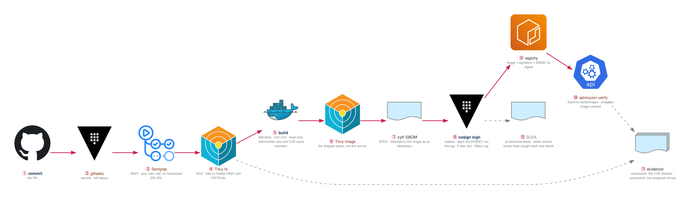

# Week 18 — Supply Chain Security

> **Thesis: this is the month that makes you beat other juniors.** Almost no candidate at this level
> can talk credibly about supply chain security, and it is exactly what hiring managers have been
> told to care about since Log4Shell and the build-system compromises that followed it.

| | |
|---|---|
| **Hours** | 35–45 (incl. ~4h job search) |
| **⚑ Bravo** | Supply chain controls complete, with **evidence** |
| **Break/Fix** | BF-51, BF-53 |
| **Exit check** | Your pipeline **demonstrably blocks** a real CVE and refuses an unsigned image |

## The week in one figure

**Figure 18.1 — The pipeline that refuses.** Supply chain security is what makes you beat other juniors. The blue path is the pipeline; the orange boxes are where it says no, with evidence. Every gate hard-fails, cheapest first.

**Say it, badge by badge:** [`content/FIGURE.md`](content/FIGURE.md) — the spoken script for each of the 12 badges, about four minutes; [`content/figure-18.1-numbered-spoken.pdf`](content/figure-18.1-numbered-spoken.pdf) is the printable two-page version. Read the figure before the day plan; say the script on Friday.

---

## Day plan
| Day | Focus | Lab |
|---|---|---|
| Mon | SAST, SCA, secret scanning — wire the gates | Lab 1 |
| Tue | Image hardening: distroless, non-root, read-only, measured | Lab 2 |
| Wed | **SBOM + signing + verification** | Lab 3 |
| Thu | SLSA, provenance, and the real attack case studies | Lab 4 |
| Fri | Break/Fix + ⚑ Bravo evidence capture | Lab 5 |
| Sat | ⚑ Bravo pipeline end to end; 15 applications | — |
| Sun | Review; plan week 19 | — |

## Reading map
- `_reference/devsecops/content-module-06-security-scanning.md`
- `_reference/devsecops/content-module-03-container-security.md`
- `_reference/devsecops/content-module-10-vulnerability-management.md`
- `_reference/devsecops/content-module-12-devsecops-practices.md`
- `_reference/devsecops/implementation/02-security-pipeline-architecture.md`
- `_reference/devsecops/implementation/02-security-pipeline-best-practices.md`
- `_reference/devsecops/implementation/cross-cutting-vulnerability-sinks.md`
- `_reference/devsecops/implementation/cross-cutting-sarif-integration.md`
- `_reference/devsecops/threat-modeling/content-06-advanced-supply-chain.md`
- **Case studies (anonymized):** `_reference/devsecops/threat-modeling/case-studies-orionsoft.md`,
  `-log4shell.md`, `-moveit.md`

## Labs
[labs/LABS.md](labs/LABS.md) · [labs/FIGURES.md](labs/FIGURES.md) (figures 18.2 to 18.6, one per lab) · [solutions/SOLUTIONS.md](solutions/SOLUTIONS.md)

## Exit criteria
- [ ] Semgrep, Trivy, and gitleaks running in CI as **hard gates**
- [ ] A deliberately-introduced critical CVE **blocks the build** — screenshot in `evidence/`
- [ ] Image hardened: **record the before/after size and CVE count**
- [ ] SBOM generated with syft and attached to the image
- [ ] Image signed with cosign (keyless); verification enforced
- [ ] An **unsigned image is refused** — screenshot in `evidence/`
- [ ] You can explain a real supply-chain attack and which control would have caught it
